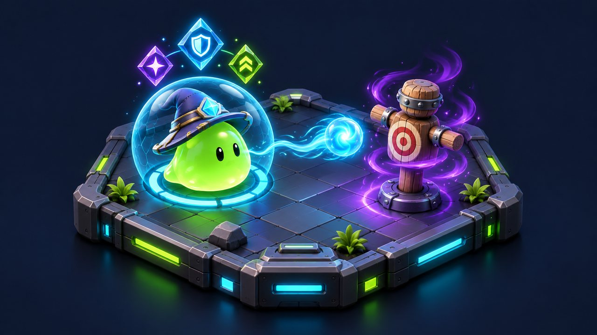
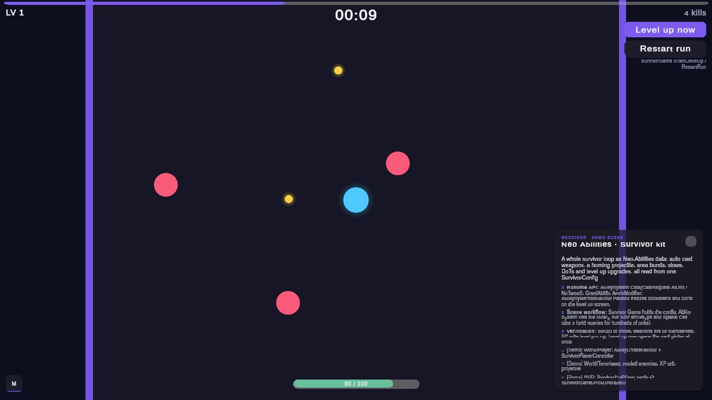
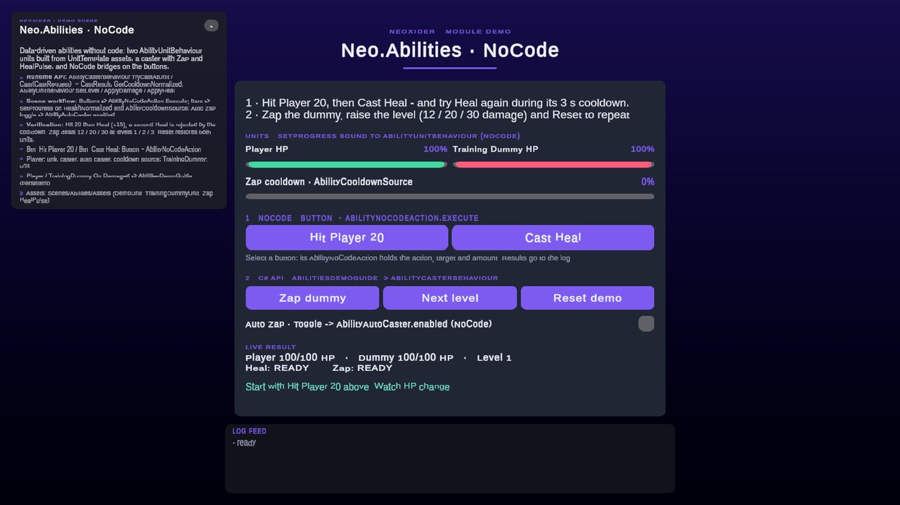
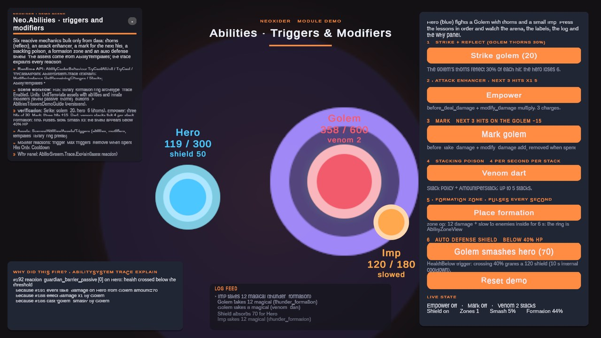

# Abilities

<!-- module-art:begin -->
<p align="center"></p>
<!-- module-art:end -->

**What it is:** `Neo.Abilities` is a Dota-derived, data-driven ability/modifier system. Abilities cast effects; **modifiers** are the single durable-effect concept — buffs, debuffs, DoTs, shields, and stuns all share one lifecycle. New content is authored in ScriptableObjects, without touching code.

<!-- demo-shots:begin -->
<p align="center"> </p>
<p align="center"></p>

*Demo scenes: `Scenes/SurvivorDemo.unity`, `Scenes/Abilities/AbilitiesNoCodeDemo.unity`, `Scenes/Abilities/AbilitiesTriggersDemo.unity`, in the **Demo Scenes** sample (Package Manager > NeoxiderTools > Samples). The scenes are saved with their UI and wiring, so you can inspect them without entering Play Mode.*
<!-- demo-shots:end -->

- **Abilities** resolve, per cast, into a list of effect operations (damage, heal, apply modifier, spawn, …) through a validated cast pipeline (states, costs, cooldown/charges, target, range).
- **Modifiers** attach to a unit and, while active: contribute **properties** (`{ Add | Mul | Max }`, aggregated in a fixed `add -> mul -> max` order), declare **states** (boolean, any-true-wins), run **tick effects** on an interval, and run **declarative event reactions** (on an event id -> an effect list). Expiry is guaranteed.
- The runtime logic uses ordinary C# objects, injected time and a seeded PRNG. It runs without GameObjects, but still depends on Unity value types/math and `Neo.Core.Resources`. Gameplay receipts flow through the **event stream** for UI, presentation, and network integration.
- **Reactive layer (12.1):** damage pre-hooks (`before_deal_damage` / `before_take_damage` with a mutable damage context: multiplier, flat add, absorb, reflect, cancel), triggers (hit landed, health threshold, every Nth event, state enter / exit, animation moments, applied / removed, charges, internal cooldowns, priorities), payload ops (projectile, area apply, zone, cast ability), auras and formations as domain zones, ready templates, a content validator and a "why did this fire" trace — see [Triggers, damage hooks, zones and templates](./TriggersAndHooks.md).
- **Replaceable rules:** damage formula, mitigation, crit, evasion, stacking, Add / Mul / Max aggregation, targeting, cooldowns, costs, time source, numeric backend and random source are strategies in `AbilitySystem.Rules` — see [Rules and extension points](./Rules.md).
- **Fixed core (12.1):** `Neo.Abilities.Fixed` is the same domain without floats and without UnityEngine (Q8.8 raw ints, whole ticks) for lockstep and server-authoritative games; `FixedContentConverter` converts these assets for it and a conformance suite keeps both cores in step — see [Fixed core](./FixedCore.md) and [Deterministic mode](./DeterministicMode.md).

**По-русски:** в 12.1 добавлены хуки урона «перед нанесением / получением» с изменяемым контекстом, триггеры (попадание, порог HP, каждое N-е событие, вход и выход из состояния, моменты анимации, наложение и снятие, заряды, внутренний кулдаун, приоритет), операции снаряда, области, зоны и каста, ауры и формации, шаблоны, валидатор и журнал срабатываний ([TriggersAndHooks](./TriggersAndHooks.md)), а формулы и системы заменяются через `AbilitySystem.Rules` ([Rules](./Rules.md)). Основной C# API — `AbilitySystem`, `AbilityUnit`, `ModifierEngine` и `IEffectOperation`. Компоненты сцены и NoCode вызывают тот же runtime API. Сначала зарегистрируйте определения, затем создайте юнитов, добавьте ресурсы и выдайте способности. Продвигайте время через `Tick(dt)`; для области действия, движения и снарядов нужен `IAbilityWorldAdapter`. Ограничения времени, callbacks и доставки описаны ниже и на страницах компонентов. Касты (мгновенные и снарядами), попадания снарядов, тики модификаторов, реакции и публикация событий в домене не выделяют память после прогрева; создание объекта снаряда в сцене идёт через `PoolManager` и в эту гарантию не входит. Для сотен юнитов включите **Spatial Cell Size** на `AbilitySystemBehaviour` (см. [Performance for many units](#performance-for-many-units)); перемещения через `TryMoveUnit` (отбрасывание, притягивание, телепорт) и снятие убитых юнитов с регистрации обновляют сетку на месте, без полной перестройки перед следующим запросом. Радиус проверяется точно (`AbilitySpatialGrid.IsWithinRadius`, расстояние в double), поэтому сетка и линейный перебор дают одинаковый результат на любой платформе. Снаряд способности с наведением `Direction` летит на эффективную дальность (**Range** + `cast_range_bonus`). При Range 0 (без ограничения) он летит на длину переданного вектора направления, но не меньше 10 единиц: `transform.forward` не обрывает выстрел через одну единицу, а вектор к цели или курсору долетает до неё. Для детерминированных игр есть отдельное целочисленное ядро без UnityEngine — `Neo.Abilities.Fixed` ([Fixed core](./FixedCore.md)): те же понятия на Q8.8 и тиках, контент переводится `FixedContentConverter`.

## Contents

**Authoring assets (ScriptableObjects)**

- [AbilityDefinition](./AbilityDefinition.md) — one ability (targeting, costs, cooldown, delivery, effects)
- [ModifierDefinition](./ModifierDefinition.md) — one buff/debuff/DoT/shield/aura payload
- [UnitTemplate](./UnitTemplate.md) — a unit archetype (team, pools, base properties, abilities)
- [AbilityLibrary](./AbilityLibrary.md) — a catalog that registers many definitions at once

**Scene components (MonoBehaviours)**

- [AbilitySystemBehaviour](./AbilitySystemBehaviour.md) — the scene hub: owns and ticks the system, world adapter, spawner
- [AbilityUnitBehaviour](./AbilityUnitBehaviour.md) — a unit's scene presence and receipt UnityEvents
- [AbilityCasterBehaviour](./AbilityCasterBehaviour.md) — the `TryCast*` API
- [AbilityProjectileBehaviour](./AbilityProjectileBehaviour.md) — a pooled data-driven projectile

**Editor tooling**

- [Ability Designer](./AbilityDesignerWindow.md) — UI Toolkit window (`Neoxider > Windows > Ability Designer`): library, phase board, live validation
- [Editor API and authoring contracts](./Editor.md) — asset editing, Undo, validation boundaries and editor C# integration

**NoCode components (inspector-only wiring)**

- [AbilityNoCodeAction](./AbilityNoCodeAction.md) — cast/grant/level/modifier/damage/heal actions from any UnityEvent
- [AbilityAutoCaster](./AbilityAutoCaster.md) — Survivor-style auto-cast with nearest-target lock-on
- [AbilityCooldownSource](./AbilityCooldownSource.md) — cooldown values for `SetProgress` / `NoCodeBindText` bindings

**Guides**

- [Triggers, damage hooks, zones and templates](./TriggersAndHooks.md) — hooks, triggers, payload ops, zones, templates, validator, trace
- [Rules and extension points](./Rules.md) — replace formulas and systems without forking the package
- [Fixed core](./FixedCore.md) — engine-free integer domain, content conversion, conformance with the float core
- [Deterministic mode](./DeterministicMode.md) — the deterministic profile, the state hash and the integer-core design
- [Survivor Demo](./SurvivorDemo.md) — a complete auto-fire survivor game built on this module
- [Building a Vampire Survivors game](../VampireSurvivor_Guide.md) — step-by-step scene assembly and the performance checklist
- [Performance for many units](#performance-for-many-units) — allocation-free hot paths and the spatial query grid

Source: `Assets/Neoxider/Scripts/Abilities` (`Domain/` pure C#, `Data/` ScriptableObjects, `Components/` wrappers).

## Quick start (no code)

**Playable guide:** open `Demo/Scenes/Abilities/AbilitiesNoCodeDemo.unity` in **Demo Scenes**.
Start with **Hit Player 20**, then **Cast Heal**: numeric HP and the result explain the actual heal.
Try Heal again during cooldown, **Zap dummy**, **Next level**, and compare 12/20/30 damage.
**Auto Zap** starts off so the dummy survives while you read; enable it to inspect automatic casting.
**Reset demo** restores both units, level and cooldowns. The whole wiring is saved in the scene, so it is
readable without entering Play Mode (the scene is authored by `Editor/Builders/Abilities/AbilitiesNoCodeDemoBuilder.cs`):

- `Btn_Hit Player 20` / `Btn_Cast Heal` each carry their own `AbilityNoCodeAction` (ApplyDamage 20 on the
  Player / CastById `heal_pulse` through the Player's caster); `Button.OnClick → AbilityNoCodeAction.Execute`,
  and the action's **On Result Message** feeds the log at the bottom.
- The HP and Zap cooldown bars are `SetProgress` bindings on `AbilityUnitBehaviour.HealthNormalized` and
  `AbilityCooldownSource.CooldownNormalized` (no code).
- The Auto Zap toggle sets `AbilityAutoCaster.enabled` directly (persistent `bool enabled` call).
- **Zap dummy / Next level / Reset demo** are the C# path: `AbilitiesDemoGuide` calls
  `AbilityCasterBehaviour.TryCastAtUnit` and `AbilityUnitBehaviour.SetLevel`; the Player's and dummy's
  **On Damaged / On Healed** and the caster's **On Cast Failed** feed its result panel.

The tutorial units have no automatic health regeneration so hits and healing remain visible between
actions. Zap explicitly reads caster unit level from its authored effect configuration.

**По-русски:** сначала нанесите урон игроку и вылечите его, затем проверьте отклонение каста на кулдауне,
урон по манекену и зависимость урона от уровня. Экран показывает численные HP, готовность и причину
отказа; Reset позволяет повторить опыт. Автоатака включается явно и не завершает демонстрацию до чтения.
Вся связка сохранена в сцене: кнопки несут свой `AbilityNoCodeAction`, полосы HP и кулдауна — это
`SetProgress`, переключатель Auto Zap включает `AbilityAutoCaster.enabled`; всё видно в инспекторе без Play Mode.
Release source is `Assets/Neoxider/Samples~`, developer layout is `Assets/Neoxider/Samples`; imported
UPM samples are under `Assets/Samples/NeoxiderTools/<version>/Demo Scenes` (`12.0.0` for this release).

1. Create a [UnitTemplate](./UnitTemplate.md) with a `health` pool (and `mana` if it casts).
2. Create [AbilityDefinition](./AbilityDefinition.md) and [ModifierDefinition](./ModifierDefinition.md) assets, add them to an [AbilityLibrary](./AbilityLibrary.md).
3. In the scene, add an [AbilitySystemBehaviour](./AbilitySystemBehaviour.md), assign the library, and bind any projectile prefabs under **Archetypes**. (You can skip this — the hub auto-creates itself — but you then have nowhere to assign the library and archetypes.)
4. On your unit GameObject add an [AbilityUnitBehaviour](./AbilityUnitBehaviour.md) (assign the template) and an [AbilityCasterBehaviour](./AbilityCasterBehaviour.md) (list the castable abilities).
5. Trigger casts without code, either way:
   - **Auto:** add an [AbilityAutoCaster](./AbilityAutoCaster.md) — every granted ability fires the moment it is ready, locking onto the nearest valid target (Survivor-style).
   - **On demand:** add an [AbilityNoCodeAction](./AbilityNoCodeAction.md) (e.g. on a UI button), pick `CastById`, set the ability id, and wire the button's `OnClick` to `Execute()`.
6. Show cooldowns with an [AbilityCooldownSource](./AbilityCooldownSource.md) + a `SetProgress` binding; unit receipts (`OnDamaged`, `OnDied`, …) are UnityEvents right on the [AbilityUnitBehaviour](./AbilityUnitBehaviour.md).

The minimum for a damageable unit is just an `AbilityUnitBehaviour` + a template; add the caster only when it casts. From code the same flow is `caster.TryCast("frost_nova")`, `TryCastAtUnit`, `TryCastAtPoint`, or `TryCastTowards` — see [AbilityCasterBehaviour](./AbilityCasterBehaviour.md).

## Core concepts

| Concept | Type | What it is |
|---------|------|-----------|
| System | `AbilitySystem` | The façade: units, catalogs, casting, effect execution, tick. One per world. |
| Unit | `AbilityUnit` | Identity + team + resource pools + base properties + cached property/state aggregation. |
| Property | `PropertyContribution` / `AbilityProperties` | Numeric stat, open string registry. Contributions combine `add -> mul -> max`. |
| State | `AbilityStates` | Boolean flag (stunned, silenced, invulnerable…), any-true-wins across modifiers. |
| Ability | `AbilityBlueprint` / `AbilityDefinition` | Per-cast logic: targeting, costs, cooldown, delivery, effect nodes. |
| Modifier | `ModifierBlueprint` / `ModifierDefinition` | Durable effect: properties + states + tick effects + event reactions. |
| Effect node | `EffectNodeData` | One authored step: which op, on whom, with which params. |
| Effect op | `IEffectOperation` / `AbilityEffectOps` | The strategy that runs a node. Open registry. |
| Event | `AbilityEventArgs` / `AbilityEvents` | Typed gameplay event; the receipt stream. |
| Damage | `DamageService` / `AbilityDamageTypes` | The one evasion -> crit -> mitigation -> shield -> HP -> death -> lifesteal pipeline. |
| World seam | `IAbilityWorldAdapter` | Positions, radius queries, unit motion (`TryMoveUnit`), spawns. The hub implements it; tests fake it. |

### Effect nodes

An `EffectNodeData` is one authored step, shared by abilities (cast/impact) and modifiers (tick/reaction):

| Field | Purpose |
|-------|---------|
| `OpId` | Operation id — see the ops table below. Default `damage`. |
| `Target` | `Target` (context primary), `Caster`, `AreaAroundTarget`, `AreaAroundCaster`, `ConeFromCaster` (uses `Angle`). |
| `TeamFilter` | For area selectors: `Any` / `Enemies` / `Allies`, relative to the caster. |
| `Radius` | Area radius (world units) for the area selectors. |
| `MaxTargets` | Cap on affected units: area selectors keep the nearest N; `chain` hops up to N targets. `0` = unlimited (`chain` treats 0 as 4). |
| `Amount` | Damage / heal / resource delta / spawn magnitude / motion distance. |
| `DamageType` | `physical` (armor), `magical` (resist, blocked by `magic_immune`), `pure` (ignores mitigation and shields), or custom. |
| `ModifierId` | For `apply_modifier` / `remove_modifier`. |
| `ResourceId` | For `resource_change` (e.g. `mana`). |
| `ArchetypeId` | For `spawn` (host maps id -> prefab). |
| `CustomParam` | Free-form string for custom ops (and `dispel` uses `"buffs"`). |
| `Chance` | `[0..1]` probability the node runs, rolled on the cast's deterministic RNG. |
| `AbilityId` | Payload ability of `projectile` / `area_apply` / `zone`, the ability `cast_ability` casts. |
| `Angle`, `Duration`, `Interval` | Cone angle (degrees); zone lifetime and pulse interval (seconds). |
| `AmountPerStack` | Added per extra stack of the modifier running the node (ticks, reactions). |

Built-in ops (`AbilityEffectOps`, registered by `DefaultEffectOps`):

| Op id | Effect |
|-------|--------|
| `damage` | Damage through the full pipeline; scaled by the caster's `spell_power`. |
| `heal` | Restore health honoring `healing_received_mul`; never revives. |
| `apply_modifier` | Attach the catalog modifier `ModifierId` to each target. |
| `remove_modifier` | Remove every instance of `ModifierId` from each target. |
| `dispel` | Remove dispellable debuffs (or buffs with `CustomParam = "buffs"`). |
| `resource_change` | Add / drain a resource pool (mana burn, energy gain…). |
| `spawn` | Ask the world adapter to spawn an archetype at the target(s)/point. |
| `knockback` | Push each target away from the caster (or from the target point, when set) by `Amount` world units. |
| `pull` | Drag each target toward the caster by `Amount` world units, never overshooting past the caster. |
| `teleport` | `Target = Caster` ⇒ blink the caster to the target point / first target; `Target = Target` ⇒ pull targets to the caster; `CustomParam = "swap"` ⇒ caster and first target trade positions. |
| `execute` | Health-derived damage: `Amount` is a fraction (0.1 = 10%) of the target's `"missing"` / `"max"` / `"current"` health per `CustomParam`, or a flat amount otherwise. Full damage pipeline, node's `DamageType`. |
| `chain` | Chain lightning: damages the first target, then hops to the nearest not-yet-hit unit within `Radius` (team-filtered), up to `MaxTargets` hits (0 ⇒ 4). Each bounce multiplies damage by the falloff parsed from `CustomParam` (e.g. `"0.85"`, default 1). Deterministic hop order. |
| `modify_damage` | In a `before_deal_damage` / `before_take_damage` reaction: `CustomParam` `multiply` (default) / `add` / `absorb` / `cancel` with `Amount`. |
| `reflect` | In a `before_take_damage` reaction: reflects `Amount` (fraction) of the mitigated damage to the attacker as `DamageType`. |
| `projectile` | Launches a projectile per target carrying the impact effects of payload `AbilityId`; the host reports the hit. |
| `area_apply` | Applies `ModifierId` to every resolved unit (area or cone selector) and runs payload `AbilityId` once on them. |
| `zone` | Spawns a domain zone (aura following the caster, or a formation at a point) pulsing `ModifierId` / payload `AbilityId` for `Duration`. |
| `cast_ability` | The caster casts its granted `AbilityId` through the normal cast pipeline (auto-cast passives, "on hit, cast X"). |

The motion family (`knockback` / `pull` / `teleport`) displaces units through the world adapter's `TryMoveUnit` seam — units with the `unmovable` or `invulnerable` state (or without a world presence) stay put. All op amounts, including motion distances and the `execute` fraction, resolve through the leveled-value fields below.

### Combat properties (crit / evasion / lifesteal)

`DamageService` reads these unit properties on every damage application; all default to 0, so they are inert until a template or modifier contributes them:

| Property | Read from | Meaning |
|----------|-----------|---------|
| `crit_chance` | attacker | Chance `[0..1]` of a critical hit — one roll per application, pre-mitigation. Fires `critical_hit`. |
| `crit_multiplier` | attacker | Full damage multiplier on crit (2 = double), floored at 1. |
| `evasion_chance` | victim | Chance `[0..1]` to fully evade **physical** damage, rolled pre-mitigation. Fires `evaded`. |
| `lifesteal_percent` | attacker | `0..100` — percent of dealt health damage returned to the attacker as healing (fires `heal_received`). Skipped for self-damage and dead attackers. |

Crit and evasion roll on the cast's deterministic RNG and only when one is supplied — effect ops, ticks, and reactions pass it; direct `DamageService.ApplyDamage` calls without an `IRandomSource` never crit or evade.

Damage and healing receipts describe the resource operation's **accepted delta**, including pool caps and
available headroom. A synchronous resource callback may change the balance again: removing 10 HP from 50
and healing 20 in that callback leaves 60 HP, while `HealthDamage` / `take_damage` still report 10.
Lifesteal uses that accepted damage and reports its own accepted increase; `heal` and
`AbilityUnitBehaviour.ApplyHeal` use the same rule. Death and later healing availability still inspect
live state. Read the resource pool for the final balance; these receipts do not roll back callback effects.

### Leveled values (per-level scaling)

Any effect `Amount` — plus an area `Radius` and a modifier's `Duration` — can scale with **level** and with a **caster/target property**, entirely in data (Dota's `AbilitySpecial`). Every new field defaults to "no effect": an all-default node resolves to exactly its flat `Amount`, so existing assets are byte-stable. Resolution is pure and deterministic (`LeveledValueResolver`): pick the driving level, pick the base (per-level array, else flat), then add the property term.

| Field (on `EffectNodeData`) | Purpose |
|-------|---------|
| `AmountByLevel` | Per-level amounts, e.g. `[5, 8, 12, 17]`. Empty ⇒ use `Amount`. |
| `AmountLevelSource` | Which level indexes the array: `None` (⇒ 1), `AbilityLevel`, `CasterUnitLevel`, `TargetUnitLevel`. |
| `AmountScaleProperty` | Optional property id added as a term (e.g. `spell_power`). `""` ⇒ none. |
| `AmountScalePerPoint` | Additive coefficient: `amount += AmountScalePerPoint * property`. |
| `AmountScaleSource` | Read the scaling property from the `Caster` or the `Target`. |
| `AmountKey` | Reference a named `AbilitySpecialValue` on the ability's `Specials` instead of the inline fields. |
| `RadiusByLevel` | Per-ability-level area radii. Empty ⇒ use `Radius`. |

- **Ability level** is the casting `AbilitySlot.Level` — raise it with `AbilitySystem.SetAbilityLevel(unit, abilityId, level)` (clamped to ≥ 1). It is **captured onto a modifier at apply time**, so a DoT keeps ticking at the level it was applied at even after the slot later levels up (re-applying re-captures the current level).
- **Unit level** is `AbilityUnit.Level`: bridge it from a `Neo.Core.Level.LevelComponent` assigned on an [AbilityUnitBehaviour](./AbilityUnitBehaviour.md), set it via [UnitTemplate](./UnitTemplate.md) **Start Level**, or call `unit.SetLevel(...)`.
- **Named specials** (`AbilityBlueprint.Specials`, a list of `{ Name, LeveledValue }`) let several nodes share one leveled array via `AmountKey` — e.g. a damage node and a scaled slow that both read `damage`.
- **Modifiers** add `DurationByLevel`, resolved by the captured ability level.

Example — an ember bolt dealing `[50, 90, 140]` per ability level plus `0.4 × spell_power`: on the `damage` node set `AmountByLevel = [50, 90, 140]`, `AmountLevelSource = AbilityLevel`, `AmountScaleProperty = spell_power`, `AmountScalePerPoint = 0.4`, `AmountScaleSource = Caster`.

## Code-first usage

### Create a system headless

The domain runs with no Unity objects — ideal for tests and servers. Add resource pools with `ResourcePoolModel.AddPool` (from `Neo.Core.Resources`).

```csharp
using Neo.Abilities;
using Neo.Core.Resources;

AbilitySystem system = new AbilitySystem();

// Author an ability entirely in code (data normally lives in an AbilityDefinition asset).
AbilityBlueprint firebolt = new AbilityBlueprint
{
    Id = "firebolt",
    Targeting = TargetingMode.Unit,
    TeamFilter = AbilityTeamFilter.Enemies,
    Cooldown = 2f,
    Costs = { new AbilityCost(AbilityResourceIds.Mana, 25f) }
};
firebolt.ImpactEffects.Add(new EffectNodeData
{
    OpId = AbilityEffectOps.Damage,
    Target = EffectTargetSelector.Target,
    Amount = 60f,
    DamageType = AbilityDamageTypes.Magical
});
system.RegisterAbility(firebolt);

AbilityUnit mage = system.CreateUnit(new TeamId(1), "Mage");
mage.Resources.AddPool(AbilityResourceIds.Mana,
    new ResourcePoolEntry { Current = 100f, Max = 100f, MaxDecreaseAmount = -1f, MaxIncreaseAmount = -1f });
system.GrantAbility(mage.Id, firebolt.Id);

AbilityUnit goblin = system.CreateUnit(new TeamId(2), "Goblin");
goblin.Resources.AddPool(AbilityResourceIds.Health,
    new ResourcePoolEntry { Current = 200f, Max = 200f, MaxDecreaseAmount = -1f, MaxIncreaseAmount = -1f });
```

### Cast from code and read the receipt stream

```csharp
// Subscribe to a single event id...
system.Events.Subscribe(AbilityEvents.TakeDamage,
    e => Console.WriteLine($"{e.Target} took {e.Amount} {e.DamageType} damage"));

// ...or to every event (receipt stream for UI / logging / network).
system.Events.SubscribeAny(e => Log(e.EventId, e.Target, e.Source, e.Amount));

CastResult result = system.Cast(CastRequest.AtUnit(mage.Id, "firebolt", goblin.Id));
// result.Success == true, result.CastId identifies the cast.
// goblin.Health is now 140; a take_damage (and deal_damage) event fired.

if (!result.Success)
    HandleFailure(result.Failure); // CastFailureReason, e.g. OnCooldown

// Advance time so cooldowns, durations, and DoTs progress.
system.Tick(0.016f);
```

Area effects and projectiles need world positions, so they only resolve with a world adapter installed. In a scene the [AbilitySystemBehaviour](./AbilitySystemBehaviour.md) is that adapter; headless tests provide their own `IAbilityWorldAdapter`.

### Runtime contracts

| Contract | Behavior |
|----------|----------|
| Registration / grants | Catalog ids are case-insensitive. A new grant holds the current catalog `Blueprint` reference; casts, cooldowns, charges and auto-targeting use that granted reference. Re-registering an id affects future grants. Repeated `GrantAbility` returns an existing slot; explicit revoke/regrant binds the replacement and resets level/cooldown/charges. Blueprint objects remain mutable, so treat registered data as read-only; no deep copy or immutable snapshot is created. |
| Resource costs | Positive costs are checked before any payment, including the sum of repeated resource ids and `mana_cost_mul`. An unaffordable total, a nonfinite effective cost/total or a nonfinite mana multiplier returns `NotEnoughResources` without payment, cooldown or `ability_cast`. This includes NaN, infinity and arithmetic overflow. Finite nonpositive costs are ignored; empty ids with positive costs are rejected. |
| Custom resource pools | Resource ids and effective amounts are captured before payment. Each positive entry must fit `ResourcePoolModel.CanSpend`, including its per-operation decrease cap; repeated ids must also fit the cumulative balance. Payment uses exact `TrySpend` on captured entries. A callback can invalidate a later entry after preflight: the cast then fails without charges, cooldown or cast effects, but earlier completed payments are not rolled back. This is not a multi-resource transaction. |
| Cooldowns / charges | Normalized cooldown uses the effective duration after cooldown reduction: `1` immediately after a positive cooldown starts, `0` at completion. A large tick restores every elapsed charge interval and preserves its remainder. A zero effective restore duration refills charges immediately. |
| Charged ability readiness | A slot can have available charges and a nonzero timer for the next charge. `IsReady` describes slot readiness; it does not check death, states, target or resources. `Cast` performs those checks. |
| Modifier timing | Finite positive `Tick` steps advance time. `AbilitySystem.Tick` and direct `ModifierEngine.Tick` ignore NaN, infinity and nonpositive steps before changing timers. The system also ignores a step that would overflow its domain clock. Finite modifiers generate interval ticks only within their remaining lifetime, including a tick exactly at expiry. Catch-up is capped at eight effect ticks per modifier per call. `TickOnApply` runs on the first accepted positive tick, not synchronously in `Apply`. |
| Removal callbacks | `RemoveById`, `RemoveWhere` and `RemoveAllFrom` operate on a snapshot. Callbacks may remove starting instances or create replacements; replacements survive the outer removal. Return counts include only removals performed by that call. An engine cannot remove another engine's instance. |
| Shield callbacks | After `shield_absorbed`, break checks use the current instance's live activity and capacity. Each exhausted instance emits at most one `shield_broken`; its own reaction runs before removal. Reapplying that id during the break creates a replacement that survives old-instance removal and participates in subsequent hits. |
| Resource maximum bonuses | Set up pools before base properties. `max_health_bonus` / `max_mana_bonus` synchronize their pool maxima when set or changed by modifiers. Increasing a maximum does not heal. |
| Direction casts | A `Direction` cast aims along the normalized `CastRequest.Direction` (world forward when it is zero or not finite). With a positive **Range** it reaches the effective cast range, `Range + cast_range_bonus` (at least 0), the same distance the range check and `AbilityAutoCaster` use; the aim vector's length does not matter. With Range `0` (unlimited) it reaches the aim vector's length, but at least `AbilitySystem.DefaultDirectionReach` (10): `transform.forward` flies 10 units, `target - origin` or `cursor - origin` arrives at the target or cursor. The reach is evaluated once per cast, so the cast's target point and, for projectile delivery, `SpawnRequest.Direction` always end at the same place, where the scene projectile detonates. |
| Range checks | The cast range check, `QueryUnitsInRadius`, `AbilitySpatialGrid` and `AbilityAutoCaster` all use `AbilitySpatialGrid.IsWithinRadius` (inclusive, exact double-precision distance). A unit the auto-caster selects on the range boundary, or far away where float squares overflow, is therefore never rejected as `OutOfRange`. A negative effective range (`Range + cast_range_bonus < 0`) reaches nothing. Nearest-target choices (auto-caster, capped area effects, `chain`) rank candidates with `AbilitySpatialGrid.SqrDistance`, also in double. |
| Cast receipt correlation | Nested effect contexts and modifier reactions retain the triggering `CastId`. Modifier lifecycle and shield receipts currently use `0`; they do not provide full per-cast attribution. |
| Effect contexts | The `EffectContext` instances the system creates for casts, projectile hits, modifier ticks and event reactions are pooled and recycled as soon as their effects finish. A custom op must not keep such a context, its `PrimaryTargets` list or its `Random` after `Execute` returns; copy the values it needs. A `CreateNested` child of such a context shares its `Random` and has the same lifetime. Once the lifetime ends, `IsReleased` is `true` and `ExecuteEffects` ignores the context (with a gated, throttled `NeoDiagnostics` warning). Contexts you build with `new EffectContext(...)`, and their nested children, are never pooled or released. |
| Unit destruction | `DestroyUnit` removes the unit, its slots and modifiers, and forgets the unit's modifier version entry (`ModifierEngine.ForgetOwner`), so long sessions that churn thousands of units do not accumulate per-unit bookkeeping. Call `ForgetOwner(unitId)` yourself only when you drive a standalone `ModifierEngine` and retire an owner without `DestroyUnit`; owners that still hold modifiers are kept. `ModifierEngine.TrackedOwnerCount` exposes the count for diagnostics. `ModifierEngine.VersionOf` values come from one engine-wide counter: compare them for equality only, since they jump between changes and read `0` once the owner is forgotten. |
| Event subscriptions | `Events.Clear()` removes specific, global and Target user subscriptions while preserving the system's internal modifier-reaction route. Specific handlers run first; matching Target and global observers are then captured together; internal reactions run next; the captured observers run in common registration order. Specific callback subscription changes affect the current observer batch; internal/observer changes affect future or nested publications and cannot cancel an already captured batch. A standalone `new AbilityEventBus()` has only user subscriptions. Handler exceptions still propagate and can stop later phases. |

For a scene unit, disable destroys its domain instance and re-enable creates a new one. Set its template, team override and level source before enable; [AbilityUnitBehaviour](./AbilityUnitBehaviour.md) explains the lifecycle. Retain event delegates and unsubscribe from `AbilitySystem.Events` when your listener is disposed. The event bus and domain are intended for one calling thread.

### Target observers and dispatch counters

Use `Subscribe(eventId, handler)` for one event id across the world, `SubscribeAny(handler)` for all events,
or `SubscribeTarget(unitId, handler)` for all event ids with that exact **Target**. Source does not select
a Target subscription. `UnitId.None` can be subscribed explicitly. Matching Target/global registrations
share one order; duplicate registrations remain distinct, and each unsubscribe removes the first matching
registration in its own scope.

```csharp
System.Action<AbilityEventArgs> onGoblin = receipt =>
    Log(receipt.EventId, receipt.Target, receipt.Source, receipt.Amount);
system.Events.SubscribeTarget(goblin.Id, onGoblin);
// When the observer is disposed or this domain unit is replaced:
system.Events.UnsubscribeTarget(goblin.Id, onGoblin);
```

Scene unit wrappers use Target subscriptions and keep their own identity check for disable/re-enable.
Publishing copies only the matching Target observers plus global observers, rather than every registered
unit wrapper. Snapshots go into buffers reused per nesting level, so once they are warm a publication
allocates nothing; registration allocates its observer record. An event without an id (`EventId == null`)
is ignored.

The bus exposes read-only cumulative `long` counters: `ObserverSnapshotCount` counts nonempty observer snapshots,
`ObserverSnapshotEntryCount` counts copied entries, and `ObserverInvocationCount` counts attempted
global/Target calls (including a throwing call). They include nested publications, exclude specific-event
handlers, and are retained by `Clear`; compare before/after values for a workload. They measure dispatch
work, not elapsed CPU time or allocated bytes. With one matching unit wrapper and one global observer,
each publication copies/invokes two observers whether 1, 100 or 1000 units are registered. The source
regressions specify those workloads; `AbilityHotPathAllocationTests` asserts that warm publications allocate
nothing.

## Extensibility

The property, state, event, and effect-op registries are all **open** — any string is valid, and the constants (`AbilityProperties`, `AbilityStates`, `AbilityEvents`, `AbilityEffectOps`, `AbilityDamageTypes`) only standardize the names the built-ins read.

**Rules.** Formulas and systems (damage, mitigation, crit, evasion, stacking, aggregation, targeting, cooldowns, costs, time, numbers, random) are swapped through `AbilitySystem.Rules`; see [Rules and extension points](./Rules.md) for each extension point with an example.

**Custom effect op.** Implement `IEffectOperation` and register it once at startup; designers then compose it in data forever:

```csharp
public sealed class HitSparksOp : IEffectOperation
{
    public string Id => "hit_sparks";

    public void Execute(EffectContext context, EffectNodeData node, List<UnitId> targets)
    {
        for (int i = 0; i < targets.Count; i++)
        {
            if (context.System.World.TryGetPosition(targets[i], out Vector3 pos))
                context.System.World.RequestSpawn(
                    new SpawnRequest("hit_sparks_fx", context.Caster, pos, default,
                        targets[i], context.AbilityId, node.Amount));
        }
    }
}

// once, after the system exists:
AbilitySystemBehaviour.I.System.Ops.Register(new HitSparksOp());
```

Nodes then set `OpId = "hit_sparks"`. Re-registering a built-in id overrides it. Custom ops read `node.Amount`, `node.CustomParam`, and the other node fields as they see fit.

Rules for custom ops on hot paths:

- The `context` (and any `CreateNested` child of it) is valid only during `Execute` (see **Effect contexts** above). To run more nodes later, for example a delayed or coroutine effect, store the ids and values you need and build a fresh `EffectContext` at that time. Check `context.IsReleased` if you are unsure.
- `targets` is a scratch list owned by the system; read it, do not keep it.
- Keep `Execute` allocation-free when the op runs per tick or per hit: reuse fields for scratch lists and, if the op can re-enter itself through event reactions, keep one scratch per nesting level (see `ChainEffectOperation`).

## Determinism

Every cast carries a seed. `CastRequest.Seed` (when non-zero) is used directly; otherwise the system derives one from the cast id and caster. Chance rolls (`EffectNodeData.Chance`) and built-in combat randomness use `XorShiftRandom` (`IRandomSource`). The domain does not read `UnityEngine.Random` or `Time`. `XorShiftRandom.Reseed(seed)` restarts an existing instance exactly as `new XorShiftRandom(seed)` would, so pooled contexts (and your own reusable generators) need no new object per cast.

Each modifier tick and each modifier event reaction rolls with its own seed: the instance seed for the first roll, then the instance seed mixed with the tick/reaction count. A 50% tick node therefore fires on roughly half the ticks (not on all or none), and an identical tick/event sequence still rolls identically.

**Replay compatibility.** Before the 2026-11 quality pass every tick and reaction of a modifier instance reused one seed. The first tick/reaction roll is unchanged, but every later one now uses a different stream, so replays or lockstep sessions recorded with an older package version diverge once a modifier ticks or reacts a second time. Re-record such replays.

Reproduce the same initial data, unit/cast creation order, tick-step sequence and adapter query order as well as the seed. Unlimited area selectors preserve adapter order; capped areas and chain bounces sort by distance with a unit-id tie-break. The eight-tick modifier catch-up cap means a single large step can differ from many small steps. This is a replay-friendly runtime seam, not a complete cross-platform lockstep or snapshot protocol.

## Performance for many units

The domain is built for survivor-scale combat (hundreds of enemies, projectiles and DoTs):

- In the domain, casts (instant and projectile delivery, including costs and capped area effects that keep the nearest N targets), projectile hits and releases, modifier ticks, event reactions, event publication, `chain`, `dispel` and `remove_modifier` allocate nothing once their pooled buffers are warm. In a scene, hub radius queries (linear scan, grid query, grid rebuild and grid patched by `TryMoveUnit`) and an `AbilityAutoCaster` pass that casts allocate nothing either; so do `AbilitySpatialGrid` queries, moves and removals. `Tests/Edit/Abilities/AbilityHotPathAllocationTests.cs` guards these paths with Unity's native `GC.Alloc` profiler counter (`Neo.Tests.Performance.GcAllocCounter`).
- The explicit `AbilityDomainBenchmarks` (category `Performance`) print `NEO_PERF` rows for a system tick with one damage-over-time modifier per unit (64, 256 and 1024 units) and for a publication to one Target observer while 1, 100 or 1000 other units hold Target subscriptions; the publication rows should stay flat across the three counts, because Target observers are looked up by unit id and unrelated ones are never copied or invoked (the benchmark asserts they are never invoked).
- Property values are cached per unit and invalidated by modifier/base-value versions; `GetProperty` is a dictionary lookup on the hot path.
- Ids stay case-insensitive everywhere (properties, states, slots, catalogs, op ids, event ids, reactions, damage types), with exactly the `StringComparer.OrdinalIgnoreCase` rules, but the Abilities domain compares and hashes them with its own ASCII fast path (resource pools of `Neo.Core` still use `OrdinalIgnoreCase`): in Unity's Mono an `OrdinalIgnoreCase` hash of a 12-character id costs about ten times an ordinal lookup, and every unit, cast and tick does many such lookups. Keyed lookups in your own per-frame code that need case-insensitive ids pay the same price; prefer ordinal keys there when the ids come from the same constants.
- Allocation that remains is per lifetime, not per frame: creating a unit (`CreateUnit`, pools, slots), applying a new modifier instance, and subscribing handlers. A modifier applied again after the previous one expired allocates only its `ModifierInstance`: the owner's modifier list is recycled.
- In a scene, the hub spawns projectile, zone and summon prefabs through `PoolManager`. That spawn is outside the domain guarantee; give the archetype prefabs a pool with a suitable initial size so steady-state combat reuses instances instead of instantiating them.

### Spatial queries for many units

Radius queries (`AreaAroundTarget` / `AreaAroundCaster` nodes, `chain` hops, projectile hit tests, auto-caster target search) go through `IAbilityWorldAdapter.QueryUnitsInRadius`. The scene hub scans every registered unit by default. For large scenes set **Spatial Cell Size** on [AbilitySystemBehaviour](./AbilitySystemBehaviour.md) (or `SpatialCellSize` from code): the hub then snapshots positions once per frame into an `AbilitySpatialGrid` and each query visits only nearby cells. Motion ops (`TryMoveUnit`) and units that unregister (for example a killed enemy) update that snapshot in place, so frames full of knockback and kills do not rebuild it before every query; a newly registered unit still triggers one rebuild, which keeps grid results in the linear scan's order. To measure the trade-off on your machine, run the explicit `AbilityQueryBenchmarks` (category `Performance`): it prints `NEO_PERF` rows for the linear scan, the warm grid, a grid rebuilt before every query and a grid patched by a `TryMoveUnit` before every query at 64, 256 and 1024 units.

Custom world adapters can use the same grid:

```csharp
public sealed class ArenaWorldAdapter : IAbilityWorldAdapter
{
    private readonly AbilitySpatialGrid _grid = new AbilitySpatialGrid(cellSize: 3f);
    private readonly Dictionary<UnitId, Vector3> _positions = new Dictionary<UnitId, Vector3>();
    private bool _dirty = true;

    // Your movement code calls this. A known unit is moved inside the grid; a new unit changes the fill
    // order, so the grid is refilled lazily on the next query.
    public void SetPosition(UnitId unit, Vector3 position)
    {
        bool known = _positions.ContainsKey(unit);
        _positions[unit] = position;
        if (!known || _dirty || !_grid.Move(unit, position))
        {
            _dirty = true;
        }
    }

    public void QueryUnitsInRadius(Vector3 point, float radius, List<UnitId> results)
    {
        if (_dirty)
        {
            _grid.Clear();
            foreach (KeyValuePair<UnitId, Vector3> pair in _positions)
            {
                _grid.Add(pair.Key, pair.Value);
            }

            _dirty = false;
        }

        _grid.Query(point, radius, results); // insertion order, inclusive radius, no allocation when warm
    }

    public bool TryGetPosition(UnitId unit, out Vector3 position)
    {
        return _positions.TryGetValue(unit, out position);
    }

    public bool TryMoveUnit(UnitId unit, Vector3 newPosition)
    {
        if (!_positions.ContainsKey(unit))
        {
            return false;
        }

        SetPosition(unit, newPosition);
        return true;
    }

    public void RequestSpawn(SpawnRequest request)
    {
    }
}
```

The grid returns ids in insertion order, so an adapter that fills it in the same order as its linear scan keeps area-effect results (and therefore replays) identical. Cell size about the typical query radius works well; queries whose radius spans more cells than there are units fall back to a plain scan.

`AbilitySpatialGrid` API: `new AbilitySpatialGrid(float cellSize = 4f)`, `CellSize` (changing it clears the grid), `Count` (entries added since `Clear`, removed ones included), `Clear()`, `int Add(UnitId, Vector3)` (returns the entry's insertion index) and `Query(Vector3 point, float radius, List<UnitId> results)` (appends, does not clear `results`). Between fills, `bool Move(UnitId, Vector3)` relocates an added unit and `bool Remove(UnitId)` takes it out; both keep the insertion order of every other entry, so later queries return exactly what a refill with the live entries in the same order would. They return `false` for an id that was not added since the last `Clear` (or was removed) and cost O(1) plus one cell's entries; the first of them after a fill indexes the ids once (O(`Count`)). Membership is the static `AbilitySpatialGrid.IsWithinRadius(position, center, radius)`: inclusive, a negative radius acts like its absolute value, NaN never matches, and the distance is computed in double precision. `AbilitySpatialGrid.SqrDistance(a, b)` returns that squared distance as a `double` (finite for finite inputs), for ranking the candidates a query returned, e.g. picking the nearest one. Use the same test in a custom adapter's linear path so both paths agree for far-away coordinates and huge radii: a float `(a - b).sqrMagnitude <= r * r` overflows to infinity beyond about `1.8e19`, and whether `r * r` overflows depends on the runtime keeping float intermediates in double precision.

```csharp
// Linear fallback that returns exactly what the grid returns:
foreach (KeyValuePair<UnitId, Vector3> pair in _positions)
{
    if (AbilitySpatialGrid.IsWithinRadius(pair.Value, point, radius))
    {
        results.Add(pair.Key);
    }
}
```

## Worked examples

For a complete playable game assembled from these pieces (units, auto-cast abilities, slow/DoT modifiers, homing projectiles, area effects, level-up upgrades), see the [Survivor Demo](./SurvivorDemo.md).

Author these as assets (an [AbilityLibrary](./AbilityLibrary.md) holds them); the field values below map one-to-one to the inspector.

### Fireball

Projectile + area damage + burn DoT.

- **Ability** `fireball`: Targeting `Point`, Delivery `Projectile`, Projectile Archetype Id `fireball_projectile`, Range `25`, one Cost `{ mana, 50 }`, Cooldown `6`.
  - Impact Effect 1: `damage`, Target `AreaAroundTarget`, Team Filter `Enemies`, Radius `3`, Amount `120`, `magical`.
  - Impact Effect 2: `apply_modifier`, Target `AreaAroundTarget`, Team Filter `Enemies`, Radius `3`, Modifier Id `burn`.
- **Modifier** `burn`: Duration `4`, Tick Interval `1`, Is Debuff on. Tick Effect: `damage`, Target `Target`, Amount `15`, `magical`.
- Bind `fireball_projectile` -> your projectile prefab (with [AbilityProjectileBehaviour](./AbilityProjectileBehaviour.md)) on the hub. On hit, the projectile detonates and both impact nodes resolve; enemies in the blast take 120 and start burning for 15/s over 4s.

### Frost Nova

Area slow + freeze state.

- **Ability** `frost_nova`: Targeting `NoTarget`, Delivery `Instant`, one Cost `{ mana, 40 }`, Cooldown `8`.
  - Impact Effect 1: `damage`, Target `AreaAroundCaster`, Team Filter `Enemies`, Radius `5`, Amount `80`, `magical`.
  - Impact Effect 2: `apply_modifier`, Target `AreaAroundCaster`, Team Filter `Enemies`, Radius `5`, Modifier Id `frost_slow`.
- **Modifier** `frost_slow`: Duration `3`, Is Debuff on. Property `{ move_speed, Mul, 0.4 }` (60% slow). State `frozen`.
- Use `AreaAroundCaster` (not `Target`) — for `NoTarget` the primary target defaults to the caster, so a `Target` node would hit the caster. Your movement code reads the `frozen` state / `move_speed` for the actual slow.

### Magic Shield

A `shield_hp` pool with automatic absorption.

- **Modifier** `magic_shield`: Duration `10`. Property `{ shield_hp, Add, 200 }`. Dispellable as you like.
- **Ability** `magic_shield_cast`: Targeting `Self` (or `Unit`, Team Filter `Allies`), Cast Effect: `apply_modifier`, Target `Caster`, Modifier Id `magic_shield`.
- The damage pipeline absorbs against every active `shield_hp` pool **automatically** (before HP), firing `shield_absorbed` per hit and `shield_broken` + removing the modifier when the pool is spent. Pure damage bypasses shields.
- To add reactive behavior (retaliate, heal on hit), give the modifier an **Event Reaction** on `take_damage` with `Target Event Source` set so the effect targets the attacker.

### Speed Aura (idea)

There is no dedicated aura component; compose one from existing pieces. Put a **permanent** modifier `speed_aura_source` on the aura carrier (Duration `0`) with Tick Interval `0.5` and a tick effect `apply_modifier`, Target `AreaAroundCaster`, Team Filter `Allies`, Radius `8`, Modifier Id `speed_aura_buff`. Make `speed_aura_buff` a short `Refresh` modifier (Duration `0.75` > the tick interval) with `{ move_speed, Mul, 1.15 }`. Allies in range keep the buff refreshed; it fades ~0.75s after they leave.

## Design notes

Observations from documenting the current implementation (useful if the API evolves):

- **Cast results are thin; receipts are events.** `CastResult` returns only success + `CastId`. The rich per-effect outcome (`DamageResult` with mitigated/absorbed/health/killed/crit) is produced inside `DamageService` but is not surfaced from `Cast` — the observable channel is the `AbilityEventBus` stream. Consumers that need "what did this cast do" correlate events by `CastId` (carried on `AbilityEventArgs`; `0` outside a cast). A dedicated `CastReceipt` was described in the architecture but is not present.
- **Two regen paths, one flat and one buffable.** `UnitTemplate` pools with `RegenPerSecond > 0` regenerate through `ResourcePoolModel` itself — `ApplyTo` sets a fixed 0.1 s regen interval, and `AbilitySystem.Tick` ticks the pools via `unit.Resources.Tick`. Separately, the `health_regen` / `mana_regen` properties are applied per second in the same tick, and since they are properties, modifiers can contribute to them. The two stack: the template field is a flat archetype baseline, the properties are the scalable/buffable path.
- **`AbilityEventArgs` carries only ids and numbers, no reference payload** (by design, for network safety) — correlate on `CastId` / unit ids.
- **Area / projectile effects silently no-op without a world adapter or scene presence.** This is correct for the pure domain, but it means a headless test must install an `IAbilityWorldAdapter` to exercise them; single-target and self effects work without one.

## See also

- [Core / Resources](../Core/README.md) — the `ResourcePoolModel` pools reuse
- [Merge](../Merge/README.md) — another pure-C# domain in the same style
- Back: [Docs index](../README.md)
