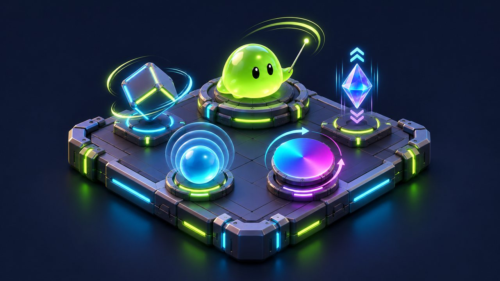
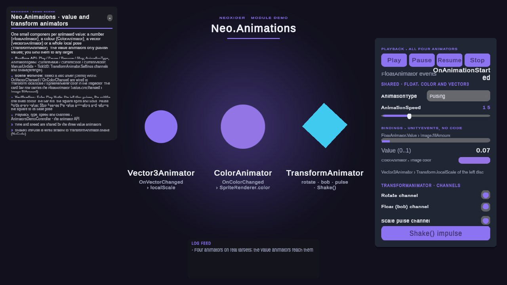

# Animation system

<!-- module-art:begin -->
<p align="center"></p>
<!-- module-art:end -->

**What it is:** the `Neo.Animations` module under `Scripts/Animations/`: scene-free evaluators
(`AnimationUtils`, `TransformAnimationEvaluator`) and small animator components that animate numbers,
colors, vectors and transform poses, with light and emission wrappers in [Tools/View](../Tools/View/README.md).

<!-- demo-shots:begin -->
<p align="center"></p>

*Demo scene: `Scenes/Animations/AnimatorsDemo.unity`, in the **Demo Scenes** sample (Package Manager > NeoxiderTools > Samples). The scenes are saved with their UI and wiring, so you can inspect them without entering Play Mode.*
<!-- demo-shots:end -->

**Contents:** the component list below; start with [FloatAnimator](FloatAnimator.md),
[TransformAnimator](TransformAnimator.md) and [AnimationUtils](AnimationUtils.md).

---

## Features

- **Universal**: Animate any data types (float, Color, Vector3)
- **Multiple animation types**: From simple sine waves to Perlin noise
- **Easy to use**: One component — one animation
- **Configurable**: Many parameters for fine-tuning
- **Events**: UnityEvents to react to animated value changes
- **Caller-owned time**: Evaluate several values with the same supplied time through `AnimationUtils`

## Components

### Core

- **[AnimationType](AnimationType.md)** — Enumeration of animation types
- **[AnimationUtils](AnimationUtils.md)** — Static utilities for computing animated values

### Universal animators

- **[FloatAnimator](FloatAnimator.md)** — Animate numeric values
- **[ColorAnimator](ColorAnimator.md)** — Animate colors
- **[Vector3Animator](Vector3Animator.md)** — Animate vectors (position, scale, rotation)
- **[TransformAnimator](TransformAnimator.md)** — Combinable transform channels: rotate, float, scale pulse, shake, impulse

### Related

- **[Tools/View](../Tools/View/README.md)** — LightAnimator, MeshEmission and other view animators (see per-component pages)

### Demo

Import the optional **Demo Scenes** sample through Unity Package Manager first. Its package source is
`Assets/Neoxider/Samples~/Demo` in the release layout, or `Assets/Neoxider/Samples/Demo` during sample
development. Unity imports it into `Assets/Samples/NeoxiderTools/<version>/Demo Scenes/...`.

Open `Scenes/Animations/AnimatorsDemo.unity` (in the editor also **Neoxider > Demo > Open Animators Demo**). The
whole demo is saved in the scene and visible without Play Mode; nothing is built at runtime:

| Target | Animator | Binding (persistent UnityEvent, no code) |
|--------|----------|------------------------------------------|
| Left disc under `[Demo] World/Scale Target` | `Vector3Animator` | `OnVectorChanged` > `Transform.localScale` |
| Middle disc under `[Demo] World/Colour Target` | `ColorAnimator` | `OnColorChanged` > `SpriteRenderer.color` and the card swatch `Image.color` |
| Square under `[Demo] World/Transform Target` | `TransformAnimator` | rotate, float (bob) and scale pulse channels; the **Shake() impulse** button calls `Shake()` directly |
| Bar row of the card | `FloatAnimator` (0..1) | `Value.OnChanged` > `Image.fillAmount` and a value readout; its started/paused/stopped events update the events label |

The card's Play / Pause / Resume / Stop buttons, the shared `AnimationType` dropdown, the `AnimationSpeed` slider
and the channel toggles call `AnimatorsDemoController`, which only forwards to the animators' public API
(`Play`, `Pause`, `Resume`, `Stop`, `AnimationType`, `AnimationSpeed`, `TransformAnimator.Settings`) and logs
each call. Type and speed apply to the three value animators; `TransformAnimator` has its own channel settings.
The scene is authored by the editor builder `Samples~/Demo/Editor/Builders/Animations/AnimatorsDemoBuilder.cs`
(rebuild it with **Neoxider > Demo > Rebuild Active Demo Scene**).

По-русски: откройте сцену `Scenes/Animations/AnimatorsDemo.unity`. Все четыре аниматора работают на настоящих
целях: `Vector3Animator` масштабирует диск, `ColorAnimator` перекрашивает второй диск, `TransformAnimator`
вращает и покачивает квадрат, `FloatAnimator` заполняет полосу на карточке. Привязки значений сделаны через
UnityEvent в инспекторе, кнопки карточки вызывают публичный API аниматоров.

## Animation types

1. **RandomFlicker** — Random flicker between values
2. **Pulsing** — Smooth sine-based pulsing
3. **SmoothTransition** — Smooth back-and-forth transition
4. **PerlinNoise** — Natural Perlin noise animation
5. **SinWave** — Sine wave
6. **Exponential** — Exponential decay
7. **BounceEase** — Bounce with decay
8. **ElasticEase** — Elastic effect
9. **CustomCurve** — Custom animation curve

## Quick usage

1. Add the desired animator component to a GameObject
2. Configure parameters in the Inspector
3. Subscribe to events or read CurrentValue / CurrentVector / CurrentColor
4. Call `Play()` to start (or enable `playOnStart`; `PlayOnEnable` for `TransformAnimator`)

## Runtime API and scene wiring

Use `AnimationUtils.GetAnimatedFloat`, `GetAnimatedColor`, or `GetAnimatedVector3` directly when the
caller owns the clock. Transform channels also have a scene-free API:
`TransformAnimationEvaluator.Evaluate` returns a `TransformAnimationState` from settings, a base pose,
time and a seed. See [TransformAnimator](TransformAnimator.md) for the settings and wrapper API.
Each component owns its clock; there is no shared clock. Every animator (Float, Color, Vector3,
Transform and the Tools/View `LightAnimator`) has a public `Tick(float deltaTime)` and a non-serialized
`ManualUpdate` switch: set `ManualUpdate = true` and call `Tick` from your own loop to drive several
animators with one clock, step frames in a replay or test deterministically. Like `Update`, `Tick` does
nothing while the component is disabled. To synchronize samples
without components, pass the same time to the static utilities, as in [AnimationUtils](AnimationUtils.md).

```csharp
// One clock for a group of animators.
[SerializeField] private FloatAnimator[] _group;

private void Awake()
{
    for (int i = 0; i < _group.Length; i++)
    {
        _group[i].ManualUpdate = true;
    }
}

private void Update()
{
    float delta = Time.unscaledDeltaTime;
    for (int i = 0; i < _group.Length; i++)
    {
        _group[i].Tick(delta);
    }
}
```

For scene authoring, configure the animator in the Inspector and connect `Value.OnChanged` (float),
`OnColorChanged`, or `OnVectorChanged` to the receiving component. Code can subscribe to
`FloatAnimator.Value.AddListener` or the color/vector UnityEvents. These value animators publish data;
the receiving code or event target applies it to a light, material, UI element or transform.

`FloatAnimator` writes each evaluated value to its reactive property, including changes below 0.001;
the property suppresses equal-value notifications. Color/vector current-value properties update each
playing, unpaused frame, while their change events require distance greater than 0.001 from the last
notified value (RGBA distance for color). Their initial start value is not emitted as a change event;
apply an initial visual value explicitly when binding. See the component pages for typed subscriptions
and listener cleanup.

## Playback and pooling contracts

| Operation | Float / Color / Vector3 | Transform |
|-----------|-------------------------|-----------|
| Startup | With `RandomizeStartTime` on (default), `Start` randomizes the clock and noise offset even when `playOnStart` is false; off keeps the caller's clock | Captures the base on enable; optional `RandomizeStartTime`; `PlayOnEnable` starts at first startup and later re-enables |
| Time | Scaled or unscaled (`UseUnscaledTime`) time while playing and unpaused, or `Tick` under `ManualUpdate` | Scaled or unscaled time while playing and unpaused, or `Tick` under `ManualUpdate` |
| `Play()` | Retains time and emits started on every call | Retains time; an already playing, unpaused call emits no duplicate started event |
| `Pause()` / `Resume()` | Pause emits while playing, including repeated calls; resume emits started only if paused | Repeated pause/resume calls are guarded; resume emits started |
| `Stop()` | Freezes the current output, retains time and emits stopped | Restores the captured local pose, clears impulse, retains main time and emits stopped |
| Disable / re-enable | Unity stops/continues Update; flags and output persist; `playOnStart` does not run again | Disable restores the base and clears playback/impulse without a stopped event; re-enable captures again and optionally plays |

`ResetTime()` and `RandomizeTime()` change the clock without immediately sampling. For the value
animators, a reset before `Start` is overwritten by startup randomization unless `RandomizeStartTime`
is off; the next active Update (or `Tick`) advances time before evaluating. Non-positive speed selects
the initial/minimum value without stopping playback. Use the evaluators when an exact supplied phase is
required.

По-русски: `AnimationUtils` и `TransformAnimationEvaluator` позволяют считать значения без сценового
компонента. Float передаёт и малые изменения через reactive property; Color/Vector3 сохраняют порог
событий. Для сценовой настройки подключите получателя через UnityEvent; жизненный цикл и подписки
описаны выше и на страницах компонентов. Для собственного цикла обновления включите `ManualUpdate`
и вызывайте `Tick(deltaTime)`; у выключенного компонента `Tick`, как и `Update`, ничего не делает.

## See also

- [Tools/View](../Tools/View/README.md) — Light and view animators
- [Extensions](../Extensions/README.md) — Additional animation utilities
