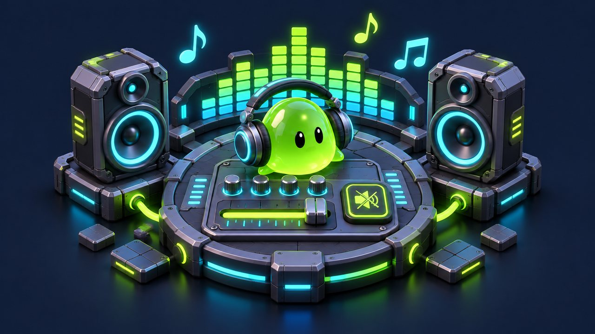
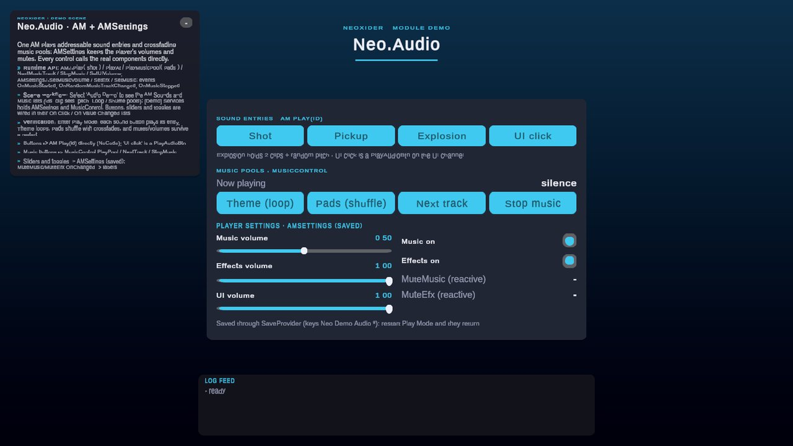

# Audio module

<!-- module-art:begin -->
<p align="center"></p>
<!-- module-art:end -->

**What it is:** sound management for Unity under `Scripts/Audio/` (namespace `Neo.Audio`): the singleton **AM** (Audio Manager) for effects, music pools and ambience, the singleton **AMSettings** for persisted volume and mute (optionally through an **AudioMixer**), and small play-on-event and UI components.

<!-- demo-shots:begin -->
<p align="center"></p>

*Demo scene: `Scenes/Audio/AudioDemo.unity`, in the Demo download (`Assets/NeoxiderDemos/Demo`). The scenes are saved with their UI and wiring, so you can inspect them without entering Play Mode.*
<!-- demo-shots:end -->

**Contents:** the component list below; the main guides are [AM](AM.md), [AMSettings](AMSettings.md) and [AudioControl](View/AudioControl.md).

---

Demo: `Assets/NeoxiderDemos/Demo/Scenes/Audio/AudioDemo.unity`; controller:
`Assets/NeoxiderDemos/Demo/Scripts/Shell/AudioDemoController.cs` (Demo download).

The demo is fully authored in the scene (no runtime UI building), so the wiring is visible without Play
Mode:

- **Audio Demo** (`AM`): four sound entries - `shot`, `pickup`, `explosion` (two clips + random pitch) and
  `ui_click` (UI channel) - and two music pools: `theme` (Loop) and `pads` (Shuffle, three tracks).
- **[Demo] Services**: `AMSettings` with demo-only save keys `Neo.Demo.Audio.*` (volumes and mutes survive a
  restart without touching your game's keys) and a `MusicControl`.
- **[Demo] Frame**: the sound buttons call `AM.Play("id")` directly, **UI click** is a `PlayAudioBtn`, the
  music buttons call `MusicControl.PlayPool` / `NextTrack` / `StopMusic`, the sliders and toggles call
  `AMSettings.SetMusicVolume` / `SetEfxVolume` / `SetMusic` / `SetEfx` and `AM.SetUiVolume`. The
  `MuteMusic` / `MuteEfx` labels are driven by `AMSettings.MuteMusic.OnChanged` without code.

The scene is produced by the editor builder `Assets/NeoxiderDemos/Demo/Editor/Builders/Audio/AudioDemoBuilder.cs`
(**Neoxider > Demo > Rebuild Active Demo Scene**).

## Main pieces

- **[AMSettings](AMSettings.md)** — Singleton for global sound settings (volume, mute, mixer). Volumes and mutes persist through `SaveProvider`; binding never forces a muted channel back on.
- **[AM](AM.md)** — Main singleton for sound effects and music (Scripts/Audio/AudioSimple/AM.cs). Sounds and music share one record contract: an optional id, a **set** of clips (random pick), a volume multiplier and an optional pitch range. Music entries are **pools** with a `Loop` / `Shuffle` mode, and music changes **crossfade** by default. Sound entries play on the **Sfx** or **UI** channel (own volume, mute, mixer group); `TryPlay` / placeholder entries keep optional cues silent; `PlayAt` plays pooled positional one-shots.
- **[PlayAudio](PlayAudio.md)** — Component to play a sound from AM (by id, by index, or from a clip list).
- **[PlayAudioBtn](PlayAudioBtn.md)** — Plays sound on UI Button click (by id, by index, or from a clip list).
- **[MusicControl](MusicControl.md)** — No-code music: start a pool by id, move to another track of it, stop. Every method is UnityEvent-ready.
- **[SettingMixer](SettingMixer.md)** — Set/get AudioMixer parameters (normalized 0–1 or dB) with enum presets (`Master/Music/Efx`) and `Custom` mode.
- **AudioControl** — Binds a Toggle or Slider to AMSettings (Master/Music/Efx), supports `Set(bool)` and normalized `Set(float)` in `0..1`, and has a `Custom` mode with UnityEvents; Scripts/Audio/View/AudioControl.cs.
- **[AudioFocusMute](AudioFocusMute.md)** — Silences all game audio while the application has no focus (minimized, another tab or app) and restores the volume on return; one `AudioFocusMute.Install()` at startup.
- **[RandomMusicController](RandomMusicController.md)** — Standalone helper for random track playback. Since 10.13 `AM` uses its own pool engine (crossfaded, with a Loop / Shuffle mode); this class remains for direct use.

## Runtime and scene entry points

```csharp
using Neo.Audio;

AM.I.SetSoundEntries(new SoundEntry("hit", hitClip));
AM.I.SetMusicEntries(new MusicEntry("gameplay", trackA, trackB));
AM.I.Play("hit");
AM.I.PlayMusicPool("gameplay");
AM.I.SetMusicVolume(0.6f);
```

For scene authoring, add `AM` and `AMSettings`, configure entries and optional mixer routing, then use
`PlayAudio`, `PlayAudioBtn` and `MusicControl` from UnityEvents. Add `AudioControl` to a Toggle or Slider;
select `AudioSourceAndMixer` when controlling source volumes without a mixer. Its synchronization is
silent: refreshing the view does not invoke the UI element's value-change callbacks.

`RandomMusicController` is a plain C# class, not an addable component; see its
[initialization and ownership example](RandomMusicController.md).


## See also

- [Audio editor authoring](Editor.md) — entry lists, clip controls and id drawers.
- [Animations](../Animations/README.md)
- [UI](../UI/README.md)
