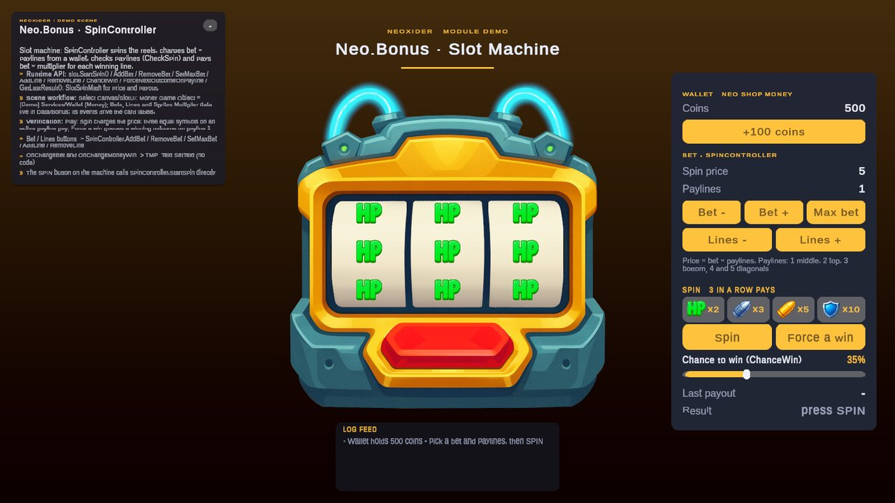
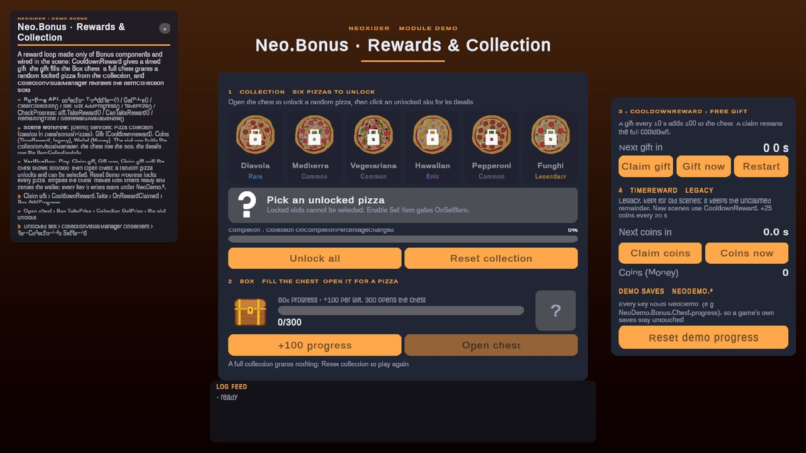
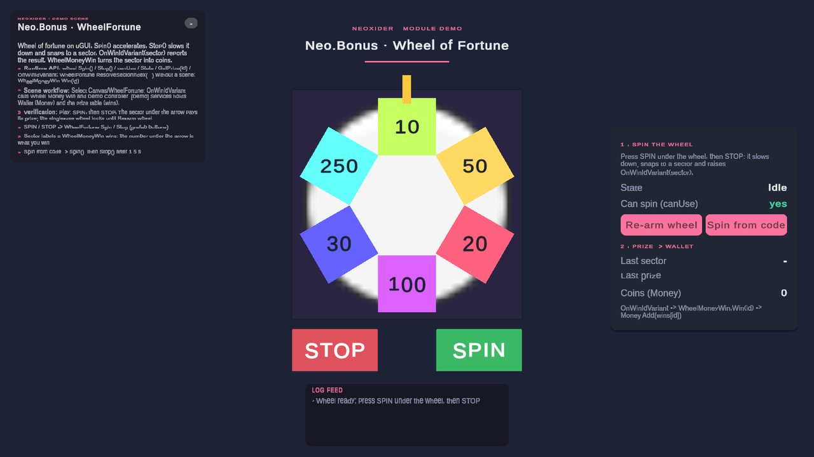

# Bonus module

<!-- module-art:begin -->

<!-- module-art:end -->

**What it is:** collections, slot machines, wheels of fortune, and time-based rewards (`Scripts/Bonus/`, assembly `Neo.Bonus`, namespace `Neo.Bonus`). Each area has a plain C# core for code-first use and tests, plus scene components that wrap it.

<!-- demo-shots:begin -->

  

*Demo scenes: `Scenes/Bonuses/SlotExample.unity`, `Scenes/Bonuses/BonusRewardsDemo.unity`, `Scenes/Bonuses/WheelFortuneExample.unity`, in the Demo download (`Assets/NeoxiderDemos/Demo`). The scenes are saved with their UI and wiring, so you can inspect them without entering Play Mode.*
<!-- demo-shots:end -->

**Contents:** the submodule table below; links point to the per-component documentation.

---

## Plain C# cores

| Core | Use it for | Scene wrapper |
|------|------------|---------------|
| [CollectionSet](./Collection/CollectionSet.md) | Independent unlock sets, claimed/saved/reset separately; C# events; injectable random. | [Collection](./Collection/Collection.md) (read-only `collection.Set`) |
| [BoxProgress](./Collection/BoxProgress.md) | Integer accumulate/threshold/claim with idempotent claim ids; `BoxProgressRules`. | [Box](./Collection/Box.md) (float, shared rules) |
| [CooldownSchedule](./TimeReward/CooldownSchedule.md) | Cooldown counting and claiming on an injected `INeoClock`; restart-safe save. | [CooldownReward](./TimeReward/CooldownReward.md), legacy `TimeReward` (shared rule) |
| `CheckSpin`, `SlotSpinMath` | Payline evaluation, spin price and payout math. | [SpinController](./Slot/SpinController.md) |
| `WheelFortune.ResolveSectorIndex` | Sector under the arrow for given angles. | [WheelFortune](./WheelFortune/WheelFortune.md) |

## Submodules

| Submodule | Description | Docs |
|-----------|-------------|--------------|
| **Slot** | Slot machine: reels, lines, spin, bets; optional winning-line **LineRenderer** (`SpinController` → Win Line Playback) | [Slot/README](./Slot/README.md) |
| **Collection** | Collectibles (`CollectionSet`, `Collection`), boxes (`BoxProgress`, `Box`), views | [Collection/README](./Collection/README.md) |
| **TimeReward** | CooldownSchedule, CooldownReward, ResourceRegen, legacy TimeReward | [TimeReward/README](./TimeReward/README.md) |
| **WheelFortune** | Wheel of fortune (`WheelFortune`), WheelMoneyWin | [WheelFortune/README](./WheelFortune/README.md) |
| **LineRoulett** | Linear roulette (root script) | [LineRoulett](./LineRoulett.md) |

## Runtime API and scene workflows

Use `Collection` by reference for persistent unlocks, `CheckSpin` for payline evaluation without a scene,
and `SlotEconomyDefinition` for shared symbol data and deterministic weighted picks. The components
`Box`, `SpinController`, `WheelFortune`, and `CooldownReward` adapt these mechanics to scene objects and
UnityEvents. `ResourceRegen` binds a cooldown to a wallet and an optional countdown label.

Assign scene references explicitly in the Inspector. Collection item/economy ScriptableObjects contain
reusable data; views and wallets belong on scene components. Every UnityEvent declared by a Bonus component exists
on a component added from code, so code-built scenes subscribe without a null check or a SerializedObject pass
(`CooldownReward` inherits its timer events from `TimerObject`, which follows [Tools/Time](../Tools/Time/README.md)).
Hook each grant to one recipient:
`SpinController` already pays its configured wallet when **Auto Payout** is enabled.

Reward claims consume their state before grant callbacks and reject recursive claims. Slot configuration
is locked throughout an accepted spin, including gaps between staggered reels. See the submodule entries
for persistence keys, cancellation, numeric limits, and the equivalent C# calls.

## Demo scenes

- `Scenes/Bonuses/SlotExample.unity`: slot machine with a wallet, bets, five paylines and a paytable; see [Slot](./Slot/README.md).
- `Scenes/Bonuses/WheelFortuneExample.unity`: wheel of fortune that pays each sector into a wallet; see [WheelFortune](./WheelFortune/README.md).
- `Scenes/Bonuses/BonusRewardsDemo.unity`: `Collection` with `CollectionVisualManager` slots and an `ItemCollectionInfo` details row, a `Box` chest filled by a `CooldownReward` gift, the legacy `TimeReward` paying into a session-only `Money` wallet; every save key holds `NeoDemo.`; see [Collection](./Collection/README.md) and [TimeReward](./TimeReward/README.md).

All three scenes save every listener in the scene (the slot and wheel keep the package prefab on its own Canvas),
so the wiring is readable in the Inspector without entering Play Mode.

## See also

- [Tools/Time](../Tools/Time/README.md)
- [Save](../Save/README.md)
- [Tools/Random](../Tools/Random/README.md)
