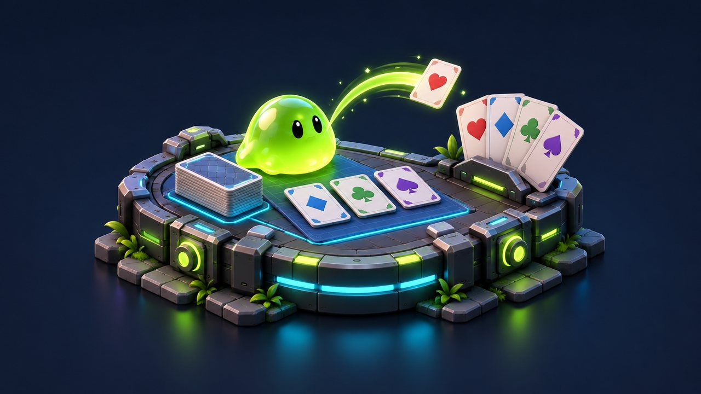
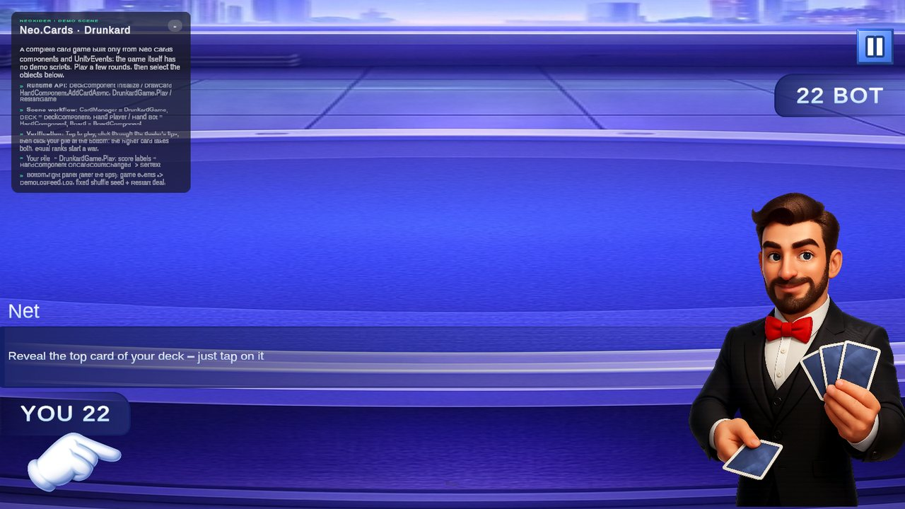

# Cards module

<!-- module-art:begin -->
<p align="center"></p>
<!-- module-art:end -->

**What it is:** card-game building blocks — pure C# models (`DeckModel`, `HandModel`, `BoardModel`, `CardData`), scene components (`DeckComponent`, `HandComponent`, `BoardComponent`, `CardComponent`), an MVP view/presenter layer (`CardView`, `HandView`, `HandPresenter`, ...), layout math, comparers and poker evaluation. Scripts live in `Scripts/Cards/` (namespace `Neo.Cards`, poker in `Neo.Cards.Poker`); Drunkard is a complete sample game built from these blocks.

<!-- demo-shots:begin -->
<p align="center"></p>

*Demo scene: `Scenes/_ExampleGame/CardGame.unity`, in the **Demo Scenes** sample (Package Manager > NeoxiderTools > Samples). The scenes are saved with their UI and wiring, so you can inspect them without entering Play Mode.*
<!-- demo-shots:end -->

**Contents:**

| Page | Description |
|------|-------------|
| [CardData](./CardData.md) | Core card value type, custom cards and comparison helpers |
| [DeckConfig](./DeckConfig.md) | Deck visuals, standard/custom generation and validation |
| [Cards editor](./Editor.md) | DeckConfig authoring, sprite auto-fill, previews and validation |
| [CardComponent](./CardComponent.md) | Scene card: visuals, interaction and animation |
| [DeckComponent](./DeckComponent.md) | Scene deck: draw, deal, visual stack, trump, seeded shuffling |
| [HandComponent](./HandComponent.md) | Scene hand: layouts, events, sorting, finite hands |
| [BoardComponent](./BoardComponent.md) | Table rows, discard piles, slots |
| [Interfaces](./Interfaces.md) | `ICardView`, `IHandView`, `IOrderedHandView`, `IDeckView` contracts |
| View: [CardView](./View/CardView.md), [CardViewUniversal](./View/CardViewUniversal.md), [DeckView](./View/DeckView.md), [HandView](./View/HandView.md) | MVP view layer; see also the [custom view guide](./View/CustomCardViewGuide.md) |
| [CardAnimationConfig](./Config/CardAnimationConfig.md) | Deal, shuffle, stack and card-view animation timings |
| [Internal types](./InternalTypes.md) | Enums, models, presenters and utilities at a glance |
| [Poker](./Poker/README.md) | Poker evaluation, results and rules |
| [Drunkard example](./Examples/Drunkard.md) | DrunkardGame sample |

How to work with it:

1. **Inspector/NoCode:** create a `DeckConfig`, add `DeckComponent` + `HandComponent` (+ `BoardComponent`) to the scene, assign the config and a `CardComponent` prefab, then drive dealing and sorting from buttons and UnityEvents.
2. **C#:** use the models directly for rules, AI and tests (`DeckModel`, `HandModel`, `CardComparer`, `PokerHandEvaluator`) and keep scene components as adapters.
3. **Custom card games:** describe cards with `CardData.CreateCustom(...)` and sort them with `CardComparer.ByValue*`; views do not depend on suits or ranks.

---

## Custom cards and standalone views

Cards are not limited to 36/52/54-card decks. Use `CardData.CreateCustom(...)` for TCG, deckbuilder, board-game, ability, or item cards. `DeckConfig` can generate a custom deck from `Custom Cards`, while `DeckModel.Initialize(IEnumerable<CardData>)` still accepts any explicit card list.

`CardComponent`, `CardView`, and `CardViewUniversal` can also run without a `DeckConfig` by calling `SetSpriteOverrides(faceSprite, backSprite)`. This keeps the card view reusable in standalone card projects where card identity, rules, and art come from another data model.

`BoardComponent` exposes `MaxCards`, `FaceUp`, `CanPlaceCard(...)`, `SetCapacity(...)`, and `SetFaceUp(...)` so one board component can support table rows, lanes, discard piles, market rows, or custom TCG zones.

## Reuse across card games

| Need | Reusable piece |
|------|----------------|
| Card identity for any game | `CardData` (standard, joker or custom id/value/group) |
| Draw pile with reproducible shuffles | `DeckModel(seed)` / `DeckModel(System.Random)`, `DeckComponent` **Use Fixed Shuffle Seed** |
| Hands, benches, trays with capacity | `HandModel` (`Capacity`, `TryAdd`, `AddRangeUntilFull`) |
| Sorting by any rule | `HandModel.Sort(...)`, `HandComponent.SortAsync(...)`, `HandPresenter.SortAsync(...)` with a `CardComparer` or your own comparer |
| Layout of any card container | `CardLayoutCalculator` (fan, line, grid, stack, scattered) |
| Visuals without game rules | `ICardView` implementations, `CardViewAnimationTemplates` |
| Classic poker | `PokerHandEvaluator`, `PokerRules` |

## Runtime models and reset

Models work without scene objects. The final list entry is the top of a `DeckModel`; `Draw()` removes it, while `PeekBottom()` reads the first entry.

```csharp
CardData wolf = CardData.CreateCustom("wolf", "Wolf", 3, "Beast");
CardData bear = CardData.CreateCustom("bear", "Bear", 8, "Beast");
DeckModel deck = new DeckModel();
deck.Initialize(new[] { wolf, bear, wolf }, shuffle: false);
CardData? drawn = deck.Draw();
deck.Reset(shuffle: false);
// Restores wolf, bear, wolf, including duplicate copies and their original order.
```

Explicit initialization snapshots its input before changing the deck, including deferred queries over `deck.Cards`. A null or failing source leaves the previous deck and discard pile intact. `Reset(...)` restores the last successful initialization and clears discards; a later `Initialize(DeckType, ...)` switches back to a standard deck. `DeckComponent` and `DeckPresenter` both generate their cards through `DeckConfig.GenerateDeck()`, including custom decks.

`BoardModel(maxCards)` enforces capacity through `Add(...)`, including calls through `ICardContainer`. Check `CanAdd(...)` before an expected rejection; `Add(...)` throws `InvalidOperationException` if the container refuses the card. Capacity zero accepts no cards; a negative board capacity is invalid. The legacy `CardContainerModel.Mutable` list bypasses validation and notifications, so use the typed mutation methods for normal gameplay.

## Deterministic shuffling and sorting

Shuffles use an injectable `System.Random`, so replays, tutorials, tests and lock-step multiplayer can reproduce a deal:

```csharp
DeckModel deck = new DeckModel(seed: 2026);   // or new DeckModel(sharedRandom)
deck.Initialize(DeckType.Standard36);         // same order for the same seed
deck.Shuffle(new System.Random(7));           // one-off source; deck.ShuffleRandom is untouched
deck.ShuffleRandom = new System.Random(8);    // reseed later shuffles

HandModel hand = new HandModel();
hand.AddRange(deck.Draw(6));
hand.Sort(CardComparer.WithTrump(Suit.Spades)); // any IComparer<CardData> or Comparison<CardData>
```

In the scene, enable **Use Fixed Shuffle Seed** on `DeckComponent` (or set `UseFixedShuffleSeed`/`ShuffleSeed` from code): every `Initialize()` and `Reset()` then produces the same order. Subclasses can override `CreateShuffleRandom()` to share a game-wide random source.

All sorts (`SortByRank`, `SortBySuit`, `Sort(...)`, `SortAsync(...)`) are stable: equal keys keep their current order, so model, presenter and view orders stay identical and index-based removal remains correct even with duplicate cards. Custom cards have no rank or suit; sort them with `CardComparer.ByValueAscending`, `ByValueDescending` or `ByGroupThenValueAscending`.

`CardLayoutCalculator` derives scattered placement and jitter from the card index (and an optional seed) instead of `UnityEngine.Random`: re-layouts after adding a card keep existing cards in place, and laying out cards never consumes the global random sequence your gameplay may depend on.

## Scene and presenter ownership

Assign a `DeckConfig` and card prefab on `DeckComponent`, configure hand/board limits and layouts, then call the component APIs from C# or Inspector events. When using `HandComponent` or `HandPresenter`, change cards through that owner so model order, view order, and click subscriptions stay together. Directly changing its exposed `Model` does not create or remove scene views.

A hand or board ignores repeated insertion of the same scene card; `HandPresenter` and `HandView` also ignore the same presenter/view instance added twice. Separate instances with equal `CardData` remain valid duplicate copies. Remove a card from its current owner before transferring it to another zone. `HandComponent.TryAddCardAsync(...)` returns acceptance. Competing `DeckComponent.DealToHandAsync(...)` calls recheck admission after flight: rejection restores the drawn data and its stack view to the same source generation, without `OnCardDealt`. Reset/reinitialize cancels pending deals; old cards cannot be restored into a replacement deck. Accepted cards belong to the hand and survive a later deck-only reset. `DeckComponent.ReturnCard(...)` removes the card from the hand or board that holds it before destroying it.

`HandPresenter.SortByRankAsync(...)`, `SortBySuitAsync(...)` and `SortAsync(...)` synchronize all three orders. The built-in `HandView` implements optional `IOrderedHandView.SetOrderAsync(...)` and applies one layout without remove/add callbacks. Existing custom `IHandView` implementations retain their nonanimated remove/add fallback and must preserve removed objects for reuse. Hand/board layouts cancel obsolete motion when membership changes. See [HandView](./View/HandView.md).

Presenter add/remove calls also honor a newer mutation made by a model callback: `Model.OnCardAdded`/`OnCardRemoved` can call `presenter.Clear()` without stale view insertion, stale indexed removal or click subscription. A superseded asynchronous call does not publish an old presenter add/remove notification after its custom view finishes. Ordinary completed calls keep their synchronous event order.

Since 11.0 a deal whose hand rejects the card after the flight returns the card to its source deck, and a cancelled deal never changes a newer deal. The Drunkard sample's `RestartGame()` can be called mid-turn: earlier animations and continuations are cancelled before state is cleared. Asset setup is described in [Cards editor](./Editor.md); the C# path is on the component pages.

`CardPresenter.IsFaceUp` reports the actual view state, including fixed display modes and direct view flips. If a face or back sprite cannot be resolved, built-in card renderers clear their previous sprite. A missing back therefore produces a blank card instead of exposing the old face.

Poker and suit/rank helpers implement classic-card rules. `PokerHandEvaluator` rejects custom cards and invalid suit/rank values, while ignoring jokers as before. Use game-specific rules for custom groups and sort values.

## Performance notes

- Model queries (`HandModel.Contains*`, `IndexOf`, `GetLowestCard`, `GetHighestCard`), shuffling, standard `CardData` construction and comparisons allocate nothing.
- `HandComponent`, `HandView`, `BoardComponent` and `DeckComponent` reuse layout buffers; `CardLayoutCalculator` has list-filling overloads for custom containers. A warm immediate board placement or removal does not allocate.
- Every board placement re-arranges all of its cards, so placing n cards one by one costs O(n²) transform writes. `BoardComponent.PlaceCardsImmediate(cards)` places a whole list with one layout pass; the deck's visual stack, the Drunkard initial board and `RestoreAllSourcesToBoard()` use it. `BoardComponent.RemoveCards(cards)` removes a list the same way.
- `DeckConfig.GetSprite` resolves custom cards through a cached id index instead of scanning the custom card list.
- `PokerHandEvaluator.EvaluateStrength(...)` scores the best hand without allocations for AI, equity and outs loops; `Evaluate(...)` builds a full result only for the winning combination.

## Finite hands and backpack rails

`HandModel` can represent both unlimited card hands and finite card rails. Leave `Capacity` at `0` for the legacy unlimited behaviour, or set it to a positive value for CCG hand limits, autobattler benches, backpack rows, market rows, and draft trays.

Use `CanAdd(...)` or `TryAdd(...)` for player-facing flows where overflow should be rejected without exceptions. `Add(...)` and `AddRange(...)` keep strict behaviour and throw if a finite hand would overflow. `RemainingCapacity`, `IsFull`, and `AddRangeUntilFull(...)` are intended for UI badges, reward overflow conversion, and bulk draw/recruit flows.

`AddRange(...)` snapshots its source, so `hand.AddRange(hand.Cards)` adds one copy of the original contents when capacity permits. `AddRangeUntilFull(...)` consumes its input incrementally and stops before advancing past available capacity; use an independent source when streaming cards into a hand.

## Demo scene

`Samples~/Demo/Scenes/_ExampleGame/CardGame.unity` (`Samples/...` in the development layout, `Assets/Samples/NeoxiderTools/<version>/Demo Scenes/...` after a Package Manager import) is a complete Drunkard game assembled in the scene. `CardManager` (`DrunkardGame`), `DECK` (`DeckComponent`), `Hand Player` / `Hand Bot` (`HandComponent`) and `Board` (`BoardComponent`) sit on the NeoxiderPages `PM` pages and talk through UnityEvents: a pile click calls `DrunkardGame.Play`, `HandComponent.OnCardCountChanged` feeds the `SetText` score labels, and the win/lose events call `GM`.

The `[Demo] Guide` overlay is saved in the scene (no runtime bootstrap). The editor builder `CardGameBuilder` in the sample's `Editor/Builders/Cards` folder authors it; **Neoxider/Demo/Rebuild Active Demo Scene** rebuilds it without touching the game objects.

| Object | What it shows |
|--------|---------------|
| `[Demo] Guide/InfoCard` (texts on `[Demo] Services/Demo Info`) | Collapsible card: which object plays which role, the C# API and how to play. |
| `[Demo] Guide/LivePanel` | Appears when the dealer tips end (`Tutorial` `Selector.OnFinished` → `GameObject.SetActive(true)`). Its log receives `DrunkardGame` events (`OnGameRestarted`, `OnPlayerWonRound`, `OnWarStarted`, `OnPlayerWin`, ...) through persistent `DemoLogFeed.Log` listeners; select `CardManager` to see them in the Inspector. |
| **Same deal every restart** toggle and **Restart deal** button | The toggle sets `DeckComponent.UseFixedShuffleSeed` directly; with it on, `DrunkardGame.RestartGame` deals the same order every time. |

The C# path is the same API: `deck.UseFixedShuffleSeed = true; game.RestartGame(); game.OnPlayerWonRound.AddListener(...)`.

## See also

- [Tools/Components](../Tools/Components/README.md)
- [Save](../Save/README.md)
