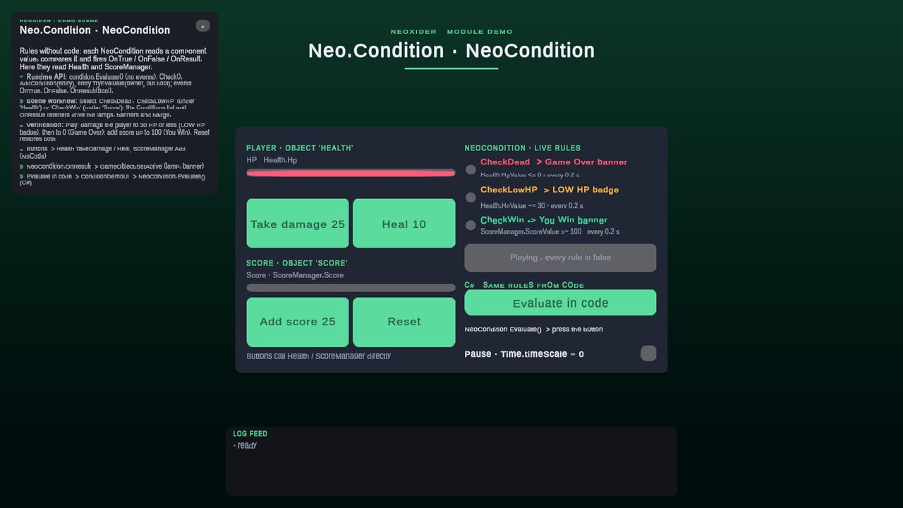

# Condition module

<!-- module-art:begin -->
<p align="center"></p>
<!-- module-art:end -->

**What it is:** reusable data-driven conditions. `ConditionEntry` (serializable, plain C# API, implements `IConditionEvaluator`) reads a field/property/method of a component or GameObject and compares it with a constant or another object's member. **NeoCondition** adds scene configuration, AND/OR composition, scheduled checks and UnityEvents. Scripts live in `Scripts/Condition/` (assembly `Neo.Condition`).

<!-- demo-shots:begin -->
<p align="center"></p>

*Demo scene: `Scenes/Condition/NeoConditionDemo.unity`, in the Demo download (`Assets/NeoxiderDemos/Demo`). The scenes are saved with their UI and wiring, so you can inspect them without entering Play Mode.*
<!-- demo-shots:end -->

**Navigation:** [← Docs](../README.md)

**How to work with it (scene / NoCode):**
1. Add **NeoCondition** to a GameObject (Add Component → Neoxider → Condition → NeoCondition).
2. Add conditions to the Conditions list: source object, component, field, operator, threshold.
3. Configure the **On True** / **On False** events.
4. Pick the check mode: **Manual** (call `Check()` from a UnityEvent), **EveryFrame** or **Interval** (optionally on
   unscaled time for pause menus).

From code, evaluate a `ConditionEntry` directly ([Runtime API](#runtime-api)).

**Contents:**

| Page | Topic |
|------|-------|
| [NeoCondition](NeoCondition.md) | Component fields, events, `ConditionEntry` C# API, method conditions, occurrences, performance, networking. |
| [Condition_Reuse](Condition_Reuse.md) | Using `ConditionEntry` / `IConditionEvaluator` in the State Machine and your own systems. |
| [InternalTypes](InternalTypes.md) | Helper types: `ConditionValueSource`, `ReflectionCache`, `BindingSourceGameObjectResolver`. |

---

## Runtime API

Configure an entry and call `Evaluate(context)` without adding a NeoCondition component:

```csharp
ConditionEntry active = new()
{
    Source = SourceMode.GameObject,
    PropertyName = nameof(GameObject.activeInHierarchy),
    CurrentValueType = Neo.Condition.ValueType.Bool,
    ThresholdBool = true
};
bool isActive = active.Evaluate(actor);
bool compared = active.TryEvaluate(actor, out bool result); // false when the source/member is unavailable
```

Use `using Neo.Condition;` and `using UnityEngine;`; `actor` is the GameObject being checked. An entry without an explicit source follows the context passed on each evaluation, including when reused for several owners. Every Inspector setting, including the Other Object branch and method arguments, has a public property. See [Condition_Reuse](Condition_Reuse.md) for integration and source-resolution rules.

## Main types

- **LogicMode** — AND (all true) or OR (at least one true).
- **CheckMode** — Manual, EveryFrame, Interval.
- **ConditionEntry** — One condition: source (Component or GameObject), property/method, compare operator, threshold or other object. `Evaluate(context)` (legacy bool) and `TryEvaluate(context, out bool)` (reports unavailable sources).
- **IConditionEvaluator** — `bool Evaluate(GameObject context)`; the contract other systems accept.

## API (NeoCondition)

- **Check()** — Evaluates conditions and invokes OnTrue/OnFalse/OnResult.
- **Evaluate()** — Returns result without invoking events.
- **LastResult** — Result of the last check.
- **OnTrue**, **OnFalse**, **OnResult**, **OnInvertedResult** — UnityEvents.
- **Logic**, **Mode**, **CheckInterval**, **UseUnscaledTime**, **OnlyOnChange** — runtime settings.
- **ResetState()**, **InvalidateAllCaches()**, **AddCondition(entry)**, **RemoveCondition(entry)** — Utility methods.

`Evaluate()` does not update `LastResult`. `Check()` updates it and invokes events, subject to `OnlyOnChange`. With the default `OnlyOnChange = true`, the first check and subsequent changes invoke `OnResult`, `OnInvertedResult`, and exactly one of `OnTrue` / `OnFalse`.

For repeated component types, use `ConditionEntry.ComponentOccurrence` and `OtherComponentOccurrence`: `0` selects the first matching component, `1` the second. These selectors count only matching types and are independent of the legacy Inspector component-list indices. See [NeoCondition](NeoCondition.md#component-occurrences) for C# and scene setup.

## Demo scene

`Scenes/Condition/NeoConditionDemo.unity` (Demo download). Select a rule on `Health` (`CheckDead`, `CheckLowHP`) or `Score` (`CheckWin`) to see its Conditions list and the `OnResult` listeners that switch lamps and banners through `GameObject.SetActive`. **Evaluate in code** runs `NeoCondition.Evaluate()`; **Pause** sets `Time.timeScale` to 0 and the rules keep checking on **Use Unscaled Time**. Everything is saved in the scene.

## See also

- [StateMachine](../StateMachine/README.md) — `ConditionEntryPredicate` uses the same entries in transitions.
- [NoCode](../NoCode/README.md) — float bindings share `BindingSourceGameObjectResolver` and `ReflectionCache`.
- [Tools/Components](../Tools/Components/README.md)
