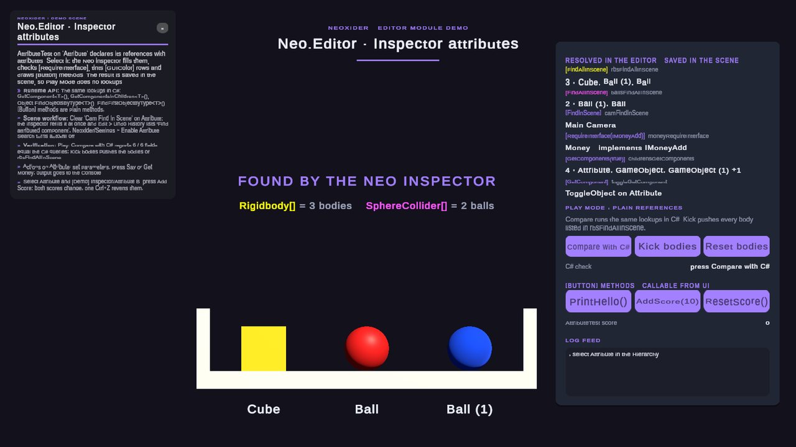

# Editor module

<!-- module-art:begin -->

<!-- module-art:end -->

**What it is:** Editor-only tools: custom inspectors, auto-build, Scene Saver, settings window, missing-scripts finder, texture tools, zip backup. Code in `Editor/`. Use this page as the English module entry.

<!-- demo-shots:begin -->

*Demo scene: `Scenes/Tools/AttributeExample.unity`, in the **Demo Scenes** sample (Package Manager > NeoxiderTools > Samples). The scenes are saved with their UI and wiring, so you can inspect them without entering Play Mode.*
<!-- demo-shots:end -->

**Contents:** the [entry points](#entry-points) list of pages and the
[C# and Inspector workflows](#c-and-inspector-workflows).

**Navigation:** [← Docs](../README.md)

---

## Entry points

- Inspectors: [NeoCustomEditor](./NeoCustomEditor.md), [CustomEditorBase](./CustomEditorBase.md), [Visual Settings](./RainbowSignature.md), [ComponentDrawer](./ComponentDrawer.md), [ResourceDrawer](./ResourceDrawer.md).
- Windows and scene authoring: [EditorWindows](./EditorWindows.md), [NeoxiderSettingsWindow](./NeoxiderSettingsWindow.md), [CreateMenuObject](./CreateMenuObject.md), [CreateSceneHierarchy](./CreateSceneHierarchy.md).
- Maintenance: [SaveProjectZip](./SaveProjectZip.md), [FindAndRemoveMissingScriptsWindow](./FindAndRemoveMissingScriptsWindow.md), [SingletonCreator](./SingletonCreator.md), [SceneSaver](./SceneSaver.md), [TextureMaxSizeChanger](./TextureMaxSizeChanger.md).

## C# and Inspector workflows

`Neo.Editor` is an Editor-only assembly. Put calls to its APIs in an Editor assembly or behind `#if UNITY_EDITOR`; runtime code should use the underlying typed gameplay APIs.

For scene authoring, select a component to run the optional attribute-based reference lookup. Arrays and `List<T>` keep their declared element types; existing non-empty assignments are preserved. Custom editors can call `ComponentDrawer.ProcessComponentAttributes(component)` and `ResourceDrawer.ProcessResourceAttributes(component)` explicitly. These editor helpers do not replace runtime initialization.

Use `[Button(PlayModeOnly = true)]` for methods that mutate live gameplay state. The inspector disables their actions in Edit Mode. A direct C# call remains an ordinary method call. With several objects selected, an action runs on each of them; in Edit Mode it is recorded with Undo.

Global settings live in [NeoxiderSettings](./NeoxiderSettings.md) (`ProjectSettings/NeoxiderSettings.json`); saving them writes only that file. The look and animation of Neo component inspectors are configured in **Neoxider > Visual Settings** ([RainbowSignature](./RainbowSignature.md), stored in `ProjectSettings/NeoInspectorSettings.asset`). The version pill in the inspector header checks GitHub at most every 10 minutes (click it to check now) and logs a changed warning once; set the EditorPrefs bool `Neo.UpdateCheck.Verbose` to log every request and result.

In Condition and float-binding inspectors, choose the source object, the exact component instance and a readable member. Duplicate components appear as `BoxCollider`, `BoxCollider (2)`, etc. The popup stores a zero-based occurrence among matching types, independently for both sides of a Condition. Missing or negative occurrences remain unresolved until you explicitly choose a component; the inspector does not silently select the first. Condition method previews convert stored arguments to the declared parameter type (including `byte` and `short`); open generic methods are excluded.

Runtime C# uses `ConditionEntry.ComponentOccurrence`, `OtherComponentOccurrence`, or `ComponentFloatBinding.ComponentOccurrence`. All default to zero for existing content; legacy flat UI `ComponentIndex` fields are preserved and are not occurrence values. Editor extensions can use `ComponentBindingInspectorShared.FindComponentByTypeName(root, typeName, occurrence)`, `IndexOfComponent(...)`, and `ComponentOccurrenceAt(...)`; the existing two-argument resolver still selects occurrence zero. These Editor helpers stay outside player builds.

Since 11.0 the second and later components of one type can be selected. Existing data keeps using the first instance; a selected instance that no longer exists has to be re-picked explicitly.

The component and member pickers reflect each component type once and reuse the formatted member labels, so drawing a Condition or float-binding inspector does not repeat reflection on every IMGUI event.

The Network Context Action Relay method menu follows the runtime's argument modes: no argument, `bool`, `float`, `string`, or `GameObject`. Float input also supports widening to a `double` parameter; it does not bind `int` or `long` parameters. Existing unsupported configurations need a compatible overload or a typed C# adapter.

The missing-script window scans closed scenes in temporary preview scenes, retaining open and unsaved work. Repairs to closed scenes and prefabs are saved; repairs to already open scenes remain dirty for normal Save/Undo. See its guide for the exact persistence rules.

Scene Saver separates same-named scenes by source asset GUID. See [SceneSaver](./SceneSaver.md) for the 11.0 backup path and retention of older copies. With Mirror enabled, [lobby authoring](./EditorWindows.md#lobby-demo-authoring-mirror) saves player prefab assets and persistent presenter callbacks after a cancellable save decision.

`PrefabToSpriteUtility.GetReadableCopy(texture)` returns the caller's texture when it is already readable; otherwise it returns a new texture that the caller must destroy. `CreateSpriteFromPreview(texture, "Assets/Icons/Item.png")` owns and releases its temporary copy, including on export failure, and returns the imported Sprite.

## Demo scene

`Samples~/Demo/Scenes/Tools/AttributeExample.unity` (`Samples/...` while sample development is active) shows the inspector attributes on one component, `AttributeTest` on the **Attribute** object. Everything is saved in the scene, so the wiring is visible without Play Mode:

- **Edit Mode.** Select **Attribute**. The Neo inspector fills `[FindAllInScene]` (Rigidbody and SphereCollider arrays, tinted by `[GUIColor]`), `[FindInScene]` (camera), `[GetComponents(true)]` (the object and its children) and `[GetComponent]` (ToggleObject); `[RequireInterface(typeof(IMoneyAdd))]` accepts only objects with an `IMoneyAdd` component (here **Money**). Clear *Cam Find In Scene*: the inspector refills it at once, and *Edit > Undo History* lists the fill as *Find attributed component* (prefab instances keep it as an override). Select **Attribute** and **[Demo] Inspector/Attribute B**, press *Add Score*: the action runs on both objects and one Ctrl+Z reverts both.
- **Game view.** The right card lists the resolved values (already in Edit Mode). In Play Mode, *Compare with C#* runs the runtime equivalents (`Object.FindObjectsByType<T>()`, `FindFirstObjectByType<T>()`, `GetComponent<T>()`, `GetComponentsInChildren<T>()`) and marks each field as equal; *Kick bodies* pushes the Rigidbodies stored in `rbsFindAllInScene`. The `PrintHello()`, `AddScore(10)` and `ResetScore()` buttons call the `[Button]` methods through persistent listeners (select a button to see the call in its On Click list).
- **Authoring.** The scene is produced by `AttributeExampleBuilder` (menu *Neoxider/Demo/Rebuild Active Demo Scene*); `AttributeDemoController` holds only references to the authored objects.

## See also

- [PropertyAttribute](../PropertyAttribute/README.md)
