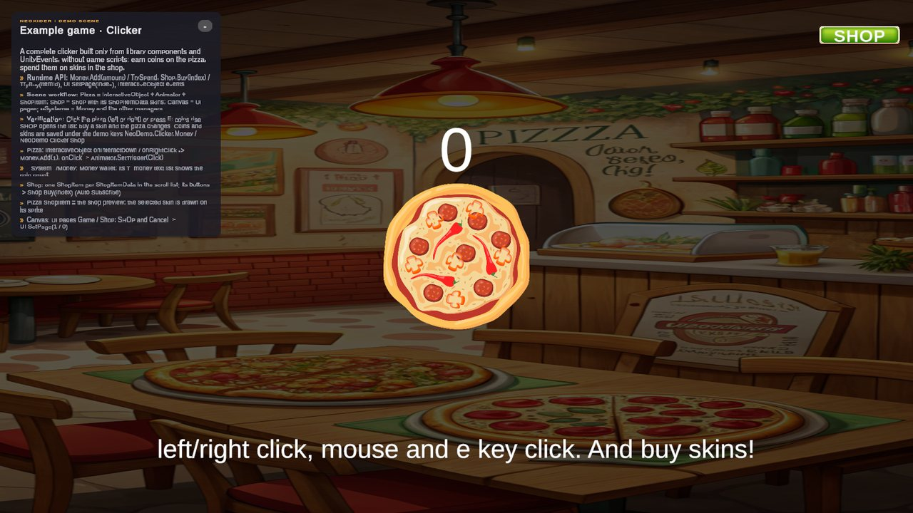
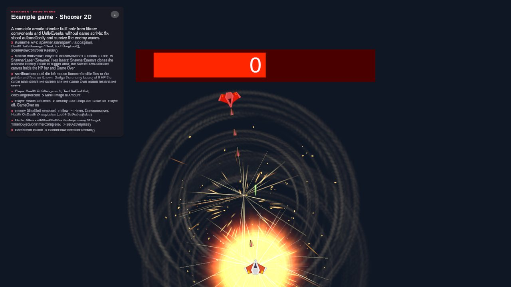
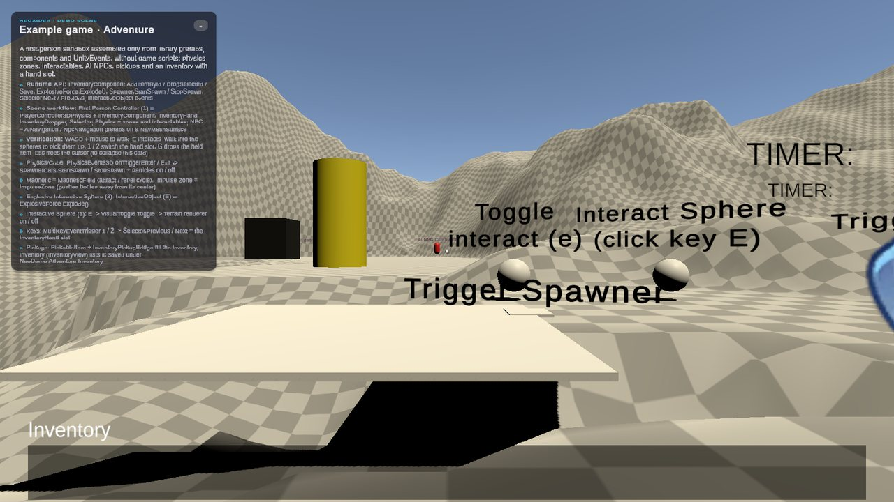
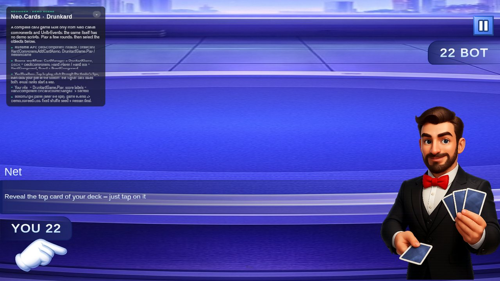

# Examples

**What it is:** step-by-step example guides plus a map of the C# entry points behind the Demo download. The demo scripts live in `Assets/NeoxiderDemos/Demo/Scripts` (assembly `Neo.Rpg.Demo`).

<!-- demo-shots:begin -->
<p align="center">   </p>

*Demo scenes: `Scenes/_ExampleGame/ClickerExample.unity`, `Scenes/_ExampleGame/Shooter2D.unity`, `Scenes/_ExampleGame/adventure.unity`, `Scenes/_ExampleGame/CardGame.unity`, in the Demo download (`Assets/NeoxiderDemos/Demo`). The scenes are saved with their UI and wiring, so you can inspect them without entering Play Mode.*
<!-- demo-shots:end -->

**Contents:**

| Page / section | What it covers |
|---|---|
| [Anomaly Game](./AnomalyGame.md) | Build an anomaly-survival game from `TimerObject`, `Selector`, `NeoCondition` and `InteractiveObject` without code. |
| [Demo sample scripts](#demo-sample-scripts) | Which runtime APIs each sample controller uses. |
| [C# configuration](#c-configuration) | Driving sample controllers from code. |
| [Owned resources](#owned-resources) | What the sample code creates and releases. |
| [Verification](#verification) | Demo tests and input requirements. |

**Navigation:** [← Docs](../README.md) · [Sample scenes](../Samples.md)

---

## Demo sample scripts

The Demo download imports into `Assets/NeoxiderDemos/Demo` and brings its `Neo.Rpg.Demo` runtime assembly.
`Neo.Rpg.Demo` contains examples for several modules and
references Mirror as well as the RPG compatibility modules.

Every demo scene is saved with its UI and wiring, so the controllers
below only hold serialized references and public methods that persistent UnityEvent listeners call; they
build no UI at runtime. Game rules stay in the runtime modules. For new combat code, start with
[Abilities](../Abilities/README.md); the RPG examples maintain existing scenes. How the scenes are built and
rebuilt is described in [Sample scenes](../Samples.md#how-demo-scenes-are-made).

| Example | Runtime entry points | Scene workflow |
| --- | --- | --- |
| Condition | `Health.TakeDamage`, `Health.Heal`, `ScoreManager.Add`, `NeoCondition.Evaluate` | `NeoCondition.OnResult` switches the lamps, banners and LOW HP badge through `GameObject.SetActive`. `ConditionDemoUI` provides the damage/heal/score actions, `EvaluateInCode()` (the C# path) and `SetPaused(bool)`. |
| Match3 | `FieldGenerator`, `Match3BoardService`, `GridSystemMatch3DemoUI` | Assign services or call the board view's `Configure`. A live view reconnects when configured with another field and rebuilds when the field is regenerated. |
| TicTacToe | `TicTacToeBoardService.TryMakeMove`, `ResetBoard`, `WinLineLength`, `WinningLine` | Assign the field, board and camera to the view; use the UI to change blockers, test paths and switch to the 5×5 four-in-a-row mode. `Rebuild` replaces the generated cells. |
| Dice Merge | `DiceBoardService`, `DiceMergeDemoController.RestartDemo`, `TryPlaceCurrentPiece`, `ShowHint` | Drag a single die or pair from the tray, tap to rotate, ask for a placement hint and restart after game over. |
| RPG | `RpgCharacter`, `RpgCombatDemoController`, `RpgWorldHealthBars` | Assign combatants and camera explicitly. Health bars use the assigned camera, hide when disabled, and release their generated views when destroyed. |
| Survivor | No game scripts: `Spawner`, `Follow`, `MagneticField`, `Loot`, `LevelComponent`, `ChanceSystemBehaviour`, `AbilityNoCodeAction`, `SceneFlowController` | The scene is wired from library components and persistent UnityEvents; unit templates, abilities and modifiers are Neo.Abilities assets. The sample reuses Abilities and PoolManager. |
| Module controllers | `<Module>DemoController` (Audio, Save, Settings, Level, Quest, StateMachine, Parallax, Network, Shop, NPC, Inventory, Light, Selector, ...) | Serialized references to the authored objects plus public listener targets; they log calls and refresh labels from module events. |
| Animation Fly | `AnimationFly.Play`, `AnimationFlyDemoController` | Try world, canvas and screen origins, pooling, motion presets, reward callbacks and the tuning sliders; the service, targets and sliders are saved in the scene. |

## C# configuration

Use the same typed package APIs as the sample buttons; Inspector/NoCode wiring is optional. In an
imported sample, the Condition controller also exposes an amount configuration method:

```csharp
using Neo.Demo.Condition;

// References to Health, ScoreManager and panels are assigned on this scene component.
conditionUi.ConfigureAmounts(damagePerHit: 7, healPerClick: 3, pointsPerClick: 11);
conditionUi.DealDamage();
conditionUi.HealPlayer();
conditionUi.AddScore();
conditionUi.EvaluateInCode();
```

`ConfigureAmounts` clamps negative amounts to zero. Existing scenes retain the defaults of 25 damage,
10 healing and 25 points.

`DiceMergeDemoView.Configure` accepts optional art references. A null sprite, cell prefab, die prefab or
sprite array keeps the corresponding authored reference. With no die prefab, the view creates simple
visible dice using `DiceDieView` and a numeric label. Its existing three-argument `Initialize` API is
retained; the overload with `showValueLabel` can explicitly request a number when no pip sprite exists.
Call `Configure` with both services before `RestartDemo`; an unwired controller reports
`GameOver == true` and `CurrentPiece == null`. Disabling and re-enabling a view refreshes the current board
and tray. Match3 and Dice views disconnect their previous event sources when reconfigured.

## Owned resources

The shipped scenes contain no runtime-generated UI, sprites or materials: everything is saved in the
scene. The controllers therefore only release what they borrow:

- The Level controller accepts unset `LevelManager` event fields: it subscribes only to existing events and
  never creates or replaces the borrowed events or the authored `LevelComponent`.
- `QuestDemoController` creates session-only fallback quests only when its scene was not built, and unregisters
  exactly those configs through `QuestManager.UnregisterQuest(expected)` before destroying them. Saved quest
  state, resource-loaded configs and a replacement config registered under the same ID remain intact; use the
  demo's reset actions when replaying it.
- The Survivor demo pools its enemies (`Spawner`) and XP orbs (`Loot` with **Use Object Pool**); a scene reload
  (**Play again**) starts from fresh pools.

The obsolete runtime frame `NeoDemoShell.Build(title, accent, owner)` still works for your own older demo
controllers. It parents the frame under the given owner and returns a `Context`: call `SetVisible` when
the controller is enabled or disabled and `Dispose` when it is removed. Disposal is idempotent and destroys
only the frame's own Canvas, gradient Sprite and Texture2D; shared cameras, EventSystems and sprites stay
usable. New demos should save their UI in the scene instead.

Русский: демо-сцены не создают UI и спрайты во время игры — всё сохранено в сцене. Контроллеры
освобождают только своё: Level не подменяет события `LevelManager`, Quest снимает с регистрации только
собственные запасные квесты (сохранённый прогресс остаётся), Survivor завершает пулы по точным ссылкам на
свои шаблоны. Устаревший `NeoDemoShell` владеет только созданными им Canvas и градиентом.

## Verification

The package's demo tests find the demo assemblies at runtime and skip when the Demo download is not imported; the list is in
[Testing](../Testing.md#sample-demo-and-packaging-tests). The grid demos read the pointer through `MouseInputCompat` and the Survivor player reads
movement through `MoveInputCompat`, so both work with the Input System only. The Character Movement Fundamentals
example scenes need **Active Input Handling** set to **Both**.
