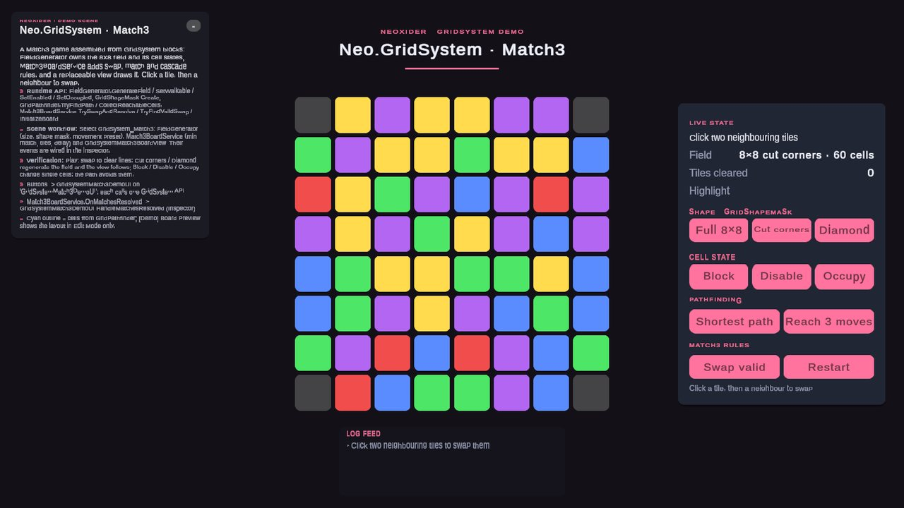
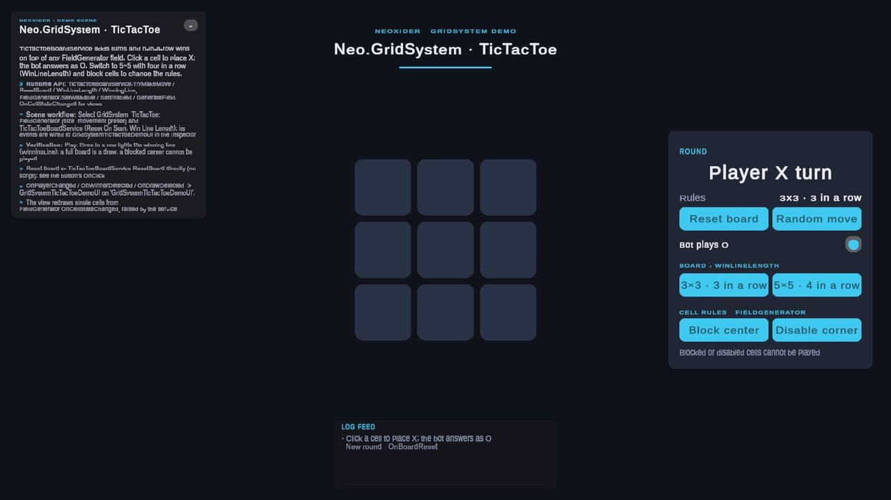
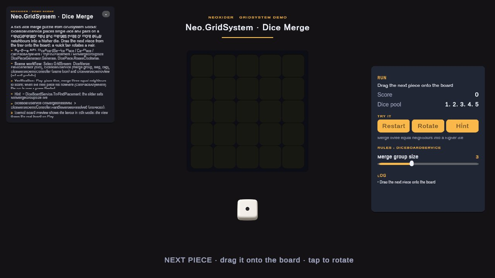

# GridSystem module

**What it is:** the base constructor module for grid-based games and tools (`Scripts/GridSystem/`, assemblies `Neo.GridSystem` and `Neo.GridSystem.Dice`). It separates the generic field core (`FieldGenerator`: shape, cells, coordinates, state) from optional rule layers, so the same grid can power Match3, TicTacToe and n-in-a-row, 2048-like games, Dice merge, tactical boards, inventory grids, puzzle fields and custom board games. Views are replaceable; every rule layer is usable from plain C#.

<!-- demo-shots:begin -->
<p align="center">  </p>

*Demo scenes: `Scenes/GridSystem/GridSystemMatch3Demo.unity`, `Scenes/GridSystem/GridSystemTicTacToeDemo.unity`, `Scenes/GridSystem/GridSystemDiceMergeDemo.unity`, in the **Demo Scenes** sample (Package Manager > NeoxiderTools > Samples). The scenes are saved with their UI and wiring, so you can inspect them without entering Play Mode.*
<!-- demo-shots:end -->

**Contents:**

| Page | Covers |
|------|--------|
| [FieldGenerator](./FieldGenerator.md) | Field core: generation, shape, cell state, conversion, placement, movement presets. |
| [GridPathfinder](./GridPathfinder.md) | BFS paths and reachability (movement ranges, flood fill). |
| [GridPlacementService](./GridPlacementService.md), [GridPlacementEntry](./GridPlacementEntry.md), [GridPlacementResult](./GridPlacementResult.md) | Rule-driven multi-cell placement. |
| [GridSlotAllocator](./GridSlotAllocator.md) | Ordered one-cell slots for benches, rows and autobattler boards. |
| [GridShapeMask](./GridShapeMask.md) | Reusable shape masks (asset or code-built). |
| [GridGameBuilder](./GridGameBuilder.md) | Inspector helper that assembles selected modules. |
| [GridCellMarker](./GridCellMarker.md) | Binds a scene object to a cell for clicks and drag/drop. |
| [FieldSpawner](./FieldSpawner.md), [FieldObjectSpawner](./FieldObjectSpawner.md) | Object placement on cells, occupancy tracking, pooling hand-off. |
| [FieldDebugDrawer](./FieldDebugDrawer.md) | Gizmos diagnostics. |
| [InternalTypes](./InternalTypes.md) | Data and helper types. |
| [Dice](./Dice/README.md) | Dice placement and merge layer. |
| [Generic Merge](../Merge/README.md) | `Neo.Merge` connected-group engine and the `GridMergeResolver` adapter. |
| [SlidingMerge](./SlidingMerge/SlidingMergeBoardService.md) | 2048, Threes, block-merge, drop-and-merge. |
| [Match3](./Match3/Match3BoardService.md) | Swap/match/resolve/refill. |
| [TicTacToe](./TicTacToe/TicTacToeBoardService.md) | Turn-based n-in-a-row boards. |

**How to work with it:**
1. Add `GridGameBuilder` to a GameObject and select features, for example `DebugDrawer + SlidingMerge` for a 2048-like game.
2. Configure `FieldGenerator.Config`: `Size`, `GridType`, `MovementPreset`, origin and shape overrides.
3. Press `Ensure Grid Components` or enter Play Mode.
4. Connect your own view/UI to `FieldGenerator.OnCellStateChanged` and the selected gameplay service events. `Match3BoardService` raises no per-cell notifications; drive Match3 views from `OnBoardChanged` / `OnResolvePhase`.

---

## Runtime C# API

Reference the `Neo.GridSystem` assembly from your own asmdef. Use explicit component references for multiple boards; `FieldGenerator.I` refers only to the latest initialized generator.

```csharp
using System.Collections.Generic;
using Neo.GridSystem;
using UnityEngine;

FieldGenerator field = GetComponent<FieldGenerator>();
field.GenerateField(new FieldGeneratorConfig(new Vector3Int(8, 8, 1), MovementRule.EightDirections2D));

GridPlacementService placement = new GridPlacementService(field);
GridPlacementResult placed = placement.Place(GridPlacementRequest.Single(Vector3Int.zero, contentId: 7));

List<FieldCell> path = new List<FieldCell>();
GridPathRequest request = new GridPathRequest { Start = Vector3Int.zero, End = new Vector3Int(7, 7, 0), IgnoreOccupied = true };
bool found = GridPathfinder.TryFindPath(field, request, path, out NoPathReason reason);
```

`Config.Size` describes the next generation; `GeneratedSize` describes the current cells. C# callers must call `GenerateField()` to apply a new size. Cell lookup, slot indices, world anchoring, gameplay scans and Gizmos use the generated dimensions while a resize is pending.

Placement rejects duplicate target coordinates and validates the complete footprint before writing. Anchor-plus-offset arithmetic is widened on all three axes before range and board-bound checks; invalid values cannot wrap onto a valid cell. Valid negative offsets remain supported. Placement, `GridMergeResolver`, `SlidingMergeResolver` and `TicTacToeBoardService` notifications run after the complete operation has committed, so observers read the final board. `Notify = false` / `NotifyOnContentChanged = false` let a caller publish its own update after additional state changes.

`GridMergeResolver.Resolve(field, request)` scans enabled cells by default. Set `RequireEnabled = false` to include disabled cells when `Seeds` is null; set `RequireWalkable = false` as well if those cells are not walkable. `Mutate = false` returns a merge preview without writing cell content or raising change notifications. Occupancy remains caller-owned in this resolver.

`GridMergeRequest.Increment(..., step)` saturates the result at `int.MinValue` / `int.MaxValue`. The resolver's default calculator uses the same policy for `content + 1`. Successful groups still clear their non-result cells, including when saturation retains the source value. A custom `GetMergedContent` delegate keeps its own numeric policy; the optional Dice layer retains its configured upper cap.

`FieldObjectSpawner` keeps surviving objects bound to their original cell instances when the field is regenerated. Removing a detached object retires its metadata without freeing a new occupant at the same coordinate. `Unregister` hands an object to your pool without destroying it, and `PruneDestroyedObjects` frees cells of objects destroyed elsewhere. See [FieldObjectSpawner](FieldObjectSpawner.md).

## Performance

Hot paths are allocation-free on warm calls: `GridPathfinder.TryFindPath` / `CollectReachableCells`, `FieldGenerator.CollectNeighbors`, `CanPlaceContentFootprint`, `DiceBoard.CanPlace` / `CanPlaceAnywhere` and in-cell `GetNearestCellFromWorld` picking. Match3 swap search, swap validation, the resolve cascade and the no-moves shuffle reuse the service's buffers (`Match3MatchFinder.HasMatch` / `CollectMatchedCells` are the allocation-free match queries); sliding-merge previews (`SlidingMergeResolver.CanSlide` / `HasAnyMove`) do not allocate, a slide allocates only its result and steps, and the merge engine creates its search collections once per resolve, not per seed. Use these APIs for per-frame previews, AI ticks and game-over checks; the list-returning convenience overloads (`GetNeighbors`, `FindPath`) allocate their results.

## Scene and Inspector workflow

Use `GridGameBuilder.EnsureConfigured()` to add selected wrappers. Field generation, shape and origin buttons support authoring in Edit Mode; movement is chosen with `MovementPreset`. Match3 and SlidingMerge gameplay buttons are available in Play Mode. Their public methods remain callable from C#; UnityEvents expose results to scene views and UI.

Use one gameplay service per board unless your own composition coordinates its content and occupancy conventions. Spawners accept scene prefab references, while `GridShapeMask` assets contain only reusable coordinates and mask settings.

## Samples

The Demo sample ships hidden in `Samples~`; import it via Package Manager to get the scenes.

The release root is `Assets/Neoxider/Samples~`; active sample development uses `Assets/Neoxider/Samples`. Package Manager imports copies into `Assets/Samples/NeoxiderTools/<version>/<sample name>`.

GridSystem scenes live in `Scenes/GridSystem/`; controller and view scripts live in `Scripts/GridSystem/`. Every scene is saved fully wired: open it and select the objects below to see the configuration and the UnityEvent wiring without entering Play Mode. Nothing is assembled at Play start.

| Scene | What it shows | Select in the Hierarchy |
|---|---|---|
| `GridSystemMatch3Demo` | 8×8 Match3 on a cut-corners `GridShapeMask`; buttons regenerate the shape (full, cut corners, code-built diamond), block/disable/occupy single cells, highlight a `GridPathfinder.TryFindPath` path or a `CollectReachableCells` area, swap and restart. Click two neighbouring tiles to swap. | `GridSystem_Match3` (FieldGenerator, Match3BoardService, view); `GridSystemMatch3DemoUI` (button targets). `Match3BoardService.OnMatchesResolved` and `FieldGenerator.OnFieldGenerated` call the controller through saved listeners. |
| `GridSystemTicTacToeDemo` | X against a bot playing O, 3×3 or 5×5 with four in a row (`WinLineLength`), the winning line highlighted from `WinningLine`, blocked and disabled cells. | `GridSystem_TicTacToe`; the Reset button calls `TicTacToeBoardService.ResetBoard` directly, and `OnPlayerChanged` / `OnWinnerDetected` / `OnDrawDetected` drive `GridSystemTicTacToeDemoUI`. |
| `GridSystemDiceMergeDemo` | 5×5 dice merge: drag the next piece from the tray, tap to rotate, merge three equal neighbours, Hint (`TryFindPlacement`), live `MinMergeGroupSize`, game over through `CanPlaceAnywhere`. | `GridSystem_DiceMerge` (FieldGenerator, DiceBoardService, DiceMergeDemoController, DiceMergeDemoView); `OnMergesResolved` feeds the log. |

Board tiles are drawn by the demo views at runtime from the live field; the `[Demo] Board Preview` object only shows the same layout in Edit Mode and hides itself on Play. The scenes are authored by editor builders (`Demo/Editor/Builders/GridSystem`); rebuild one with **Neoxider > Demo > Rebuild Active Demo Scene**.
