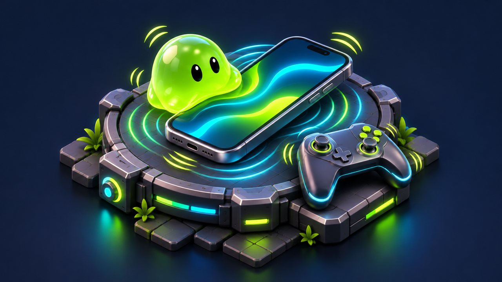

# Haptics

<!-- module-art:begin -->
<p align="center"></p>
<!-- module-art:end -->

**What it is:** one static entry point for device vibration with named feels (`Selection`, `Light`,
`Medium`, `Heavy`, `Soft`, `Rigid`, `Success`, `Warning`, `Error`), a master switch you bind to your
settings, and a repeat throttle so fast input does not turn into one long buzz. File:
`Scripts/Haptics/Haptics.cs`, namespace `Neo.Haptics`, assembly `Neo.Haptics`.

**How to use:**
1. Bind the setting once: `Haptics.EnabledProvider = () => settings.VibrationOn;`.
2. Call `Haptics.Play(HapticType.Light)` (or another feel) from gameplay or a scene-owned UnityEvent method.
3. Optionally install the `com.tsyk5.mobilehapticfeedback` backend for richer native feedback.

---

[Documentation index](../README.md) · [C# API](#api) · [Scene workflow](#scene--unityevent-workflow)

Code in a custom assembly definition must reference `Neo.Haptics` to use this API.

## Backends

| Setup | iOS | Android | Editor / desktop |
|-------|-----|---------|------------------|
| With `com.tsyk5.mobilehapticfeedback` (recommended) | Core Haptics / UIKit feedback | VibrationEffect, amplitude-aware | silent |
| Without it: `Play(HapticType)` | `Handheld.Vibrate` for `Heavy`/`Success`/`Warning`/`Error` only | same | silent |
| Without it: `Play(intensity, sharpness, seconds)`, `PlayPattern(...)` | silent (`Stop()` / `Prepare()` are no-ops) | same | silent |

Without the backend, `Play(intensity, sharpness, seconds)` and `PlayPattern(...)` never vibrate, yet they
still pass the gates and raise `Played` (as `Medium` and `Heavy` respectively), so they also share the
repeat throttle with `Play(HapticType.Medium)` / `Play(HapticType.Heavy)`. Install the backend if the
game relies on custom shapes or waveforms.

Native code is guarded by the version define `NEO_MOBILE_HAPTICS`. `Neo.Haptics.asmdef` declares it
for `com.tsyk5.mobilehapticfeedback` starting at `0.5.0` and references the backend assembly
`tsyk5.MobileHapticFeedback`. The define selects the code path; the assembly reference resolves
backend types when that path is compiled. Keep these settings together when integrating the backend.

Verify compilation both with and without the backend on your Unity version: the conditional fallback
alone does not establish how a missing named assembly reference is resolved. Native compilation and
device playback also require their own checks; observing `Played` in the editor proves neither.

Install the recommended backend:

```json
"com.tsyk5.mobilehapticfeedback": "https://github.com/tsyk5/MobileHapticFeedback.git?path=package/com.tsyk5.mobilehapticfeedback"
```

## Code usage

```csharp
using Neo.Haptics;

// once, where your settings live
Haptics.EnabledProvider = () => settings.VibrationOn;

Haptics.Play(HapticType.Selection); // finger picked something up
Haptics.Play(HapticType.Light);     // small confirmed action
Haptics.Play(HapticType.Heavy);     // level won
Haptics.Play(HapticType.Success);   // reward granted

Haptics.Play(0.6f, 0.9f, 0.03f);    // custom shape (intensity, sharpness, seconds)
Haptics.PlayPattern(new[] { 0.05f, 0.08f, 0.12f }, new[] { 0.4f, 0.7f, 1f });
Haptics.Prepare();                  // warm the engine before a burst (iOS)
```

## API

| Member | Description |
|--------|-------------|
| `Enabled` | Master switch, on by default. Combined with `EnabledProvider`. |
| `EnabledProvider` | Optional live source of truth, e.g. the Vibration setting. |
| `MinRepeatInterval` | Each type has its own repeat interval in unscaled seconds (default `0.035`); interleaving other types does not reset it. Set `0` to allow immediate repeats. |
| `IsSupported` | Always false in the editor. With the optional backend, reports its capability check; without it, reports iOS/Android player platform availability without probing the motor. |
| `Played` | Raised for every pulse that passed the gates, on every platform - tests and debug overlays watch it. Each observer is isolated: its exception is logged, not propagated, and later observers still run. |
| `ResetThrottle()` | Clears every type's repeat history (between test cases, after a scene reset). |
| `Play(HapticType)` / `Play(intensity, sharpness, seconds)` / `PlayPattern(...)` / `Stop()` / `Prepare()` | See above. |

Static state (`Enabled`, `EnabledProvider`, `MinRepeatInterval`, `Played` subscribers, the throttle) is
reset at `SubsystemRegistration`, so Enter Play Mode with domain reload disabled starts clean: bind
`EnabledProvider` and subscribe to `Played` from scene code (`Awake` / `Start`), not from edit-time code.

Use the API on Unity's main thread. Detach scene-owned `EnabledProvider` delegates and `Played`
listeners when their owner is destroyed. Disabling haptics prevents new requests; call `Stop()` as
well if a pattern already playing should end immediately.

## Input and observation contracts

- `Play(HapticType)` ignores undefined enum values.
- Custom pulses ignore any `NaN` or infinity. Finite intensity/sharpness are clamped to `0..1` and
  finite negative duration is clamped to zero by the native path, preserving the existing API.
- Patterns pair up to the shorter array. Null arrays, zero paired segments, or any `NaN`/infinity in
  a paired segment reject the whole request. Unpaired tail elements are ignored. Supply nonnegative
  durations in seconds and amplitudes in `0..1`.
- Rejected inputs neither raise `Played` nor consume or reset any repeat history.
- Accepted custom pulses share `Medium` history; accepted patterns share `Heavy` history. For example,
  `Selection`, `Light`, `Selection` inside one repeat interval raises only `Selection`, `Light`.
- `Played` observes accepted requests, including on silent platforms; it does not confirm physical
  playback. It runs synchronously before native dispatch. Every observer is invoked on its own: an
  exception is logged through the `NeoDiagnostics` error gate and neither cancels the native pulse, nor
  skips the observers subscribed after the faulty one, nor reaches the caller. Handlers should return
  promptly. A subscriber added or removed inside a handler takes effect from the next pulse.
- The gates and the observer dispatch do not allocate: the repeat history is a fixed table indexed by
  `HapticType`, and the observer list is copied once per subscription change, not per pulse. Every
  subscribe or unsubscribe drops that cached copy at once, so an unsubscribed observer is not kept alive
  until the next pulse.
- Pattern arrays remain caller-owned. Keep their contents unchanged until `PlayPattern` returns,
  including inside `Played` handlers: native segment construction reads the paired elements after
  notification. The current API does not snapshot those arrays before notifying observers.

## Scene / UnityEvent workflow

This module is a static C# API and has no built-in scene or NoCode component. Expose the calls you
need on a scene-owned component, then connect UI events to those public methods:

```csharp
using Neo.Haptics;
using UnityEngine;

public sealed class ConfirmHaptics : MonoBehaviour
{
    public void PlayConfirm() => Haptics.Play(HapticType.Light);
    public void SetEnabled(bool enabled) => Haptics.Enabled = enabled;
    public void StopFeedback() => Haptics.Stop();
}
```

Wire `Button.onClick` to `PlayConfirm`, and `Toggle.onValueChanged(bool)` to the dynamic `SetEnabled`
method. If `EnabledProvider` is also bound, both the master switch and provider must allow playback.
Use `StopFeedback` when leaving a screen that owns a running pattern. No scene references are stored
in ScriptableObjects.

## Compatibility in 11.0.0

Public signatures and `HapticType` numeric values are unchanged. Each type now retains its repeat
history across intervening types, so alternating types cannot bypass the interval. Empty patterns,
undefined enum values and non-finite pulse/pattern parameters are rejected before `Played` or any
repeat-history mutation. Existing finite scalar clamping, shorter-array pairing and native mappings
are preserved. Scene bindings continue to call the same public methods.

## Choosing a feel

- **Selection** for continuous or repeated contact (grab, drag step, picker tick). It is the only
  type that stays pleasant at a high rate.
- **Light / Medium** for confirmations, **Heavy** for the one big moment of a screen.
- **Success / Warning / Error** carry meaning; use them for outcomes, not for decoration.
