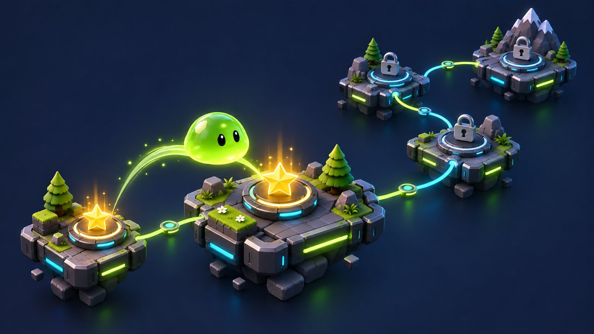
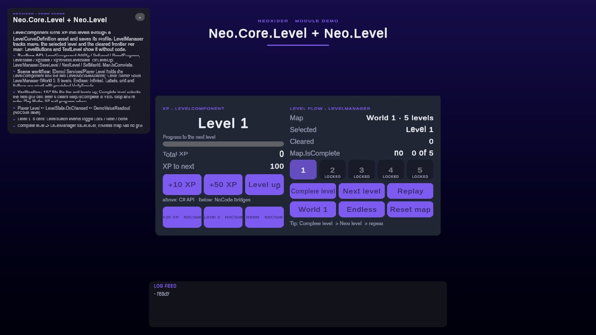

# Level module

<!-- module-art:begin -->
<p align="center"></p>
<!-- module-art:end -->

**What it is:** level selection and per-map progress (`LevelManager`, `Map`), level-select UI (`LevelButton`, `TextLevel`) and scene loading with a progress screen (`SceneFlowController`). Scripts in `Scripts/Level/`, namespace `Neo.Level`.

<!-- demo-shots:begin -->
<p align="center"></p>

*Demo scene: `Scenes/Level/LevelFlowDemo.unity`, in the Demo download (`Assets/NeoxiderDemos/Demo`). The scenes are saved with their UI and wiring, so you can inspect them without entering Play Mode.*
<!-- demo-shots:end -->

**Navigation:** [← Docs](../README.md)

**How to work with it:**
1. Add `LevelManager`, configure its maps and save prefix.
2. Optionally add `LevelButton` children for the map UI and `TextLevel` labels.
3. After a won level call `SaveLevel()` and `SetLastLevel()`; load scenes with `SceneFlowController`.

**Contents:** see [Component documentation](#component-documentation) below.

---

## Runtime API

`LevelManager` manages zero-based level selection and a separate progress frontier per `Map`. `Map.level` / `MaxLevel` identify the next uncompleted level; they are also the number of recorded completions. In a looping map, selection wraps while progress keeps increasing.

```csharp
using Neo.Level;

LevelManager levels = LevelManager.I;
levels.SetLastLevel();              // Select the saved frontier (wrapped for looping maps).
levels.SetLevel(2);                 // Select directly from ordinary C#.
// After successful gameplay:
levels.SaveLevel();                 // Record completion only at the current frontier.
levels.SetLastLevel();              // Select the newly unlocked level.
// "New game" for one map (or ResetAllProgress() for every map). The reset returns the frontier to 0
// but keeps the selected level, so select level 0 again:
levels.TryResetProgress(levels.MapId);
levels.SetLastLevel();
```

Reference `Neo.Level` from a custom assembly. Level selection does not load a Unity scene; use `OnChangeLevel` to drive your level view or call `SceneFlowController` explicitly. The manager can run without level buttons. Empty map slots are skipped during initialization and map discovery, and cannot be selected.

## Scene and Inspector workflow

Configure maps and the save prefix on `LevelManager`; optional `LevelButton` children provide the map UI and `TextLevel` displays current or maximum progress. Buttons use visual IDs **0 = locked, 1 = current frontier, 2 = passed**. Inspector UnityEvents call the same public methods shown above. `SceneFlowController` independently handles loading, progress, manual activation, pause, and quit.

`LevelButton` labels widen their one-based addition, and `TextLevel` integer animations finish with exact digits through `SetText`; intermediate text and `currentNum` remain approximate floats. See [TextLevel](TextLevel.md) for lifecycle and offset details.

## Demo scene

`Assets/NeoxiderDemos/Demo/Scenes/Level/LevelFlowDemo.unity` (Demo download). The `Level Demo` `LevelManager` has a finite **World 1** map (5 levels) and an infinite **Endless** map under the save key `Neo.Demo.LevelFlow`. Look at the five `LevelButton`s, the two `TextLevel` labels and the buttons that call `SaveLevel`, `NextLevel`, `Restart` and `SetMapId` through persistent UnityEvents. The same scene drives a `Neo.Core.Level` `LevelComponent`. Everything is saved in the scene.

## Component documentation

| Page | Description |
|------|-------------|
| [LevelManager](./LevelManager.md) | Level selection and map progress |
| [LevelButton](./LevelButton.md) | UI button for level selection |
| [TextLevel](./TextLevel.md) | UI text bound to current or max level |
| [Map](./Map.md) | Serialized map progress entry |
| [SceneFlowController](./SceneFlowController.md) | Scene transition control |

## See also

- [Save](../Save/README.md)
- [UI](../UI/README.md)
