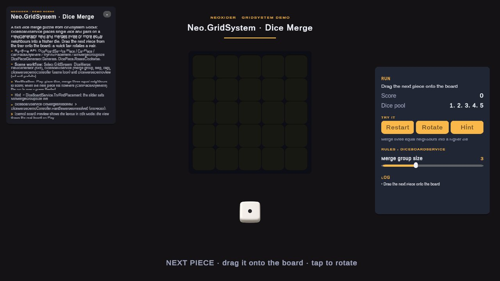

# Merge

<!-- module-art:begin -->
<p align="center"></p>
<!-- module-art:end -->

**What it is:** `Neo.Merge` (`Scripts/Merge/`, assembly `Neo.Merge`, no Unity engine dependency) is a generic pure C# merge engine for connected groups, not tied to scenes, grids or inventories. It finds equivalent connected items, chooses the result item, computes the new value, clears the rest and can cascade from the result.

<!-- demo-shots:begin -->
<p align="center"></p>

*Demo scene: `Scenes/GridSystem/GridSystemDiceMergeDemo.unity`, in the Demo download (`Assets/NeoxiderDemos/Demo`). The scenes are saved with their UI and wiring, so you can inspect them without entering Play Mode.*
<!-- demo-shots:end -->

**How to use:**
1. Build a `MergeRequest<TItem, TValue>` with your items, value accessors and a neighbor callback.
2. Call `MergeResolver.Resolve(request)` with `Mutate = false` for a preview or `true` to apply.
3. Read `MergeResult.Groups` / `ChangedItems` to update views. For `FieldGenerator` boards use `GridMergeResolver` instead of writing the adapter yourself.

**Contents:** [runtime API](#runtime-api) (request and graph contracts, dry runs and cascades, performance,
[C# example](#c-example)), [null result items](#null-result-items),
[scene and NoCode workflow](#scene-and-nocode-workflow) and [examples](#examples).

**Navigation:** [← Docs](../README.md)

---

## Runtime API

- `MergeRequest<TItem, TValue>` defines items, seeds, value access, neighbors, match rules, result selection, merged value, cascade mode, `MaxCascadeIterations`, and mutate/dry-run mode.
- `MergeResolver.Resolve(request)` returns `MergeResult<TItem, TValue>`.
- `MergeResult` contains resolved groups, changed items, and `CascadeLimitReached` (set when a cascade hit the safety limit).
- For grids, `Neo.GridSystem.Merge.GridMergeRequest.Increment(...)` is a ready-made preset for the common "merge equal content into content+step at the seed, cascade from result" rule. Its integer addition saturates at `int.MinValue` and `int.MaxValue`; custom result calculators define their own numeric policy.

Consumers with their own asmdef reference `Neo.Merge` and use the `Neo.Merge` namespace. This assembly has no Unity engine or other module dependency. Grid adapters live in the separate `Neo.GridSystem` assembly and `Neo.GridSystem.Merge` namespace; dice APIs live in `Neo.GridSystem.Dice` and also use GridSystem. These integrations are optional for the generic engine.

### Request and graph contracts

`Items`, `GetValue`, and `GetNeighbors` are required. `SetValue` is required only when `Mutate` is true. A null request throws `ArgumentNullException`; missing required fields throw `ArgumentException`.

`Seeds` controls where evaluation starts; when omitted, `Items` supplies the seeds. `Items` is not a graph boundary: neighbors and explicitly selected result items may lie outside it. Callbacks must support every item they expose. Null seeds and neighbors are ignored, and a null neighbor enumerable means no outgoing edges. Traversal follows the supplied outgoing edges; return both directions when connections are undirected.

`CanUseItem` filters items before matching. `IsEmptyValue` filters their current simulated values, including values cleared by earlier groups. Supply an empty predicate explicitly: omitting it makes every value eligible, including `EmptyValue`. `AreValuesEqual` defaults to `EqualityComparer<TValue>.Default.Equals`. Validation fills this default on the request and clamps `MinGroupSize` to at least 1.

`SelectResultItem` defaults to the current seed. It may choose an item outside the group, which receives the merged value while every group item is cleared. It must return a non-null item. A null result throws `InvalidOperationException` before the resolver calls `SetValue` for any item, including groups evaluated earlier in the request. An absent `GetMergedValue` preserves the source value at the result item.

Items use `EqualityComparer<TItem>.Default` for identity. Their equality and hash codes must remain stable during resolution. Keep callbacks free of mutations while evaluating groups; use `IsEmptyValue` and `AreValuesEqual` for value-dependent rules so they see the simulated values used by dry runs and cascades. Seed and neighbor enumeration order can affect group order and result selection. All supplied enumerables and reachable graphs must be finite.

### Dry runs, mutation, and cascades

`Mutate = false` simulates all groups and cascades without calling `SetValue`. The returned groups describe the simulation; `ChangedItems` lists each affected item once, including a result item outside its source group. These result collections belong to the caller.

With `Mutate = true`, evaluation still happens first. Once every seed succeeds, the resolver calls `SetValue` once per affected item with its final simulated value. Exceptions during evaluation prevent these writes. A throwing `SetValue` can leave partially applied changes; the resolver does not provide rollback or guarantee setter invocation order. Setter callbacks should not assume all other items already contain their final values.

`CascadeMode.None` resolves at most one group per seed. `FromResult` continues from each selected result item. `MaxCascadeIterations` defaults to 128 per seed occurrence; values below 1 allow one iteration. `CascadeLimitReached` is true only when another qualifying group remains after that limit. A cascade that finishes exactly at the limit leaves the flag false. Repeated seeds are evaluated again against the accumulated simulated state.

### Performance

One `Resolve` call allocates its search collections once and reuses them for every seed and cascade step; each search costs `O(group size x neighbors)`, also after a very large group. When `GetNeighbors` returns an `IReadOnlyList<TItem>` (a list or array), it is indexed instead of enumerated, so no enumerator is boxed per visited item. The resolver consumes each returned neighbor list before requesting the next one, so a callback may return the same reused buffer every time (as `GridMergeResolver` does). `SelectResultItem` receives the group list that is later reported as `MergeGroupResult.Items`.

### C# example

This example treats three inventory nodes as a fully connected graph:

```csharp
using System.Collections.Generic;
using Neo.Merge;

Dictionary<string, int> values = new Dictionary<string, int>
{
    ["A"] = 1,
    ["B"] = 1,
    ["C"] = 1
};

MergeRequest<string, int> request = new MergeRequest<string, int>
{
    Items = values.Keys,
    Seeds = new[] { "A" },
    GetValue = item => values[item],
    SetValue = (item, value) => values[item] = value,
    GetNeighbors = item => values.Keys,
    IsEmptyValue = value => value == 0,
    EmptyValue = 0,
    GetMergedValue = (value, count) => value + 1,
    MinGroupSize = 3,
    Mutate = false
};

MergeResult<string, int> preview = MergeResolver.Resolve(request);
// preview.Groups[0].ResultValue == 2; the source values are still 1.

request.Mutate = true;
MergeResult<string, int> applied = MergeResolver.Resolve(request);
// values["A"] == 2; values["B"] == 0; values["C"] == 0.
```

The second call recomputes the merge against the current source; it does not commit the earlier preview. Use a separate request for each concurrent resolution.

## Null result items

A `SelectResultItem` callback that returns null throws `InvalidOperationException`, and nothing in that call is written, including earlier successful groups and cascade iterations. A null callback (not a null result) still selects the seed, and value-type items such as integer `0` are valid.

## Scene and NoCode workflow

`Neo.Merge` contains no scene components, ScriptableObjects, or UnityEvent actions. Scene-facing code calls the same typed API and refreshes its own views from the result. For a grid scene, configure `FieldGenerator` and use the existing `GridMergeResolver` adapter; for dice placement, use `DiceBoardService`. Keep Inspector or UnityEvent wiring in those scene adapters and game components. The generic engine requires no specific view or NoCode chain.

## Examples

- Grid games: use `Neo.GridSystem.Merge.GridMergeResolver` to adapt `FieldGenerator` cells.
- Dice games: use `Neo.GridSystem.Dice.DiceBoardService` for dice placement and dice-specific merge rules.
- Custom systems: pass any graph/list/inventory nodes as `TItem` and provide a neighbor callback.

## See also

- [GridSystem](../GridSystem/README.md)
- [FieldGenerator setup and runtime API](../GridSystem/FieldGenerator.md)
- [Dice](../GridSystem/Dice/README.md)
- [DiceBoardService settings and UnityEvent workflow](../GridSystem/Dice/DiceBoardService.md)
