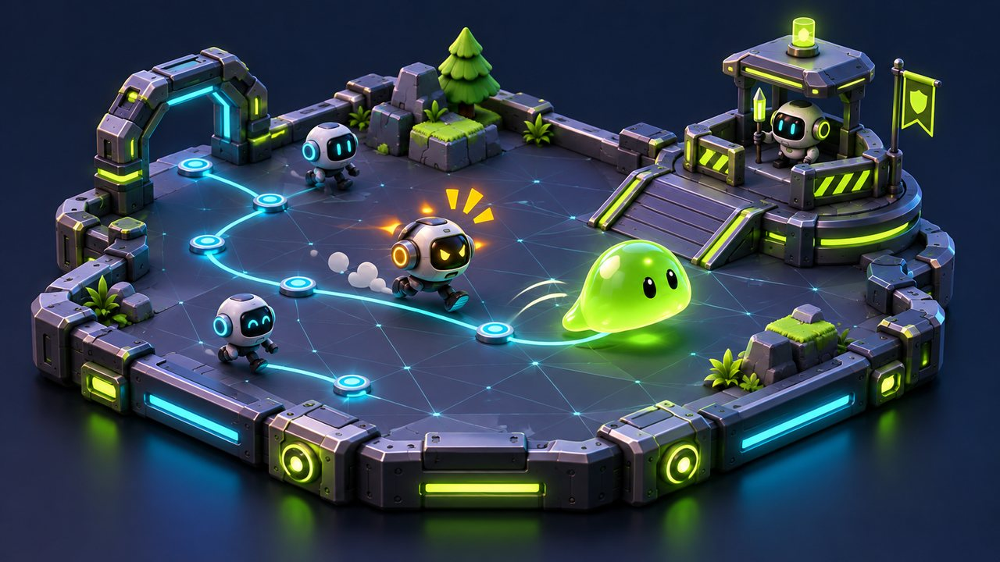
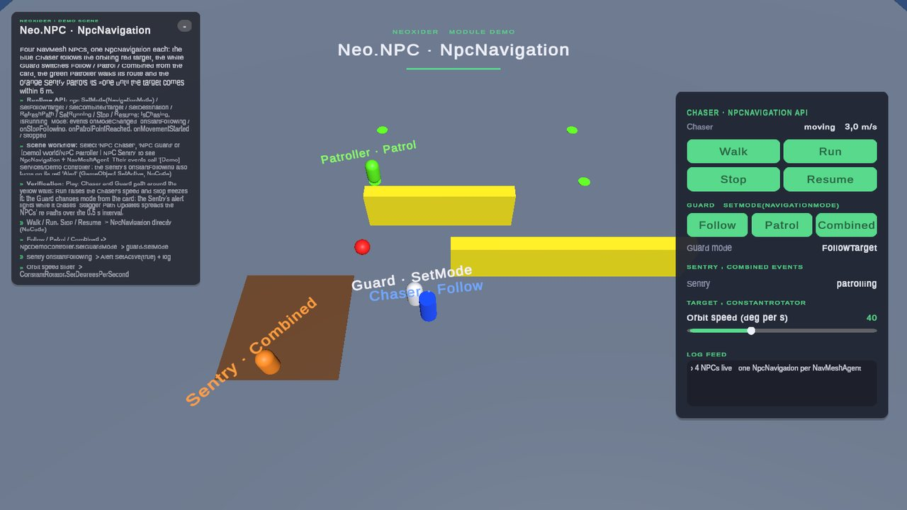

# NPC module

<!-- module-art:begin -->
<p align="center"></p>
<!-- module-art:end -->

**What it is:** NavMesh NPC navigation (follow / patrol / combined aggro), target binding, an animator driver and a
modular RPG combat brain. Scripts are in `Scripts/NPC/` (`Neo.NPC`, `Neo.NPC.Navigation`, `Neo.NPC.Combat`).

<!-- demo-shots:begin -->
<p align="center"></p>

*Demo scene: `Scenes/Ai/AiMoveExample.unity`, in the Demo download (`Assets/NeoxiderDemos/Demo`). The scenes are saved with their UI and wiring, so you can inspect them without entering Play Mode.*
<!-- demo-shots:end -->

**How to work with it:**
1. Add `NpcNavigation` to an object with a `NavMeshAgent` on a baked NavMesh.
2. Pick a mode (FollowTarget, Patrol, Combined) and assign the target or route, or add `NpcTargetFinder`.
3. For combat NPCs add the [recommended stack](#recommended-composition).

**Contents:** the per-component table below.

**Navigation:** [← Docs](../README.md)

---

## docs (per-component)

| Page | Description |
|------|-------------|
| [NPCNavigation](./Navigation/NPCNavigation.md) | Navigation, patrol, chase |
| [NpcTargetFinder](./NpcTargetFinder.md) | Auto-binds a scene target (by tag/name) to NpcNavigation |
| [NpcAnimatorDriver](./NpcAnimatorDriver.md) | Animator state sync with movement |
| [NpcRpgCombatBrain](./Combat/NpcRpgCombatBrain.md) | Modular auto-combat brain for melee/ranged NPCs |
| [NpcCombatPreset](./Combat/NpcCombatPreset.md) | Data preset for chase/hold/attack behavior |
| [NpcCombatScenarios](./Combat/NpcCombatScenarios.md) | Ready-made setup scenarios for melee/ranged/patrol combat NPCs |

## Recommended composition

For combat NPCs, the intended stack is:

- `NpcNavigation`
- `NpcAnimatorDriver`
- `RpgCharacter`
- `RpgTargetSelector`
- `RpgAttackController`
- `NpcRpgCombatBrain`
- `RpgAttackPreset` + `NpcCombatPreset`

This keeps enemies assembled from reusable components instead of custom one-off scripts.

## C# entry point

```csharp
using Neo.NPC;
using UnityEngine;

// navigation and player are explicit scene references supplied by the caller.
navigation.SetFollowTarget(player);
navigation.SetMode(NpcNavigation.NavigationMode.FollowTarget);
navigation.SetRunning(true);
navigation.Resume();
```

`SetFollowTarget`, `SetMode`, and `SetRunning` support configuration before the navigation component's
`Awake`; the selected behaviour starts on enable. Path requests need an initialized agent on a NavMesh.
`Stop`, `Resume`, and `IsActive` control movement explicitly; disabling navigation also stops its agent.
For an Inspector workflow, assign the target/route directly or add `NpcTargetFinder`, and connect the
navigation events to presentation. The C# methods remain available without UnityEvent chains.

The navigation cores are ordinary C# classes that adapt Unity transforms and NavMesh agents; they are
not engine-independent simulation classes. See [core contracts](./InternalTypes.md) for direct usage
and [navigation](./Navigation/NPCNavigation.md) for path/failure semantics.

## Crowds and per-frame cost

- A navigation tick does not allocate, on a settled path and on a tick that submits a new path; periodic re-paths are spread over `Path Update Interval` across NPCs
  (`Stagger Path Updates`, on by default) instead of all running in the same frame.
- A Combined chase toward an unreachable target is retried once per path interval, not every frame.
- `NpcRpgCombatBrain` re-applies navigation only when the chase target, mode or activity actually changed, so a
  sustained chase does not force a new path every decision tick.
- `NpcAnimatorDriver` checks the controller's parameters once per controller and skips missing ones instead of
  writing (and warning) every frame.

The RPG combat stack above is maintained for existing projects. New combat systems should use
`Neo.Abilities`; NPC navigation can be reused independently of the legacy combat brain.

## Demo scene

`Assets/NeoxiderDemos/Demo/Scenes/Ai/AiMoveExample.unity` shows
four NPCs on a baked NavMesh, each driven by one `NpcNavigation`:

| Object | Mode | What to look at |
|--------|------|-----------------|
| `NPC Chaser` (blue) | FollowTarget | Follows the orbiting red `target`; the card's Walk / Run / Stop / Resume buttons call `SetRunning`, `Stop` and `Resume` directly (NoCode persistent calls). |
| `NPC Guard` (white) | switched from the card | Follow (Trigger Distance 10 m), Patrol (the green route) or Combined; the buttons call `NpcDemoController.SetGuardMode` because a persistent UnityEvent cannot pass an enum. |
| `[Demo] World/NPC Patroller` (green) | Patrol | Walks `Patrol Route/Point 1..4`; `onPatrolPointReached` writes to the card's log. |
| `[Demo] World/NPC Sentry` (orange) | Combined | Patrols `Sentry Zone` and chases the target within 6 m; `onStartFollowing` / `onStopFollowing` toggle its red `Alert` with `GameObject.SetActive`. |

Everything is saved in the scene.

## See also

- [Tools/Move](../Tools/Move/README.md)
- [Animations](../Animations/README.md)
