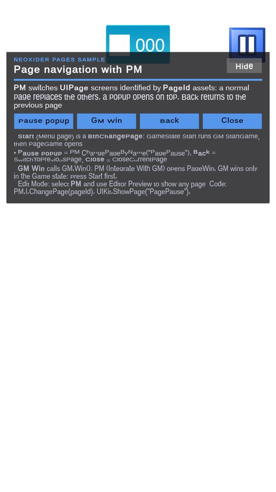

# NeoxiderPages module

**What it is:** `NeoxiderPages` is a sample module for screen/page navigation on top of Unity UI (namespace `Neo.Pages`, sample source `Samples~/NeoxiderPages`). It imports and runs on its own, without **DOTween**, **DOTween Pro** or the Demo Scenes sample.

<!-- demo-shots:begin -->
<p align="center"></p>

*Demo scene: `Demo/Scenes/UI.unity`, in the **NeoxiderPages** sample (Package Manager > NeoxiderTools > Samples). The scenes are saved with their UI and wiring, so you can inspect them without entering Play Mode.*
<!-- demo-shots:end -->

**Contents:**

| Page | What it covers |
|------|----------------|
| [PM](./PM.md) | Page manager: switching, popups, history, GM integration |
| [UIPage](./UIPage.md) | Page component: `PageId`, popup mode, exclusive-change rules |
| [PageId](./PageId.md) | ScriptableObject page identifier |
| [BtnChangePage](./BtnChangePage.md) | Button that opens, cancels or closes pages |
| [PageSubscriber](./PageSubscriber.md) | Opens Game/Win/Lose/End pages from game-state events |
| [FakeLoad](./FakeLoad.md) | Simulated loading progress for a loading page |
| [ToggleAudio](./ToggleAudio.md) | Music/effects toggle bound to `AMSettings` |

**Navigation:** [← Docs](../README.md) · [Sample scenes](../Samples.md)

---

Text-based examples additionally need the consuming project's official **TMP Essential Resources**
(Window → Text Mesh Pro → Import TMP Essential Resources). uGUI supplies the TMP API, while these
font/material/shader assets are imported separately. This resource prerequisite does not add a
DOTween dependency to Pages. See [sample setup](../Samples.md) for the full collection's prerequisites.

## Location

In the package the sample source lives in `Assets/Neoxider/Samples~/NeoxiderPages/` (or
`Assets/Neoxider/Samples/NeoxiderPages/` while samples are being developed). Importing it through
**Package Manager → NeoxiderTools → Samples → Import** copies it into the game project:

```text
Assets/Samples/NeoxiderTools/<version at import>/NeoxiderPages/
```

### Updating an imported copy

The imported copy is part of the game, not of the package: bumping the package version does **not**
update it. When a release fixes something in NeoxiderPages (for example 10.16.1, where the `PM` editor
page preview stopped switching pages during Play Mode), re-import the sample or copy the changed files.
The folder keeps the version it was first imported with, so to find out which fixes a project has,
compare the files with the package's `Samples~/NeoxiderPages` (ignore BOM and line endings) instead of
trusting the folder name.

## Demo scene

`NeoxiderPages/Demo/Scenes/UI.unity` is a portrait scene (pages on a 1080x1920 canvas that matches the screen
width) with a `PM`, its `UIPage` pages, audio and system prefabs. The scene builds nothing at runtime. The
**[Demo] Pages Info** card under the pages' top bar scales like the pages, explains the scene and lets you try the
page API:

| Card button | What it calls |
|-------------|---------------|
| **Pause popup** | `PM.ChangePageByName("PagePause")`: the popup opens on top of the current page. |
| **GM Win** | `GM.Win()`; with **Integrate With GM** on, `PM` opens `PageWin`. GM only wins from the Game state, so press **Start** on the menu first. |
| **Back** | `PM.SwitchToPreviousPage()` |
| **Close** | `PM.CloseCurrentPage()`; after a popup the page under it becomes current again. |
| **Hide** / **Info** | Collapses or expands the card. |

**Start** on the menu page is a `BtnChangePage`: it runs `GameState.Start` (`GM.StartGame`) and opens `PageGame`; the
gear button opens the `PagePause` popup with the music and sound toggles. Outside Play Mode, select `PM` and use its
**Editor Preview** buttons to show any page in the Scene view. The persisting managers of the `--System--` prefab
save under demo-only keys (`NeoDemo.Pages.Money`, `NeoDemo.Pages.BestScore`, `NeoDemo.Pages.Level`), so the demo
never touches the balance, best score or level progress of your own game.

The card is plain uGUI + TextMeshPro with built-in UI sprites, so the scene still opens when only this sample is
imported. When the Demo Scenes sample is also visible, its `PagesUIBuilder` re-authors the card and keeps the scene
clean (Input System UI module on the EventSystem) through **Neoxider > Demo > Rebuild Active Demo Scene**. The
CardGame example in Demo Scenes uses the PM prefab and `UIPage` from this sample.

## Main concepts

- `PM` manages page switching and previous/current page state. All **`UIPage`** instances must be **children (descendants)** of the GameObject that has **`PM`** — page discovery walks only that subtree (including inactive objects).
- `UIPage` marks a GameObject as a page.
- `BtnChangePage` connects UI buttons to page actions.
- `UIKit` exposes a simple static API for page changes and static facades: `G` (game events and commands through `GM`/`EM`), `Audio` (music/effects switches through `AMSettings`), `Wallet` (`Money`), `Score` (`ScoreManager`) and `Level` (`LevelManager`). A facade whose manager is missing never throws: `Audio` switches read as on and writes are ignored, `Wallet`/`Score`/`Level` values read as `0` and their events as `null`, `G` events read as `null` and its commands do nothing. Each facade has an `IsAvailable` check.

## Logging

The sample logs through `NeoDiagnostics`. Page switches and setup warnings of a `PM` (missing, duplicate or blocked
pages) are silent unless **Debug Logs** is on for that `PM` or `NeoDiagnostics.Configure(logs: true, warnings: true)`
enables them. `BtnChangePage` warnings (no `PM` in the scene, no target page) follow `NeoDiagnostics` only. Errors for
pages that cannot be found log unless `NeoDiagnostics` errors are turned off. One warning always logs, once per button:
a `BtnChangePage` with a legacy action value (see [BtnChangePage](./BtnChangePage.md#actions)).

## Editor tools

- **Neoxider > Samples > Generate Default PageIds** creates `PageMenu`, `PageGame`, `PagePause`, `PageSettings`,
  `PageShop`, `PageWin`, `PageLose` and `PageEnd` next to existing PageId assets (or in `Assets/Pages`).
- The `PM`, `UIPage` and `BtnChangePage` inspectors pick PageIds from a project-wide dropdown; with several objects
  selected a pick only changes the field when you choose an entry.
- **Neoxider > Samples > Auto Sprite Assigner** / **Auto TMP Font Assigner** batch-assign sprites by object name and a
  TMP font to the open scenes (undoable).

## Transition behavior

- `ChangePage(pageId)` chooses the strategy from the target `UIPage`: exclusive pages go through `SetPage`, popup pages go through `ActivePage`.
- During exclusive switches, `PM` enables the incoming page and closes outgoing pages through `UIPage.EndActive()`.
- Active popup pages are closed by default when an exclusive non-popup page opens. This is controlled by `PM.closePopupsOnExclusivePageChange` and defaults to `true`.
- Pages with `Ignore On Exclusive Change` are never closed by exclusive switches.

## Android Back

`PM` does not handle the Back button itself; one game-level handler maps
`PM.I.currentUiPage.PageId` to the action of that page's on-screen back/close button (popups close,
sub-pages return to their parent, result pages ignore Back, the root page minimises the app with
`moveTaskToBack`). With the Input System, read Escape from **every** `Keyboard` device
(`Keyboard.current` can be null on a handset) and, on Android, also treat `Application.wantsToQuit` as
a Back press (return `false`), guarded so one press is handled once per frame. The
[Cookbook](../Cookbook.md#android-back-over-pm-pages) has the full recipe.

## More docs

- UI module: [`../UI/README.md`](../UI/README.md)
