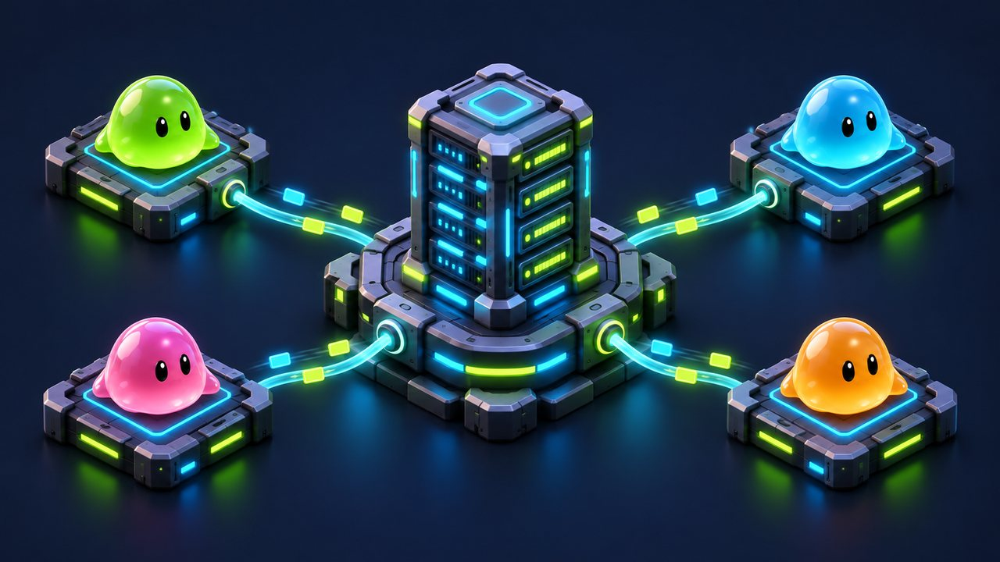
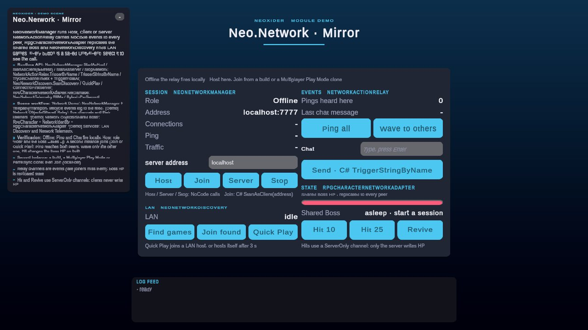

# Network

<!-- module-art:begin -->

<!-- module-art:end -->

**What it is:** Mirror-based multiplayer helpers for NeoxiderTools (`Scripts/Network/`, namespace `Neo.Network`;
the optional RPG transport lives in `Scripts/RpgNetwork/`). The module keeps package gameplay code usable in
offline projects while enabling network synchronization when Mirror is installed.

<!-- demo-shots:begin -->

*Demo scene: `Scenes/Network/NetworkDemo.unity`, in the **Demo Scenes** sample (Package Manager > NeoxiderTools > Samples). The scenes are saved with their UI and wiring, so you can inspect them without entering Play Mode.*
<!-- demo-shots:end -->

**Contents:** the entry-point table below, the [guides](#guides) and the [Realtime toolkit](./Realtime/README.md).
How to work with it:
1. Put a `NeoNetworkManager` (or `NeoLobbyManager` for a ready-check lobby) in the scene; start it from UI or with
   [NeoNetworkBootstrap](./NeoNetworkBootstrap.md).
2. Replicate state with typed components (`NetworkPropertySync`, `NetworkReactiveSync`, `NetworkSingleton<T>`)
   and actions with the relays; every NoCode component has a C# path described on its page.
3. Leave **Is Networked** off on a component to keep it local-only; without Mirror everything runs offline.

---

## Main entry points

| Component / file | Docs |
|------------------|------|
| `Scripts/Network/Core/NeoNetworkComponent.cs` | [NeoNetworkComponent](./NeoNetworkComponent.md) |
| `Scripts/Network/Core/NeoNetworkManager.cs` | [NeoNetworkManager](./NeoNetworkManager.md) |
| `Scripts/Network/Core/NetworkActionRelay.cs` | [NetworkActionRelay](./NetworkActionRelay.md) |
| `Scripts/Network/Core/NetworkContextActionRelay.cs` | [NetworkContextActionRelay](./NetworkContextActionRelay.md) |
| `Scripts/Network/Core/NetworkEventDispatcher.cs` | [NetworkEventDispatcher](../Tools/Network/NetworkEventDispatcher.md) |
| `Scripts/Network/Core/NetworkOwnerFilter.cs` | [NetworkOwnerFilter](./NetworkOwnerFilter.md) |
| `Scripts/Network/Core/NetworkPropertySync.cs` | [NetworkPropertySync](./NetworkPropertySync.md) |
| `Scripts/Network/Core/NetworkReactiveSync.cs` | [NetworkReactiveSync](./NetworkReactiveSync.md) |
| `Scripts/Network/Core/NetworkSingleton.cs` | [NetworkSingleton](./NetworkSingleton.md) |
| `Scripts/Network/Player/NeoNetworkPlayer.cs` | [NeoNetworkPlayer](./NeoNetworkPlayer.md) |
| `Scripts/Network/Player/NetworkPlayerName.cs` | [NetworkPlayerName](./NetworkPlayerName.md) |
| `Scripts/Network/Spawner/NeoNetworkSpawner.cs` | [NeoNetworkSpawner](./NeoNetworkSpawner.md) |
| `Scripts/Network/Lobby/*.cs` | [Lobby](./Lobby.md), [NeoNetworkDiscovery](./NeoNetworkDiscovery.md), [NeoLobbyManager](./NeoLobbyManager.md), [NeoLobbyPlayer](./NeoLobbyPlayer.md) |
| `Scripts/Network/Lobby/NeoLobbyPresenter.cs` | [Persistent lobby UI wiring](./Lobby.md#persistent-lobby-ui) |
| `Scripts/Network/Bootstrap/*.cs` | [NeoNetworkBootstrap](./NeoNetworkBootstrap.md): command line (`-host`, `-server`, `-client`, ...), dedicated server, headless runtime |
| `Scripts/Network/Realtime/*.cs` | [Realtime toolkit](./Realtime/README.md): snapshot timeline and buffer, prediction, quantisation, framing and fragmentation, handlers, event channel |
| `Scripts/Network/Telemetry/*.cs` | [NeoNetworkTelemetry](./NeoNetworkTelemetry.md): RTT, bytes per second, per-kind traffic, overlay |
| `Scripts/RpgNetwork/*.cs` | [RPG network adapters](../Rpg/Network.md): optional Mirror transport for `RpgCharacter` / `RpgAttackController` |

## Guides

| Page | Purpose |
|------|---------|
| [Multiplayer Guide](./Multiplayer_Guide.md) | Setup flow for Mirror, `NeoNetworkManager`, scene-player templates, and common no-code sync patterns. |
| [Realtime IO Guide](./Realtime_IO_Guide.md) | Architecture of a server-authoritative realtime game: handshake, snapshots, interpolation, prediction, events, telemetry, bootstrap. |
| [NoCode Network Spec](./NoCode_Network_Spec.md) | Rules for building networked no-code components. |
| [Network contracts](./Contracts.md) | Always-available configuration/authority declarations, the transport-free [`NetworkAuthorityPolicy`](./Contracts.md#authority-policy-in-c) decision table, and offline hierarchy semantics. |

## Diagnostics

Runtime `Log` and `Warning` output in package code goes through `NetworkDiagnostics` and is disabled by default. Enable `NetworkDiagnostics.RuntimeLogsEnabled` or `NetworkDiagnostics.RuntimeWarningsEnabled` only while debugging; component-level verbose toggles (`Debug Lifecycle Log`, `Verbose Logging`) still print explicitly requested diagnostics.

## Realtime games (.io, arenas, shooters)

Everything a server-authoritative realtime game needs beyond per-property sync lives in `Neo.Network.Realtime` plus the bootstrap and telemetry components: a guaranteed client handshake with per-connection server events, scene objects woken on every peer, batched and quantised world snapshots with datagram fragmentation, an adaptive interpolation clock, client prediction with input acknowledgement, a reliable typed event channel, handler registries that survive reconnects, RTT and bandwidth telemetry, and a command-line bootstrap for dedicated servers (WebGL included). Start with the [Realtime IO Guide](./Realtime_IO_Guide.md).

## Start / stop cheat sheet

| You want | Call |
|----------|------|
| Host | `NeoNetworkManager.StartAsHost()` |
| Client | `StartAsClient()`, `StartAsClient(address)`, `StartAsClient(address, port)` |
| Dedicated server | `StartAsServer()` (or `-server` with [`NeoNetworkBootstrap`](./NeoNetworkBootstrap.md)) |
| Stop | `StopNetwork()` |

Details: [NeoNetworkManager](./NeoNetworkManager.md#start--stop-cheat-sheet).

## Demo scene

`Samples~/Demo/Scenes/Network/NetworkDemo.unity` (`Samples/...` while the sample is being developed) is authored in
the editor by `NetworkDemoBuilder` (menu **Neoxider/Demo/Rebuild Active Demo Scene**). Everything is saved in the scene,
so the wiring is visible in the Inspector without entering Play Mode:

| Object | What to look at |
|--------|-----------------|
| `Network Demo` | `NeoNetworkManager` + `TelepathyTransport`. No player prefab (Auto Create Player off), no DontDestroyOnLoad. Its lifecycle and per-connection server events log to the feed. |
| `[Demo] Network Objects/Shared Relay` | `NetworkIdentity` + `NetworkActionRelay` with five channels: `Chat` and `Ping` (AllClients), `Wave` (OthersOnly), `Hit boss` and `Revive boss` (ServerOnly). Each channel's listeners are persistent. |
| `[Demo] Network Objects/Shared Boss` | `RpgCharacter` + `NetworkIdentity` + `RpgCharacterNetworkAdapter`, server-authoritative: clients reach it only through the ServerOnly channels, the adapter replicates its HP. |
| `[Demo] Services` | `NeoNetworkDiscovery` (LAN search starts only from a button) and `NeoNetworkTelemetry` (overlay off; ping and traffic are shown in uGUI rows). |
| `[Demo] Frame` | The buttons: Host / Server / Stop call the manager directly (NoCode), Join calls `StartAsClient(address)` through `NetworkDemoController` (C#). |

How to try it: offline, Ping and Chat fire locally (offline fallback). Press **Host**: the scene network objects wake up
(Mirror keeps them disabled until a session starts). Start a second instance (a build, a Multiplayer Play Mode or a
ParrelSync clone) and press **Join** (or **Quick Play** for LAN discovery): Ping reaches both peers, Wave only the other
one, and **Hit** changes the boss HP on both. Relay channels are events, so a peer that joins later misses earlier
ones; the boss HP is replicated state, so a late joiner sees the current value.

## Usage notes

- Install Mirror only when the project needs multiplayer.
- Keep offline gameplay paths working; network components should bridge state, not own the game rule.
- Prefer explicit ownership checks for player actions.
- Use `NetworkPropertySync` for simple state, and dedicated networked components for durable or security-sensitive game state.

For C# gameplay, use `NeoNetworkManager` for session control, `NetworkSingleton<T>` for a shared component,
and `NetworkReactivePropertyBridge.SetFromNetwork` to update an existing reactive value. Scene authors can
configure the property-sync and relay components and connect their UnityEvents to the same gameplay API.
`OwnerToServer` sync applies accepted values to the target on dedicated servers as well as hosts; the
server checks the component's enabled networking option, direction and configured value type before accepting a command.

Realtime snapshot buffers reject non-finite timestamps without taking ownership of the rejected payload;
timeline observations and deltas with NaN or infinity are ignored. See [snapshot interpolation](./Realtime/SnapshotInterpolation.md).
LAN discovery joins use the complete advertised URI, including its port. See [discovery](./NeoNetworkDiscovery.md).

In 11.0.0, unnamed authority-policy integers fail closed for every caller, including direct server and
host contexts. Pick `None`, `OwnerOnly` or `ServerOnly` explicitly; their values and named behavior are
unchanged. `INeoOptionalNetworked.IsNetworked` describes configuration: offline scene recovery requires
at least one implementation in the identity hierarchy and every implementation opting out. See
[Contracts](./Contracts.md), rather than inferring opt-out from a disconnected session.

## Related docs

- [Rpg](../Rpg/README.md)
- [StateMachine](../StateMachine/README.md)
