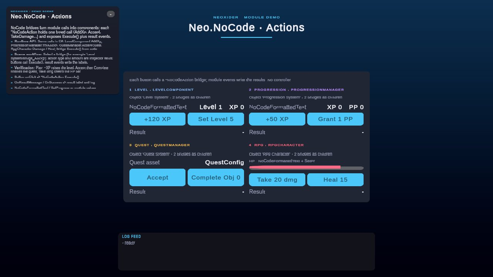
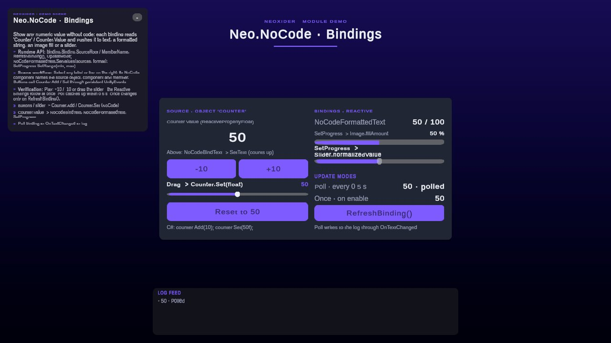

# Neo.NoCode

<!-- module-art:begin -->
<p align="center"></p>
<!-- module-art:end -->

**What it is:** no-code UI bindings (assembly `Neo.NoCode`, scripts in `Scripts/NoCode/`) that connect a numeric field/property or `ReactiveProperty*` of any component to text and progress visuals without one-off view scripts. Each component wraps the plain C# `ComponentFloatBinding` and has a typed C# API.

<!-- demo-shots:begin -->
<p align="center"> </p>

*Demo scenes: `Scenes/NoCode/NoCodeActionsDemo.unity`, `Scenes/NoCode/NoCodeBindingDemo.unity`, in the Demo download (`Assets/NeoxiderDemos/Demo`). The scenes are saved with their UI and wiring, so you can inspect them without entering Play Mode.*
<!-- demo-shots:end -->

**Contents:**

| Page | Topic |
|------|-------|
| [GettingStarted](GettingStarted.md) | Scene walkthrough: build gameplay UI without code. |
| [ComponentFloatBinding](ComponentFloatBinding.md) | The serializable source binding and its C# API. |
| [NoCodeFloatBindingBehaviour](NoCodeFloatBindingBehaviour.md) | Base class for custom float views (`NoCodeBindText`, `SetProgress`). |

---

## Demos

Both scenes are fully authored in the `.unity` file (no runtime UI construction, no controller): select any label, bar or button to see its NoCode component or persistent UnityEvent in the Inspector without entering Play Mode.

| Scene | What it shows | Where to look |
|---|---|---|
| `Scenes/NoCode/NoCodeBindingDemo.unity` | One source, `Counter.Value` (a `ReactivePropertyFloat`), drives every binding: `NoCodeBindText` into a tweening `SetText`, `NoCodeFormattedText`, `SetProgress` into a Filled image and into a slider, and the update modes side by side (Reactive, Poll every 0.5 s, Once + `RefreshBinding()`). | Object `Counter`; the right column of `[Demo] Frame`. Buttons and the input slider call `Counter.Add` / `Counter.Set` directly. |
| `Scenes/NoCode/NoCodeActionsDemo.unity` | `LevelNoCodeAction`, `ProgressionNoCodeAction`, `QuestNoCodeAction` and `RpgNoCodeAction` bridges: buttons call `Execute()`, result events (`OnResultMessage`, `OnSuccess`) write the result labels and the log, readouts use `NoCodeFormattedText` / `SetProgress`. | Objects `Level System`, `Progression System`, `Quest System`, `Rpg Character` and their `Bridge_*` children. |

C# equivalent of the binding demo: `counter.Add(10)`, `bindText.RefreshBinding()`, `formattedText.SetValues(sources, "{0:0} / 100")`, `setProgress.SetRange(0f, 100f)`.

The scenes are authored by the editor builders `NoCodeBindingDemoBuilder` / `NoCodeActionsDemoBuilder` (menu **Neoxider/Demo/Rebuild Active Demo Scene**). Paths are relative to `Assets/NeoxiderDemos/Demo` (Demo download).

## UX Discipline And C# Contract

NoCode is a data-binding layer for UI, not hidden gameplay logic in the Inspector. New behavior must expose a testable C# contract and have EditMode or PlayMode coverage before adding Inspector convenience around it.

NoCode runs on scene components. ScriptableObject assets must not store scene object references; if a setup lives in an SO, store only data, keys, or context slots, and assign concrete `GameObject` references on the scene component.

Current `ComponentFloatBinding` contract:

- data sources are readable fields and readable non-indexed properties only;
- methods addressed by string name are not valid sources and are never invoked;
- `ReactivePropertyFloat`, `ReactivePropertyInt`, and `ReactivePropertyBool` are supported source values;
- `ComponentOccurrence` selects a zero-based matching component instance; the default `0` preserves existing first-match bindings, and invalid/missing occurrences never fall back to that first instance;
- `GameObject.Find` is allowed only as an explicit `Find By Name` fallback with a retry interval, not as the primary architecture.

For business rules, keep the rule in a normal C# component or service, test it there, and expose only the final field, property, or reactive state to NoCode.

## Components

| Component | Purpose |
|-----------|---------|
| `NoCodeBindText` | Reads a numeric source and writes to `SetText`, then `TimeToText`, then TMP, in that priority order. Unassigned targets are looked up on the same GameObject. An unchanged value is not written again (call `ForceRewrite()` to re-push it). |
| `NoCodeFormattedText` | Formats multiple sources with invariant-culture `string.Format`, for example `HP {0:0}/{1:0}`. Writes to `SetText`, TMP, or an existing legacy uGUI Text target, in that order. Unchanged inputs are not re-formatted. |
| `SetProgress` | Maps a value from Min/Max into the assigned `Slider.normalizedValue` and/or `Image.fillAmount`, clamped to 0–1. Equal or approximately equal endpoints leave the targets unchanged. `SetRange(min, max)` updates the range at runtime (e.g. max HP). |

## Source Flow

1. Select the source object.
2. Select the source component type and its field/property. For repeated components of that type, choose **Component Occurrence** (`0` = first match, `1` = second); unrelated component types are ignored.
3. Select the target UI component.
4. Configure formatting, clamping, or progress range when needed.

The module is intended for Inspector-driven prototypes and reusable UI screens. It intentionally does not support arbitrary method invocation by string.

## Updates and object lifetime

- **Once** reads when enabled. **Reactive** subscribes to supported reactive values and polls ordinary or unresolved sources. **Poll** refreshes in `LateUpdate`.
- Polling uses unscaled time, defaults to 0.16 seconds, and clamps the interval to at least 0.016 seconds. Disabling **Poll In Late Update** also disables polling for missing sources and ordinary values in Reactive mode; reactive events still work.
- Inspector validation marks configuration dirty without reading source getters. The next active `LateUpdate` reconciles it before the polling decision, so editing an interval/source does not stop Reactive fallback. Once remains nonpolling, and disabling **Poll In Late Update** still prevents periodic UI refreshes.
- Subscriptions belong to enabled, active components. Disabling releases them. An explicit refresh while disabled can update the view once but does not subscribe. An event already being dispatched when another listener disables the view is ignored.
- At the next refresh, replacing a reactive instance or changing its binding releases the previous subscription and connects the current source. For immediate runtime rewiring, refresh explicitly or disable/re-enable the view. A purely reactive view does not continuously search for replacement objects while its existing source is idle.
- If a Slider callback changes a `SetProgress` binding from reactive to an ordinary field, the binding uses its final subscription state and continues through the polling fallback.
- If no cached text target is alive, newly added or recreated targets are resolved at the next refresh. `NoCodeFormattedText` writes the current text even when the value is unchanged; `OnTextChanged` remains a value-change event and does not fire again solely because a target appeared. Inspector changes to `NoCodeBindText` targets invalidate its cached target selection.

`NoCodeFormattedText.OnTextChanged` compares the formatted result with the previous result for the current enable period. Interval-only edits, target reassignment and equivalent format strings can redraw the current text without repeating that event. A source or format change that produces a different string emits one notification; repeated unchanged refreshes emit none. Enabling the component still publishes its initial result once. In Once mode, validation keeps the redraw pending until an explicit refresh or re-enable.

`NoCodeFormattedText` treats missing/null bindings as zero. Invalid format strings are displayed literally. `NoCodeBindText` and `SetProgress` retain their previous output when their source cannot be read.

`NoCodeBindText` pushes a value only when it (or the resolved target) changed since the last write; this avoids restarting `SetText` number animations on every poll. If another script overwrites the label, call `ForceRewrite()`. Enabling the component always writes once. An Inspector edit makes the next refresh write even for an unchanged value; that refresh is the next poll, or in Reactive mode with a subscribed source the next value change. Call `ForceRewrite()` to push immediately.

## Performance

- One reflective read per poll for plain sources (a plain numeric field boxes once). A subscribed reactive source is re-checked once after the output callback, so each reactive change costs two reads; reactive reads do not box.
- `NoCodeFormattedText` skips `string.Format` when no value, format or target changed, so a Reactive refresh without changes is allocation-free.
- Unresolved sources (late spawn, missing component) are retried without allocating component arrays or messages; the warning is logged once.
- Prefer `ReactiveProperty*` sources: they refresh only on change, while ordinary fields are polled every **Poll Interval** (0.16 s by default).

## C# API

Use [ComponentFloatBinding](./ComponentFloatBinding.md) directly to read component data from C#. Its `UseSceneSearch`, `SearchObjectName`, `SourceRoot`, `ComponentTypeName`, `ComponentOccurrence` and `MemberName` setters invalidate cached resolution automatically. `TryGetReactiveProperty` exposes the typed reactive instance; callers that subscribe directly own their listener cleanup.

Every NoCode component has a typed path:

| Component | C# API |
|-----------|--------|
| `NoCodeBindText`, `SetProgress` (and custom subclasses) | `Binding`, `UpdateMode`, `PollIntervalSeconds`, `RefreshBinding()`; `NoCodeBindText.ForceRewrite()`; `SetProgress.MinValue` / `MaxValue` / `SetRange(min, max)` |
| `NoCodeFormattedText` | `Values`, `SetValues(bindings, format)`, `Format`, `UpdateMode`, `PollIntervalSeconds`, `RefreshFromSource()`, `CurrentText`, `OnTextChanged` |

```csharp
using Neo.NoCode;
using UnityEngine;

public sealed class HealthBarSetup : MonoBehaviour
{
    [SerializeField] private SetProgress _bar;
    [SerializeField] private NoCodeFormattedText _label;
    [SerializeField] private GameObject _player;

    private void Start()
    {
        ComponentFloatBinding hp = new()
        {
            SourceRoot = _player,
            ComponentTypeName = "Health",
            MemberName = "Current"
        };
        _bar.Binding.SourceRoot = _player;
        _bar.Binding.ComponentTypeName = "Health";
        _bar.Binding.MemberName = "Current";
        _bar.SetRange(0f, 250f);
        _label.SetValues(new[] { hp }, "HP {0:0}");
    }
}
```

`Health` / `Current` stand for any component and numeric (or reactive) member of your game. For custom views, derive from [NoCodeFloatBindingBehaviour](./NoCodeFloatBindingBehaviour.md) and override `ApplyFloat(float)`. `RefreshBinding()` and `NoCodeFormattedText.RefreshFromSource()` are public and can also be connected to a UnityEvent.

## Related docs

- [Scene setup walkthrough](./GettingStarted.md)
- [ComponentFloatBinding API](./ComponentFloatBinding.md)
- [Custom float views](./NoCodeFloatBindingBehaviour.md)
- [Condition](../Condition/README.md)
- [Reactive](../Reactive/README.md)
- [Tools/Text](../Tools/Text/README.md)
