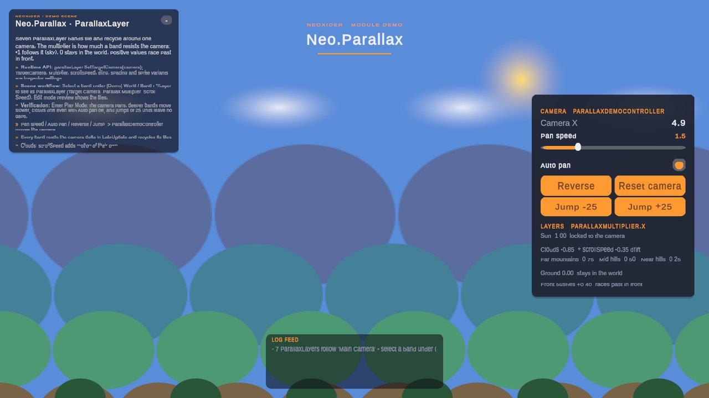

# Parallax module

<!-- module-art:begin -->

<!-- module-art:end -->

**What it is:** parallax layers for 2D scrolling (`Neo.Parallax`, scripts in `Scripts/Parallax/`).

**How to work with it:** add `ParallaxLayer` to each background band, assign `targetCamera` and set
`parallaxMultiplier.x` (`-1` follows the camera, `0` stays in the world, positive values race past in front).

**Navigation:** [← Docs](../README.md)

<!-- demo-shots:begin -->

*Demo scene: `Scenes/Parallax/ParallaxDemo.unity`, in the Demo download (`Assets/NeoxiderDemos/Demo`). The scenes are saved with their UI and wiring, so you can inspect them without entering Play Mode.*
<!-- demo-shots:end -->

**Contents:** [ParallaxLayer](./ParallaxLayer.md) - the one component of the module.

---

## Demo scene

`Assets/NeoxiderDemos/Demo/Scenes/Parallax/ParallaxDemo.unity` (Demo download). Everything is saved in the scene. `[Demo] World` holds seven bands, each a `ParallaxLayer` bound to the scene camera through `targetCamera`:

| Band | `parallaxMultiplier.x` | Shows |
|---|---|---|
| Sun | -1.00 | follows the camera (infinitely far), no tiling |
| Clouds | -0.85 | plus `scrollSpeed` -0.35: drifts even when the camera stops |
| Far mountains / Mid hills / Near hills | -0.75 / -0.50 / -0.25 | deeper bands follow the camera more |
| Ground | 0.00 | stays in the world |
| Front bushes | +0.40 | races past in front, with `tileSpacing` gaps |

The card's slider, toggle and buttons only move the camera (`ParallaxDemoController.SetPanSpeed`, `SetAutoPan`, `Reverse`, `Jump`, `ResetCamera`); the 25-unit jumps show that tiles recycle in one step.

## docs

- [ParallaxLayer](./ParallaxLayer.md) — C# camera binding, Inspector/UnityEvent setup, source ownership, count/local-geometry validation and recovery, preview, gaps and randomization.

## See also

- [Animations](../Animations/README.md)
