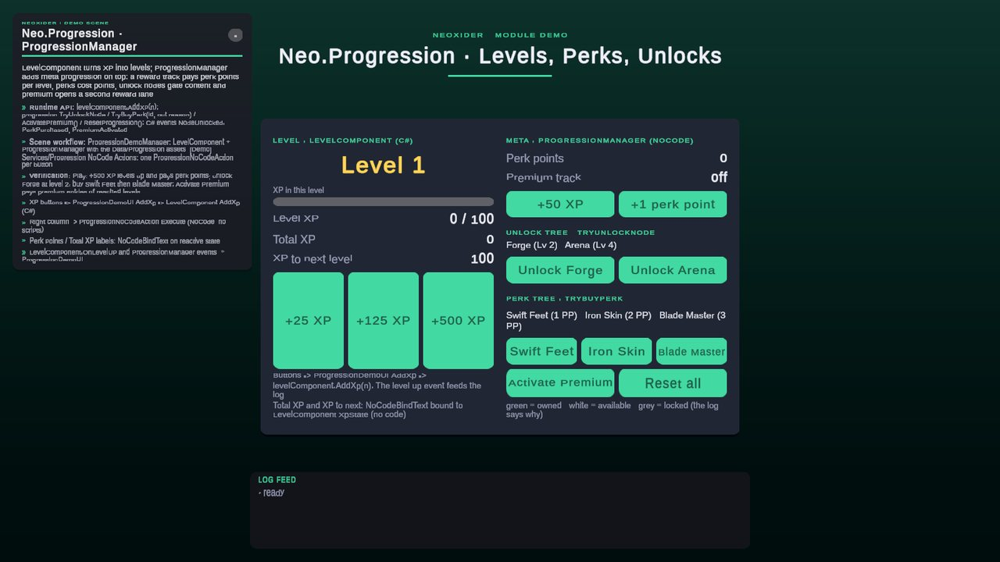

# Progression

<!-- module-art:begin -->
<p align="center"></p>
<!-- module-art:end -->

**What it is:** a meta-progression module for `XP`, levels, unlock trees, perk trees, and a persistent player profile. Scripts live in `Scripts/Progression/`.

<!-- demo-shots:begin -->
<p align="center"></p>

*Demo scene: `Scenes/Progression_Demo.unity`, in the **Demo Scenes** sample (Package Manager > NeoxiderTools > Samples). The scenes are saved with their UI and wiring, so you can inspect them without entering Play Mode.*
<!-- demo-shots:end -->

**Contents:**
- [ProgressionManager](./ProgressionManager.md) — main runtime entry point and save/profile coordinator.
- [ProgressionNoCodeAction](./ProgressionNoCodeAction.md) — UnityEvent bridge for no-code flows.
- [ProgressionConditionAdapter](./ProgressionConditionAdapter.md) — progression checks for `NeoCondition` and other evaluator-based systems.
- [Level Reward Track](./Data/LevelCurveDefinition.md), [Unlock Tree](./Data/UnlockTreeDefinition.md), and [Perk Tree](./Data/PerkTreeDefinition.md) — reusable definition assets.
- [Runtime types](./InternalTypes.md) and [Scenarios](./Scenarios.md).

**Demo:** `Assets/Neoxider/Samples~/Demo/Scenes/Progression_Demo.unity` (`Samples/...` during sample development, `Assets/Samples/NeoxiderTools/<version>/<sample name>/` after a Package Manager import). The hand-authored `ProgressionDemoManager` holds `LevelComponent` + `ProgressionManager` with the reward track, unlock tree and perk tree from `Demo/Data/Progression`. XP buttons call `ProgressionDemoUI.AddXp` (C# path), the perk/unlock/premium buttons call `ProgressionNoCodeAction.Execute` on the objects under `[Demo] Services/Progression NoCode Actions` (NoCode path), and the perk point / XP labels use `NoCodeBindText`. Authored by `Demo/Editor/Builders/Progression/ProgressionDemoBuilder.cs`; nothing is built at Play.

**Navigation:** [← Docs](../README.md)

---

## How to use

1. For XP and levels, add a Core `LevelComponent` and assign a `Neo.Core.Level.LevelCurveDefinition` (the XP curve).
2. Create optional **Level Reward Track**, **Unlock Tree Definition**, and **Perk Tree Definition** assets from **Create → Neoxider → Progression**, then assign them to `ProgressionManager`. Assign its `LevelProvider`, or place the Core component on the same GameObject for automatic binding.
3. Configure distinct save keys for the Core level profile and the Progression profile. Progression saves perk points, premium ownership, and unlocked/purchased identifiers; the Core component saves XP and level separately.
4. Bind UI to `XpState`, `LevelState`, `PerkPointsState`, `XpToNextLevelState`, the manager UnityEvents, or the C# events `NodeUnlocked`, `PerkPurchased` and `PremiumActivated`.
5. Trigger `AddXp`, `TryUnlockNode`, `TryBuyPerk` and `ActivatePremium` from code or via `ProgressionNoCodeAction`.
6. Use `ProgressionConditionAdapter` for no-code gating rules (including `HasPremium`).

## Module scope

- `ProgressionManager` manages its profile, node unlocks, perk purchases, and level reward dispatch. XP and level calculations belong to its Core `LevelProvider`.
- `Neo.Progression.LevelCurveDefinition` is a reward track: it maps Core levels to perk point grants and rewards. Its legacy XP helpers do not configure the Core curve.
- `UnlockTreeDefinition` stores unlock nodes, prerequisites, conditions, and rewards.
- `PerkTreeDefinition` stores purchasable perks, costs, dependencies, and rewards.
- `ProgressionReward` dispatches rewards into `Money`, `Collection`, `Quest`, XP, and perk points.

The manager works without a level provider for perk points and trees whose requirements are level 1. It reports level 1 and XP 0 in that setup. `TryAddXp(int, out string)` and `TrySetLevel(int, out string)` expose missing-provider failures to C#; `AddXp` and `SetLevel` remain convenient void wrappers. NoCode `AddXp` forwards the same failure through `OnFailed`.

UI can bind to the manager's reactive fields even when code changes its Core provider directly: XP, load, reset, and level decreases refresh those mirrors without adding saves or rewards. Manager commands coalesce nested state notifications into a settled batch; an unlock or purchase with several rewards publishes one snapshot before its node/perk event. Conditions that re-enter the same unlock or purchase cannot claim it twice. In Inspector/NoCode workflows, keep the explicit `LevelProvider` assignment and existing UnityEvent bindings; no polling component or additional scene setup is needed. See [ProgressionManager](./ProgressionManager.md) for notification ordering and profile switching.

If initial dependency setup, binding, or profile reading throws, correct the dependency and retry `EnsureInitialized()` before continuing. The failed attempt releases its own subscriptions and does not mark an unapplied profile ready. Reentrant profile commands during unfinished setup are rejected; errors from observers after the profile commits leave initialization complete. See [ProgressionManager](./ProgressionManager.md) for the retry and observer contract.

`OnProfileLoaded` exposes the same serialized UnityEvent used by the Inspector **On Profile Loaded** binding. C# consumers can use `AddListener`/`RemoveListener` to observe that existing load notification after profile application and runtime refresh; no extra scene wiring is needed.

Reloading the same active Progression key retains this session's highest rewarded level. Explicit reset starts fresh; loading a different key uses the incoming Core level as its baseline. Changing `SaveKey` alone does not switch profiles. For account/season restoration, load the Core component before loading Progression. The V2 profile format is unchanged and does not provide a durable claim ledger or atomic reward delivery.

Call each asset's `ValidateDefinition()` before using authored trees. Default nodes/perks are applied on load/reset without dispatching their rewards. Definition assets must not depend on scene objects: leave scene reward targets empty to use the existing service fallbacks, and evaluate conditions against the manager's scene `ConditionContext`.

## Game scenarios

### Arcade / Hypercasual

Use a short XP curve, a very small unlock tree, and optional perks for lightweight meta retention.

Recommended setup:
- 5-15 levels
- quick XP thresholds
- rewards focused on `Money` and cosmetic unlocks
- minimal prerequisite chains

### RPG / Action RPG

Use the full stack: level curve, unlock tree, and perk tree.

Recommended setup:
- long level curve with regular perk point grants
- unlock nodes for specializations or systems
- perk tree as the main build layer
- optional quest rewards through `ProgressionReward`

### Strategy / Base Builder

Use unlock nodes as tech or building gates and perks as faction-wide passive bonuses.

Recommended setup:
- unlock tree for research branches
- perks for commander or empire bonuses
- level rewards for economy boosts and content access

### Narrative / Adventure

Use progression mainly as a content gate instead of a combat stat layer.

Recommended setup:
- light XP usage
- unlock tree for chapters, locations, and story flags
- `ConditionEntry` for story requirements

### Roguelite / Meta Run

Use `Progression V2` for permanent profile upgrades between runs, not for run-local state.

Recommended setup:
- account-wide XP
- permanent perks and unlocks
- separate run-state save outside this module

## Recommended configuration

### LevelCurveDefinition

- Keep level 1 at `0 XP`.
- For short games, use frequent rewards and compact thresholds.
- For longer games, slow down perk point grants after the early levels.

### UnlockTreeDefinition

- Reserve `UnlockedByDefault` for baseline nodes only.
- Use prerequisite nodes for structure, not for unnecessary depth.
- Add `ConditionEntry` only when the unlock depends on external game state.

### PerkTreeDefinition

- Scale `Cost` slower than XP growth so the tree keeps moving.
- Use `RequiredUnlockNodeIds` to gate specializations or branches.
- Keep the first release of the perk tree small and readable.

## Usage examples

### Grant XP from code

```csharp
using Neo.Progression;
using UnityEngine;

public class EnemyRewardExample : MonoBehaviour
{
    [SerializeField] private int xpReward = 25;

    public void GrantReward()
    {
        if (ProgressionManager.Instance != null)
        {
            ProgressionManager.Instance.AddXp(xpReward);
        }
    }
}
```

### Unlock a node from a scripted event

```csharp
using Neo.Progression;
using UnityEngine;

public class QuestUnlockExample : MonoBehaviour
{
    [SerializeField] private string nodeId = "chapter-2";

    public void UnlockChapter()
    {
        if (ProgressionManager.Instance == null)
        {
            return;
        }

        ProgressionManager.Instance.TryUnlockNode(nodeId, out _);
    }
}
```

### No-code flow

1. Add `ProgressionNoCodeAction`.
2. Set `Action Type = AddXp`.
3. Set `XP Amount = 100`.
4. Bind `Execute()` to a `Button`, quest event, or any UnityEvent source.
