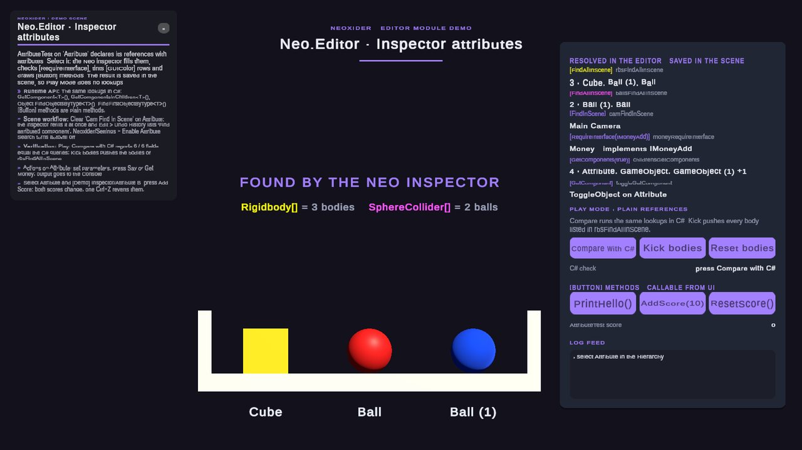

# PropertyAttribute module

**What it is:** Inspector metadata for method buttons, field tinting, interface-constrained references and automatic reference assignment. Scripts live in `Scripts/PropertyAttribute/`; reference the `Neo.PropertyAttribute` assembly from an assembly definition that uses these attributes.

<!-- demo-shots:begin -->
<p align="center"></p>

*Demo scene: `Scenes/Tools/AttributeExample.unity`, in the Demo download (`Assets/NeoxiderDemos/Demo`). The scenes are saved with their UI and wiring, so you can inspect them without entering Play Mode.*
<!-- demo-shots:end -->

**Contents:** the attribute table below, the [Inspector workflow](#scene-and-inspector-workflow) and the
[runtime C# workflow](#runtime-c-workflow). Drawers and `[NeoDoc]`: [Internal types](InternalTypes.md).

**Navigation:** [← Docs](../README.md)

---

## Public API and entry points

| Attribute | Namespace | Purpose |
|-----------|-----------|---------|
| [Button](ButtonAttribute.md) | `Neo` | Inspector action for a method; optional label, width metadata and `PlayModeOnly`. |
| [GUIColor](ColorAttribute.md) | `Neo` | Tint a serialized field using numeric RGBA components. |
| [RequireInterface](RequireInterfaceAttribute.md) | `Neo` | Validate a Unity Object reference against an interface. |
| [GetComponent](GetComponentAttribute.md) | Global | Assign a component from the same GameObject, optionally searching children. |
| [GetComponents](GetComponentsAttribute.md) | Global | Assign a component array/list, optionally searching children. |
| [FindInScene](FindInSceneAttribute.md) | `Neo` | Assign one scene component or GameObject. |
| [FindAllInScene](FindAllInSceneAttribute.md) | Global | Assign scene objects to an array/list with a configurable sort mode. |
| [LoadFromResources](LoadFromResourcesAttribute.md) | Global | Assign one asset using a Resources path or an already loaded object. |
| [LoadAllFromResources](LoadAllFromResourcesAttribute.md) | Global | Assign an asset array/list. |
| [NeoDoc](InternalTypes.md) | `Neo` | Associate a component class with a Markdown path relative to package `Docs/`. |

The global namespaces of existing injection attributes are retained for compatibility. Use `using Neo;` for the attributes in `Neo`.

## Scene and Inspector workflow

1. Add an attribute to a serialized field or `[Button]` to a method.
2. Select the component. The `Neo.Editor.NeoCustomEditor` fallback inspector processes component/resource assignment when `NeoxiderSettings.EnableAttributeSearch` is enabled.
3. Assignment fills missing references and empty supported collections. Existing nonempty values are retained. Every assignment is recorded with Undo, so it can be undone and prefab instances keep it as an override. With several objects selected, every selected object is processed. A custom inspector must integrate the assignment processors explicitly if it replaces this fallback.
4. Review and save the resulting references. Scene searches are fallbacks; prefer explicit references when several candidates exist.

A field that cannot be resolved (no scene candidate, no Resources asset, a non-component element type) logs its warning once per object and field, not on every repaint. The inspector does not repeat a lookup that found nothing on every IMGUI event either: it searches again after a hierarchy or project change, and at most every 0.5 s otherwise.

The demo scene `Assets/NeoxiderDemos/Demo/Scenes/Tools/AttributeExample.unity` shows every attribute on one component; see [Editor - Demo scene](../Editor/README.md#demo-scene).

For a missing single-reference `[FindInScene]` field, scene lookup checks every stacked `[RequireInterface]` before assignment. Existing nonempty references are retained by automatic lookup; no compatible candidate leaves the field unassigned with a bounded diagnostic. See the [scene-search contract](FindInSceneAttribute.md) for GameObject/Component semantics and search ordering.

## Runtime C# workflow

The attributes contain metadata. They do not perform runtime dependency injection or restrict assignments made from C#. Keep required runtime initialization explicit:

```csharp
using Neo;
using UnityEngine;

public sealed class AudioPreview : MonoBehaviour
{
    [SerializeField, GetComponent] private AudioSource source;

    private void Awake()
    {
        if (source == null)
        {
            source = GetComponent<AudioSource>();
        }
    }

    [Button("Play", PlayModeOnly = true)]
    public void Play()
    {
        if (source != null)
        {
            source.Play();
        }
    }
}
```

`PlayModeOnly` controls Inspector availability; direct C# calls still use the method's own contract. ScriptableObjects should store asset/configuration references rather than scene dependencies.

Attribute declarations and three editor-guarded drawers live in `Scripts/PropertyAttribute/`. The fallback inspector and injection processors belong to the separate `Neo.Editor` assembly in `Editor/PropertyAttribute/`. See [drawer and documentation metadata APIs](InternalTypes.md).

For editor integration, see [NeoCustomEditor](../Editor/NeoCustomEditor.md), [ComponentDrawer](../Editor/ComponentDrawer.md) and the [Editor module](../Editor/README.md). These authoring helpers provide the Inspector workflow; runtime C# still owns dependency initialization.
