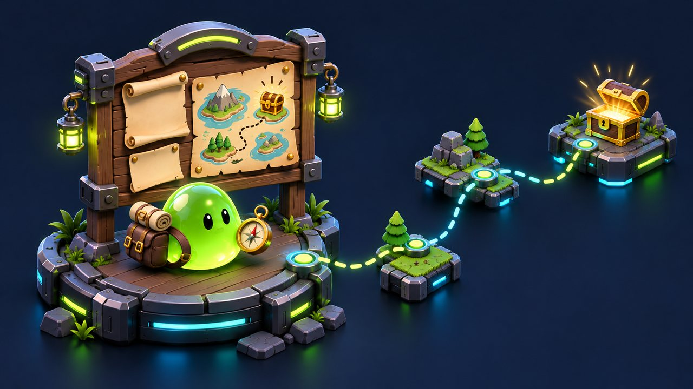
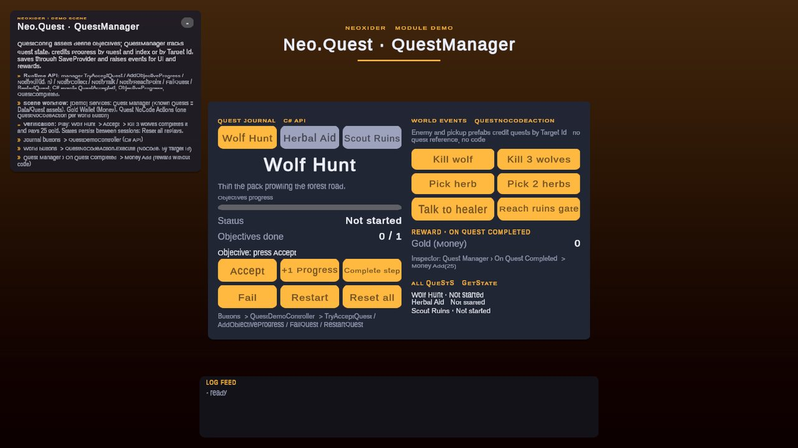

# Quest module

<!-- module-art:begin -->

<!-- module-art:end -->

**What it is:** a compact quest runtime built around `QuestConfig` (ScriptableObject), the `QuestManager` singleton, runtime `QuestState`, and the UnityEvent-friendly `QuestNoCodeAction` bridge. Scripts live in `Scripts/Quest/` (namespace `Neo.Quest`).

<!-- demo-shots:begin -->

*Demo scene: `Scenes/Quests/QuestDemo.unity`, in the Demo download (`Assets/NeoxiderDemos/Demo`). The scenes are saved with their UI and wiring, so you can inspect them without entering Play Mode.*
<!-- demo-shots:end -->

**Contents:**

| Page | Description |
|------|-------------|
| [QuestConfig](./QuestConfig.md) | Quest asset structure, objectives, start conditions, validation |
| [QuestObjectiveData](./QuestObjectiveData.md) | Objective types, target ids and counters |
| [QuestManager](./QuestManager.md) | Scene runtime manager, events, and main API |
| [QuestState](./QuestState.md) | Runtime quest state, progress, and UI-facing data |
| [Quest NoCode Action](./QuestBridge.md) | UnityEvent bridge for inspector-driven quest actions |
| [QuestContext](./QuestContext.md) | Marker for the condition-evaluation object |
| [C# guide](./Code.md) | Typed calls, progress notifications, and subscriptions |
| [Inspector scenarios](./Scenarios.md) | Scene setup and UnityEvent wiring |
| [Quest flow](./QuestFlowConfig.md) | Optional sequence and availability checks |
| [Saving](./Saving.md) | SaveProvider storage and objective list migration |

Demo: `Assets/NeoxiderDemos/Demo/Scenes/Quests/QuestDemo.unity` (Demo download). Everything is saved in the scene, so the wiring is visible without entering Play Mode:

- `[Demo] Services/Quest Manager` — `QuestManager` with the three quest assets from `Demo/Data/Quest` in **Known Quests**; its **On Quest Completed** event calls `Money.Add(25)` on `[Demo] Services/Gold Wallet (Money)` (a reward without code).
- Left column (C# path) — buttons call `QuestDemoController` (`Demo/Scripts/Shell/QuestDemoController.cs`), which uses `TryAcceptQuest`, `AddObjectiveProgress`, `FailQuest`, `RestartQuest`, `ResetAllQuests` and refreshes from the C# events.
- Right column (NoCode path) — each world button calls `Execute()` on a pre-configured `QuestNoCodeAction` under `[Demo] Services/Quest NoCode Actions` (`NotifyKill wolf ×1/×3`, `NotifyCollect herb ×1/×2`, `NotifyTalk healer`, `NotifyReachPoint ruins_gate`).
- The scene is authored by the editor builder `Demo/Editor/Builders/Quest/QuestDemoBuilder.cs` (menu **Neoxider → Demo → Rebuild Active Demo Scene**).

---

## Main pieces

- `QuestConfig` stores quest id, title, description, objectives, start conditions, and next quest ids.
- `QuestManager` accepts quests, tracks runtime state, credits objectives, and raises UnityEvents and C# events.
- `QuestState` stores per-quest runtime progress and status.
- `QuestNoCodeAction` triggers quest actions from Inspector events (`Accept`, `CompleteObjective`, `Fail`, `Restart`, `Reset`, `ResetAll`, `NotifyKill`, `NotifyCollect`, `NotifyReachPoint`, `NotifyTalk`, `EvaluateObjectiveConditions`).
- `QuestContext` marks the object used as condition evaluation context for quest start conditions.

## Objective types

| Type | Credited by |
|------|-------------|
| `CustomCondition` | `CompleteObjective` by index, or `EvaluateObjectiveConditions()` when a `ConditionEntry` is assigned |
| `KillCount` | `NotifyKill(targetId[, amount])` until `RequiredCount` |
| `CollectCount` | `NotifyCollect(targetId[, amount])` until `RequiredCount` |
| `ReachPoint` | `NotifyReachPoint(targetId)` |
| `Talk` | `NotifyTalk(targetId)` |

Every type can also be credited by index with `CompleteObjective` / `AddObjectiveProgress`.

## Typical flow

1. Create one or more `QuestConfig` assets and check them with `ValidateDefinition()`.
2. Add `QuestManager` to the scene and register configs in `Known Quests`.
3. Assign `Condition Context` if start conditions should be evaluated against a player or world object.
4. Accept quests via `AcceptQuest(...)`, `QuestNoCodeAction(Accept)`, or UI events.
5. Progress objectives through `CompleteObjective(...)`, `AddObjectiveProgress(...)`, the target notifications `NotifyKill(...)` / `NotifyCollect(...)` / `NotifyReachPoint(...)` / `NotifyTalk(...)`, or the matching `QuestNoCodeAction` actions.

Each counter call adds one (or the given amount, clamped to `RequiredCount`); other objective types store progress `1` when completed. `CustomCondition` entries are checked only when you call `EvaluateObjectiveConditions()`. `NextQuestIds` is metadata for your game/UI: the manager does not automatically accept or unlock those quests. `QuestFlowConfig` is an optional gate applied by your code or by `QuestNoCodeAction.FlowConfig`.

Use the Inspector action buttons in Play Mode. They can change saved progress when Auto Save is enabled.

## Key API

- `AcceptQuest(string questId)` and `AcceptQuest(QuestConfig quest)`
- `TryAcceptQuest(string questId, out string failReason)`
- `RegisterQuest(QuestConfig quest)` and `bool UnregisterQuest(QuestConfig expected)` — release only your exact runtime config before destroying it; progress is retained. See [runtime config lifetime](Code.md#runtime-config-lifetime).
- `CompleteObjective(string questId, int objectiveIndex)` and `bool AddObjectiveProgress(QuestConfig quest, int objectiveIndex, int amount)`
- `NotifyKill(string enemyId)`, `NotifyCollect(string itemId)` (plus `int amount` overloads), `NotifyReachPoint(string pointId)`, `NotifyTalk(string npcId)`, and the general `int Notify(QuestObjectiveType type, string targetId, int amount = 1)`
- `EvaluateObjectiveConditions()`
- `GetState(string questId)` and `GetState(QuestConfig quest)`
- `FailQuest(...)`, `ResetQuest(...)`, `RestartQuest(...)`, `ResetAllQuests()`
- `AllQuests`, `GetActiveQuests(List<QuestState>)` (allocation-free), `ActiveQuests`
- `QuestConfig.ValidateDefinition()` for authoring checks

## Events

`QuestManager` exposes both Inspector-facing `UnityEvent` callbacks and C# events:

| UnityEvent | C# event |
|------------|----------|
| `OnQuestAccepted`, `OnAnyQuestAccepted` | `QuestAccepted` |
| `OnObjectiveProgress` | `ObjectiveProgress` |
| `OnObjectiveCompleted` | `ObjectiveCompleted` |
| `OnQuestCompleted`, `OnAnyQuestCompleted` | `QuestCompleted` |
| `OnQuestFailed` | `QuestFailed` |
| — | `QuestReset`, `QuestsLoaded` |

## Performance

Target notifications and `EvaluateObjectiveConditions` iterate pooled snapshots and allocate nothing when warm, so enemy deaths and pickups can notify the manager at high rates. Auto Save writes once per top-level operation, even when callbacks chain further quest changes.

## Save note

`QuestManager` persists quest states through `SaveProvider` under `Save Key` (default `Settings_Quests`). `Auto Save` saves after accept/progress/fail/reset (once per top-level operation), `Auto Load` restores on initialization; `Save()` / `Load()` are public for manual control. See [Saving](./Saving.md).

Configs registered after loading reconcile saved objective lists and completed binary progress exactly as known-at-load configs do, without replaying gameplay events. Unregistering a config preserves saved states for later registration.

## See also

- [Internal types](InternalTypes.md) — supporting public types of the module
- [Condition](../Condition/README.md)
- [Save](../Save/README.md)
- [Progression](../Progression/README.md) — `AcceptQuest` rewards from levels, nodes and perks
