# NeoxiderTools Docs

<!-- docs-banner:begin -->

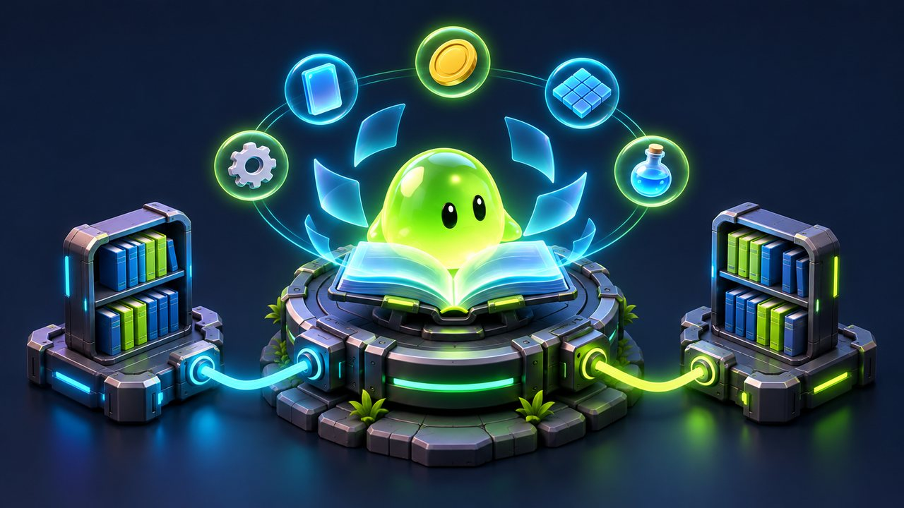

<!-- docs-banner:end -->

**What it is:** the documentation entry point for **NeoxiderTools** `v12.1.0`, with English guides and short Russian routes. Start here for public runtime APIs, scene setup, and optional Inspector / NoCode workflows.

**Contents:** [starting points](#choose-your-starting-point), [existing building blocks](#do-not-rebuild-first), [module index](#modules), [samples](#samples-and-add-ons) and [guides](#guides).

> **Upgrading?** From 11.x read [Upgrading to 12](./Migration12.md): the HTML → UI Toolkit converter moved to its own package, a few APIs became obsolete, and the demo scenes are now authored in the scene. From 10.x read [Migration to 11](./Migration11.md) first. The Windows verification recorded for 11.0.0 (Unity `6000.3.14f1` and `6000.6.0f1`) is in [Verification 11](../Verification11.md).

## Choose your starting point

| Goal | Entry |
|------|-------|
| C# API без сцены / Runtime API | [Runtime-model quick start](./GettingStarted.md#start-with-a-c-runtime-model), then [Core](./Core/README.md), [Merge](./Merge/README.md), or [StateMachine](./StateMachine/README.md) |
| Первый компонент / First component | [Getting Started — first audio scene](./GettingStarted.md#your-first-scene-in-5-minutes-audio-manager-am), then [Audio](./Audio/README.md) |
| Inspector / NoCode | [NoCode Getting Started](./NoCode/GettingStarted.md) and [Condition](./Condition/README.md) |
| Взаимодействия / Interaction | [Interaction contracts and components](./Tools/InteractableObject/README.md) |
| Примеры / Samples | [Sample scenes, how they are authored and rebuilt](./Samples.md) |
| Обновление с 11.x / Upgrade from 11.x | [Upgrading to 12](./Migration12.md) |
| Обновление с 10.x / Upgrade from 10.x | [Migration to 11](./Migration11.md) |
| Проверки / Verification | [Recorded results and limits](../Verification11.md), [EditMode and isolation](./Testing.md), [PlayMode](./PlayModeTesting.md), and [Package compatibility](./PackageCompatibility.md) |
| Host requirements / Требования проекта | [Package compatibility](./PackageCompatibility.md) and [IL2CPP / code stripping](./IL2CPP.md) |
| Dependencies / Зависимости и MCP | [Versions, upgrade constraints and editor tooling](./Dependencies.md) |

Use each module's README as its canonical entry. It links to the runtime API and the scene / NoCode setup. Runtime models can be owned by your code; scene services document their component dependencies. ScriptableObjects store reusable configuration, while scene components hold scene references.

**По-русски:** выберите строку под свою задачу. C#-ядро можно использовать отдельно; компоненты и NoCode подключаются по необходимости. Для обновления существующего проекта начните с migration guide, а для запуска тестов — с требований к изолированному host.

The HTML/CSS → UI Toolkit converter (HtmlToUitk) is now the separate package `com.neoxider.htmltouitk`
([HtmlToUitk](https://github.com/NeoXider/HtmlToUitk)); see [Upgrading to 12](./Migration12.md#htmltouitk-moved-to-its-own-package).
Legacy delivery is choose-one Core or Complete; [Samples](./Samples.md#legacy-release-archives-choose-one)
explains the layouts. Final archive import status is in [Verification 11](../Verification11.md).

## Namespace policy

Runtime gameplay types live in their module namespace (`Neo.Audio`, `Neo.Bonus`, `Neo.Level`,
`Neo.Parallax`, `Neo.UI`, and so on). The root `Neo` namespace is intentionally reserved for the small
authoring-attribute surface used across every module: `[Button]`, `[GUIColor]`, `[FindInScene]`,
`[NeoDoc]`, `[RequireInterface]`, `[CreateFromMenu]`, `[LegacyComponent]`, and their editor drawers.
Keeping these attributes at the root preserves the terse, stable `using Neo;` workflow; new runtime
components must use a module namespace. The Tools submodules share `Neo.Tools`; see
[module structure](../MODULE_STRUCTURE.md) for folder, assembly and namespace rules.

## Start here

- [Package README](../README.md)
- [**Getting Started** — C# runtime model or first audio scene](./GettingStarted.md)
- [**NoCode Getting Started** — build gameplay without writing code](./NoCode/GettingStarted.md)
- [**Cookbook** — recipes & interesting examples (cross-module combos)](./Cookbook.md)
- [Project summary](../PROJECT_SUMMARY.md)
- [Useful components](./UsefulComponents.md)
- [Package compatibility](./PackageCompatibility.md)
- [Sample scenes](./Samples.md)
- [Upgrading from 11.x to 12](./Migration12.md)
- [Migration from 10.x to 11](./Migration11.md)
- [Deprecated components and removal candidates](./DEPRECATED_OR_REMOVAL_CANDIDATES.md)
- [Testing — EditMode contracts and isolation](./Testing.md)
- [PlayMode testing — lifecycle and integration scope](./PlayModeTesting.md)
- [IL2CPP and code stripping](./IL2CPP.md)

Static-reset and Play Mode transition fixtures need an isolated host. The testing guides explain provider/scene ownership and global-state effects; broad test-suite dependencies can exceed those of a single runtime module.

## Do not rebuild first

| Task | Existing blocks | Entry |
|------|-----------------|-------|
| Grid field, coordinates, shape masks | `FieldGenerator`, `GridShapeMask`, `FieldDebugDrawer` | [GridSystem](./GridSystem/README.md) |
| Paths, movement ranges, flood fill on a grid | `GridPathfinder.TryFindPath`, `CollectReachableCells` | [GridPathfinder](./GridSystem/GridPathfinder.md) |
| Multi-cell pieces/items and drag/drop placement | `GridPlacementEntry`, `GridPlacementResult`, `PlaceContentFootprint` | [FieldGenerator](./GridSystem/FieldGenerator.md) |
| Connected equal-item merge | `Neo.Merge`, `MergeResolver`, `GridMergeRequest.Increment(...)` | [Merge](./Merge/README.md) |
| Dice Merge, 2048-like, Match3, TicTacToe / Gomoku | `DiceBoardService`, `SlidingMergeBoardService`, `Match3BoardService`, `TicTacToeBoardService` | [GridSystem](./GridSystem/README.md) |
| Money, shop, multi-currency, typed purchase result | `Money`, `IMoneySpend`, `Shop.TryBuy` → `ShopPurchaseStatus`, `TextMoney` | [Shop](./Shop/README.md) |
| Scene/global save, 64-bit values | `SaveManager`, `SaveProvider` (`GetLong`/`SetLong`), `GlobalSave`, `SaveableBehaviour` | [Save](./Save/README.md) |
| HP/Mana/resources, XP/levels | `HealthComponent`, `ResourcePoolModel`, `LevelComponent`, `LevelCurveDefinition` | [Core](./Core/README.md) |
| Data-driven abilities/modifiers, buffs/debuffs/DoT/shields, cast pipeline (successor to Rpg) | `AbilityDefinition`, `ModifierDefinition`, `AbilityUnitBehaviour`, `AbilityCasterBehaviour` | [Abilities](./Abilities/README.md) |
| RPG combat, projectiles, buffs/statuses, damage modifiers (superseded by Abilities) | `RpgCharacter`, `IRpgDamageModifier`, `RpgAttackController`, `RpgProjectile` | [Rpg](./Rpg/README.md) |
| Reward fly animation between world/canvas points | `AnimationFly.Play(AnimationFlyRequest)`, sprite/prefab visuals, reward timing | [AnimationFly](./UI/AnimationFly.md) |
| NoCode conditions, actions, state transitions | `NeoCondition`, `ConditionEntryPredicate`, module NoCode bridges | [Condition](./Condition/README.md) |
| Custom interaction input, hover/click, physics events | `IInteractiveTarget`, `InteractiveObject`, `InteractionRayProvider` | [Interaction](./Tools/InteractableObject/README.md) |
| Movement, free-fly camera, pooling, timers, input | `Tools/Move`, `Tools/Spawner`, `Tools/Time`, `Tools/Input` | [Tools](./Tools/README.md) |
| Injectable time for tests and replays | `IFrameClock`, `ManualFrameClock`, `INeoClock`, `NeoTrustedTime.AsClock` | [Clocks](./Tools/Time/Clocks.md) |
| Exact integer odds (1 in 1,000,000) | `IntegerChanceTable` | [IntegerChanceTable](./Tools/Random/IntegerChanceTable.md) |
| Bark lines by tag without repeats | `DialogueLinePool`, `DialogueLinePlayer` | [DialogueLinePool](./Tools/Dialogue/DialogueLinePool.md) |
| Collections, piggy banks, cooldown rewards without a scene | `CollectionSet`, `BoxProgress`, `CooldownSchedule` | [CollectionSet](./Bonus/Collection/CollectionSet.md), [BoxProgress](./Bonus/Collection/BoxProgress.md), [CooldownSchedule](./Bonus/TimeReward/CooldownSchedule.md) |

<!-- demo-gallery:begin -->

### See the modules running

<table>
<tr>
<td width="33%" align="center"><a href="./Abilities/README.md">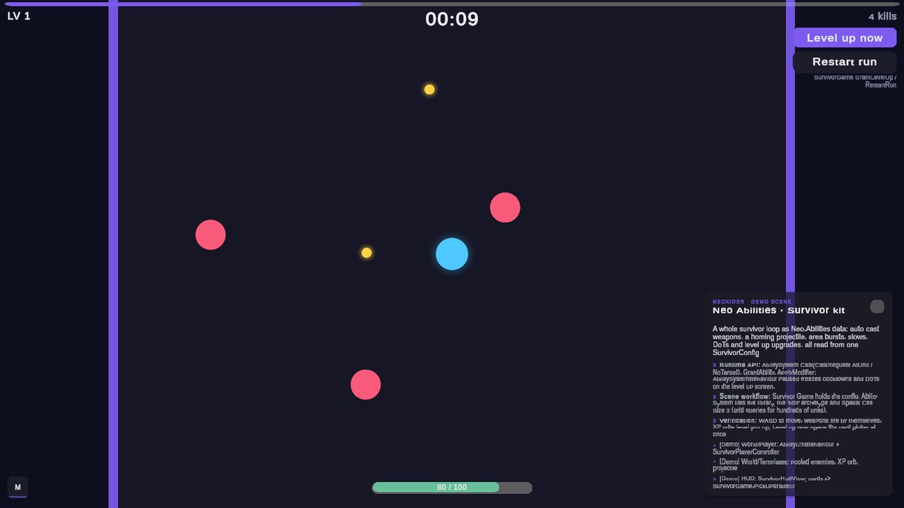</a> <b>Survivor arena</b> Abilities, waves and upgrades from one config</td>
<td width="33%" align="center"><a href="./GridSystem/README.md">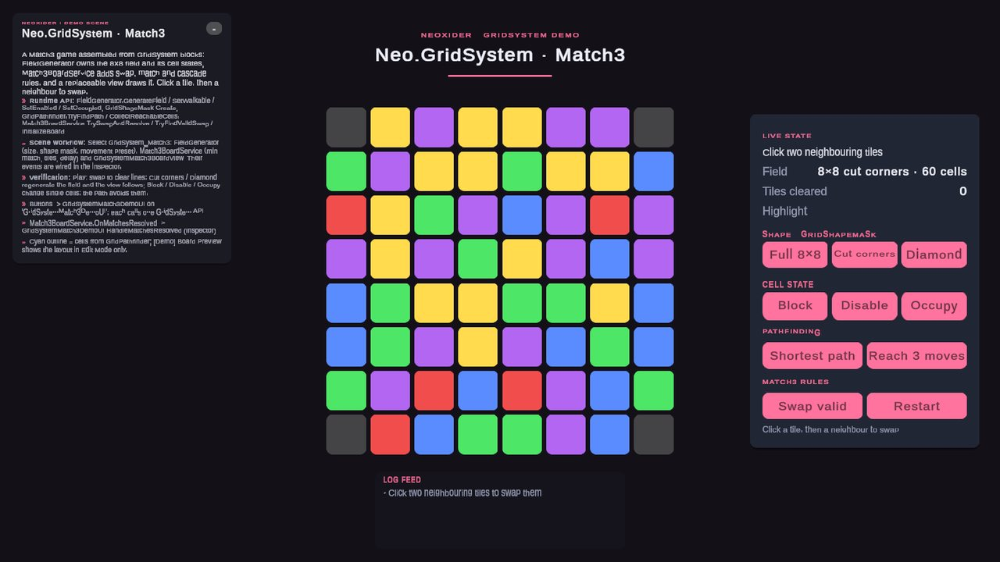</a> <b>Match3 board</b> Shaped boards, paths and match rules</td>
<td width="33%" align="center"><a href="./Bonus/README.md">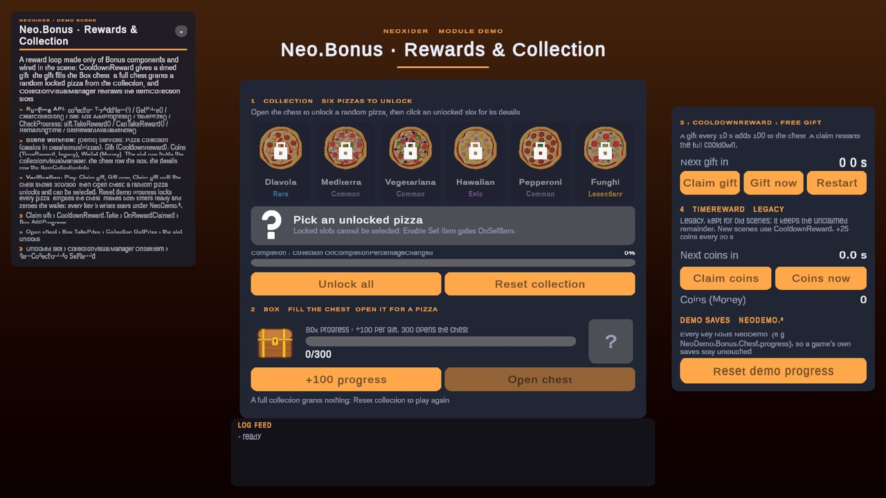</a> <b>Rewards and collection</b> Collection, chest and cooldown gifts, no script</td>
</tr>
<tr>
<td width="33%" align="center"><a href="./Tools/Physics/README.md">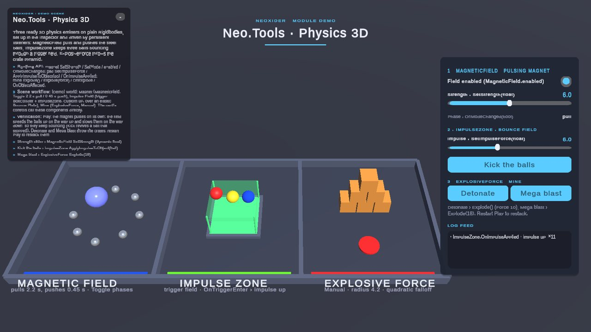</a> <b>Physics 3D</b> Magnet, impulse zone and explosive force</td>
<td width="33%" align="center"><a href="./UI/README.md">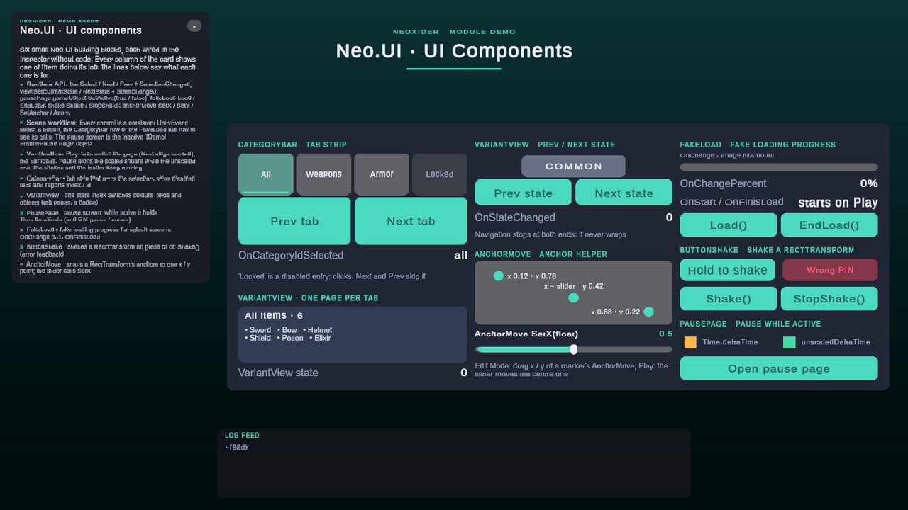</a> <b>UI components</b> Tabs, variants, loader, shake and pause</td>
<td width="33%" align="center"><a href="./Cards/README.md">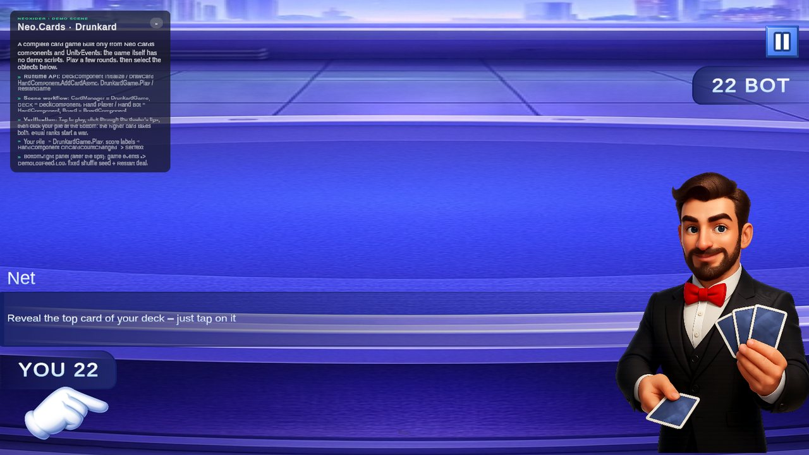</a> <b>Card game</b> Deck, hand and board components</td>
</tr>
<tr>
<td width="33%" align="center"><a href="./Bonus/README.md">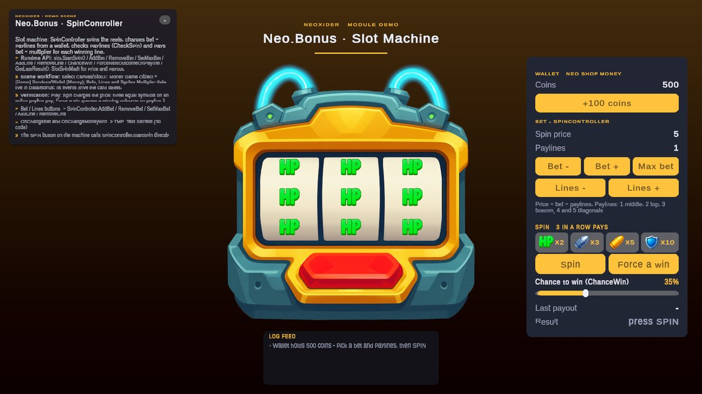</a> <b>Slot machine</b> Bets, paylines and a paytable</td>
<td width="33%" align="center"><a href="./Shop/README.md">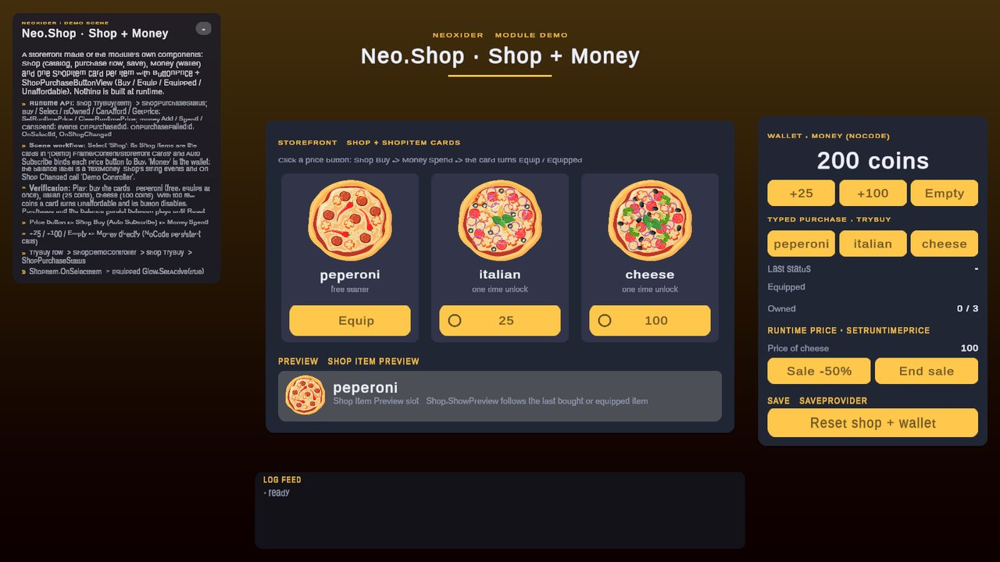</a> <b>Shop</b> Storefront, purchase states and a wallet</td>
<td width="33%" align="center"><a href="./UI/README.md">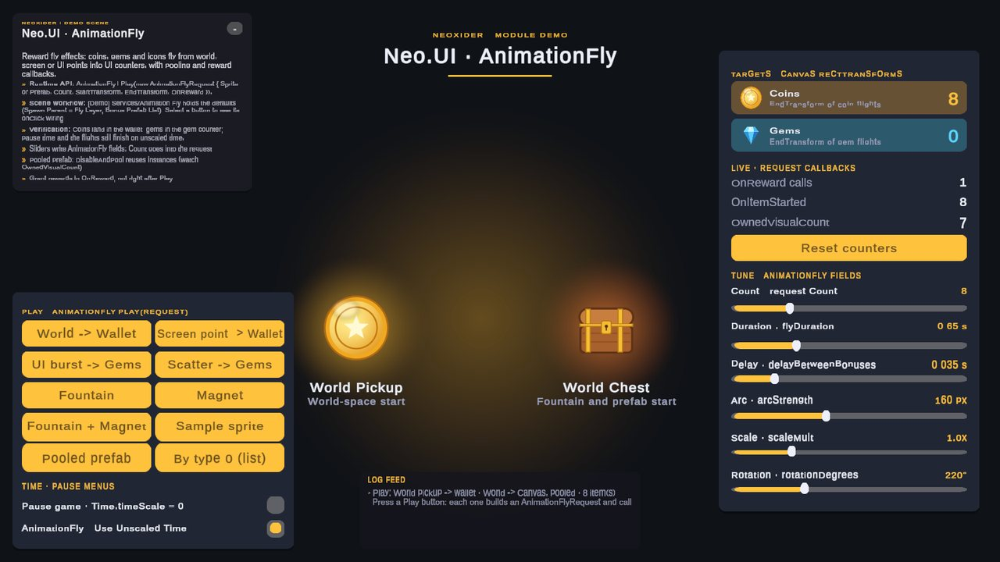</a> <b>Reward fly</b> Coins flying from world, canvas and screen</td>
</tr>
<tr>
<td width="33%" align="center"><a href="./NoCode/README.md">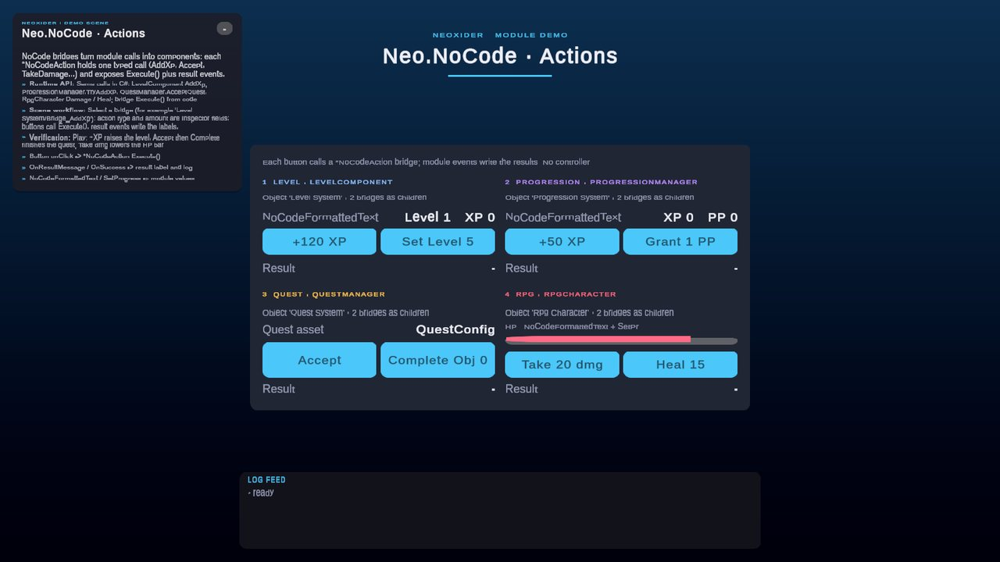</a> <b>NoCode actions</b> Level, Progression, Quest and RPG without code</td>
<td width="33%" align="center"><a href="./Progression/README.md">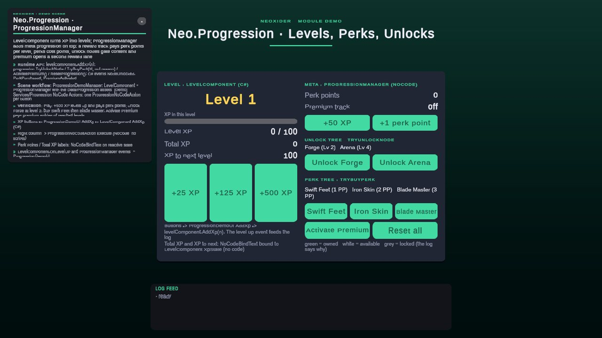</a> <b>Progression</b> XP, perk and unlock trees, premium track</td>
<td width="33%" align="center"><a href="./UI/README.md">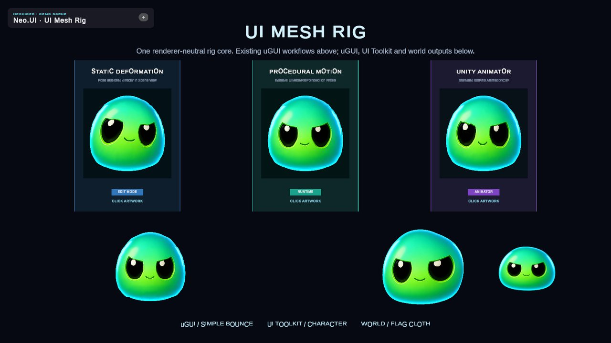</a> <b>UI Mesh Rig</b> One rig in uGUI, UI Toolkit and world space</td>
</tr>
</table>

<!-- demo-gallery:end -->

## Modules

| | Module | What it covers | Entry |
|:-:|--------|----------------|-------|
| 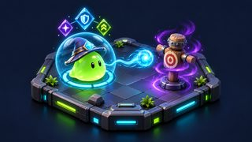 | **Abilities** | Data-driven Dota-style abilities and modifiers: units, properties, buffs/debuffs/DoT/shields, cast pipeline with typed `CastResult`, opt-in spatial grid for crowds, multiplayer-ready receipts; successor to Rpg | [Abilities](./Abilities/README.md) |
| 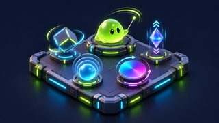 | **Animations** | Runtime value animation for float, color, `Vector3` and transforms, with a manual `Tick` clock and unscaled time | [Animations](./Animations/README.md) |
|  | **Audio** | Audio manager, mixer helpers, random music, audio UI; `AMSettings` saves volumes and mutes | [Audio](./Audio/README.md) |
|  | **Haptics** | Device vibration: named feels, settings switch, repeat throttle, MobileHapticFeedback backend | [Haptics](./Haptics/Haptics.md) |
|  | **Bonus** | Slots, wheel rewards, collections, timed rewards; every mechanic has a plain C# core (`CollectionSet`, `BoxProgress`, `CooldownSchedule`, `SlotSpinMath`) | [Bonus](./Bonus/README.md) |
|  | **Cards** | Deck/hand/board runtime, seeded shuffling, stable custom sorting, poker evaluation, Drunkard sample | [Cards](./Cards/README.md) |
|  | **Condition** | No-code conditions, reflection checks, AND/OR logic, events, unscaled-time checks | [Condition](./Condition/README.md) |
| 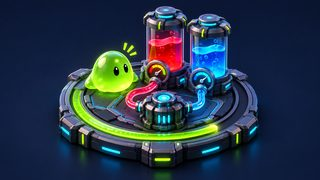 | **Core** | Resource pools, health, level/XP helpers | [Core](./Core/README.md) |
| 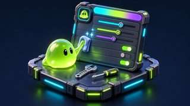 | **Editor** | Inspector, editor windows, missing-script scan, settings (`NeoxiderSettings`, saved in `ProjectSettings/NeoxiderSettings.json`), maintenance tools | [Editor](./Editor/README.md) |
| 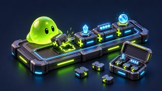 | **Extensions** | Extension methods for C# and Unity APIs, including seeded random helpers | [Extensions](./Extensions/README.md) |
| 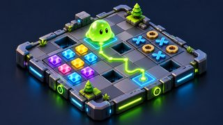 | **GridSystem** | Grid-game constructor: field generation, pathfinding, placement, Dice, GridMerge, Match3, TicTacToe / n-in-a-row, SlidingMerge (2048) | [GridSystem](./GridSystem/README.md) |
| 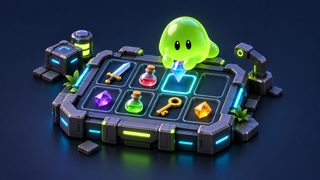 | **Inventory** | Aggregated and slot-grid inventories, pickups, transfers, selection events, save integration | [Inventory](./Tools/Inventory/README.md) |
| 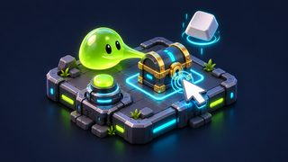 | **Interaction** | Reusable C# contracts, scene hover/click, 2D/3D physics events, ray modes, range checks | [Interaction](./Tools/InteractableObject/README.md) |
| 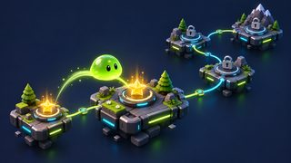 | **Level** | Level manager, scene loading, level map flow | [Level](./Level/README.md) |
|  | **Merge** | Pure C# connected-group merge engine for grids, inventories, lists, and custom graphs | [Merge](./Merge/README.md) |
|  | **Network** | Mirror wrappers, no-code sync, lobby, discovery, realtime .io toolkit (snapshots, prediction), bootstrap, telemetry, transport-free authority policy | [Network](./Network/README.md) |
| 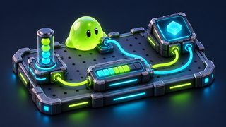 | **NoCode** | Scene UI bindings and Inspector wrappers around C# contracts, each with a typed C# API; ScriptableObjects do not hold scene object references | [NoCode](./NoCode/README.md) |
| 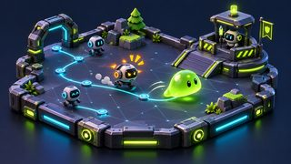 | **NPC** | Navigation, target finder, patrol/chase, staggered re-pathing, RPG combat brain | [NPC](./NPC/README.md) |
|  | **Parallax** | Parallax layers | [Parallax](./Parallax/README.md) |
|  | **Progression** | XP, levels, unlock tree, perk tree, premium track (`ActivatePremium` action, `HasPremium` condition) | [Progression](./Progression/README.md) |
|  | **PropertyAttribute** | Inspector attributes: button, color, inject helpers | [PropertyAttribute](./PropertyAttribute/README.md) |
| 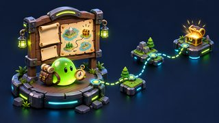 | **Quest** | Quest configs, objectives, manager, runtime state; kill/collect/reach/talk notifications by target id from code or `QuestNoCodeAction` | [Quest](./Quest/README.md) |
| 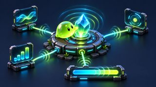 | **Reactive** | Serializable reactive properties for `float`, `int`, and `bool` | [Reactive](./Reactive/README.md) |
| 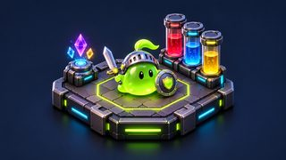 | **Rpg** | `RpgCharacter`, resources, stats, attacks, damage modifiers, buffs/statuses, save/network/no-code bridges (superseded by Abilities) | [Rpg](./Rpg/README.md) |
|  | **Save** | Save providers, attributes, scene/global save flow, 64-bit values | [Save](./Save/README.md) |
|  | **Settings** | Game settings, scene service, UI bindings | [Settings](./Settings/README.md) |
|  | **Shop** | Shop data, typed purchases, currency UI | [Shop](./Shop/README.md) |
|  | **StateMachine** | Runtime state machine and no-code data workflow | [StateMachine](./StateMachine/README.md) |
| 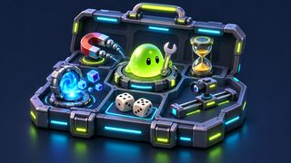 | **Tools** | Movement, free-fly camera, input, physics, spawning, timers and clocks, random tables, dialogue, UI helpers | [Tools](./Tools/README.md) |
| 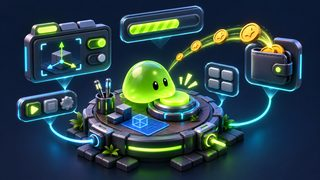 | **UI** | UI panels, button animations, toggles, `CategoryBar` / `VariantView` with typed C# events, UI Mesh Rig, presentation helpers | [UI](./UI/README.md) |

## Gameplay ownership

`Gameplay` is not a standalone Neoxider module. Gameplay systems are owned by concrete runtime modules (`Rpg`, `Quest`, `Progression`, `Cards`, `GridSystem`, `Tools`, `NoCode`, etc.). Do not add a new `Docs/Gameplay` or `Scripts/Gameplay` folder unless a real runtime assembly/API is introduced with clear ownership and tests.

## Samples and add-ons

| Section | Entry |
|---------|-------|
| **Sample scenes** (authored in the scene, rebuilt from **Neoxider > Demo**) | [Samples](./Samples.md) |
| **Examples** | [Examples](./Examples/README.md) |
| **NeoxiderPages** | [NeoxiderPages](./NeoxiderPages/README.md) |
| **Character Movement Fundamentals** | [Character controller and optional demo scenes](./Tools/Move/CharacterController/README.md) |
| **UI Extension** | [UI Extension](./UI%20Extension/README.md) |

## Guides

- [Multiplayer Guide](./Network/Multiplayer_Guide.md)
- [Realtime IO Guide](./Network/Realtime_IO_Guide.md) - server-authoritative realtime games: handshake, snapshots, interpolation, prediction, events, bootstrap
- [NoCode Network Spec](./Network/NoCode_Network_Spec.md)
- [Survivor demo — Vampire-Survivors kit on `Neo.Abilities`](./Abilities/SurvivorDemo.md)
- [Building a Vampire Survivors game (Neo.Abilities)](./VampireSurvivor_Guide.md)
