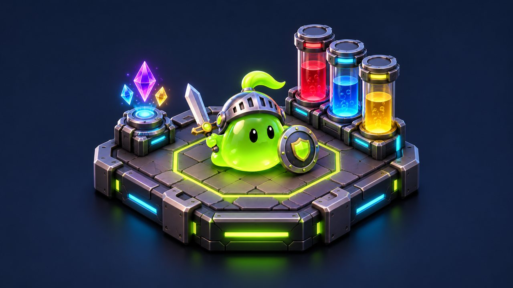
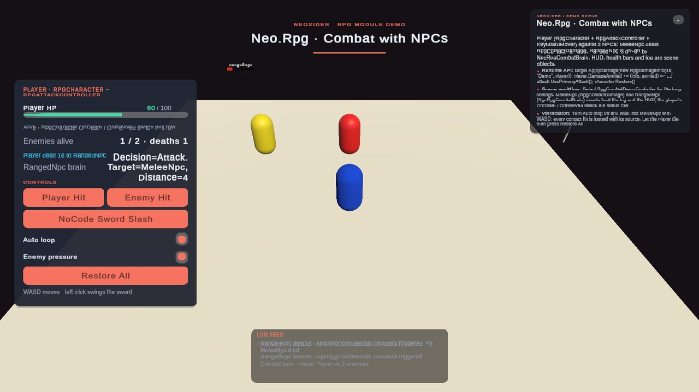
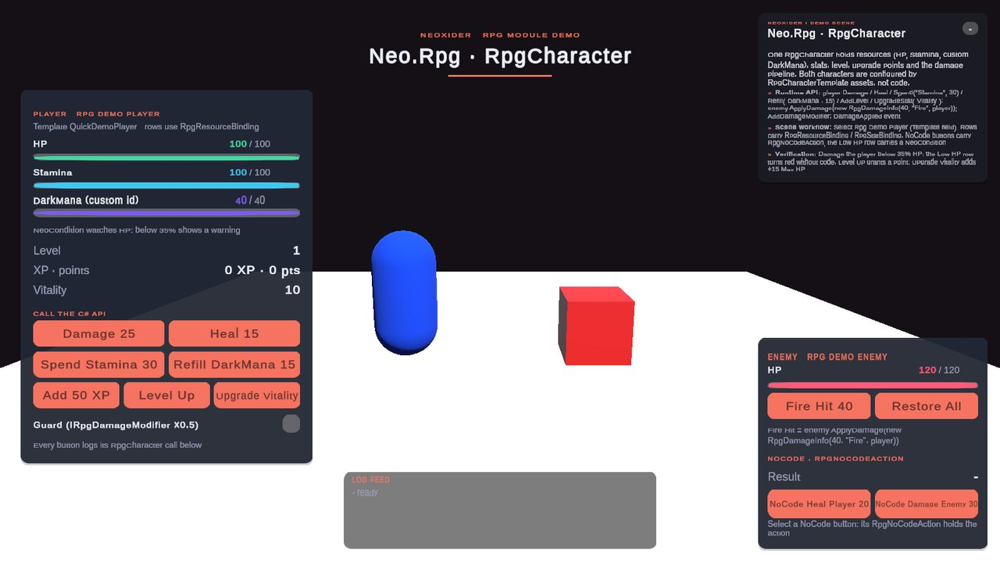

# RPG

<!-- module-art:begin -->
<p align="center"></p>
<!-- module-art:end -->

**What it is:** a full RPG runtime module for persistent player profiles, local and networked combat actors, melee/ranged/aoe attacks, target selectors, attack presets for AI/skills/spells, evade, buffs, statuses, built-in input, and no-code integration. Scripts live in `Scripts/Rpg/`.

<!-- demo-shots:begin -->
<p align="center"> </p>

*Demo scenes: `Scenes/RpgCombatNpcDemo.unity`, `Scenes/RpgCharacterQuickDemo.unity`, in the Demo download (`Assets/NeoxiderDemos/Demo`). The scenes are saved with their UI and wiring, so you can inspect them without entering Play Mode.*
<!-- demo-shots:end -->

**Contents:**

- [RpgCharacter](./RpgCharacter.md) — universal character component for players, NPCs, mobs, pets, and destructibles.
- [RpgCharacterTemplate](./RpgCharacterTemplate.md) — SO template for resources, stats, effects, and progression.
- [RpgProgressionDefinition](./RpgProgressionDefinition.md) — level growth mode: all-stats, manual upgrades, or hybrid.
- [RpgStatGrowthDefinition](./RpgStatGrowth.md) — per-level formula/curve growth rules (`RpgStatGrowthRule`).
- [BuffDefinition](./Data/BuffDefinition.md) / [StatusEffectDefinition](./Data/StatusEffectDefinition.md) — reusable buff and status assets.
- [RpgAttackController](./RpgAttackController.md) — unified melee/ranged/aoe attack entry point.
- [RpgAttackDefinition](./RpgAttackDefinition.md) — ScriptableObject attack payload.
- [RpgAttackPreset](./RpgAttackPreset.md) — AI/skills/spells preset with targeting rules.
- [RpgProjectile](./RpgProjectile.md) — projectile runtime for ranged attacks.
- [RpgTargetSelector](./RpgTargetSelector.md) — reusable target selector for AI/ability logic.
- [RpgAutoAttackController](./RpgAutoAttackController.md) / [RpgContactDamage](./RpgContactDamage.md) — interval and proximity attackers for NPCs.
- [AuraWeapon](./Components/Weapons/AuraWeapon.md) / [MeleeWeapon](./Components/Weapons/MeleeWeapon.md) — timer aura and melee weapon bases.
- [RpgEvadeController](./RpgEvadeController.md) — evade and invulnerability.
- [RpgDeathHandler](./RpgDeathHandler.md) — NoCode deactivate/destroy reaction on death.
- [Runtime services and internal types](./InternalTypes.md) — plain-C# services, enums, data types and clock contracts.
- [RpgNoCodeAction](./RpgNoCodeAction.md) — UnityEvent bridge for no-code flows.
- [Condition bridge](./ConditionBridge.md) — optional `Neo.Rpg.ConditionBridge` assembly and RPG checks for `NeoCondition`.
- [Combat compatibility](./Combat/README.md) — optional `Neo.Rpg.Combat` assembly and legacy AttackSystem migration.
- [Network integration](./Network.md) — optional `Neo.Rpg.Network` assembly, authority and snapshots.
- [RpgResourceBinding](./RpgResourceBinding.md) / [RpgStatBinding](./RpgStatBinding.md) — reactive resource/stat binding for UI and NoCode; text and progress output should use generic `Neo.NoCode`.
- [RpgStatsDamageableBridge](../Tools/Components/AttackSystem/RpgStatsDamageableBridge.md) — legacy
  `AttackSystem` bridge (`IDamageable/IHealable` -> `RpgCharacter`), sourced from
  `Scripts/Rpg/Combat/` in the optional `Neo.Rpg.Combat` compatibility assembly.

**Navigation:** [← Docs](../README.md)

---

## How to use

1. Create `BuffDefinition`, `StatusEffectDefinition`, and `RpgAttackDefinition` assets from the `Neoxider/RPG` menu.
2. Use `RpgCharacter` for the player, enemies, NPCs, pets, and scene-local actors.
3. Enable persistence on `RpgCharacter` when runtime mutations should be saved.
4. Configure resources with presets (`HP`, `Mana`, `Stamina`, `Shield`) or custom IDs (`DarkMana`, `Rage`, etc.).
5. Use `RpgAttackController` for direct, area, and projectile attacks. Primary attack uses left mouse button by default.
6. Use `RpgEvadeController` for dodge/i-frames and `RpgProjectile` for ranged payload delivery.
7. Built-in input on attack/evade can be disabled for NPC and AI actors.
8. Use `RpgNoCodeAction` and `RpgConditionAdapter` for inspector-driven flows.

## Demo scenes

Both scenes live in the Demo download (`Assets/NeoxiderDemos/Demo/Scenes/`). Their UI, bindings and listeners are saved in the
scenes, so every connection can be inspected without
entering Play Mode.

| Scene | What it shows | Look at in the Inspector | C# equivalent |
|---|---|---|---|
| `RpgCharacterQuickDemo.unity` | Resources (HP, Stamina, custom `DarkMana`), level, XP, upgrade points, Vitality upgrade (+15 Max HP), typed damage with a source, a guard damage modifier | `Rpg Demo Player` (template asset), `Resource · HP` (`RpgResourceBinding`), `Value · Vitality` (`RpgStatBinding`), `NoCode ...` buttons (`RpgNoCodeAction`), `Condition · Low HP` (`NeoCondition`) | `Damage`, `Heal`, `Spend`, `Refill`, `AddXp`, `AddLevel`, `UpgradeStat`, `ApplyDamage(new RpgDamageInfo(...))`, `AddDamageModifier`, `DamageApplied` |
| `RpgCombatNpcDemo.unity` | Player (`RpgAttackController`, WASD + left click) against `MeleeNpc` (`RpgContactDamage`) and `RangedNpc` (`NpcRpgCombatBrain`): auto combat loop, world health bars, death and wave restore | `RpgCombatDemoController` (loop settings, explicit references), `MeleeNpc` contact events → log, `RangedNpc` decisions → HUD row, `Player` OnDeath / OnRevived → status row, `NoCode Sword Slash` (`RpgNoCodeAction`) | `ApplyDamage`, `DamageApplied`, `UsePrimaryAttack`, `Restore` |

## Module scope

- `Neo.Rpg` is the base local/offline assembly. Its complete asmdef dependency closure contains no Mirror,
  `Neo.Network`, or other network implementation; only the transport-neutral `Neo.Network.Contracts` leaf
  is allowed for adapter contracts.
- `RpgNoCodeAction` and `RpgNoCodeActionType` remain in `Neo.Rpg` so existing compiled code and serialized
  UnityEvent type names retain their original assembly identity.
- `Neo.Rpg.ConditionBridge` contains only the optional `RpgConditionAdapter` component and owns the
  dependency on `Neo.Condition`. Code in a custom asmdef that uses this adapter must reference
  `Neo.Rpg.ConditionBridge` in addition to `Neo.Rpg`.
- `RpgCharacter` is the scene/API facade and keeps orchestration only (event order, re-entrancy guards,
  persistence, replication hooks). State lives in plain-C# services: `RpgCharacterResourceService`
  (resources, regen clocks), `RpgCharacterStatService` (stats, upgrade rules, investments, resolvers),
  `RpgCharacterProgressionService` (level, XP, upgrade points, applied growth) and `RpgEffectShelf`
  (buffs/statuses), with `RpgModifierMath` aggregating combat multipliers.
- Damage is extensible without subclassing: `IRpgDamageModifier` hooks run after resist multipliers and
  before HP changes; `RpgCharacter.DamageApplied` reports the hit source and the HP removed.
- Hot paths (character tick, regen, damage, multiplier queries, Direct/Area attack casts, aura pulses and
  target selection) are allocation-free once warm and are guarded by zero-GC tests. Listeners you add to
  the UnityEvents on these paths can still allocate on their own.
- `RpgCharacterNetworkAdapter` adds optional Mirror commands and snapshot replication without coupling
  `Neo.Rpg` to the `Neo.Network` runtime implementation; the local assembly uses only
  `Neo.Network.Contracts`. The adapter itself lives in the separate `Neo.Rpg.Network` assembly. The
  character publishes one complete snapshot per step (a frame of regen/effect ticks, a hit, a level-up, one
  command); `RpgCharacter.DeferSnapshotPublication()` groups your own mutations the same way.
- `BuffDefinition` defines temporary buffs with duration and stat modifiers.
- `StatusEffectDefinition` defines status effects (poison, slow, DoT).
- `RpgCharacterProfileData` is the serializable profile payload stored via `SaveProvider`; the plain-C#
  `RpgCharacterProfileService` validates and serializes the same payload for persistence or adapters.
- `RpgCharacterResourceService`, `RpgCharacterStatService` and `RpgCharacterProgressionService` can be tested
  or hosted without a GameObject; `RpgCharacter` preserves the existing UnityEvent-friendly methods and
  serialized definitions as their scene wrapper.

## Persistence

- Profile is stored through `SaveProvider`, not the scene-local `SaveManager`.
- Default save key is configurable on `RpgCharacter`.
- `CaptureProfile()` / `ApplyProfile(data)` transfer state without accessing storage.
- `RpgCharacterProfileService.Serialize` clones its input; buff/status stacks survive serialization.
  Null collections and null rows in profile payloads are sanitized without changing the serializer's source.
- Profile **v2** keeps saved effective resource Max authoritative for that restore call (last duplicate ID wins).
  Max is restored before Current and percentage regen. `BaseMax` remains the template base; an ordinary later
  derived refresh recomputes from that base. There is no v3 schema or durable base-max override.
- Initialization/rebuild/profile application defer transport notifications until state is coherent.
  `RuntimeRebuilt` still fires before optional auto-load; `OnProfileLoadedEvent` marks a completed storage load.

## C# resource runtime

Use `Neo.Rpg.Runtime` without a scene component when a simulation only needs resource pools:

```csharp
RpgCharacterResourceService resources = new RpgCharacterResourceService();
resources.Build(new[]
{
    new RpgResourceDefinition
    {
        id = new RpgStatId(RpgStatPreset.Mana),
        startMax = 100f,
        startCurrent = 20f,
        restoreToFull = false,
        regen = new RpgRegenDefinition
        {
            enabled = true, mode = RpgRegenMode.FlatPerTick, value = 5f, tickInterval = 0.5f
        }
    }
});
resources.Spend("Mana", 10f);
resources.TickRegen(0.5f, false); // Mana is now 15.
```

Use `RefreshDerived(maxResolver, regenResolver, initial)` to resolve stats and active modifiers.
Both continuous and tick modes use the resolved rate. `RegenFlat` and upgrade `AddRegenFlat` values
are units per second; `RegenPercent = 50` adds 50%. Resource percentage regen uses percentage points
too (`value = 5` means 5% of Max). Tick modes preserve their configured interval.

Tick regen and status damage deliver at most **1024 logical ticks per entry per public call**. Extra whole
intervals are discarded; fractional phase is retained, including a small prior phase with a huge finite
delta. Nonfinite delta/interval/amount cannot enter delivery loops. Nested calls to the same tick service
return immediately. Resource gates and the existing pause-crossing frame skip remain in effect; status
expiry uses UTC and retains its damage-before-expiry order. This is a per-entry bound, not a frame budget
across every character. See [runtime contracts](InternalTypes.md).

For scene authoring, configure the same definitions on `RpgCharacter` or its template, then connect
`RpgNoCodeAction`, `RpgResourceBinding`, and `RpgStatBinding` to UnityEvents. Bindings reconnect after
`ApplyTemplate` / `RebuildRuntime`; C# consumers caching reactive states can use `RuntimeRebuilt`.

## Integration with Progression

- Level in `RpgCharacter` can be driven directly with `SetLevel`, `AddLevel`, `AddXp`, or manual stat upgrades.
- To sync with another progression system, call `SetLevel(ProgressionManager.Instance.CurrentLevel)` when progression changes.
- `ApplyLevelGrowth()` explicitly commits deferred growth at the current level. Manual/None/deferred
  modes retain their previously applied growth level across unrelated refreshes. See
  [growth and v2 restore policy](RpgProgressionDefinition.md).

По-русски: RPG остаётся набором C# runtime-контрактов с компонентными обёртками. Рост можно применить
явно через `ApplyLevelGrowth()`. Лимит тиков действует на одну запись за вызов; сохранение v2 временно
восстанавливает эффективный Max, не меняя базовое значение шаблона.
