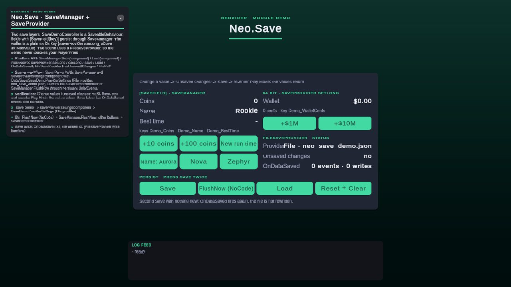

# Save module

<!-- module-art:begin -->
<p align="center"></p>
<!-- module-art:end -->

**What it is:** provider-based persistence (`SaveProvider` facade over PlayerPrefs or a JSON file), component-level scene saves (`SaveManager`, `SaveableBehaviour`, `[SaveField]`) and project-wide data (`GlobalSave`). Scripts: `Scripts/Save/`, namespace `Neo.Save`.

<!-- demo-shots:begin -->
<p align="center"></p>

*Demo scene: `Scenes/Save/SaveDemo.unity`, in the Demo download (`Assets/NeoxiderDemos/Demo`). The scenes are saved with their UI and wiring, so you can inspect them without entering Play Mode.*
<!-- demo-shots:end -->

**Contents:**

| Page | Covers |
|------|--------|
| [SaveProvider](./SaveProvider.md) | Static PlayerPrefs-like facade, provider switching, flush hooks |
| [ISaveProvider](./ISaveProvider.md) | Backend contract and the optional `ILongSaveProvider` capability |
| [PlayerPrefsSaveProvider](./PlayerPrefsSaveProvider.md) | Default backend |
| [FileSaveProvider](./FileSaveProvider.md) | JSON file backend: slots, durability, recovery, write skipping |
| [SaveFileEncryption](./SaveFileEncryption.md) | AES helpers for file saves |
| [SaveProviderExtensions](./SaveProviderExtensions.md) | `long`, `int[]` and `float[]` helpers |
| [SaveProviderSettings](./Settings/SaveProviderSettings.md), [SaveProviderSettingsComponent](./SaveProviderSettingsComponent.md) | Inspector configuration |
| [SaveManager](./SaveManager.md), [SaveableBehaviour](./SaveableBehaviour.md), [SaveField](./SaveField.md), [ISaveableComponent](./ISaveableComponent.md) | Component field persistence |
| [ISaveIdentityProvider](./ISaveIdentityProvider.md), [SaveIdentityUtility](./SaveIdentityUtility.md) | Stable component identities |
| [GlobalSave](./GlobalSave.md), [GlobalData](./GlobalData.md) | Global data object |
| [SaveProviderType](./SaveProviderType.md) | Backend selector enum |
| [PlayerData](./PlayerData.md) | Sample `ISaveableComponent` |

---

Demo: `Assets/NeoxiderDemos/Demo/Scenes/Save/SaveDemo.unity`, authored by the editor builder `Demo/Editor/Builders/Save/SaveDemoBuilder.cs` (rebuild with **Neoxider/Demo/Rebuild Active Demo Scene**), controller `Demo/Scripts/Shell/SaveDemoController.cs`. Everything is saved in the scene, so the wiring is visible without Play Mode: `Save Demo` holds `SaveManager` and a `SaveProviderSettingsComponent` that selects `Demo/Data/Save/SaveDemoProviderSettings.asset` (File provider, `neo_save_demo.json`; the demo never touches your PlayerPrefs). The card shows both save layers: `[SaveField]` values through `SaveManager.Save(this)` / `Load(this)` and a 64-bit wallet through `SaveProvider.SetLong` / `GetLong` above `int.MaxValue`. The status rows read `FileSaveProvider.HasUnsavedChanges` and count `SaveProvider.OnDataSaved` events against real file writes: press **Save** twice and the second save raises the event without rewriting the file. **FlushNow (NoCode)** calls `SaveManager.FlushNow()` through a persistent UnityEvent. It is part of the Demo download.

## Main workflows

- `SaveProvider` for simple key/value persistence with switchable backends.
- `SaveableBehaviour` + `[SaveField]` + `SaveManager` for component state on scene objects.
- `GlobalSave` for data that should not belong to a specific scene object.

## Quick start

```csharp
using Neo.Save;

SaveProvider.SetInt("score", 100);
SaveProvider.SetLong("wallet.cents", 12_345_678_901L);
SaveProvider.Save();
int score = SaveProvider.GetInt("score", 0);
long cents = SaveProvider.GetLong("wallet.cents");
```

`GetLong` / `SetLong` store 64-bit integers (money in cents, large scores, timestamps). A key written earlier with `SetInt` reads back through `GetLong`, so a counter can widen from `int` to `long` without migrating saves.

For component state, add one `SaveManager` and derive components from `SaveableBehaviour`, marking fields with `[SaveField("unique-key")]`. Private fields in base classes are supported. Use `ISaveIdentityProvider` when scene placement is not a suitable persistent identity; identities must stay unique per component type and stable while registered.

`SaveManager.Save(component)` stages all marked fields. `SaveManager.Save()` stages fields that allow automatic saving and keeps previously saved manual fields. Call `SaveProvider.Save()` to persist staged changes, or `SaveManager.I.FlushNow()` to stage registered components and flush together.

## Scene / Inspector setup

1. Create a **Neoxider → Save → Save Provider Settings** asset. Select PlayerPrefs or File and configure optional file encryption.
2. Put the asset at `Resources/SaveProviderSettings.asset` for lazy initialization, or assign it to `SaveProviderSettingsComponent`. The component's `Awake` runs at execution order -1000, before `SaveManager` and other save consumers of the same scene.
3. Add `SaveManager` to the initial scene. `SaveableBehaviour` handles registration and stages automatic fields before disabling. The manager restores initial and newly loaded scene objects, including objects registered during `OnEnable`.
4. After creating runtime objects and assigning their stable identities, call `SaveManager.Load(component)` explicitly. `Register` alone caches fields.

Direct `FileSaveProvider` instances need explicit `Save()` calls. The static facade also flushes on focus loss and application quit, and `SaveManager` flushes on pause, focus loss and quit. A file provider with no pending change skips the disk write, so these overlapping flushes cost no I/O. Failed file-slot flushes retain the original slot and pending values; use [`TryChangeSlot`](./FileSaveProvider.md) when the caller needs a success result.

Invalid enabled file encryption is rejected before opening storage. [`SaveProviderSettings.TryCreateProvider`](./Settings/SaveProviderSettings.md) returns the error without activating a provider; legacy `CreateProvider()` throws `InvalidOperationException`. Lazy Resources initialization can be retried after correcting the asset, and an assigned scene-settings failure retains the previous provider and always logs the error. This is an intentional 11.0 change from silently falling back to plaintext.

## More docs

- Time module: [`../Tools/Time/README.md`](../Tools/Time/README.md)
- Shop module: [`../Shop/README.md`](../Shop/README.md)
