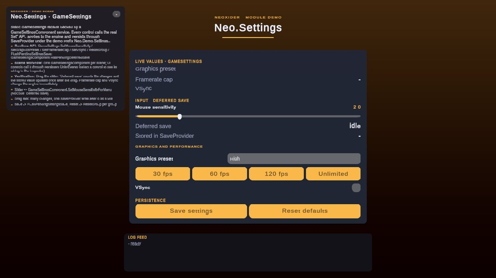

# Settings module

<!-- module-art:begin -->
<p align="center"></p>
<!-- module-art:end -->

**What it is:** runtime assembly **Neo.Settings**: static **`GameSettings`**, **`GameSettingsComponent`** singleton (persistence via **Neo.Save.SaveProvider**, `QualitySettings` presets), and UI binder **`SettingsView`**. Scripts live under `Assets/Neoxider/Scripts/Settings/`.

<!-- demo-shots:begin -->
<p align="center"></p>

*Demo scene: `Scenes/Settings/SettingsDemo.unity`, in the Demo download (`Assets/NeoxiderDemos/Demo`). The scenes are saved with their UI and wiring, so you can inspect them without entering Play Mode.*
<!-- demo-shots:end -->

Demo: `Assets/NeoxiderDemos/Demo/Scenes/Settings/SettingsDemo.unity`, authored by the editor builder `Assets/NeoxiderDemos/Demo/Editor/Builders/Settings/SettingsDemoBuilder.cs` (every control, label and persistent UnityEvent is saved in the scene; rebuild with **Neoxider/Demo/Rebuild Active Demo Scene**), controller `Assets/NeoxiderDemos/Demo/Scripts/Shell/SettingsDemoController.cs` (Demo download). The slider calls `GameSettingsComponent.SetMouseSensitivityForMenu` directly (NoCode, Deferred save); the **Deferred save** row follows `GameSettingsComponent.HasPendingDeferredSave` while a drag is collected into one write, and **Stored in SaveProvider** shows the value that landed. The demo service saves under the key prefix `Neo.Demo.Settings.`, so it never overwrites a game's settings.

**Contents:**

| Doc | Topic |
|-----|--------|
| [GameSettings.md](./GameSettings.md) | Static API |
| [GameSettingsComponent.md](./GameSettingsComponent.md) | Scene service |
| [SettingsView.md](./SettingsView.md) | UI binding |
| [GraphicsPreset.md](./GraphicsPreset.md) | Named quality tiers |
| [SettingsPersistMode.md](./SettingsPersistMode.md) | Immediate, debounced and explicit saving |
| [SettingsGroup.md](./SettingsGroup.md) | Logical groups for persistence and reset |
| [GameSettingsSaveKeys.md](./GameSettingsSaveKeys.md) | Save key suffixes |
| [GraphicsPresetLevelMapping.md](./GraphicsPresetLevelMapping.md) | Preset to `QualitySettings` index mapping |
| [ResolutionPresetEntry.md](./ResolutionPresetEntry.md) | Fixed resolution options |
| [ISettingsLocalization.md](./ISettingsLocalization.md) | Localization hook for the settings UI |

**How to use:**

1. Add **Game Settings Service** (`GameObject → Neoxider/Settings/Game Settings Service`).
2. Read from **`GameSettings`**; write via **`Set…`** or **`SettingsView`**.
3. Keep audio volumes in **`AMSettings`**.

**C# example:** reference `Neo.Settings` from your gameplay assembly and use `using Neo.Settings;`.

```csharp
float sensitivity = GameSettings.MouseSensitivity;
GameSettings.SetMouseSensitivity(3.5f, SettingsPersistMode.Deferred);
GameSettings.SetFullScreen(false);
GameSettings.FlushPendingSettingsSave();
```

The scene service supplies configuration and loads values during initialization. `GameSettings.OnSettingsChanged` lets code react to applied settings; unsubscribe when the consumer is disabled or disposed. Enabled `SettingsView` panels synchronize automatically after API and UI changes. Their callbacks are released when disabled.

Quality dropdown and named preset changes preserve the separate VSync selection. The requested VSync is reapplied after the quality profile and before panels are notified; platforms determine whether VSync affects presentation.

Persistence flags control **writes**, while loading still reads existing saved values. `SaveState` writes every enabled group into the current `SaveProvider`; backend durability is controlled by that provider. See [GameSettings.md](./GameSettings.md) for input validation, display mode consistency and save boundaries.

**Requirements:** this module uses **`QualitySettings`** and does not require URP. If your project needs URP-specific settings, add `com.unity.render-pipelines.universal` to the project separately.
