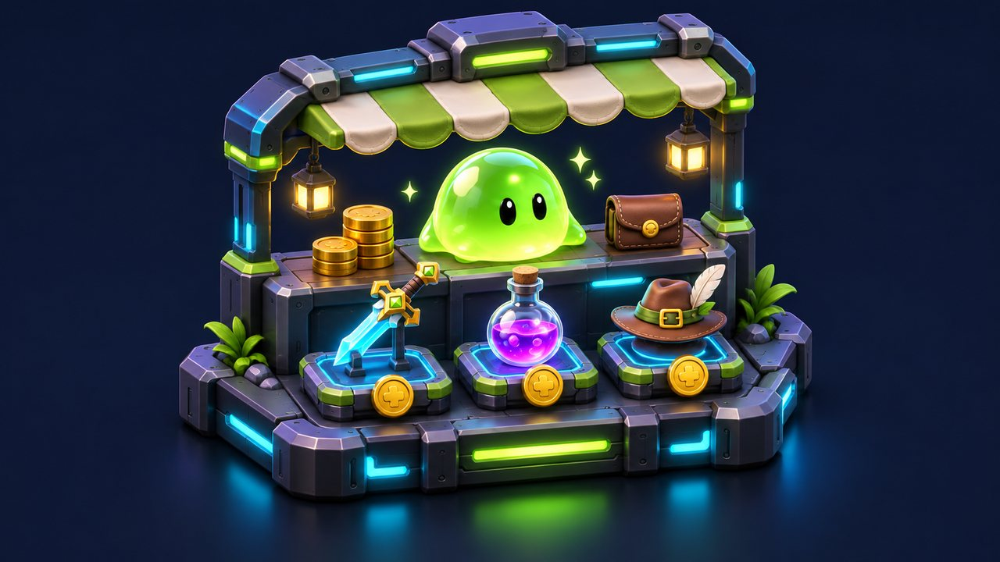
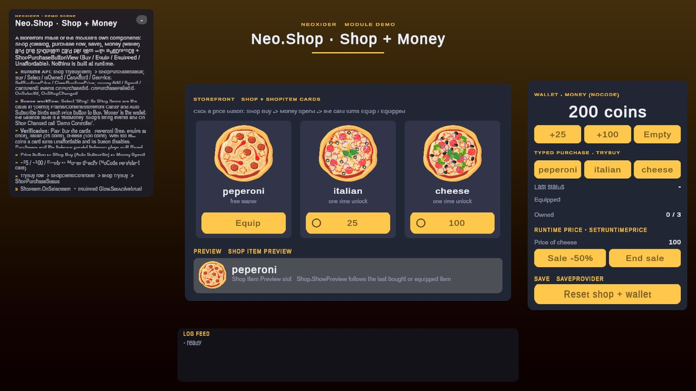

# Shop module

<!-- module-art:begin -->
<p align="center"></p>
<!-- module-art:end -->

**What it is:** shop controller, item/bundle catalog assets, `Money` wallets, purchase/list/category UI views and an
optional Inventory bridge. Scripts live in `Scripts/Shop/` (`Neo.Shop`; the bridge in `Scripts/Shop/Bridges/`,
`Neo.Shop.Bridges`).

<!-- demo-shots:begin -->
<p align="center"></p>

*Demo scene: `Scenes/Shop/Shop.unity`, in the **Demo Scenes** sample (Package Manager > NeoxiderTools > Samples). The scenes are saved with their UI and wiring, so you can inspect them without entering Play Mode.*
<!-- demo-shots:end -->

**Contents:** the table below; start with [Shop](./Shop.md) and [Money](./Money.md).

**Navigation:** [← Docs](../README.md)

---

Since version **8.5.0**: stable string-ids for items, JSON profile save (`ShopProfileData`), bundles, categories, multi-currency, and an optional [Inventory](../Tools/Inventory/README.md) link via the [ShopInventoryGrantBridge](Bridges.md) component.

## Entry pages

| Page | Description |
|------|-------------|
| [Shop](./Shop.md) | Main shop controller, save behavior, and purchase flow |
| [ShopItemData](./ShopItemData.md) | Item asset: id, category, currency override, optional inventory link |
| [ShopBundleData](./ShopBundleData.md) | Bundle of items sold for a single price |
| [ButtonPrice](./ButtonPrice.md) | Shop button view states and price presentation |
| [Money](./Money.md) | Currency component, reactive values, and save behavior |
| [ShopListView](./ShopListView.md) | Optional category/filter view that creates and reuses `ShopItem` cells |
| [ShopCategoryButton](./ShopCategoryButton.md) | NoCode category tab for `ShopListView` |
| [ShopCategorySelector](./ShopCategorySelector.md) | Previous/next category selector |
| [ShopListViewCategoryBar](./ShopListViewCategoryBar.md) | Adapter driving `ShopListView` from a generic `Neo.UI.CategoryBar` |
| [ShopPurchaseButtonView](./ShopPurchaseButtonView.md) | Reactive Buy/Select/Selected/Unaffordable button state per item slot |
| [ShopVariantsPanel](./ShopVariantsPanel.md) | Furniture/equipment variants panel: unowned/owned/equipped states, buy-then-equip |
| [ShopResolver](./ShopResolver.md) | Shared parent-first, scene-fallback lookup policy for optional shop references |
| [Shop bridges](./Bridges.md) | Canonical setup, fallback/lifecycle rules and API of the optional Inventory grant bridge |
| [EquipmentManager](./Equipment/EquipmentManager.md) | Independent equipment state and optional sprite slots per category |
| [EquipItemDefinition](./Equipment/EquipItemDefinition.md) | One equippable piece (`Id`, `CategoryId`, `Sprite`) |
| [ShopItem](./ShopItem.md), [TextMoney](./TextMoney.md) | Reusable item cells and reactive wallet text |

## Runtime API

Use catalog assets or stable ids from ordinary C#:

```csharp
Shop shop = GetComponent<Shop>();
shop.SetMoneySpendSource(wallet.gameObject);
shop.OnPurchasedId.AddListener(HandlePurchased);
if (shop.CanAfford(item))
{
    ShopPurchaseStatus status = shop.TryBuy(item);
    if (status == ShopPurchaseStatus.Purchased)
    {
        PlayPurchaseFeedback();
    }
}
```

`CanAfford` is a precheck; `TryBuy` / `TryBuyBundle` return the actual outcome (`Purchased`, `AlreadyOwned`,
`InsufficientFunds`, `CommitFailed`, `PendingServerAuthority`, ...) and raise the same events as `Buy` / `BuyBundle`,
so `OnPurchasedId` remains the hook for scene/NoCode reactions. `Select` changes equipment directly and does not check
ownership. Use `Buy` / `TryBuy` for the purchase flow. `Select((ShopItemData)null)` clears selection and its highlights.

## Dynamic Storefront Views

Recommended setup for category stores: keep one `Shop` for catalog, save, currency, and purchases; disable `Auto Spawn Items` on that `Shop`; then let one or more `ShopListView` components own the visible lists.

For scene/NoCode setup, assign the catalog and wallet to `Shop`, assign a row prefab to `ShopListView`, and add `ShopPurchaseButtonView` to the row for affordability. Use category buttons/selectors to filter the list and `ShopVariantsPanel` for equipment variants. Rows notify dependent views when rebound; runtime wallet replacement updates affordability immediately. Disabled views reconnect on enable.

In **11.0.0**, free/paid profile mutation and persistence share rollback. A failed profile save restores `Money` spending above its cap without increasing lifetime income. Successful saves commit before view and purchase notifications: observer errors are reported through `OnNotificationFault` / `LastNotificationFault` and leave the purchase committed. Bundle notifications continue with later item ids. Nested `Buy` / `BuyBundle` calls are ignored until the current call settles; call again after it returns. [Shop](./Shop.md#purchase-failure-and-profile-data) explains this event-contract migration and best-effort Inventory delivery.

Networked Money now defaults to server-only client mutation authority. Choose cooperative `None` or wallet `OwnerOnly` explicitly when needed; see [Money](Money.md#client-mutation-authority-1100).

## Demo scene

`Samples~/Demo/Scenes/Shop/Shop.unity` (`Samples/...` while the samples are unpacked for development) is a storefront
made only of the module's components, all saved in the scene:

- `Shop` keeps the catalog (`Resources/Shop/*.asset`) and its **Shop Items** are the authored cards under
  `[Demo] Frame/Content/Storefront Cards`; **Auto Spawn Items** is off and **Auto Subscribe** binds each card's price
  button to `Buy`.
- Each card is a `ShopItem` + `ShopPurchaseButtonView` with a `ButtonPrice` price button (Buy / Equip / Equipped /
  Unaffordable). `ShopItem.OnSelectItem` / `OnDeselectItem` toggle the card's `Equipped Glow` (NoCode).
- `Money` is the wallet; the balance label is a `TextMoney`, and the +25 / +100 / Empty buttons call `Money.Add` and
  `Money.SetCurrentMoney` directly.
- The control card shows the typed C# path: `shop.TryBuy(item)` and the returned `ShopPurchaseStatus`,
  `SetRuntimePrice` / `ClearRuntimePrice`, and a reset of the `SaveProvider` keys. `Shop.OnPurchasedId`,
  `OnPurchaseFailedId`, `OnSelectId` and `OnShopChanged` are wired to `Demo Controller` (`ShopDemoController`).

The scene is authored by the editor builder `Samples~/Demo/Editor/Builders/Shop/ShopDemoBuilder.cs` (menu
**Neoxider/Demo/Rebuild Active Demo Scene**).

## Tests

Shop has both EditMode and PlayMode coverage:

- `Assets/Neoxider/Tests/Play/ShopPurchasePlayModeTests.cs` — purchases, bundles, runtime prices, `Browse` / `EquipOnly` flows, inventory integration, multi-currency, and `ShopListView`.
- `Assets/Neoxider/Tests/Edit/Shop/ShopTypedPurchaseAndRefreshTests.cs` — typed purchase statuses, one list rebuild per purchase, allocation-free row rebinding, runtime catalog growth, event-driven `TextMoney` binding, indexed allocation-free id lookups.
- `Assets/Neoxider/Tests/Edit/Bonus/CodeBuiltComponentEventsTests.cs` — every Shop and Shop.Bridges component (with Bonus and NPC) added from code has each UnityEvent it declares.
- `Assets/Neoxider/Tests/Edit/Shop/ShopProfileDataTests.cs` — JSON round-trip, sanitize/dedupe (allocation-free when warm), runtime price overrides, and clone.
- `Assets/Neoxider/Tests/Edit/Shop/ShopVariantsPanelTests.cs` — unowned/owned/equipped rendering, buy-then-equip, the EquipmentManager bridge, Unequip, one push per changed slot for every listener order with a subscribed `ShopListView` (selection, forwarded selection, purchase that equips), the full-push `RefreshStates`, and the follow-up pass for a slot callback that equips.
- `Assets/Neoxider/Tests/Edit/Shop/Audit20261023NeoShopRegressionTests.cs` — failed/free purchases, capped refunds, invalid numbers/profile collections, equipment restore, row rebinding, and view lifecycle/source changes.
- `Assets/Neoxider/Tests/Edit/Shop/Audit20261023NeoShopMoneyAuthorityTests.cs` — authority/default serialization and local admission-unit coverage.
- `Assets/Neoxider/Tests/Play/Audit20261023NeoShopCommitPlayModeTests.cs` — post-delivery observer faults, wallet/profile/inventory conservation, native TextMoney lifecycle and paused limiter cadence.
- `Assets/Neoxider/Tests/Edit/Save/ShopManagerTests.cs` — legacy Shop/Save coverage.

Run them through Unity Test Runner → EditMode / PlayMode.

Currency contracts are documented in [InterfaceMoney](./InterfaceMoney.md).

## See also

- [Save](../Save/README.md)
- [Tools/Inventory](../Tools/Inventory/README.md)
