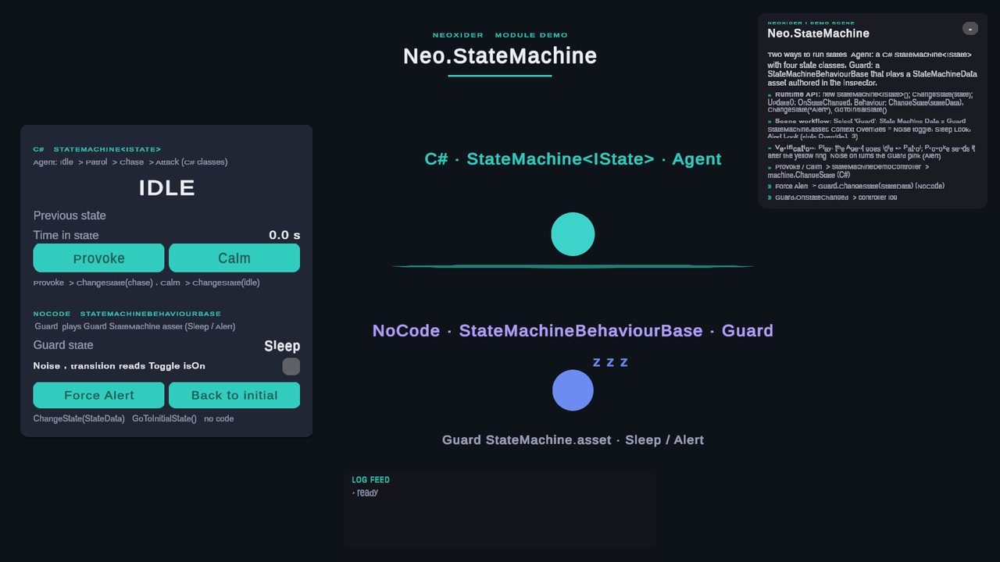

# StateMachine module

<!-- module-art:begin -->

<!-- module-art:end -->

**What it is:** a state machine runtime (`IState`, transitions), no-code ScriptableObject configuration and a visual editor. Scripts in `Scripts/StateMachine/`.

**How to work with it:** in code, run a `StateMachine<IState>` with your own states; in a scene, attach
`StateMachineBehaviourBase` and assign a `StateMachineData` asset ([Choosing a workflow](#choosing-a-workflow)).

<!-- demo-shots:begin -->

*Demo scene: `Scenes/StateMachine/StateMachineDemo.unity`, in the Demo download (`Assets/NeoxiderDemos/Demo`). The scenes are saved with their UI and wiring, so you can inspect them without entering Play Mode.*
<!-- demo-shots:end -->

**Contents:** [current architecture](#current-architecture), [scene wrapper API](#scene-wrapper-api),
[choosing a workflow](#choosing-a-workflow) and the [page index](#docs).

**Navigation:** [← Docs](../README.md)

---

## Current Architecture

- `StateMachine<TState>` is the C# runtime core. Use it directly when you do not need a scene component.
- `StateMachineBehaviour<TState>` and `StateMachineBehaviourBase` are scene wrappers: ticking, context slots, UnityEvents, reload, and enable/disable lifecycle.
- `StateMachineData` / `StateData` assets must not store scene object references. Put scene objects on the component context overrides and reference them from SO data by slot.
- Use `SetContextGameObjectActiveAction` for scene-object actions. `SetGameObjectActiveAction` is legacy compatibility for old assets with direct scene references.
- Runtime logs are gated per machine. A component's **Enable Debug Log** (C#: `EnableDebugLog`) drives its own logs and its machine's `DebugLogEnabled`, which also gates the NoCode actions that machine runs (`LogStateAction`, action errors). Another component's setting does not change them. A plain `StateMachine<TState>` follows the shared switch (the last enabled component) until you assign `DebugLogEnabled`.
- On disable, the component exits the current state; on re-enable it can reload `StateMachineData`.
- Enter, update, and exit actions receive the component's owner and override slots, including exit during disable, destruction, and reload.
- Transition priorities and sources can change at runtime. Moving `FromStateData` to another asset, or changing `FromStateType` (including clearing it to make the transition source-less), takes effect on the next evaluation without re-registering.
- A NoCode machine evaluates only the transitions leaving the active `StateData` (plus source-less ones): per-frame cost is O(outgoing transitions), `OnTransitionEvaluated` reports only those, and predicate entry hooks run only for transitions leaving the entered state. Equal priorities keep registration order. Sorted lists are revalidated through `StateTransition.RoutingVersion`, so a warm evaluation neither re-sorts nor allocates.
- A missing condition override returns false before optional predicate inversion; it does not substitute the owner. `StateMachineData.Validate(true)` returns false for missing initial state or invalid NoCode endpoints without logging; `Validate(false)` (the Inspector's **Validate Configuration** button) always writes those problems to the console.
- A `ConditionEntryPredicate` whose **Source Object** is empty reads its context slot, also from a saved asset in Editor Play Mode.

## Scene wrapper API

- `StateMachineBehaviourBase.ChangeState(StateData)` enters a specific asset (also one not listed in the data); `ChangeState(string)` resolves a name in `StateMachineData`. A literal `ChangeState(null)` is ambiguous at compile time.
- C# event accessors on `StateMachineBehaviourBase`: `OnInitialized`, `OnStateEntered`, `OnStateExited`, `OnStateChanged(previous, current)`, `OnTransitionEvaluated(name, result)`, plus `CurrentStateName`, `PreviousStateName`, `StateChangeCount`, `CurrentStateElapsedTime`, `HasCurrentState`.
- The generic `StateMachineBehaviour<TState>` exposes `EvaluateTransitionsNow()`, `AutoEvaluateTransitions`, `StateMachineData` and `ContextOverrides`; its `initialStateTypeName` accepts a full (`Namespace.State`) or assembly-qualified type name.
- Both wrappers expose `EnableDebugLog`; setting it (or the Inspector toggle in Play Mode) updates the running machine's `DebugLogEnabled`.
- The `StateMachine` property creates the machine on first access, so code can configure it before `Awake`; `Awake` keeps that instance.
- Loading `StateMachineData` enters the assigned `InitialState` asset itself, not the first state with the same name.
- The wrappers' `Update` / `FixedUpdate` / `LateUpdate` and transition evaluation add no per-frame allocations.

## Choosing a workflow

For code, implement `IState`, register `StateTransition` rules, and call `Update()` and `EvaluateTransitions()` on `StateMachine<IState>`. For scene authoring, attach `StateMachineBehaviourBase`, assign `StateMachineData`, and put scene references in **Context for conditions**. See the [runtime API](StateMachine.md) and [NoCode guide](NoCode_StateMachine_Usage.md).

`StateMachineData.LoadIntoStateMachine` registers the configured transition instances. Built-in duration predicates, including children of AND/OR/NOT, use each machine's own entry time by default, so components can share a duration configuration. Custom mutable predicates/actions are still shared; loading does not clone the graph.

`ChangeState` and `Stop` called from lifecycle callbacks are queued FIFO until the current exit/enter/events finish. Each outer dispatch processes at most 128 requests, then discards pending requests with a gated diagnostic. Normal calls remain synchronous. See the [lifecycle and timing contracts](StateMachine.md) for ordering, exception behavior, clock injection and the addressed `SetCurrentStateEnterTime` migration.

Each machine measures state duration on its own clock. To adjust the active machine's time by hand use `machine.SetCurrentStateEnterTime(...)`; `predicate.SetEnterTime(...)` keeps its standalone contract.

If a target state's constructor changes or stops the machine, that newer choice wins: the interrupted activation does not enter or cache its target and does not fall through to a lower-priority automatic rule. `TryChangeState<T>()` returns false for it.

Automatic transitions to a CLR type (`ToStateType`) check the target type once per machine, including targets it rejects. With state caching on (the default), repeated transitions between cached states use no reflection, and the machine itself does not allocate; your predicates, states and event listeners may.

## Demo scene

`Assets/NeoxiderDemos/Demo/Scenes/StateMachine/StateMachineDemo.unity` (Demo download). The **Agent** shows the C# path (`StateMachine<IState>` driven by `StateMachineDemoController`). The **Guard** shows the NoCode path: a `StateMachineBehaviourBase` playing `Data/StateMachine/Guard StateMachine.asset`, where Sleep → Alert reads the Noise toggle through a `ConditionEntryPredicate` and Alert → Sleep also needs 1.5 s in Alert (`StateDurationPredicate`). Everything is saved in the scene.

## По-русски

Длительность состояния считается по часам каждой машины; для ручной правки используйте `machine.SetCurrentStateEnterTime(...)`. Вложенные смены состояния выполняются после текущей последовательности lifecycle-событий, а более новый выбор из конструктора состояния побеждает (`TryChangeState<T>()` вернёт false). NoCode-машина проверяет только переходы из активного `StateData` и переходы без источника. Логи включаются для каждой машины отдельно через **Enable Debug Log**; `Validate(false)` всегда пишет найденные проблемы в консоль.

## docs

| Page | Description |
|------|-------------|
| [README](./README.md) | Module overview and when to use code-first vs no-code |
| [StateMachine](./StateMachine.md) | Core runtime API |
| [StateMachineBehaviour](./StateMachineBehaviour.md), [StateMachineBehaviourBase](./StateMachineBehaviourBase.md) | MonoBehaviour integration |
| [NoCode_StateMachine_Usage](./NoCode_StateMachine_Usage.md) | No-code workflow |
| [Editor](./Editor.md) | Visual graph editor and authoring tools |
| [IState](./IState.md), [StateTransition](./StateTransition.md) | State contract and transition rules |
| [StateAction](./StateAction.md), [StateCondition](./StateCondition.md), [StatePredicate](./StatePredicate.md), [ConditionEntryPredicate](./ConditionEntryPredicate.md) | NoCode actions, conditions and predicates |
| [StateMachineData](./NoCode/StateMachineData.md), [StateData](./NoCode/StateData.md) | NoCode ScriptableObject assets |
| [StateMachineEvaluationContext](./StateMachineEvaluationContext.md) | Internal owner/context scope for predicates and actions |

## See also

- [Condition](../Condition/README.md)
