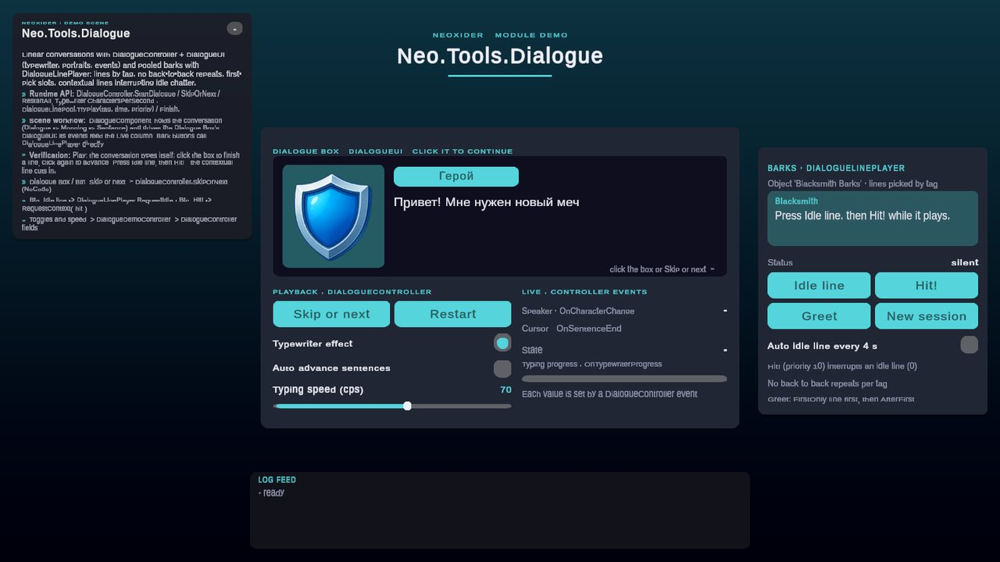

# Tools / Dialogue

**What it is:** Linear dialogue playback (`DialogueController`) with an optional UI and the reusable `TypewriterEffect`, plus pooled bark lines (`DialogueLinePool` / `DialogueLinePlayer`) picked by tag. Namespace: `Neo.Tools`; assembly: `Neo.Tools.Dialogue`. Scripts live in `Scripts/Tools/Dialogue/`.

<!-- demo-shots:begin -->
<p align="center"></p>

*Demo scene: `Scenes/Tools/Dialogue.unity`, in the Demo download (`Assets/NeoxiderDemos/Demo`). The scenes are saved with their UI and wiring, so you can inspect them without entering Play Mode.*
<!-- demo-shots:end -->

**Contents:** see [Component guides](#component-guides) below.

**Navigation:** [← Tools](../README.md)

---

## Start here

Add `DialogueController` and, optionally, `DialogueUI` to the same GameObject. Populate `dialogues` inline as `Dialogue[]` → `Monolog[]` → `Sentence[]`. These are serializable classes, not ScriptableObject assets. Assign TMP name/body labels and an optional portrait on `DialogueUI`. A UI on a different GameObject can be assigned in the controller's Inspector.

Use `autoStart` or call `StartDialogue()`. Connect a UI button to `SkipOrNext()` to complete the current line on the first press and advance on the next. Inspector playback buttons are available in Play Mode.

## C# workflow

```csharp
using Neo.Tools;

// controller is an assigned DialogueController reference.
controller.useTypewriterEffect = false;
controller.dialogues = new[]
{
    new Dialogue
    {
        monologues = new[]
        {
            new Monolog
            {
                characterName = "Guide",
                sentences = new[] { new Sentence { sentence = "Welcome." } }
            }
        }
    }
};
controller.StartDialogue();
controller.SkipOrNext();
```

No UI is required for cursor navigation and events. Custom asmdefs must reference `Neo.Tools.Dialogue`; reference `Neo.Tools.Components` when directly configuring the exposed `TypewriterEffect`.

## Playback contracts

- `SkipOrNext()` completes typing before advancing; `Advance()` directly moves to the next line/boundary and cancels current typing.
- `autoNextSentence` starts automatic progression. The monolog/dialogue auto flags apply their respective delays when a boundary is reached. A zero automatic delay yields until the next frame.
- Missing/empty child arrays are crossed iteratively when their boundary auto flag is off: `StartDialogue()` and manual navigation reach the next available line synchronously, with constant traversal stack depth. Configured boundary delays stop that traversal until the scheduled transition. Null data entries still stop presentation with a gated warning.
- Disabling cancels typing and pending delays while preserving the cursor and `DialogueStarted`. Re-enabling does not resume cancelled work; call `StartDialogue(currentDialogue, currentMonolog, currentSentence)` to replay that selection.
- Completion sets `DialogueStarted` to `false` before `OnAllDialoguesEnd`. Event listeners may start a replacement dialogue; the interrupted controller call then stops.
- `OnSentenceEnd` retains its historical timing: it fires when a sentence is presented/typing is launched. Use `Typewriter.OnComplete` for typing completion, including `CompleteTypewriter()`.

## Demo scene

Open `Assets/NeoxiderDemos/Demo/Scenes/Tools/Dialogue.unity` from the Demo download. Everything is saved in the scene:

- **Dialogue box** - a `DialogueUI` (portrait, name plate, body) driven by the `DialogueComponent` object (`DialogueController`, typewriter, `autoStart`). Clicking the box or `Btn_Skip or next` calls `SkipOrNext`; `Btn_Restart` calls `RestartAll`.
- **Live column** - `OnCharacterChange`, `OnSentenceEnd`, `OnTypewriterProgress` and `OnAllDialoguesEnd` update the labels and the typing bar through `DialogueDemoController`; the toggles and the speed slider change `useTypewriterEffect`, `autoNextSentence` and `Typewriter.CharactersPerSecond`.
- **Barks panel** - the `Blacksmith Barks` object (`DialogueLinePlayer`) holds idle, greet and hit lines. `Btn_Idle line` calls `RequestIdle`, `Btn_Hit!` calls `RequestContext("hit")` and interrupts an idle line, `Btn_Greet` shows the `FirstOnly` line once and `AfterFirst` lines later, `Btn_New session` calls `ResetSession`.

The scene is authored by the editor builder `DialogueBuilder` (menu **Neoxider > Demo > Rebuild Active Demo Scene**).

## Component guides

| Page | Description |
|------|-------------|
| [DialogueController](./DialogueController.md) | Main controller |
| [DialogueUI](./DialogueUI.md) | UI binding |
| [DialogueData](./DialogueData.md) | Inline serializable data and events |
| [DialogueLinePool](./DialogueLinePool.md) | Pooled lines by tag: no back-to-back repeats, time windows, first-pick slots, contextual lines interrupting idle; plain C# core plus `DialogueLinePlayer` |

## Pooled lines

For barks, announcer calls and idle chatter use `DialogueLinePool` (plain C#) or the `DialogueLinePlayer` component instead of a `Dialogue[]` tree:

```csharp
DialogueLinePool pool = new DialogueLinePool(lines);
pool.LineStarted += line => subtitle.text = line.Text;
pool.TryPlay("hit", elapsedSeconds, DialogueLinePool.ContextPriority, out _);
```

## See also

- [Tools/Components](../Components/README.md)
- [UI](../../UI/README.md)
