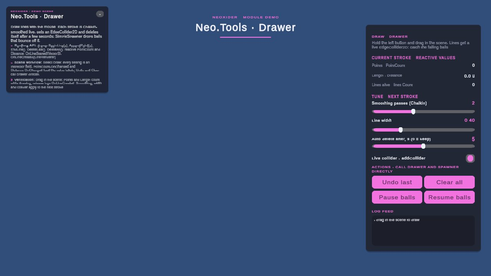

# Tools / Draw

**What it is:** the `Neo.Tools.Draw` module. It provides `Neo.Tools.Drawer`, a scene component for drawing world-space polylines with optional smoothing, 2D edge colliders and pooled line reuse. Scripts live in `Scripts/Tools/Draw/`.

<!-- demo-shots:begin -->

*Demo scene: `Scenes/Tools/DrawExample.unity`, in the **Demo Scenes** sample (Package Manager > NeoxiderTools > Samples). The scenes are saved with their UI and wiring, so you can inspect them without entering Play Mode.*
<!-- demo-shots:end -->

**Navigation:** [← Tools](../README.md)

**Contents:**

| Page | Description |
|------|-------------|
| [Drawer](./Drawer.md) | Setup, C# stroke API, geometry helpers, performance, materials, pooling, events and lifecycle. |

---

Use `BeginLine`, `AppendPoint`, and `EndLine` from C#, or enable the component's pointer input in the Inspector (legacy Input Manager or Input System). The geometry helpers (`Smooth`, `LimitPoints`, `GetDistance`, `UpdateColliderPoints`) can also be called without creating a component; `Smooth` and `LimitPoints` have non-allocating overloads for per-frame use.

Reset/start callbacks may create a replacement stroke. Pooled lines capture owner/generation so external return and reuse cannot leave the former Drawer controlling the new rental. Each Drawer retires only its unique automatic source; assigned prefab pools remain reusable. See [pool cleanup](../Spawner/PooledObjectInfo.md) for the shared lifecycle contract.

Custom assemblies using this module must reference `Neo.Tools.Draw`. The component uses `Neo.Reactive`, `Neo.Extensions`, `Neo.PropertyAttribute`, `Neo.Tools.Spawner`, `Neo.Tools.Managers`, and `Neo.Tools.Input` (pointer compatibility); no separate Editor assembly is required.

**Demo scene:** `Scenes/Tools/DrawExample.unity` in the Demo sample: draw lines that catch falling balls, with the reactive point count and length, smoothing, width and auto-delete controls saved in the scene. See [Drawer › Demo scene](./Drawer.md#demo-scene).
