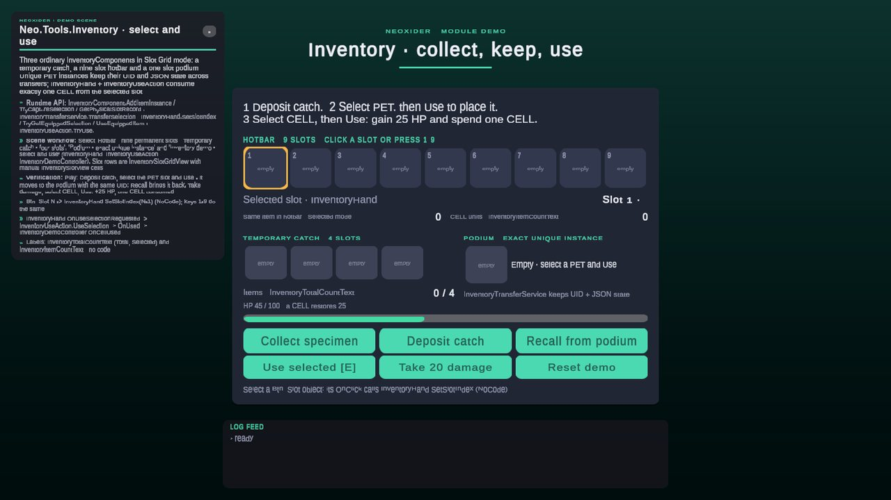

# Tools / Inventory

<!-- module-art:begin -->
<p align="center"></p>
<!-- module-art:end -->

**What it is:** Reusable inventory storage (plain C# `AggregatedInventory` / `SlotGridInventory`), the
`InventoryComponent` scene facade with persistence, pickup/drop, equipped visuals and UI binding. Scripts in
`Scripts/Tools/Inventory/` (`Core`, `Data`, `Runtime`, `UI`), namespace `Neo.Tools`, assembly `Neo.Tools.Inventory`.

<!-- demo-shots:begin -->
<p align="center"></p>

*Demo scene: `Scenes/Inventory/InventoryUseDemo.unity`, in the **Demo Scenes** sample (Package Manager > NeoxiderTools > Samples). The scenes are saved with their UI and wiring, so you can inspect them without entering Play Mode.*
<!-- demo-shots:end -->

**Contents:** see [Documentation](#documentation) below.

**How to work with it:**
1. Plain C#: create a storage, call `SetConstraints`, then `Add`/`Remove`/`MoveSlot` (see Runtime API).
2. Scene: add [InventoryComponent](InventoryComponent.md) with an optional [InventoryDatabase](Data/InventoryDatabase.md).
3. Add [PickableItem](PickableItem.md), [InventoryDropper](InventoryDropper.md), [InventoryHand](InventoryHand.md)
   and the view/text components as needed; they bind to the same inventory.

---

## Runtime API

```csharp
InventoryConstraints limits = new() { MaxTotalItems = 20, MaxUniqueItems = 4 };
limits.SetItemMaxStack(7, 5);
SlotGridInventory bag = new(6);
bag.SetConstraints(limits);
int added = bag.Add(7, 8); // 5 in slot 0, 3 in slot 1
int moved = bag.MoveSlot(1, 2, 2);
InventorySlotState slot = bag.GetSlot(2); // a copy; Count == 2
```

`AggregatedInventory` keeps one simple stack per item id and separate instance records.
`SlotGridInventory` uses physical indices, including empty slots, and caps each simple stack separately.
Both return actual accepted counts and clone instance payloads/snapshots. Unique limits count item ids,
including ids already represented by an instance. Unlimited limits still respect the `int.MaxValue`
total supported by the public count API.

Use `TryInsertIntoSlot` for a constrained insertion. Low-level `SlotGridInventory.SetSlot` is an
unchecked restoration/authoring API; `InventoryComponent.TrySetSlot` validates a complete replacement.
See [core contracts](InternalTypes.md) and [InventoryComponent](InventoryComponent.md).

## Scene / Inspector quick start

1. Add `InventoryComponent` and assign an optional `InventoryDatabase` for item metadata and validation.
2. Choose `Aggregated`, or `SlotGrid` with a slot count. Keep singleton registration off for additional chests.
3. Add `PickableItem` to world drops. Default collector validation requires an inventory on the collector or its parents.
4. Add `InventoryDropper` if items should return to the world. Assign the same inventory to the hand/dropper pair.
5. Bind counts and views with `InventoryView`, `InventorySlotGridView`, or the text components.
6. For use from the hand add [InventoryUseAction](InventoryUseAction.md), set a type/consume amount,
   and connect `OnUsed` to the effect. Prefer exact selections when multiple items share one type id.

## Playable example and collection games

Open `Demo/Scenes/Inventory/InventoryUseDemo.unity` from the **Demo Scenes** sample. Deposit the catch,
select a PET, place/recall it with its UID and state, then select CELL and use it to restore HP.
The screen explains each step, shows the selected item and remaining quantity, and provides Reset.
It demonstrates independent temporary carry, nine-slot hotbar and podium inventories. See
[exact selection and collection-game integration](InventorySelection.md) for API and save/catalog mapping.

Everything is saved in the scene, so the wiring is visible without entering Play Mode:

| Look at | What it shows |
|---|---|
| `Hotbar - nine permanent slots`, `Temporary catch - four slots`, `Podium - exact unique instance` | Three `InventoryComponent`s (Slot Grid, singleton off, no save) sharing the generated `Data/Inventory/InventoryDemoDatabase` (PET 101, CELL 202). Their `OnInventoryChanged` calls `InventoryDemoController.Refresh`. |
| `Inventory demo - select and use` | `InventoryHand` → `OnUseSelectionRequested` calls `InventoryUseAction.UseSelection` (CELL, consume 1); `OnUsed` calls `InventoryDemoController.OnCellUsed`. |
| `[Demo] Frame/Content/Hotbar slots` | `InventorySlotGridView` with nine manual `InventorySlotView` + `InventoryItemView` cells. Each `Btn_Slot N` button calls `InventoryHand.SetSlotIndex(N-1)` directly (NoCode). |
| Count labels | `InventoryTotalCountText` (Total for the catch, Selected for the hotbar — follows the hand selection without a mutation) and `InventoryItemCountText` (CELL units). |

C# equivalents: `InventoryComponent.AddItemInstance` / `TryCaptureSelection`,
`InventoryTransferService.TransferSelection`, `InventoryHand.SetSlotIndex` / `UseEquippedItem`,
`InventoryUseAction.TryUse`. The scene is authored by `InventoryUseDemoBuilder`
(`Demo/Editor/Builders/Inventory`); rebuild it with **Neoxider → Demo → Rebuild Active Demo Scene**.

**По-русски:** готовый пример показывает использование, а не только подбор и переключение. Улов,
постоянный инвентарь и подиум — отдельные контейнеры; UID, уровень и мутация сохраняются при переносе.
`TryConsumeSelection` расходует выбранный экземпляр, `TryConsume(itemId, amount)` — количество по типу.
Вся связка сохранена в сцене: кнопки слотов `Btn_Slot N` напрямую вызывают `InventoryHand.SetSlotIndex`,
ряды слотов — это `InventorySlotGridView` с ручными ячейками, счётчики — `InventoryTotalCountText` и
`InventoryItemCountText`, а `InventoryHand.OnUseSelectionRequested` → `InventoryUseAction.UseSelection`
видно в инспекторе без запуска Play Mode.
Исходники сэмпла: `Assets/Neoxider/Samples~` (release), `Assets/Neoxider/Samples` (разработка); после
UPM-импорта — `Assets/Samples/NeoxiderTools/<version>/Demo Scenes`.

Successful slot moves, swaps, and payload replacements notify UI and auto-save even when item counts
stay equal. Item delta events only describe actual count changes. Auto-save writes JSON to the current
SaveProvider; call `SaveProvider.Save()` at your application's persistence boundary to flush it.
Auto-save is attempted even when a mutation observer throws; paired transfers attempt both inventories'
finalizers and rethrow the first fault after those attempts. This does not make two save keys atomic.

Partial pickups leave the rejected remainder in the world. `CanDrop` gates every drop entry point,
including calls from `InventoryHand`. Runtime Inspector buttons are available in Play Mode.

In 11.0, pickup remaining amounts and drop recovery use the exact committed quantity before inventory
callbacks. Failed drops return to their original physical slot first. If reentrant callbacks occupy the
available capacity, the dropper retains the unreturned quantity: inspect `PendingReturnCount`, free room,
and call `RetryPendingReturns()` before requesting more drops. See the pickup/drop pages for ownership
and exception behavior. Item icons remain authored asset references; prefab previews are resolved by views.

Кратко: количество в мире фиксируется до событий, сохранение выполняется и при ошибке обработчика.
Невместившийся возврат остаётся у `InventoryDropper` до явного `RetryPendingReturns()`.

## Performance notes

- Every mutation captures before/after counts for its delta events. The built-in storages read ids and counts
  in place, so this no longer deep-clones every instance payload; `GetSnapshotEntries`, `GetNonEmptySlotCount`,
  `GetFirstItemId`/`GetLastItemId`, `GetItemIdAtSlotIndex` and `TryTakeFirstRecordByItemId` avoid clones the same
  way, and so does `InventoryHand.EquippedItemId` (safe to poll from NeoCondition every frame).
- Auto Save serializes the live rows instead of a cloned snapshot. It still writes JSON after each mutation;
  wrap a burst of mutations in `using (inventory.DeferAutoSave()) { ... }` to write once when the scope closes
  (or set `AutoSave = false` and call `Save()` yourself). See [InventoryComponent](InventoryComponent.md).
- `SlotGridInventory.Add` keeps a running total (O(slots) instead of O(slots squared)); slot validation during
  `TrySetSlot` and `Load` reads slots in place.
- `InventorySlotGridView` binds live slot states, count labels skip rewriting an unchanged value, and
  `InventoryHand` keeps its visual when an unrelated change leaves the equipped item and payload unchanged.
- Allocation guards in `InventoryHotPathTests` cover the mutation capture, unchanged count-label refreshes and the
  clone-free id reads.

## Documentation

| Page | Description |
|------|-------------|
| [InternalTypes](InternalTypes.md) | Public C# storage, constraints, snapshots, and slot contracts |
| [InventoryComponent](InventoryComponent.md) | Scene facade, persistence, events, and load compatibility |
| [PickableItem](PickableItem.md), [InventoryDropper](InventoryDropper.md) | Pickup and drop workflows |
| [InventorySlotGridView](InventorySlotGridView.md), [InventoryItemState](InventoryItemState.md), [InventoryItemStateBehaviour](InventoryItemStateBehaviour.md) | Slot UI and instance payloads |
| [InventoryView](InventoryView.md), [InventoryHand](InventoryHand.md), [HandView](HandView.md) | List UI and equipped visuals |
| [InventorySelection](InventorySelection.md), [InventoryUseAction](InventoryUseAction.md) | Exact instance use, consumption and transfer; collection-game sample |
| [InventoryItemCountText](InventoryItemCountText.md), [InventoryTotalCountText](InventoryTotalCountText.md) | Count display |
| [InventoryDatabase](Data/InventoryDatabase.md), [InventoryInitialStateData](Data/InventoryInitialStateData.md) | Item definitions and initial-content assets |

## See also

- [Save](../../Save/README.md)
- [Shop](../../Shop/README.md)
- [Shop bridges](../../Shop/Bridges.md) — canonical purchase-to-inventory setup and best-effort grant contract
