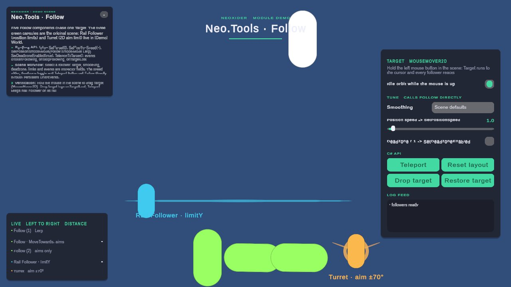
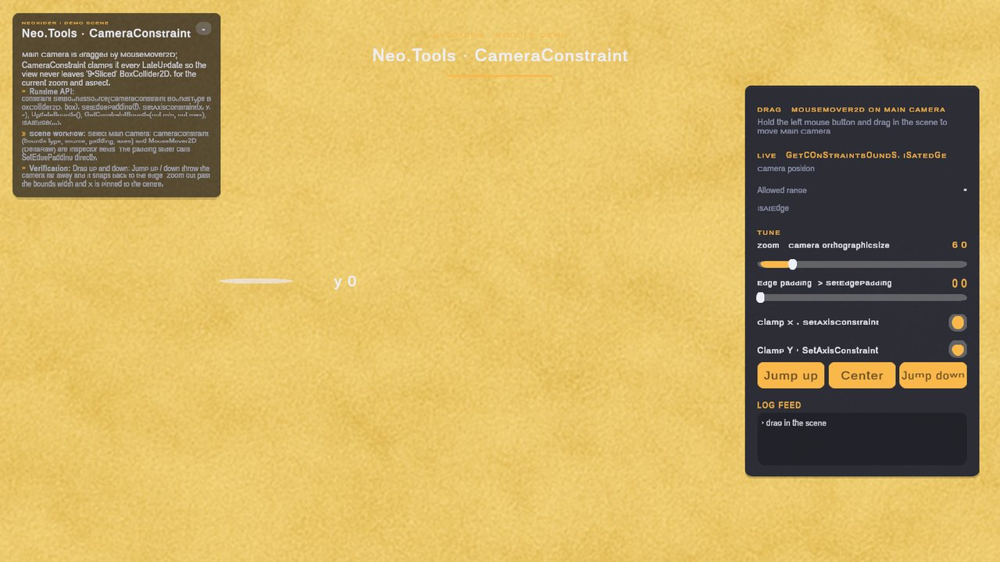

# Tools / Move

**What it is:** the `Neo.Tools.Move` module — movement and positioning: follow, character controllers, camera helpers, cursor control, forces and the MovementToolkit (`IMover`, `KeyboardMover`, `MouseMover2D/3D`, constant movers). Scripts live in `Scripts/Tools/Move/`, namespace `Neo.Tools`.

<!-- demo-shots:begin -->

 

*Demo scenes: `Scenes/Tools/Move/Follow.unity`, `Scenes/Tools/CameraConstraint.unity`, in the **Demo Scenes** sample (Package Manager > NeoxiderTools > Samples). The scenes are saved with their UI and wiring, so you can inspect them without entering Play Mode.*
<!-- demo-shots:end -->

**Navigation:** [← Tools](../README.md)

**Contents:**

| Page | Description |
|------|-------------|
| [CharacterController](./CharacterController/README.md) | Current 3D character controller (CMF motor + Neoxider input, sprint, camera bridge, Mirror). |
| [Follow](./Follow.md) | Follow a target's position/rotation with smoothing, deadzone and limits. |
| [UniversalRotator](./UniversalRotator.md) | Aim at a transform, point or the mouse in 2D/3D. |
| [DistanceChecker](./DistanceChecker.md) | Approach/depart events between two transforms. |
| [AdvancedForceApplier](./AdvancedForceApplier.md) | Configured forces/impulses for `Rigidbody` and `Rigidbody2D`, with a speed cap. |
| [CameraConstraint](./CameraConstraint.md) | Keep a camera inside sprite/collider bounds. |
| [CameraRotationController](./CameraRotationController.md) | Drag-rotate an object with per-axis limits. |
| [FreeFlyCameraController](./FreeFlyCameraController.md) | Scene View style debug/spectator camera. |
| [CursorLockController](./CursorLockController.md) | Cursor ownership stack that drives player look/movement gates. |
| [ScreenPositioner](./ScreenPositioner.md) | Place an object at a screen edge. |
| [PlayerController2DPhysics](./PlayerController2DPhysics.md) / [PlayerController2DAnimatorDriver](./PlayerController2DAnimatorDriver.md) | `Rigidbody2D` side-scroller controller and its Animator driver. |
| [PlayerController3DPhysics](./PlayerController3DPhysics.md) / [PlayerController3DAnimatorDriver](./PlayerController3DAnimatorDriver.md) | Legacy `Rigidbody` 3D controller and its Animator driver. |
| [MovementToolkit](./MovementToolkit/README.md) | `IMover`, `KeyboardMover`, `MouseMover2D`, `MouseMover3D`, `ConstantMover`, `ConstantRotator`. |

---

## Character controller

Start at **[CharacterController](./CharacterController/README.md)** — the current 3D character controller (CMF motor + Neoxider input, sprint, camera bridge and Mirror support). It handles slope limits with slide-off, stairs, moving platforms, momentum from external forces, first- and third-person cameras and animation.

[PlayerController3DPhysics](./PlayerController3DPhysics.md) and [PlayerController3DAnimatorDriver](./PlayerController3DAnimatorDriver.md) are **legacy**: still supported with preserved serialized settings and public APIs. New projects should use the CharacterController module. Their component menu entries moved under `Neoxider/Tools/Legacy/`. The 2D controllers are not affected by this migration.

## Runtime API and scene setup

Gameplay code can call the typed APIs directly: `Follow.SetTarget`, `UniversalRotator.RotateTo`,
`AdvancedForceApplier.ApplyForce`, or the movement commands on `IMover`. Reference `Neo.Tools.Move`
from your own assembly and use namespace `Neo.Tools`.

For scene assembly, add the relevant component, assign its target/body/camera, and configure its
Inspector fields. Public methods can also be connected to UnityEvents; force application is a
Play Mode-only Inspector action. See the [MovementToolkit guide](./MovementToolkit/README.md)
for plane coordinates, physics choices, small movement steps, and pointer input support.

## Demo scenes

Both scenes are in the Demo sample and saved with all their wiring (rebuild them with **Neoxider > Demo > Rebuild
Active Demo Scene**):

| Scene | Shows |
|-------|-------|
| `Scenes/Tools/Move/Follow.unity` | Five `Follow` components on one `MouseMover2D`-driven target: smoothing modes, position limits, a 2D aim limit, `TeleportToTarget` and `onTargetLost`. See [Follow › Demo scene](./Follow.md#demo-scene). |
| `Scenes/Tools/CameraConstraint.unity` | A camera dragged by `MouseMover2D` and clamped by `CameraConstraint`, with live bounds, padding, zoom and per-axis toggles. See [CameraConstraint › Demo scene](./CameraConstraint.md#demo-scene). |

## Compatibility notes

11.0 keeps existing component APIs and serialized settings. Overlapping
[cursor controllers](./CursorLockController.md) retain each player's first gate values until the last
owner releases them; [camera drag](./CameraRotationController.md) balances active transitions and
keeps its legacy sensitivity. Review the [ScreenPositioner depth migration](./ScreenPositioner.md#110-depth-migration)
when preserving existing orthographic or perspective placements; scene values are not rewritten.

12.0 keeps the same APIs and serialized settings, with these behaviour fixes: `Follow` rotation limits and
`UniversalRotator` `limitRange` share one sector rule (nearer edge, sectors past 180, a range of a full turn or
more disables limits, an inverted range wraps through 180); a `CameraConstraint` whose bounds source disappears
at runtime pauses instead of disabling itself (check `HasValidBounds`); and a `CursorLockController` that is
deactivated or destroyed hands look back like `DisableController()`, so a standalone player re-locks the cursor
unless it leaves play together with that owner; an owner on an inactive GameObject then counts as absent, like a
disabled one, so the player handles Escape itself until the owner is active again.

Character controller pages: [NeoCharacterInput](./CharacterController/NeoCharacterInput.md), [NeoCameraInput](./CharacterController/NeoCameraInput.md), [NeoCharacterSprint](./CharacterController/NeoCharacterSprint.md), [NeoCharacterCameraBridge](./CharacterController/NeoCharacterCameraBridge.md), [NeoCharacterNetworkBinding](./CharacterController/NeoCharacterNetworkBinding.md).

## Performance notes

Movement components run every frame for many objects, so the per-frame paths avoid managed allocations.
The legacy-input availability probe is cached for all controllers (no exception per read in Input System-only
projects), `Follow`, `ScreenPositioner` and `CameraConstraint` write their transform only when it changes, and the
animator drivers write parameters by cached hash. EditMode allocation guards (`GcAlloc`) cover the warm paths
of `Follow`, `ScreenPositioner`, `CameraConstraint` and both animator drivers.

## Free-Fly Camera

Use [FreeFlyCameraController](./FreeFlyCameraController.md) for a Unity Scene View style debug/spectator camera. By default RMB gates look and movement; `W/A/S/D`, `Q/E`, `Left Shift`, `Left Alt`, and mouse wheel cover movement and speed control. Disable `Require Look Button` and optionally `Move Only While Looking` for always-on control.

## Ready-made prefabs

Character prefabs (first/third person, animated top-down, side-scroller, click-to-move) and a moving platform are listed in the **Create Neoxider Object** window under *Presets → Player* / *Presets → Environment*, and under **GameObject → Neoxider → Presets**. See [CharacterController → Ready-made prefabs](./CharacterController/README.md#ready-made-prefabs).
