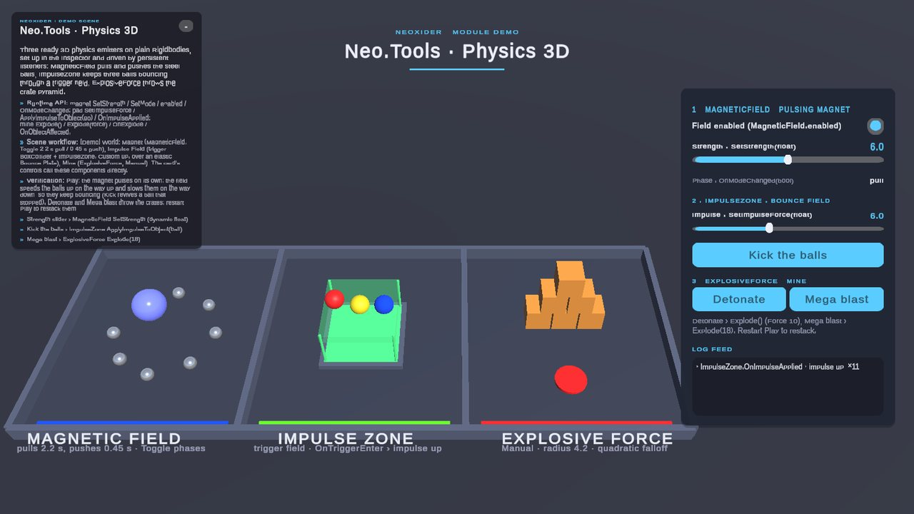

# Tools / Physics

**What it is:** reusable 3D physics emitters in `Scripts/Tools/Physics/`, namespace `Neo.Tools`, assembly `Neo.Tools.Physics` (reference it from custom asmdefs). They use Unity's default physics scene and `Rigidbody`; they do not affect `Rigidbody2D`.

<!-- demo-shots:begin -->

*Demo scene: `Scenes/Tools/Physics/Physics3DDemo.unity`, in the Demo download (`Assets/NeoxiderDemos/Demo`). The scenes are saved with their UI and wiring, so you can inspect them without entering Play Mode.*
<!-- demo-shots:end -->

**Navigation:** [← Tools](../README.md)

**Contents:**

| Page | Description |
|------|-------------|
| [ExplosiveForce](./ExplosiveForce.md) | One-shot or manual radial impulse with falloff |
| [ImpulseZone](./ImpulseZone.md) | Trigger zone that pushes entering bodies (jump pads, boosters) |
| [MagneticField](./MagneticField.md) | Continuous attract/repel/direction field |

---

## C# and scene setup

Call `ExplosiveForce.Explode()`, `ImpulseZone.ApplyImpulseToObject(target)`, or configure a continuously running `MagneticField` through `SetMode`, `SetTarget`, `SetTargetPoint`, and `SetDirection`. Every component exposes `AffectedLayers` for runtime layer changes; `ImpulseZone` also has `SetDirection`, `SetCustomDirection` and `SetCooldown`. Subscribe to their UnityEvents from C# with `AddListener`, or connect the same methods and events in the Inspector. No manager, singleton, or NoCode action chain is required.

Explosion and magnetic queries use reusable, self-growing `OverlapSphereNonAlloc` buffers: they never drop colliders when many bodies are in range, and repeated explosions or field updates allocate no new query arrays. Once warm, a repeated `Explode`, a `MagneticField` update with a stable population, a manual impulse and an idle `ImpulseZone` update make no managed allocations at all; EditMode `GcAlloc` guards in `Audit20261102NeoToolsPhysicsQueryBufferTests` keep it that way.

Use 3D colliders and dynamic rigidbodies on targets, and configure **Affected Layers** on each component. **Add Rigidbody If Needed** is optional and changes static targets into physics objects. `ImpulseZone` needs a concrete collider such as `BoxCollider` on its own GameObject; `Awake` marks that collider as a trigger. Unity trigger detection requires a Rigidbody on at least one participant.

Each explosion or magnetic query applies force once per attached Rigidbody, including bodies with multiple child colliders. Explosion and magnetic emitters exclude their own attached body. Impulse one-shot history and cooldown are also shared by colliders attached to the same body. Custom falloff uses the body's world center of mass in both explosion modes. The `AddForce` explosion mode and magnetic evaluation also use the center of mass for direction; native `AddExplosionForce` delegates direction and force application to Unity's closest-surface behavior. Layer/tag filters still use the detected collider's GameObject.

`MagneticField` membership events and `ObjectsInFieldCount` track distinct collider GameObjects, so a compound body can have several membership entries while receiving one force. Disabling the field clears membership and emits exits; re-enabling discovers fresh entries. See its page for query buffer and timing details.

## Demo scene

`Scenes/Tools/Physics/Physics3DDemo.unity` in the Demo Scenes sample: a `MagneticField` that toggles between pull
and push phases on a ring of steel balls, an `ImpulseZone` trigger field above an elastic plate that keeps balls
bouncing (Kick calls `ApplyImpulseToObject`), and a manual `ExplosiveForce` mine under a crate pyramid (`Explode()`,
`Explode(18)`). Every control is a persistent listener; the module events write to the log. A detonated pyramid is
restacked by restarting Play Mode.

## See also

- [Tools/Move](../Move/README.md)
