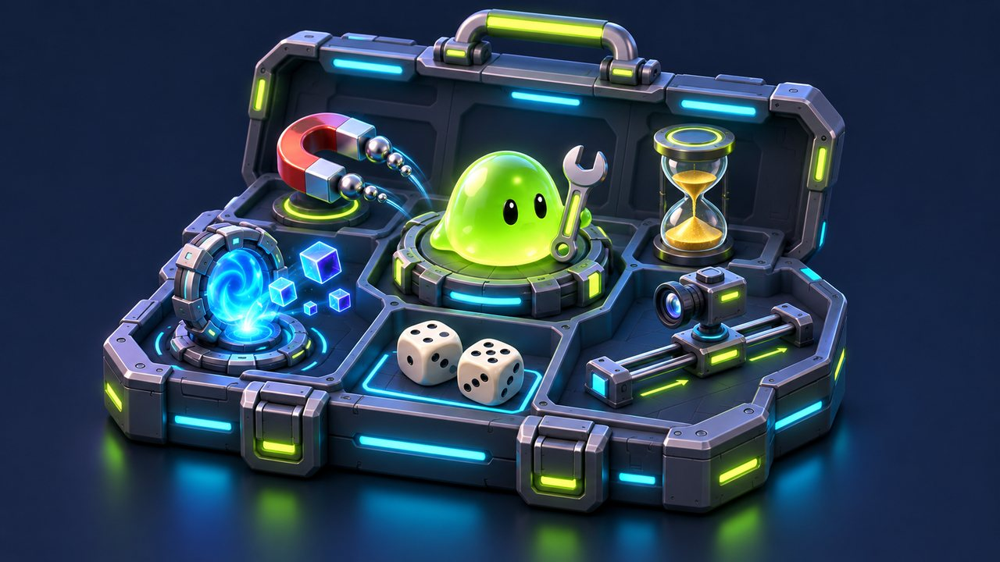
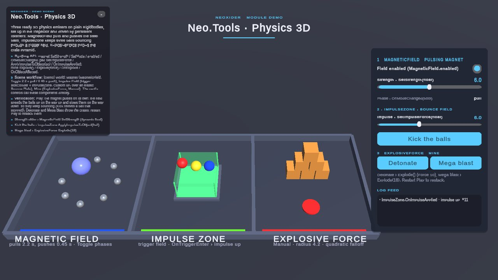
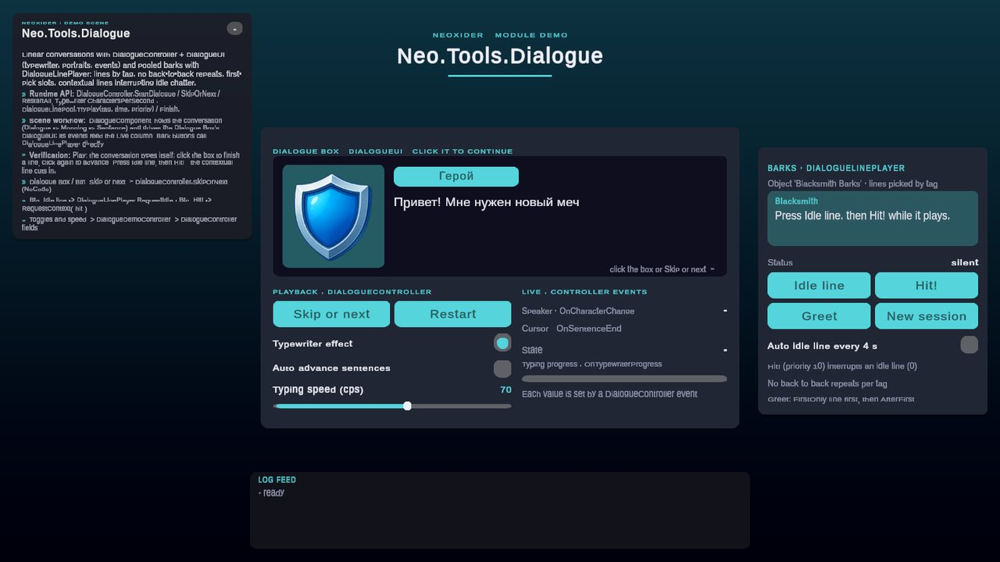
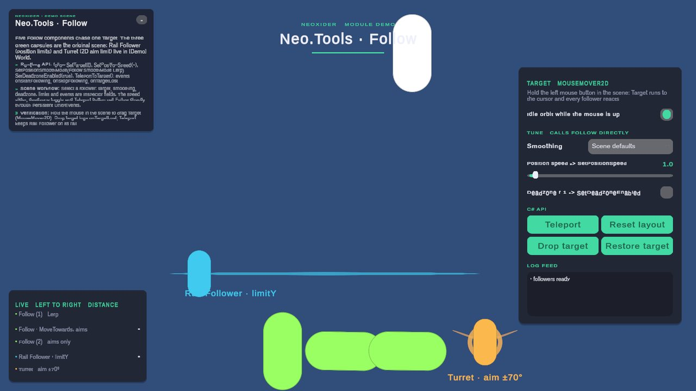
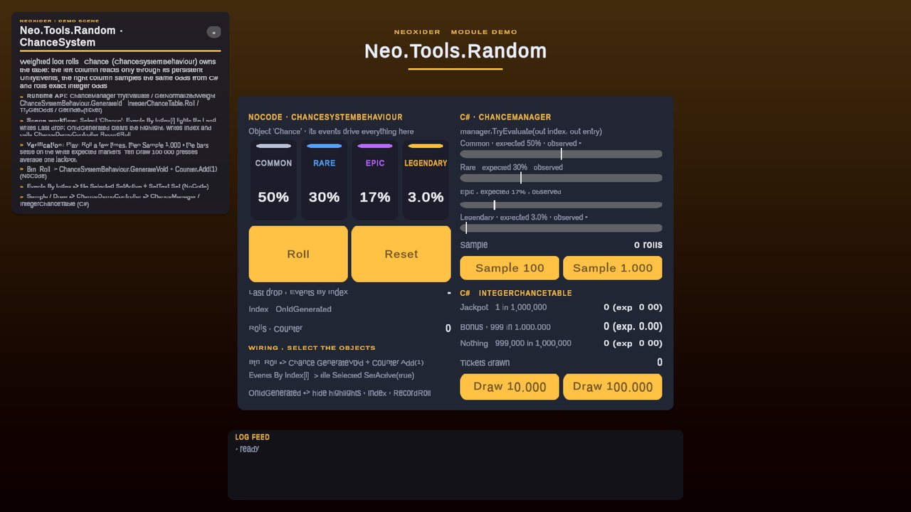

# Tools

<!-- module-art:begin -->

<!-- module-art:end -->

**What it is:** the broadest utility area of the package: inventory, movement, pooling, dialogue, input, time, game
managers, text formatting and scene-level utility components. Scripts live under `Assets/Neoxider/Scripts/Tools/*`,
split into asmdef-backed submodules (`Neo.Tools.*`), namespace `Neo.Tools`.

<!-- demo-shots:begin -->

   

*Demo scenes: `Scenes/Tools/Physics/Physics3DDemo.unity`, `Scenes/Tools/Dialogue.unity`, `Scenes/Tools/Move/Follow.unity`, `Scenes/Tools/ChanceSystemExample.unity`, in the Demo download (`Assets/NeoxiderDemos/Demo`). The scenes are saved with their UI and wiring, so you can inspect them without entering Play Mode.*
<!-- demo-shots:end -->

**How to work with it:** pick the submodule below, reference its `Neo.Tools.*` assembly from your asmdef, and
follow its README for the C# API and the scene/NoCode workflow.

**Navigation:** [← Docs](../README.md)

**Contents:** the submodule index below.

---

## Recommended entry points

- [Inventory](./Inventory/README.md)
- [Spawner](./Spawner/README.md)
- [Move](./Move/README.md)
- [Input](./Input/README.md)
- [Dialogue](./Dialogue/README.md)
- [Managers](./Managers/README.md)

## Submodule index

| Submodule | What it covers | Docs |
|-----------|----------------|------|
| **Components** | Counter, score, random range, loot, typewriter (frame-rate independent pacing), Animator driver, lifecycle events, camera aspect scaler | [`Components/README.md`](./Components/README.md) |
| **Dialogue** | Dialogue controller, data, UI binding and pooled bark lines ([DialogueLinePool](./Dialogue/DialogueLinePool.md)) | [`Dialogue/README.md`](./Dialogue/README.md) |
| **Input** | Mouse, swipe, multi-key, and click-related helpers | [`Input/README.md`](./Input/README.md) |
| **Inventory** | Inventory runtime, pickups, drops, UI binding and batched Auto Save (`DeferAutoSave`) | [`Inventory/README.md`](./Inventory/README.md) |
| **InteractableObject** | Click/hover interactions and 2D or 3D physics events | [`InteractableObject/README.md`](./InteractableObject/README.md) |
| **Managers** | GM state flow, EM events, Bootstrap, singleton bases | [`Managers/README.md`](./Managers/README.md) |
| **Move** | Player movement, follow, camera, cursor, movement toolkit | [`Move/README.md`](./Move/README.md) |
| **Physics** | Explosions, impulse zones, and magnetic fields | [`Physics/README.md`](./Physics/README.md) |
| **Random** | Weighted random selection, chance helpers and exact integer odds ([IntegerChanceTable](./Random/IntegerChanceTable.md)) | [`Random/README.md`](./Random/README.md) |
| **Spawner** | Spawners, despawners, and O(1) allocation-free pool workflows | [`Spawner/README.md`](./Spawner/README.md) |
| **Text** | `SetText` number formatting and `TimeToText` time display for UI | [`Text/README.md`](./Text/README.md) |
| **Time** | Timers, timer objects, game speed and injectable clock seams ([Clocks](./Time/Clocks.md)) | [`Time/README.md`](./Time/README.md) |
| **View** | Visual state and billboard-style presentation helpers | [`View/README.md`](./View/README.md) |
| **Debug** | FPS counter, bounded on-screen error log (entry and character limits), debug overlay | [`Debug/README.md`](./Debug/README.md) |
| **Draw** | `Drawer`: world-space polylines with smoothing, 2D edge colliders and pooled line reuse; pointer input through `Neo.Tools.Input` | [`Draw/README.md`](./Draw/README.md) |
| **FakeLeaderboard** | Mock leaderboard UI helpers | [`FakeLeaderboard/README.md`](./FakeLeaderboard/README.md) |
| **Network** | Network event dispatcher | [`Network/NetworkEventDispatcher.md`](./Network/NetworkEventDispatcher.md) |
| **Other** | Camera shake, AI navigation (legacy), Spine controller, small helpers | [`Other/README.md`](./Other/README.md) |

## Loose pages

| Page | Notes |
|------|-------|
| [CameraAspectRatioScaler](./CameraAspectRatioScaler.md) | Camera fit for any aspect ratio (assembly `Neo.Tools.Components`). |
| [UpdateChilds](./UpdateChilds.md) | UnityEvent when a Transform's children change (assembly `Neo.Tools.Components`). |
| [GameTimeController](./GameTimeController.md) | Redirect to [Time / GameTimeController](./Time/GameTimeController.md). |
| [InternalTypes](./InternalTypes.md) | Index of helper and adapter types without their own page. |

## Runtime, Editor, and Deprecated Areas

- **Runtime:** user-facing scene/runtime components live under `Assets/Neoxider/Scripts/Tools/*` and are split by asmdef-backed submodule.
- **Editor tools:** windows and inspectors live under `Assets/Neoxider/Editor/Tools/*` and must not be referenced by runtime asmdefs.
- **Deprecated / compatibility:** old `AttackSystem` and `AiNavigation` remain for compatibility. New projects should use `Rpg` and `NPC`.
