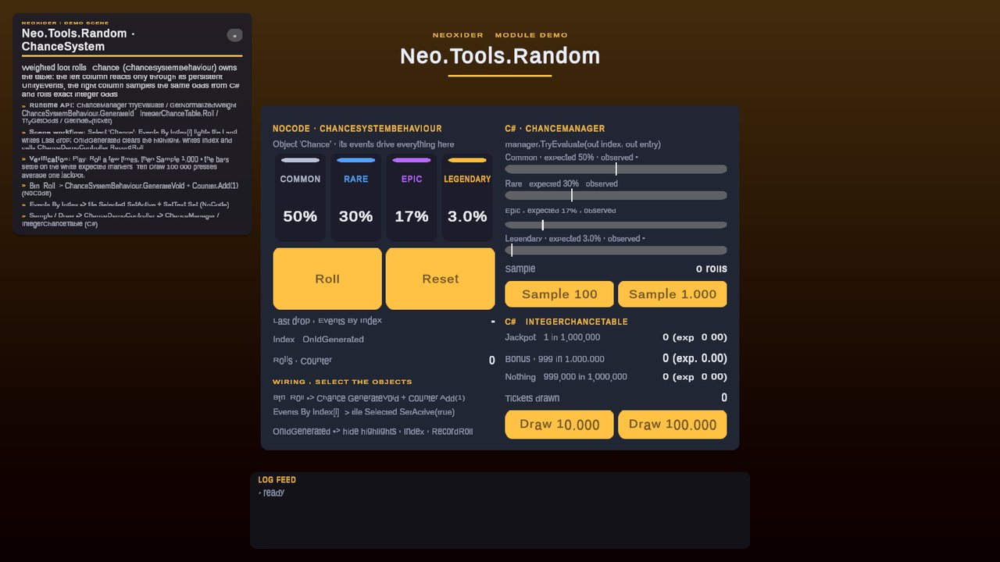

# Tools / Random

**What it is:** Weighted selection for loot tables, random events, and other reusable probability tables: float-weighted `ChanceManager` with normalization and locks, exact integer-weighted `IntegerChanceTable`, a scene wrapper and a ScriptableObject asset. Runtime code lives in `Scripts/Tools/Random/`, namespace `Neo.Tools`, assembly `Neo.Tools.Random`.

<!-- demo-shots:begin -->
<p align="center"></p>

*Demo scene: `Scenes/Tools/ChanceSystemExample.unity`, in the Demo download (`Assets/NeoxiderDemos/Demo`). The scenes are saved with their UI and wiring, so you can inspect them without entering Play Mode.*
<!-- demo-shots:end -->

**Contents:** see [Component documentation](#component-documentation) below.

**Navigation:** [← Tools](../README.md)

---

## Start with the runtime API

```csharp
using Neo.Tools;

ChanceManager table = new(60f, 30f, 10f);
if (table.TryEvaluate(out int index, out ChanceManager.Entry entry))
{
    // Use index to address a parallel reward list; entry contains label, weight, and CustomId.
}
```

`GetChanceId()` and `GetId(float)` return a zero-based list index, not `Entry.CustomId`. Empty tables or tables with no positive weights return `-1`. Constructors and collection changes normalize automatically by default; use `AutoNormalize = false` before adding entries to retain raw weights. For a batch of relative weights, use the constructor or `AddChances` so normalization runs once after the batch.

Zero-weight entries cannot be selected while positive weights exist. An all-zero table is redistributed evenly during normalization by default; disable `DistributeEvenlyWhenZero` or `AutoNormalize` when zero means an entirely disabled table.

When odds must be exact integers (for example per-million jackpot odds), use `IntegerChanceTable`:

```csharp
IntegerChanceTable odds = new IntegerChanceTable();
odds.Add(1, "Jackpot");
odds.Add(999_999, "Nothing");
int index = odds.Roll(); // exactly 1 in 1,000,000 for index 0
```

## Scene and asset workflow

Add `ChanceSystemBehaviour` through **Component > Neoxider > Tools > ChanceSystemBehaviour**. Configure its inline manager or assign a `ChanceData` asset, then connect a UI Button or another UnityEvent to `GenerateVoid()`. The component copies asset configuration at `Awake` and emits index, probability, per-index, and completion events. Scene references belong in the component's events.

Create reusable configurations with **Assets > Create > Neoxider > Tools > Random > Chance Data**. Code can use `ChanceData.Manager` directly; those callers share the asset's mutable table. Use `CopyFrom` or the scene component for an independent table.

## Demo scene

Open `Assets/NeoxiderDemos/Demo/Scenes/Tools/ChanceSystemExample.unity` from the Demo download. The whole scene is saved, so the wiring is visible in the Inspector without Play Mode:

- **NoCode column** - the `Chance` object (`ChanceSystemBehaviour`) owns the table. `Btn_Roll` calls `GenerateVoid` and `Counter.Add(1)`; `Events By Index[i]` lights the rarity tile and writes *Last drop* through `SetText`; `OnIdGenerated` clears the highlight, writes *Index* and calls `ChanceDemoController.RecordRoll`.
- **C# column** - *Sample 100 / 1,000* runs `ChanceManager.TryEvaluate` in a loop (no events), and the bars converge on the white expected markers; *Draw 10,000 / 100,000* rolls an `IntegerChanceTable` with exact `1 in 1,000,000` jackpot odds.

The scene is authored by the editor builder `ChanceSystemExampleBuilder` (menu **Neoxider > Demo > Rebuild Active Demo Scene**).

## Component documentation

| Page | Description |
|------|-------------|
| [ChanceManager](./ChanceManager.md) | Runtime selection, normalization, deterministic rolls, and mutation rules |
| [IntegerChanceTable](./IntegerChanceTable.md) | Exact integer weights, O(log n) ticket mapping, unbiased injectable random source |
| [ChanceSystemBehaviour](./ChanceSystemBehaviour.md) | Scene configuration, UnityEvents, and C# event subscriptions |
| [Data/README](./Data/README.md), [ChanceData](./Data/ChanceData.md) | Reusable asset configuration and independent copies |

## See also

- [Tools module](../README.md)
- [Bonus](../../Bonus/README.md)
- [Tools/Spawner](../Spawner/README.md)
