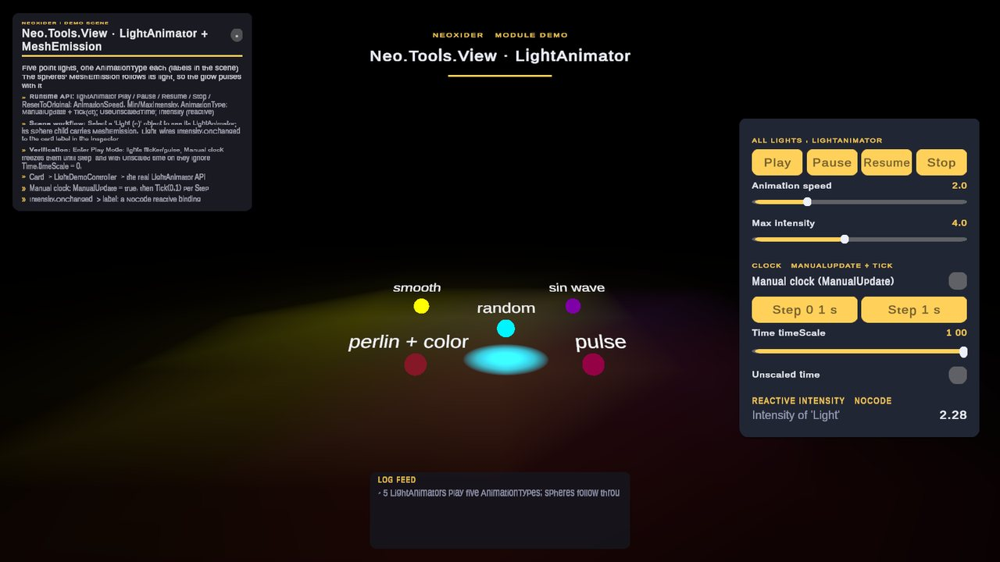
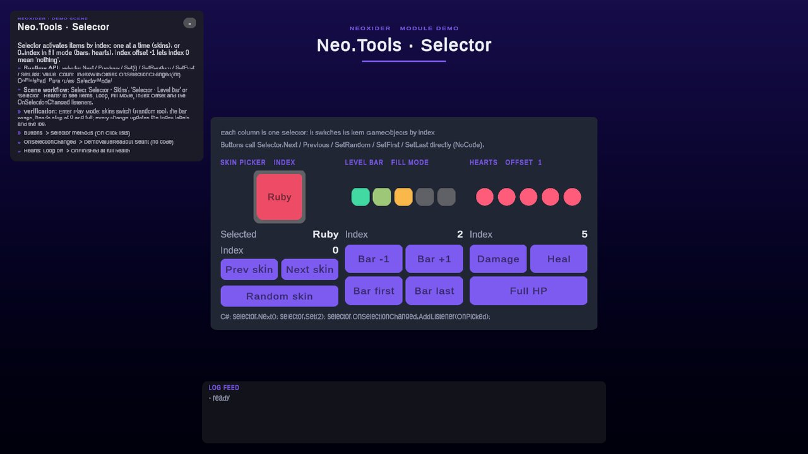

# Tools / View

**What it is:** the `Neo.Tools.View` assembly: reusable scene views for selection, progress, stars, facing,
depth, light and emission. Scripts live in `Scripts/Tools/View/`. Selection rules also have a plain C#
entry point: `SelectorModel`.

<!-- demo-shots:begin -->

 

*Demo scenes: `Scenes/Tools/View/Light.unity`, `Scenes/Tools/View/Selector.unity`, in the **Demo Scenes** sample (Package Manager > NeoxiderTools > Samples). The scenes are saved with their UI and wiring, so you can inspect them without entering Play Mode.*
<!-- demo-shots:end -->

**Contents:** the table below links one page per component.

---

## Choose a component

| Page | Description |
|------|-------------|
| [ImageFillAmountAnimator](./ImageFillAmountAnimator.md), [BillboardUniversal](./BillboardUniversal.md) | UI/3D |
| [Selector](./Selector.md), [SelectorModel](./SelectorModel.md), [SelectorItem](./SelectorItem.md) | Scene selection, pure selection rules and item callbacks |
| [StarView](./StarView.md) | ScoreManager star display |
| [LightAnimator](./LightAnimator.md), [MeshEmission](./MeshEmission.md) | Light/emission |
| [ZPositionAdjuster](./ZPositionAdjuster.md) | Z-order |

## Demo scenes

Both scenes live in `Samples~/Demo/Scenes/Tools/View/` (`Samples/` during sample development) and are
authored by editor builders in `Samples~/Demo/Editor/Builders/View/`, so the wiring is visible without
Play Mode:

- **Light.unity** - five hand-authored point lights, one `LightAnimator` each (RandomFlicker, Pulsing,
  SmoothTransition, PerlinNoise, SinWave) with a `MeshEmission` sphere that follows its light. The card
  (`LightDemoController`) plays, pauses and stops all lights, changes speed and range, switches the manual
  clock (`ManualUpdate` + `Tick`) and unscaled time, and drives `Time.timeScale`. The PerlinNoise light's
  `Intensity.OnChanged` is wired to the card label in the Inspector (a reactive binding without code).
- **Selector.unity** - three `Selector` components with their items: a skin picker (index mode, random),
  a level bar (fill mode) and hearts (fill mode, index offset -1, loop off). Buttons call
  `Next` / `Previous` / `SetRandom` / `SetFirst` / `SetLast` directly; every `OnSelectionChanged` drives
  an index label, and `SelectorDemoController` names the skin and logs the changes.

## C# and Inspector workflows

Use `Neo.Tools` for selection, fill, billboard, stars and Z ordering; use `Neo.Tools.View` for
`LightAnimator` and `MeshEmission`. A custom assembly consuming these types must reference `Neo.Tools.View`.
Use `SelectorModel` directly when no scene objects are needed; `Selector.CreateModelSnapshot()` gives an
independent copy. Scene components expose typed methods and optional UnityEvents for Inspector wiring.

Assign dependencies before activating runtime-created objects. In particular, `StarView.scoreManager`
is explicit, `MeshEmission` needs an assigned material on its `MeshRenderer`, and camera-facing billboard
modes need either an assigned camera or the optional `Camera.main` fallback. Custom-direction billboards
do not need a camera. DOTween is used by the fill animator; Light2D support is discovered only when URP
is installed. `MeshEmission` restores a surviving renderer's source material when its component is removed.
`LightAnimator` has the same manual clock as the [Animations](../../Animations/README.md) components
(`ManualUpdate` + `Tick`); `Tick` does nothing while the component is disabled. The per-frame components
(billboard, depth, light, emission) cache their transforms and allocate nothing on warm frames. Depth
(`ZPositionAdjuster`) and emission (`MeshEmission`) also skip writes that would not change anything; the
billboard re-applies its rotation every `LateUpdate`, and `LightAnimator` writes intensity and color every
tick and reads the applied values back once.

Selection persistence initializes in `Start` before runtime writes are allowed. For networking, the
component delegates authority to the existing Neo network layer; the pure model has no network or save
dependencies. See each component page for lifecycle details and callable APIs.

In 11.0, selection bounds are checked instead of silently overflowing, deferred index replacements
preserve their previous set on enumeration failure, and received selection events see complete snapshots.
Network admission uses per-caller budgets; see [Selector](./Selector.md) for authority and matching-peer
version requirements, and [SelectorModel](./SelectorModel.md) for the exact integer/input contracts.

## See also

- [Animations](../../Animations/README.md)
