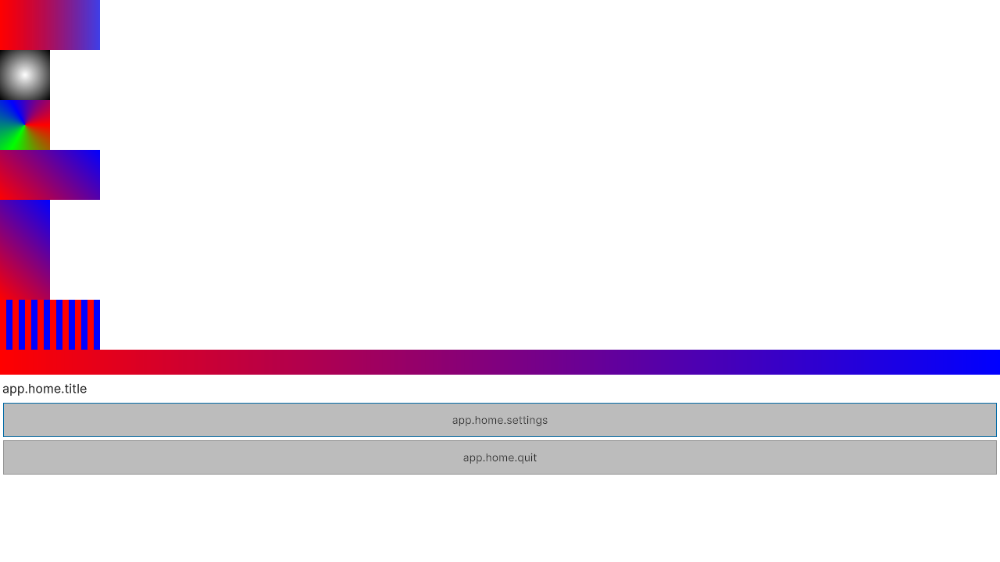

# HTML → UI Toolkit: verification for 11.0.0

This is the recorded Windows verification on 26–27 October 2026. Start with the
[module guide](HtmlToUitk.md); this page records what was actually executed and its limits.

## Module and tool boundaries

The Unity package supplies `Neo.HtmlToUitk.Runtime` and `Neo.HtmlToUitk.Editor`.
The converter is the separate .NET solution at `Tools/HtmlToUitk`, with its own CLI,
rules, parsers, capabilities reader and PNG baker. The CLI is an authoring dependency;
its assemblies and a JavaScript/browser engine are not required in the Unity player.

The optional release CLI zip contains a framework-dependent `htmltouitk.dll` and its
complete publish output. It targets .NET 9 and carries `LatestMajor` roll-forward;
the published payload was actually exercised with .NET 10.0.9, outside the repository,
without a `DOTNET_ROLL_FORWARD` environment override. .NET 9 runtime was not installed
or redistributed. Source builds used SDK 10.0.301; the net8 test groups used runtime 8.0.21.

## Fresh results

| Executed scope | Actual result |
| --- | --- |
| Complete external converter solution | **2573 passed, 30 NotExecuted, 0 failed** |
| Unity runtime/editor pure-logic .NET project | **291 passed, 0 failed, 0 skipped** |
| Complete Unity HTML assembly on `6000.3.14f1` | **370 passed, 0 failed, 0 skipped** |
| Complete Unity HTML assembly on `6000.6.0f1` | **370 passed, 0 failed, 0 skipped** |
| Published CLI copied to an independent C-drive temporary directory | Real external process exited **0**, producing the two-document neutral output |
| Actual mouse input in Unity 6.3 at 1280 × 720 | Settings, Video tab, Back, modal open/Cancel and Profile Save passed; each C# action ran once |

The groups overlap and must not be added to the package-wide qualified baselines as
one new all-pass suite. Native execution used the full assembly/`Neo.HtmlToUitk`
filter, retaining the pure-logic namespace as well as editor/runtime adapters.

The 30 .NET NotExecuted outcomes remain explicit: 29 legacy conversion goldens
(7 validate-only fixtures and 22 open/incomplete expectations), plus one existing
S08 tokens/skin diagnostic-expectation case. They are coverage debt, not passes.
The capabilities group ran against the actual installed Unity 6.6 managed assemblies
and passed all 199 cases; it was not silently skipped for an unavailable SDK.

## Real converter-to-document acceptance

`Release11HtmlToUitkEndToEndTests.PublishedCliImportsRendersNavigatesAndRebindsActualDocument`
performs the following through production APIs on both tested SDKs:

1. Launches the published external CLI through `HtmlToUitkRunner`/`CliProcessBridge`.
2. Converts the immutable two-page neutral fixture; repeats conversion and checks all
   output bytes; Validate Only preserves those files and the original job.
3. Imports generated UXML, USS, navigation/media/animation metadata and seven PNGs
   through the real AssetDatabase. Texture ownership, sRGB, clamp and disabled mipmaps
   are checked.
4. Creates an actual Play Mode `UIDocument`, runtime theme and 1280 × 720 render target.
   The imported native Texture/Sprite binding and contained gradient bounds are checked.
   Actual native pixels must run from red on the left to blue on the right.
5. Exercises native submit events, page history, modal open/close, tab IDs and visible
   panels, exactly one C# action, disable/re-enable and replacement of the document tree.
   Temporary assets and prior bridge/preference ownership are restored.

These are real native render-target captures from that fixture. Text remains localization
keys until an application supplies `ILocalizer`; the manual mouse pass additionally used
an application localizer. The neutral fixture is a minimal technical acceptance fixture,
not a finished game menu or a claim of arbitrary responsive/browser fidelity.

Programmatic native submit coverage is separate from the manual pass. Actual OS mouse
clicks opened Settings, selected Video, returned Home, opened and cancelled confirmation,
then invoked Save after public `UIDocument.visualTreeAsset` replacement. Observed final
state: `settingsClicks=1`, `saveClicks=1`, no screen error and no Unity console errors.

## Defects corrected before acceptance

- Distinct pages and shared CSS files with the same output stem now reserve actual,
  deterministic destinations. For example, three colliding inputs retain
  `home.uxml`, `home-2.uxml` and `home-2-2.uxml` and their own semantic content.
- Generated asset aliases use one canonical path. Equal content is idempotent;
  conflicting content, escaping/reserved paths and cross-kind output collisions fail
  explicitly before filesystem commit instead of silently discarding an output.
- A newer UI projection created from localization or animation-cancellation callbacks
  survives the interrupted outer rebuild. Same-root page/responsive resources are
  released before callback-producing animation disposal. Cancellation faults still
  release owned root/action registrations and allow ordinary reuse.
- Runtime localization recognizes the converter's mixed-case default keys and preserves
  explicit `LocalizationKey` markers for custom key patterns. Ordinary display text is
  not indiscriminately treated as a localization key.
- PureLogic compile globs are relative to the copied project, so verification does not
  accidentally compile moving files from a developer's main checkout.

Independent source review and Root review preceded these executions. Initial failures
were retained: a new NUnit4 assertion and a nonexistent test enum needed fixture-only
corrections; a duplicate legacy CMF import was removed from the isolated developer
hosts. No assertion was relaxed to turn a product failure into a pass.

## Scope and retained limits

This validates the selected Windows SDKs and the named workflow. It does not certify
every Unity 6 minor, mobile/IL2CPP/consoles, physical keyboard/controller input, all
screen sizes, arbitrary JavaScript, complete CSS/browser parity or performance budgets.
Custom converter localization regexes are not automatically transmitted to the runtime
heuristic; use explicit `LocalizationKey` markers for those keys.

The four old managed-DLL diagnostic `.csproj` files under `Verification~` remain
machine-specific historical utilities. Actual Unity compilation and tests above are the
current native evidence. The pure-logic project is portable. Existing blur limitations
around an externally authored RenderTexture background remain documented in the module
guide; the gradient capture is not a blanket blur/fidelity certification.

The hosted package-integrity check passed for 11.0.0; its Unity jobs did not run because
GameCI secrets were unavailable. GitHub Actions workflows were subsequently removed; the
local native results above are separate evidence. Legacy `.unitypackage` export/import and release checks are recorded
in the release asset manifest and [package verification record](../../Verification11.md).

## По-русски

Проверена вся цепочка: отдельный CLI → файлы UXML/USS и PNG → настоящий импорт Unity →
рендер и работа `UIDocument`. На Unity 6.3 и 6.6 прошло по 370 случаев без пропусков;
внешний конвертер дал 2573 Passed / 30 NotExecuted, PureLogic — 291 Passed. Мышью
проверены переходы, вкладка, модальное окно и по одному вызову C#-действий после смены дерева.
Тридцать старых пропусков и ограничения платформ/браузерной совместимости сохранены явно.
