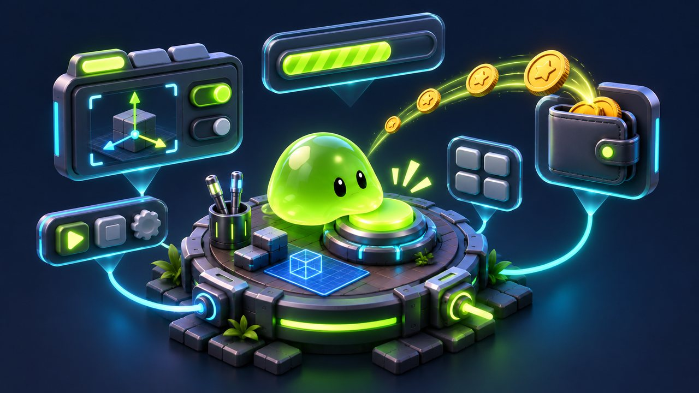
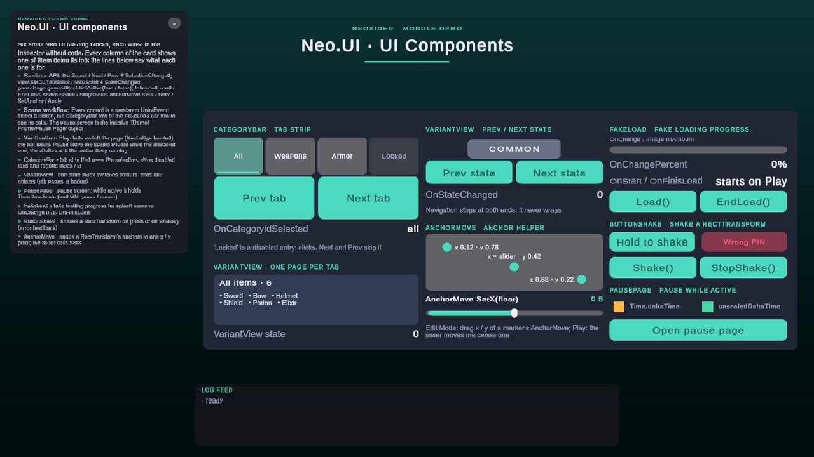
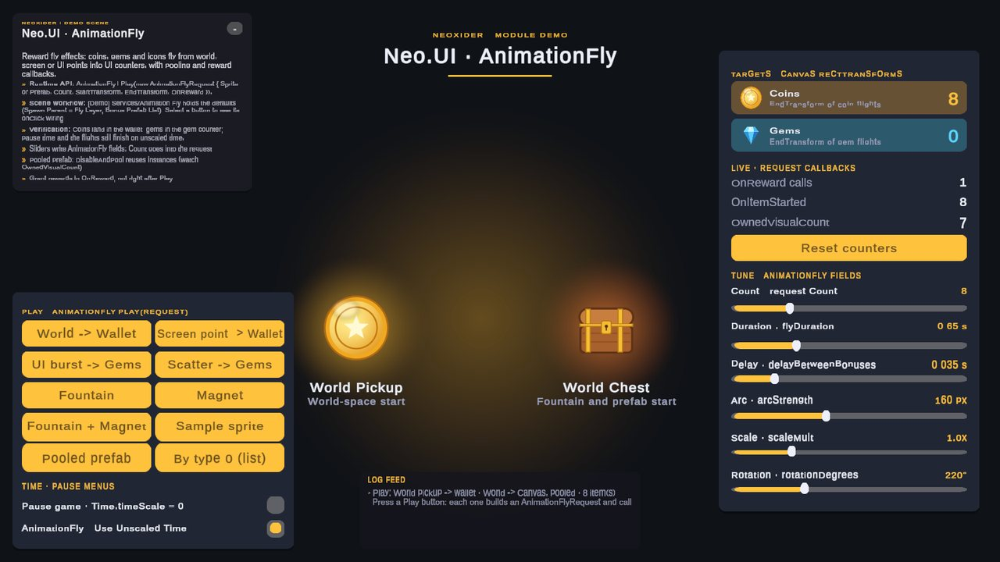
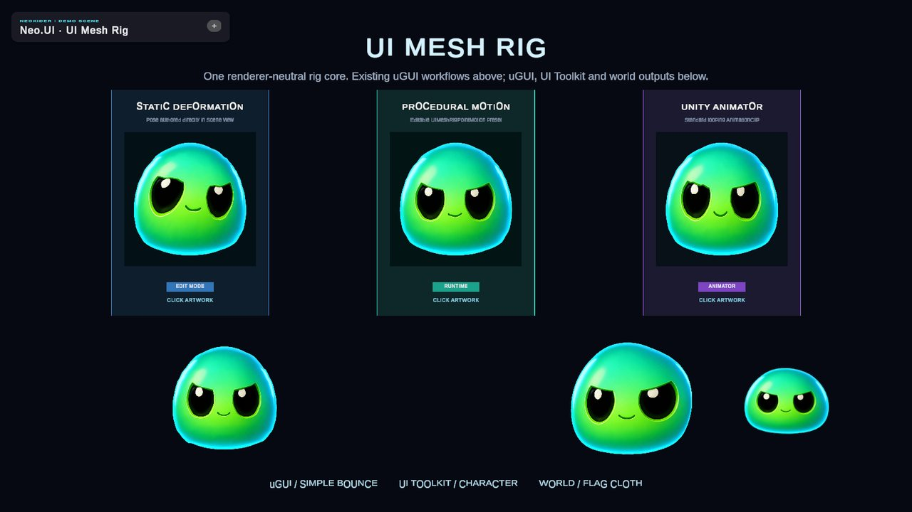

# UI module

<!-- module-art:begin -->

<!-- module-art:end -->

**What it is:** reusable UI helpers in `Scripts/UI/` (assembly `Neo.UI`, namespace `Neo.UI`; `PausePage`
keeps `Neo.Tools`): page switching, button feedback, two-state and indexed views, a category bar, fly-to-target
effects and the UI Mesh Rig deformation. Every component has a typed C# API next to its Inspector/UnityEvent
workflow.

<!-- demo-shots:begin -->

  

*Demo scenes: `Scenes/UI/UIComponentsDemo.unity`, `Scenes/UI/AnimationFlyDemo.unity`, `UI Mesh Rig/UIMeshRigDemo.unity`, in the Demo download (`Assets/NeoxiderDemos/Demo`). The scenes are saved with their UI and wiring, so you can inspect them without entering Play Mode.*
<!-- demo-shots:end -->

**Contents:** the tables below link every component page.

---

Scene loading, Quit/Restart, and progress UI live in the Level module: use `SceneFlowController`.
For active pause screens with shared time/GM/cursor ownership, use [PausePage](./PausePage.md).

## Entry pages

| Page | Description |
|------|-------------|
| [UI](./UI.md) | Page manager, switching modes, and events |
| [AnimationFly](./AnimationFly.md) | Typed flight requests, coordinate spaces, pooling, and visual ownership |
| [UI Mesh Rig](./UIMeshRig.md) | Shared deformation API and scene authoring across render adapters |
| [PausePage](./PausePage.md) | Overlapping pause screens with first/last time, GM, and cursor ownership |

## Typical use cases

- Button press feedback and simple UI animation (ButtonScale, ButtonShake; both keep working while `Time.timeScale` is 0)
- Page/state transitions (UI, ButtonChangePage; delayed and animated switches also finish under a paused time scale)
- Fake loading screens (FakeLoad)
- Toggle-style state visualization (VisualToggle, VariantView)
- Tab/category selection with a movable selected marker (CategoryBar)
- Text and value presentation (see Tools/Text)
- Deformable Canvas sprites with Animator-friendly control points (UI Mesh Rig)

## Demo scenes

- `Scenes/UI/UIComponentsDemo.unity` (Demo Scenes sample): `CategoryBar` tabs switching a `VariantView` page, a
  `VariantView` badge, `AnchorMove`, `FakeLoad`, `ButtonShake` and a `PausePage` overlay with scaled and unscaled
  clocks, all wired in the Inspector without code.
- `Scenes/UI/AnimationFlyDemo.unity` and `UI Mesh Rig/UIMeshRigDemo.unity`: `AnimationFly` and the UI Mesh Rig
  adapters. See [Samples](../Samples.md#module-demo-scenes).

## docs (per-component)

| Page | Description |
|------|-------------|
| [UI](./UI.md), [AnchorMove](./AnchorMove.md), [ButtonScale](./ButtonScale.md), [ButtonShake](./ButtonShake.md) | Core UI |
| [VisualToggle](./VisualToggle.md), [VariantView](./VariantView.md), [AnimationFly](./AnimationFly.md) | Toggles and animation |
| [CategoryBar](./CategoryBar.md) | Generic category/tab bar with selection state and marker |
| [PausePage](./PausePage.md), [FakeLoad](./FakeLoad.md) | UI flow helpers |
| [ButtonChangePage](./ButtonChangePage.md) | Button that switches pages through `UI.I` |
| [UI Mesh Rig](./UIMeshRig.md) | Editable uGUI mesh deformation, setup/pose tools, Animator workflow |

## See also

- [NeoxiderPages](../NeoxiderPages/README.md) — Page-navigation sample
- [Tools/Text](../Tools/Text/README.md) — Text helpers
