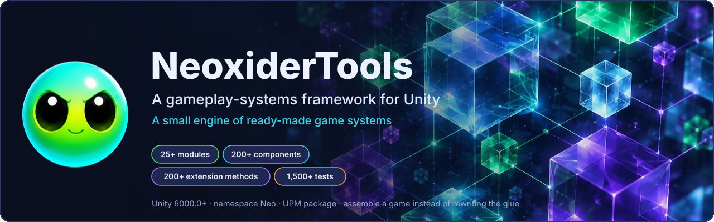
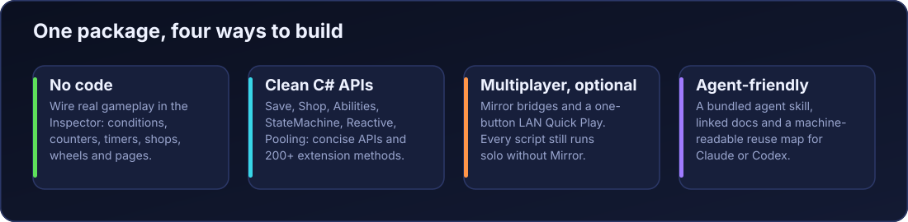
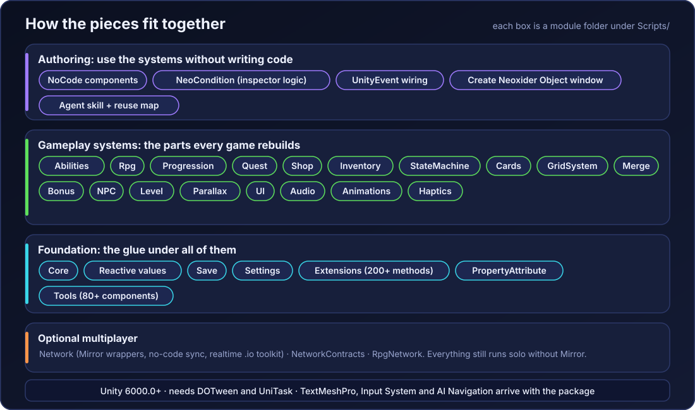
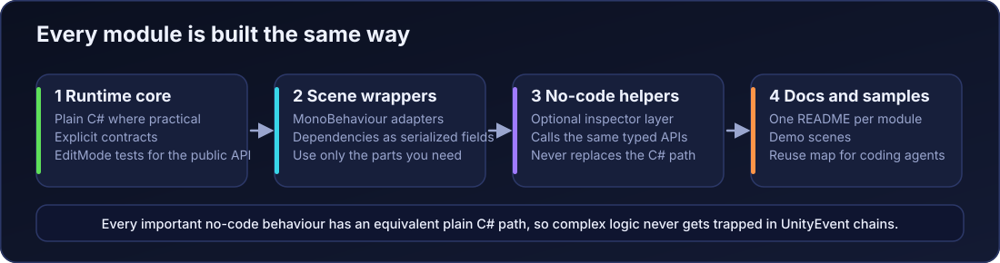

<p align="center"></p>

# NeoxiderTools — a gameplay-systems framework for Unity

[]() []() []() [](https://github.com/NeoXider/NeoxiderTools/actions/workflows/tests.yml) []()

**A small engine of ready-made game systems that sits on top of Unity: abilities, shop, save, quests, cards, grids, NPC AI, UI motion. 25+ modules, 200+ ready components, 200+ extension methods and 1,500+ tests, so you _assemble_ a game instead of rewriting the same glue in every project.**

Prototype a jam game in an afternoon or ship a full title: drop in ready systems — Dota-style **Abilities**, **Shop**, **Save**, **Quests**, **RPG**, **Cards**, **Grids**, **Merge**, **NPC AI**, **UI motion** — wire them in the Inspector *or* drive them from clean C# APIs, then go online with one optional package. Backed by **1,500+ automated EditMode and PlayMode tests**.

[GitHub](https://github.com/NeoXider/NeoxiderTools) · [Documentation](./Docs/README.md) · [Changelog](./CHANGELOG.md) · [Reuse map](./PROJECT_SUMMARY.md)

---

## One package — four ways to build

<p align="center"></p>

| | Who | What you get |
|---|-----|--------------|
| 🧩 | **Beginners — zero code** | Build real gameplay by wiring inspector components: conditions (`NeoCondition`), counters, timers, shops, wheels, slots, equipment, page navigation, click sounds. Start here → [NoCode guide](./Docs/NoCode/GettingStarted.md). |
| 🛠 | **Pros — clean C# APIs** | Production modules (Abilities, Save, Shop, StateMachine, Reactive, Pooling) with concise APIs, `TypeName.I` singletons, and **200+ `Neo.Extensions` helpers** so gameplay code reads like a spec. |
| 🌐 | **Multiplayer, optional** | Drop-in [Mirror](https://github.com/MirrorNetworking/Mirror) bridges (`NetworkPropertySync`, `NetworkReactiveSync`, `NetworkActionRelay`) + one-button Quick Play. Every script still **compiles and runs solo** without Mirror installed. |
| 🤖 | **AI-agent friendly** | A bundled [agent skill](./Skill/neoxider-tools/SKILL.md), `[NeoDoc]`-linked docs, and a machine-readable [reuse map](./PROJECT_SUMMARY.md) let Claude/Codex-style agents build on the package instead of reinventing it. |

---

## Highlight reel

- ⚔️ **Dota-style Abilities + a visual Ability Designer.** Author abilities and modifiers as data assets (`AbilityDefinition`, `ModifierDefinition`, `UnitTemplate`); one validated cast pipeline resolves damage / heal / knockback / pull / teleport / chain / execute, live crit / lifesteal / evasion, and buffs / debuffs / DoT / auras / shields / stuns — with multiplayer-ready receipts.
- 🧛 **A full Vampire-Survivors game from ONE data asset.** The bundled `SurvivorDemo` assembles auto-fire, waves, upgrades and scaling from a single `SurvivorConfig` on top of `Neo.Abilities` — clone it to ship your own survivor-like.
- 🧩 **No-code that actually builds games.** Ready components + inspector event wiring + binding scripts let non-coders assemble whole scenes. Study the reference scenes: `adventure`, `Shooter2D`, `ClickerExample`, `DrawExample`.
- 🟢 **A living inspector.** The Neoxider header is a "slime linter": it reflects each component's health — remembers console errors per component, flags missing references and NaN/∞ fields, and watches the Game view in Play Mode.
- 🎁 **Juice out of the box.** `AnimationFly` (coins/gems fly to the HUD with fountain / magnet / scatter presets), tweened toggles and buttons, parallax, and audio managers — all DOTween-powered.
- 🧰 **200+ extension methods & 200+ drop-in components.** Random, collections, transforms, string/number formatting, coroutines, movement, cameras, spawners, timers — the repetitive glue is already written. Spawn any of them from the **Create Neoxider Object** window (218 component entries + 14 ready-made presets).

---

## Requirements

- **Unity 6000.0+** (Unity 6). Compatibility notes: [`Docs/PackageCompatibility.md`](./Docs/PackageCompatibility.md).
- **Installed automatically (UPM):** `com.unity.ugui` (ships TextMeshPro on Unity 6), `com.unity.ai.navigation`, `com.unity.inputsystem`.
- **Required (add to your project):** [DOTween](https://assetstore.unity.com/packages/tools/animation/dotween-hotween-v2-27676) and [UniTask](https://github.com/Cysharp/UniTask).
- **Optional:** `Mirror` (multiplayer), `DOTween Pro`, `Odin Inspector` (works great without it), `Spine Runtime`, [`MarkdownRenderer`](https://github.com/NeoXider/MarkdownRenderer), URP (only for URP-specific rendering / 2D lights).

None of the third-party packages are bundled — see [THIRD-PARTY-NOTICES.md](./THIRD-PARTY-NOTICES.md).

## Install

**Package Manager → `+` → Add package from git URL:**

```text
https://github.com/NeoXider/NeoxiderTools.git?path=Assets/Neoxider
```

Then install DOTween (Asset Store, run `Tools > Demigiant > DOTween Utility Panel`) and UniTask:

```text
https://github.com/Cysharp/UniTask.git?path=src/UniTask/Assets/Plugins/UniTask
```

*Manual install:* copy `Assets/Neoxider` into your project (you still need DOTween + UniTask).

## Quick start

1. Install NeoxiderTools + DOTween + UniTask (above).
2. Add components from **`Add Component ▸ Neoxider`**, or spawn ready objects from **`Neoxider ▸ Windows ▸ Create Neoxider Object`**.
3. Need managers/UI bootstrap? Drop in `Prefabs/--System--.prefab`.
4. Pick a module and follow its guide in the [Docs index](./Docs/README.md).

**Multiplayer:** install Mirror → add `NeoNetworkManager` + a Transport → enable `isNetworked` on the NoCode components that should replicate. Full walkthrough: [Multiplayer Guide](./Docs/Network/Multiplayer_Guide.md).

---

## How it fits together

<p align="center"></p>

<p align="center"></p>

## Module map

| Module | What it covers | Docs |
|--------|-----------------|------|
| ⚔️ **Abilities** *(v10)* | Data-driven Dota-style abilities & modifiers: units, properties, buffs/DoT/shields, cast pipeline, effect-op atoms, multiplayer receipts | [Abilities](./Docs/Abilities/README.md) |
| 🧙 **RPG** | Unified `RpgCharacter`: resources, stats, level/XP, buffs/statuses, melee/ranged/aoe, evade, target selectors, no-code bridges *(superseded by Abilities)* | [RPG](./Docs/Rpg/README.md) |
| 📈 **Progression** | XP, levels, perk tree, unlock tree, persistent meta-progression | [Progression](./Docs/Progression/README.md) |
| 🎛 **Condition** | No-code checks over fields/props/methods/state, AND/OR, UnityEvent outputs | [NeoCondition](./Docs/Condition/NeoCondition.md) |
| 🔗 **NoCode** | Bind component values to UI & actions, formatted text, progress, action bridges | [NoCode](./Docs/NoCode/README.md) |
| 💾 **Save** | PlayerPrefs + JSON providers, typed helpers, save attributes, scene/global data | [Save](./Docs/Save/README.md) |
| 🛒 **Shop** | Items, bundles, owned/equipped, multi-currency, inventory bridge, save profile | [Shop](./Docs/Shop/README.md) |
| 🎒 **Inventory** | Aggregated & slot-grid inventories, pickups, transfer rules, save integration | [Inventory](./Docs/Tools/Inventory/README.md) |
| 🗺 **Quest** | Quest configs, goals, manager, no-code actions, runtime state | [Quest](./Docs/Quest/README.md) |
| 🔁 **StateMachine** | Runtime FSM + no-code transition predicates | [StateMachine](./Docs/StateMachine/README.md) |
| 🧬 **Reactive** | Serializable reactive `float`/`int`/`bool` properties driving UI without glue | [Reactive](./Docs/Reactive/README.md) |
| 🃏 **Cards** | Deck/hand/board runtime, custom decks/views, poker, Drunkard sample | [Cards](./Docs/Cards/README.md) |
| ⬛ **GridSystem** | Field generation, placement, GridMerge, Dice, Match3, TicTacToe, SlidingMerge | [GridSystem](./Docs/GridSystem/README.md) |
| 🔀 **Merge** | Pure-C# connected-group merge engine for grids, inventories, lists, graphs | [Merge](./Docs/Merge/README.md) |
| 🎰 **Bonus** | Wheel of Fortune, slot machine, daily/cooldown rewards | [Bonus](./Docs/Bonus.md) |
| 🤺 **NPC** | Navigation, patrol, chase, animator driver, modular RPG-ready combat | [NPC](./Docs/NPC/README.md) |
| ✨ **UI** | Panels, button & toggle animations, `AnimationFly` reward motion | [UI](./Docs/UI/README.md) |
| **HTML → UITK** | HTML/CSS authoring, native controls, typed actions, adaptive/nav/anim specs и ограниченный static gradient bake | [Модуль](./Docs/UI/HtmlToUitk.md), [CLI](../../Tools/HtmlToUitk/README.md) |
| 🔊 **Audio** | Music/SFX manager, one-shot pooling, settings-bound volume | [Audio](./Docs/Audio.md) |
| 🌐 **Network** | Optional Mirror wrappers + no-code sync/action bridges + realtime .io toolkit (bootstrap, snapshots, prediction, telemetry) | [Multiplayer Guide](./Docs/Network/Multiplayer_Guide.md), [Realtime IO Guide](./Docs/Network/Realtime_IO_Guide.md) |
| 🧰 **Tools** | 80+ components: 3D character controller (slopes, stairs, platforms, 1st/3rd person), free-fly camera, physics, spawners, timers, input, text, view helpers | [Tools](./Docs/Tools/README.md) |
| ➕ **Extensions** | 200+ C# / Unity API extension methods | [Extensions](./Docs/Extensions/README.md) |

Full navigation lives in the [Docs index](./Docs/README.md); the [Project Summary](./PROJECT_SUMMARY.md) is a compact "what already exists, reuse it" map.

## HTML/CSS → UI Toolkit

Модуль переносит поддерживаемое HTML/CSS-подмножество в native UITK controls: [runtime/editor, typed C# actions и lifecycle](./Docs/UI/HtmlToUitk.md), media width/height/aspect, nav/modal/tabs и animation specs. [Внешний CLI](../../Tools/HtmlToUitk/README.md) создаёт UXML/USS/localization и gradient PNG с manifest. Static gradient geometry имеет явные ограничения; произвольные CSS/JS и full browser parity не обещаются. Проверенный срез: Unity 6000.3.14f1 EditMode — 239/239, Unity 6000.6.0f1 EditMode — 239/239 и PlayMode — 7/7; failures/skips — 0, exit0. [Проверки и границы](../../Docs/Plans/HtmlToUitk-Verification-20261014.md), [оставшийся TODO](../../Docs/Plans/HtmlToUitk-TODO.md). Player/mobile и полный browser parity не заявляются.

UPM/manual package включает runtime/editor, но **не CLI и его .NET DLL**. Для conversion нужен полный NeoxiderTools checkout либо отдельно собранный CLI, .NET9 и настроенный внешний CLI path в editor integration. Из корня полного checkout:

```powershell
dotnet publish Tools/HtmlToUitk/src/HtmlToUitk.Cli/HtmlToUitk.Cli.csproj -c Release -o Tools/HtmlToUitk/bin
dotnet Tools/HtmlToUitk/bin/htmltouitk.dll run Tools/HtmlToUitk/fixtures/production-neutral/neutral.htujob.json
```

C# `preview`/`compare` честно возвращают nonzero unsupported; работающие Python oracle preview/comparison команды приведены в CLI документации. NuGet install не требуется и не заявляется.

## Samples

Import via `Package Manager ▸ NeoxiderTools ▸ Samples`.

| Sample | Purpose |
|--------|---------|
| **Demo Scenes** | Integration + NoCode scenes for every module, plus **`SurvivorDemo`** — a Vampire-Survivors-style game built from one `SurvivorConfig` on `Neo.Abilities` ([guide](./Docs/Abilities/SurvivorDemo.md)). |
| **NeoxiderPages** | Optional page-navigation module (`PM`, `UIPage`, `BtnChangePage`, `UIKit`). |

## Games built with NeoxiderTools

| Game | Genres | Platform | Link | Notes |
|------|--------|----------|------|-------|
| **Fake Grandkids** *(Внуки понарошку)* | Arcade, Survival | Windows | [MyIndie](https://myindie.ru/games/game/fake-grandkids) | UralGameJam 2026; NeoCondition / Neoxider workflow |

## Tests

**1,000+ automated EditMode and PlayMode tests** cover save flows, resource/level math, abilities & combat, grid/bonus/UI behavior, networking, and NoCode bindings. Run them from Unity **Test Runner** (`com.unity.test-framework` required in the host project). Counts and skipped tests depend on the Unity version, optional modules, graphics availability, and sample layout. The workflow badge reports the actual CI status; Unity jobs require repository license secrets.

## Project layout

```text
Assets/Neoxider/
  Scripts/    Runtime modules (asmdef-separated)
  Editor/     Custom inspectors, windows, tooling
  Tests/      EditMode + PlayMode coverage
  Docs/       Documentation
  Samples~/   UPM sample source (Demo, NeoxiderPages)
  Prefabs/    Ready-to-use prefabs
  Resources/  Settings & package assets
```

## Support

Found a bug or have an idea? Open an [issue](https://github.com/NeoXider/NeoxiderTools/issues) or PR. Behavior changes are tracked in the [Changelog](./CHANGELOG.md) and the relevant module docs.
