<p align="center">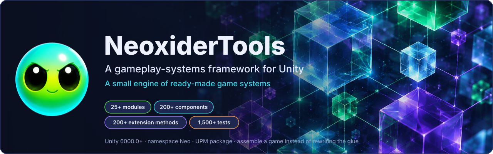</p>

# NeoxiderTools — a gameplay-systems framework for Unity

[](./package.json) [](./Docs/PackageCompatibility.md) [](./Docs/README.md#namespace-policy) [](./LICENSE.md) [](./Docs/NoCode/README.md)

**A modular Unity C# construction library: abilities, shops, saving, quests, cards, grids, NPC AI, UI motion. 26 module areas plus 17 Tools submodules, 200+ ready components, 200+ extension methods and more than 5,000 tests help you assemble reusable game systems from ready parts. Use runtime APIs directly, add scene components, or combine both.**

**`SurvivorDemo`** is a complete Vampire-Survivors-style game assembled only from library components and UnityEvents on top of `Neo.Abilities`, with no game scripts. **Abilities**, **Shop**, **Save**, **Quests**, **RPG**, **Cards**, **Grids**, **Merge**, **NPC AI** and **UI motion** offer C# APIs and scene workflows, with optional Mirror integration for multiplayer. The package includes EditMode and PlayMode coverage; see [Tests](#tests) for how to run it.

[GitHub](https://github.com/NeoXider/NeoxiderTools) · [Documentation](./Docs/README.md) · [Changelog](./CHANGELOG.md) · [Reuse map](./PROJECT_SUMMARY.md) · [Upgrade from 11.x](./Docs/Migration12.md) · [Upgrade from 10.x](./Docs/Migration11.md)

> **Upgrading from 11.x?** Read [Upgrading to 12](./Docs/Migration12.md): the HTML → UI Toolkit converter moved to [its own package](https://github.com/NeoXider/HtmlToUitk), a few APIs became obsolete, and the demo scenes are now authored in the scene. The Windows validation of 11.0.0 (Unity `6000.3.14f1` and `6000.6.0f1`) is in [Verification 11](./Verification11.md); see also the [11.0.0 release](https://github.com/NeoXider/NeoxiderTools/releases/tag/v11.0.0).

**По-русски:** [C# API, компоненты и NoCode](./Docs/README.md) · [обновление с 11.x](./Docs/Migration12.md) · [обновление с 10.x](./Docs/Migration11.md).

---

## One package — four ways to build

<p align="center">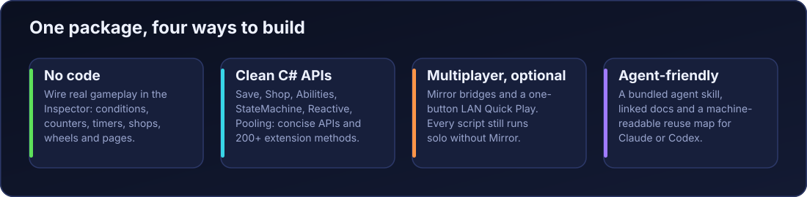</p>

| | Who | What you get |
|---|-----|--------------|
| 🧩 | **Beginners — zero code** | Build real gameplay by wiring inspector components: conditions (`NeoCondition`), counters, timers, shops, wheels, slots, equipment, page navigation, click sounds. Start here → [NoCode guide](./Docs/NoCode/GettingStarted.md). |
| 🛠 | **Programmers — clean C# APIs** | Runtime models and services you own from C#, plus **200+ `Neo.Extensions` helpers**. Start with the [C# quick start](./Docs/GettingStarted.md#start-with-a-c-runtime-model). Scene singletons such as `AM.I` are available for modules that expose them. |
| 🌐 | **Multiplayer, optional** | [Mirror](https://github.com/MirrorNetworking/Mirror) bridges (`NetworkPropertySync`, `NetworkReactiveSync`, `NetworkActionRelay`) and one-button Quick Play. The bridges include a solo-mode path; install Mirror when enabling networking. |
| 🤖 | **AI-agent friendly** | A bundled [agent skill](./Skill/neoxider-tools/SKILL.md), `[NeoDoc]`-linked docs, and a machine-readable [reuse map](./PROJECT_SUMMARY.md) let Claude/Codex-style agents build on the package instead of reinventing it. |

---

<!-- demo-gallery:begin -->

## See it running

Captures taken in the Unity Editor (several in Play Mode) of scenes from the **Demo Scenes** sample.

<table>
<tr>
<td width="33%" align="center"><a href="./Docs/Abilities/README.md">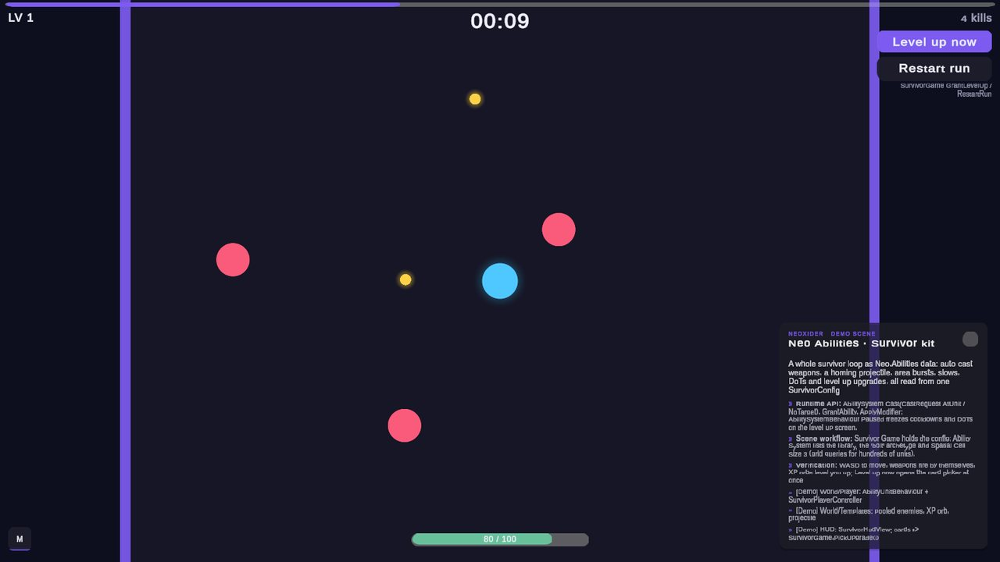</a><br /><b>Survivor arena</b><br /><sub>Abilities, waves and upgrades from one config</sub></td>
<td width="33%" align="center"><a href="./Docs/GridSystem/README.md">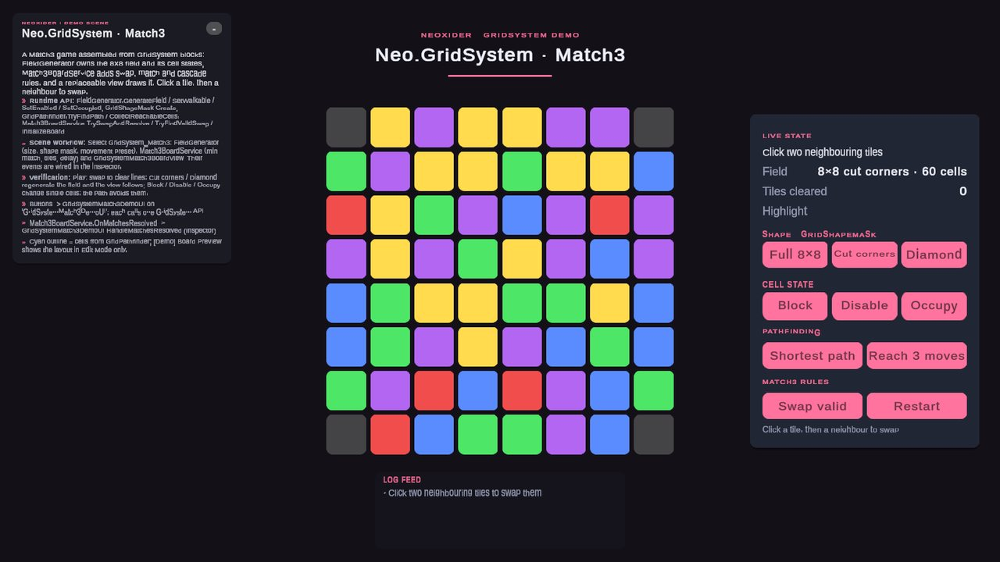</a><br /><b>Match3 board</b><br /><sub>Shaped boards, paths and match rules</sub></td>
<td width="33%" align="center"><a href="./Docs/Bonus/README.md">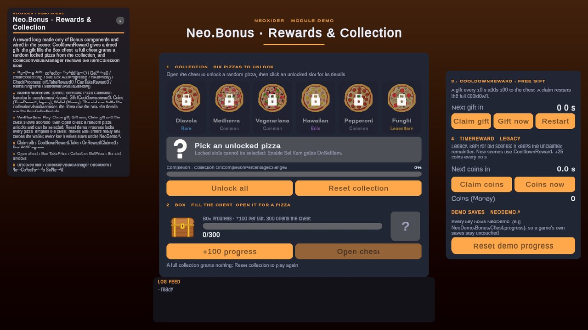</a><br /><b>Rewards and collection</b><br /><sub>Collection, chest and cooldown gifts, no script</sub></td>
</tr>
<tr>
<td width="33%" align="center"><a href="./Docs/Tools/Physics/README.md">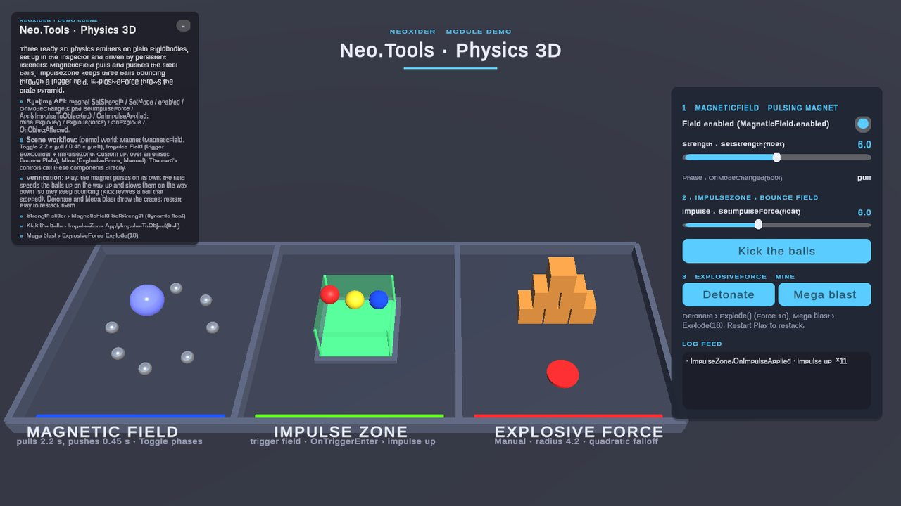</a><br /><b>Physics 3D</b><br /><sub>Magnet, impulse zone and explosive force</sub></td>
<td width="33%" align="center"><a href="./Docs/UI/README.md">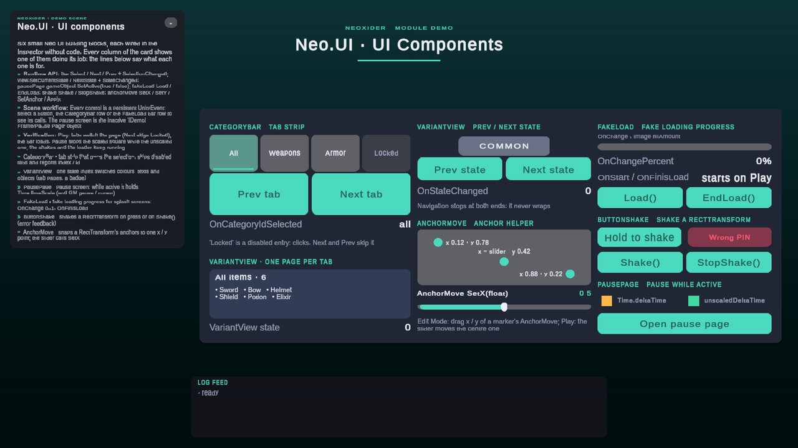</a><br /><b>UI components</b><br /><sub>Tabs, variants, loader, shake and pause</sub></td>
<td width="33%" align="center"><a href="./Docs/Cards/README.md">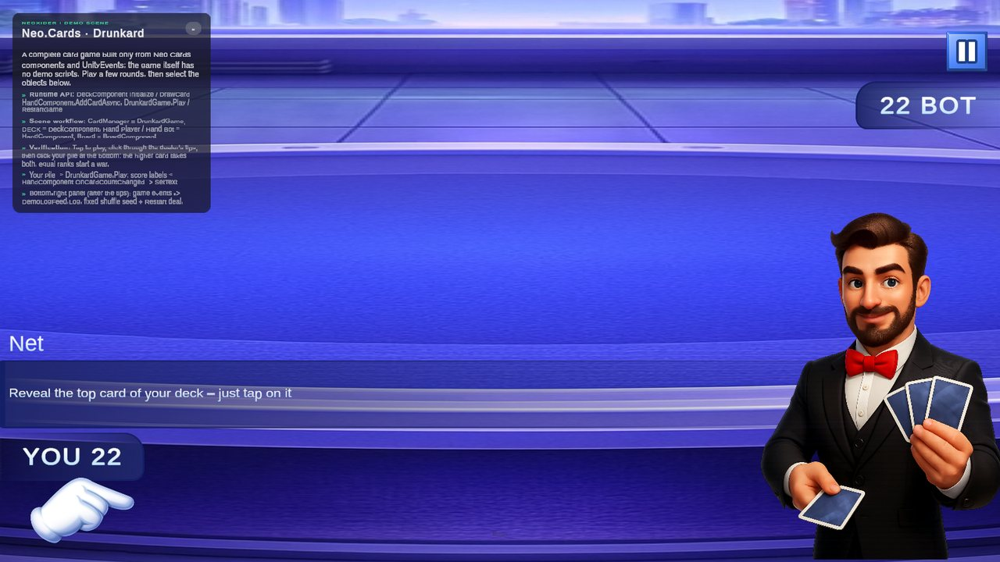</a><br /><b>Card game</b><br /><sub>Deck, hand and board components</sub></td>
</tr>
<tr>
<td width="33%" align="center"><a href="./Docs/Bonus/README.md">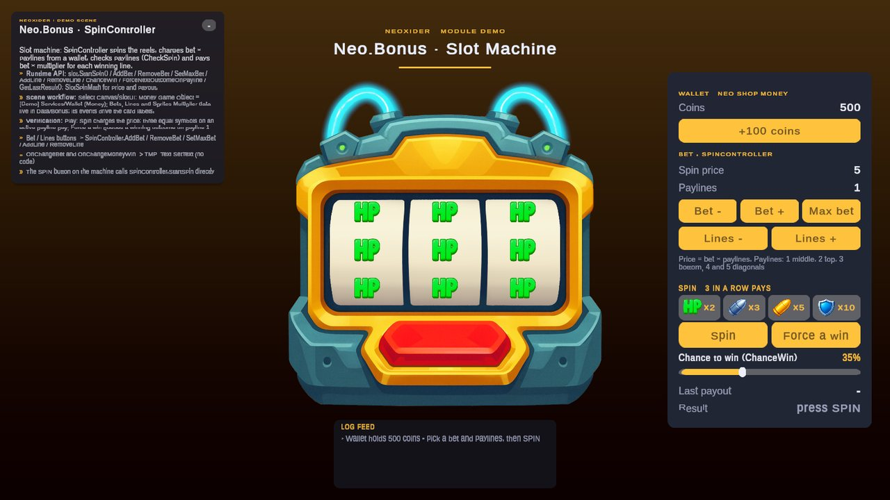</a><br /><b>Slot machine</b><br /><sub>Bets, paylines and a paytable</sub></td>
<td width="33%" align="center"><a href="./Docs/Shop/README.md">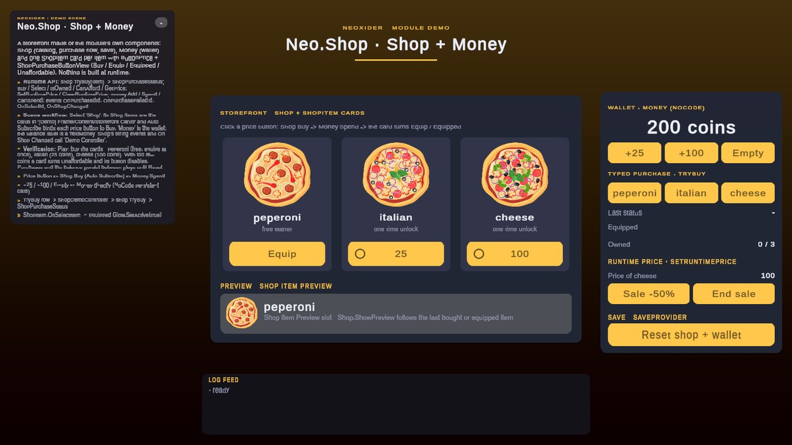</a><br /><b>Shop</b><br /><sub>Storefront, purchase states and a wallet</sub></td>
<td width="33%" align="center"><a href="./Docs/UI/README.md">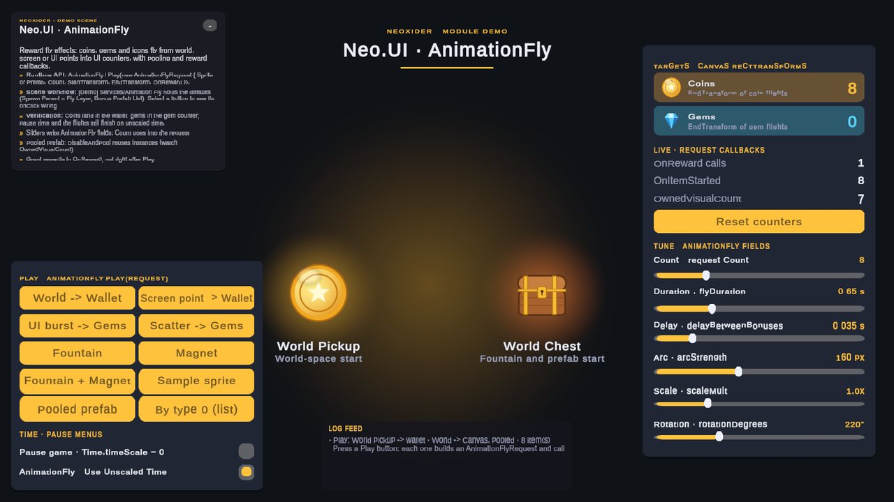</a><br /><b>Reward fly</b><br /><sub>Coins flying from world, canvas and screen</sub></td>
</tr>
<tr>
<td width="33%" align="center"><a href="./Docs/NoCode/README.md">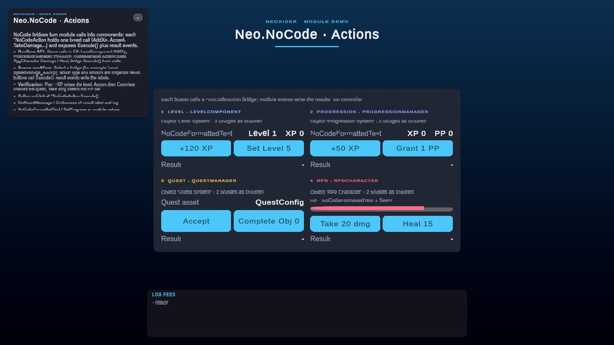</a><br /><b>NoCode actions</b><br /><sub>Level, Progression, Quest and RPG without code</sub></td>
<td width="33%" align="center"><a href="./Docs/Progression/README.md">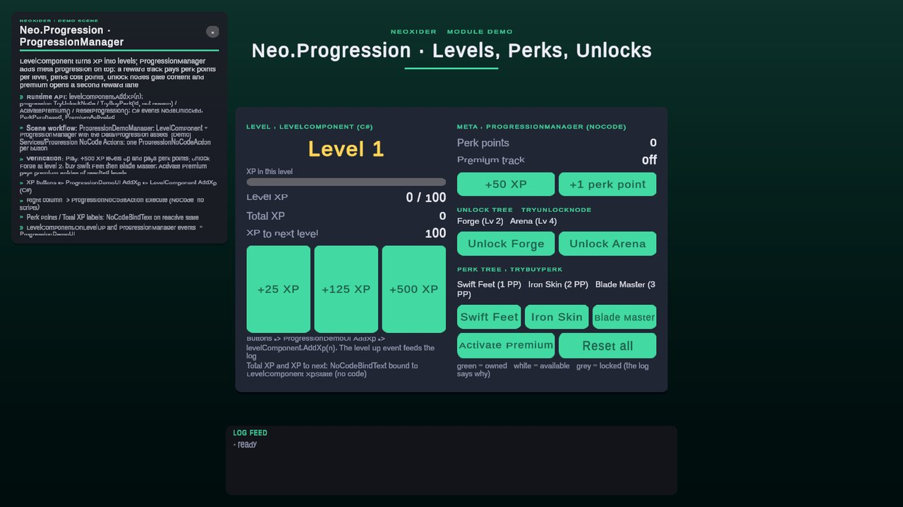</a><br /><b>Progression</b><br /><sub>XP, perk and unlock trees, premium track</sub></td>
<td width="33%" align="center"><a href="./Docs/UI/README.md">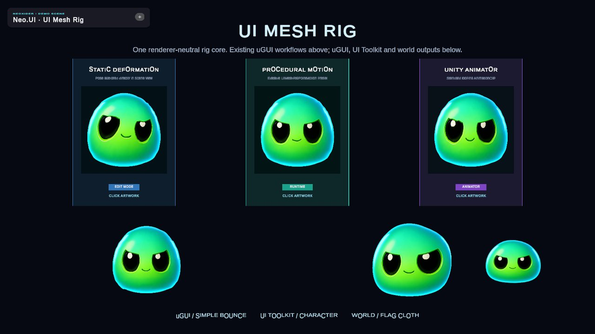</a><br /><b>UI Mesh Rig</b><br /><sub>One rig in uGUI, UI Toolkit and world space</sub></td>
</tr>
</table>

<!-- demo-gallery:end -->

## Highlight reel

- ⚔️ **Dota-style Abilities + a visual Ability Designer.** Author abilities and modifiers as data assets (`AbilityDefinition`, `ModifierDefinition`, `UnitTemplate`); one validated cast pipeline resolves damage / heal / knockback / pull / teleport / chain / execute, live crit / lifesteal / evasion, and buffs / debuffs / DoT / auras / shields / stuns — with multiplayer-ready receipts, typed cast results and an opt-in spatial grid for crowds of units.
- 🧛 **A Vampire-Survivors-style game with no game scripts.** The `SurvivorDemo` scene wires auto-fire, waves, XP, upgrade cards, a win timer, hit reactions, particles and sounds from library components and UnityEvents on top of `Neo.Abilities` — use it as a starting point for your own survivor-like.
- 🧩 **No-code that actually builds games.** Ready components + inspector event wiring + binding scripts let non-coders assemble whole scenes. Study the reference scenes: `adventure`, `Shooter2D`, `ClickerExample`, `DrawExample`.
- 🔍 **Demo scenes you can read in the Inspector.** Every module demo is saved with its UI and UnityEvent wiring, so you see how a button reaches a module API without entering Play Mode.
- 🧪 **Testable cores.** Plain C# rules behind the components (bonus schedules, collections, slot math, card decks, grid pathfinding, RPG stat services), injectable clocks (`IFrameClock`, `INeoClock`), seeded shuffles and exact integer odds (`IntegerChanceTable`) make games reproducible in tests, replays and servers.
- 🟢 **A living inspector.** The Neoxider header is a "slime linter": it reflects each component's health — remembers console errors per component, flags missing references and NaN/∞ fields, and watches the Game view in Play Mode.
- 🎁 **Juice out of the box.** `AnimationFly` (coins/gems fly to the HUD with fountain / magnet / scatter presets), tweened toggles and buttons, parallax, and audio managers provide configurable motion and feedback.
- 🧰 **200+ extension methods & 200+ drop-in components.** Random, collections, transforms, string/number formatting, coroutines, movement, cameras, spawners, timers — the repetitive glue is already written. Browse registered component entries and ready-made presets in the **Create Neoxider Object** window; the available entries depend on imported samples and optional modules.

---

## Requirements

- **Unity 6000.0+** (Unity 6). Compatibility notes: [`Docs/PackageCompatibility.md`](./Docs/PackageCompatibility.md).
- **Installed automatically (UPM):** `com.unity.ugui` (ships TextMeshPro on Unity 6), `com.unity.ai.navigation`, `com.unity.inputsystem`.
- **Required (add to your project):** [DOTween](https://assetstore.unity.com/packages/tools/animation/dotween-hotween-v2-27676) and [UniTask](https://github.com/Cysharp/UniTask).
- **Optional:** `Mirror` (multiplayer), `DOTween Pro`, `Odin Inspector`, `Spine Runtime`, [`MarkdownRenderer`](https://github.com/NeoXider/MarkdownRenderer), [HtmlToUitk](https://github.com/NeoXider/HtmlToUitk) (HTML/CSS → UI Toolkit), the [mobile haptics backend](./Docs/Haptics/Haptics.md), URP (only for URP-specific rendering / 2D lights). NeoxiderPages imports without DOTween Pro.
- **Demos:** TMP Essential Resources and `com.unity.2d.sprite`; see [demo prerequisites](./Docs/Samples.md#host-and-sample-prerequisites).

DOTween, UniTask, and the optional integrations above are installed separately. Character Movement Fundamentals runtime/editor code is bundled in `ThirdParty/CharacterMovementFundamentals`; its demo scenes are a separate download. See [THIRD-PARTY-NOTICES.md](./THIRD-PARTY-NOTICES.md) for the license and dependency details.

## Install

**Package Manager → `+` → Add package from git URL:**

```text
https://github.com/NeoXider/NeoxiderTools.git#upm
```

The `upm` branch holds only the package (no demos, tests or repository history in the download: about 4 MB instead of
the whole repository). To pin a version, replace `upm` with the commit listed in the release notes. Use the
[local-package route](./Docs/GettingStarted.md#option-b--local-path-for-development) for source development.

Then install DOTween (Asset Store, run `Tools > Demigiant > DOTween Utility Panel`) and UniTask:

```text
https://github.com/Cysharp/UniTask.git?path=src/UniTask/Assets/Plugins/UniTask#2.5.11
```

*Manual install:* copy `Assets/Neoxider` into your project (you still need DOTween + UniTask).

### Release archives

Every [release](https://github.com/NeoXider/NeoxiderTools/releases) has the package and each demo as its own download:

| Archive | Contents |
|---|---|
| `NeoxiderTools.v<ver>.unitypackage` | The package, imported into `Assets/Neoxider`. Same files as the `upm` branch. |
| `NeoxiderTools.Demo.v<ver>.unitypackage` | Module demo scenes, imported into `Assets/NeoxiderDemos/Demo`. |
| `NeoxiderPages.v<ver>.unitypackage` | Page navigation module and its demo, imported into `Assets/NeoxiderDemos/NeoxiderPages`. |
| `NeoxiderTools.CharacterMovementDemo.v<ver>.unitypackage` | Character controller scenes, imported into `Assets/NeoxiderDemos/CharacterMovementFundamentals`. |

Install the package first, then only the demos you need. [Demo guide](./Docs/Samples.md).

## Quick start

1. Install NeoxiderTools + DOTween + UniTask (above).
2. Choose the entry point that matches the feature you are building:

| Workflow | First step |
|----------|------------|
| **C# runtime API** | Follow the [runtime-model quick start](./Docs/GettingStarted.md#start-with-a-c-runtime-model), then use the public APIs in [Core](./Docs/Core/README.md), [Merge](./Docs/Merge/README.md), or [StateMachine](./Docs/StateMachine/README.md). |
| **Scene components** | Follow the [first audio scene](./Docs/GettingStarted.md#your-first-scene-in-5-minutes-audio-manager-am). Add components from `Add Component ▸ Neoxider` or `Neoxider ▸ Windows ▸ Create Neoxider Object`, then assign their dependencies. |
| **Inspector / NoCode** | Follow [NoCode Getting Started](./Docs/NoCode/GettingStarted.md). Bind values and events to typed runtime APIs; keep scene references on components and reusable configuration in assets. |

The package's `Prefabs/-System--.prefab` is available for the existing manager bootstrap. Runtime models such as `ResourcePoolModel`, `MergeResolver`, and `StateMachine<TState>` can be owned by your own code without it. Module setup and dependencies are described in the [Docs index](./Docs/README.md).

**Multiplayer:** install Mirror → add `NeoNetworkManager` + a Transport → enable `isNetworked` on the NoCode components that should replicate. Full walkthrough: [Multiplayer Guide](./Docs/Network/Multiplayer_Guide.md).

---

## How it fits together

<p align="center">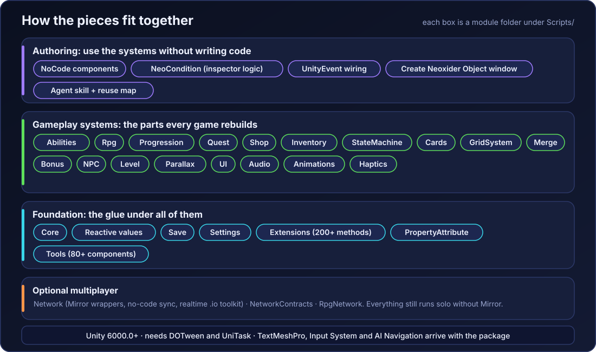</p>

Start with the runtime contract and add scene wrappers, views, or NoCode helpers where the feature needs them. Assembly definitions declare each module's dependencies; module guides distinguish ordinary C# objects from scene-facing components.

<p align="center">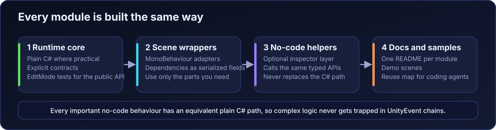</p>

## Module map

| | Module | What it covers | Docs |
|:-:|--------|-----------------|------|
| 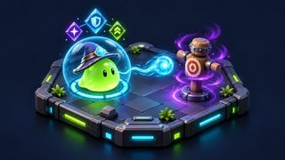 | ⚔️ **Abilities** | Data-driven Dota-style abilities & modifiers: units, properties, buffs/DoT/shields, cast pipeline with typed results, effect-op atoms, spatial grid for crowds, multiplayer receipts | [Abilities](./Docs/Abilities/README.md) |
| 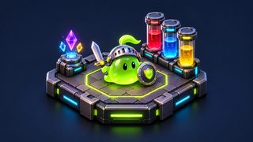 | 🧙 **RPG** | Unified `RpgCharacter`: resources, stats, level/XP, buffs/statuses, damage modifiers, melee/ranged/aoe, evade, target selectors, no-code bridges *(superseded by Abilities)* | [RPG](./Docs/Rpg/README.md) |
| 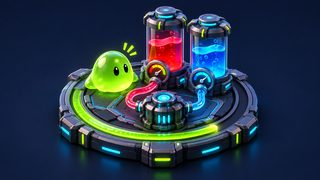 | ❤️ **Core** | Resource pools (HP/mana), health component, levels and XP curves | [Core](./Docs/Core/README.md) |
|  | 📈 **Progression** | XP, levels, perk tree, unlock tree, premium track, persistent meta-progression | [Progression](./Docs/Progression/README.md) |
|  | 🎛 **Condition** | No-code checks over fields/props/methods/state, AND/OR, UnityEvent outputs | [Condition](./Docs/Condition/README.md) |
| 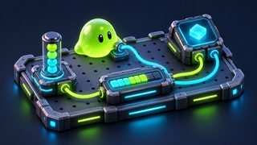 | 🔗 **NoCode** | Bind component values to UI & actions, formatted text, progress, action bridges, each with a typed C# API | [NoCode](./Docs/NoCode/README.md) |
|  | 💾 **Save** | PlayerPrefs + JSON providers, typed helpers incl. 64-bit values, save attributes, scene/global data | [Save](./Docs/Save/README.md) |
|  | ⚙️ **Settings** | Game settings service with deferred saving and UI bindings | [Settings](./Docs/Settings/README.md) |
|  | 🛒 **Shop** | Items, bundles, typed purchase results, owned/equipped, multi-currency, inventory bridge, save profile | [Shop](./Docs/Shop/README.md) |
| 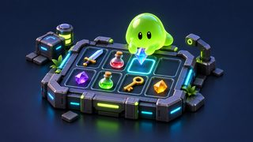 | 🎒 **Inventory** | Aggregated & slot-grid inventories, pickups, transfer rules, selection events, save integration | [Inventory](./Docs/Tools/Inventory/README.md) |
| 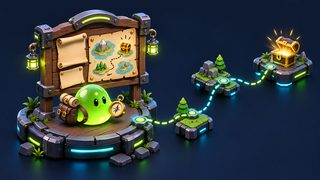 | 🗺 **Quest** | Quest configs, goals, manager, kill/collect/reach/talk notifications, no-code actions, runtime state | [Quest](./Docs/Quest/README.md) |
| 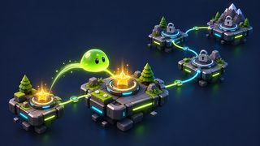 | 🚪 **Level** | Level manager, scene loading, level map flow | [Level](./Docs/Level/README.md) |
| 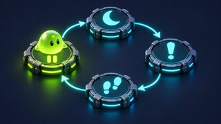 | 🔁 **StateMachine** | Runtime FSM + no-code transition predicates | [StateMachine](./Docs/StateMachine/README.md) |
| 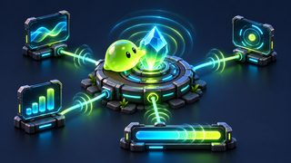 | 🧬 **Reactive** | Serializable reactive `float`/`int`/`bool` properties driving UI without glue | [Reactive](./Docs/Reactive/README.md) |
|  | 🃏 **Cards** | Deck/hand/board runtime, seeded shuffling, stable custom sorting, custom decks/views, poker, Drunkard sample | [Cards](./Docs/Cards/README.md) |
| 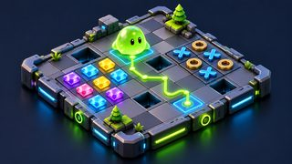 | ⬛ **GridSystem** | Field generation, pathfinding & movement ranges, placement, GridMerge, Dice, Match3, TicTacToe / n-in-a-row, SlidingMerge (2048) | [GridSystem](./Docs/GridSystem/README.md) |
|  | 🔀 **Merge** | Pure-C# connected-group merge engine for grids, inventories, lists, graphs | [Merge](./Docs/Merge/README.md) |
|  | 🎰 **Bonus** | Wheel of Fortune, slot machine, collections, daily/cooldown rewards, each with a plain C# core | [Bonus](./Docs/Bonus/README.md) |
| 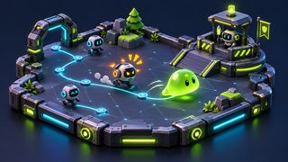 | 🤺 **NPC** | Navigation, patrol, chase, staggered re-pathing, animator driver, modular RPG-ready combat | [NPC](./Docs/NPC/README.md) |
|  | ✨ **UI** | Panels, button & toggle animations, `AnimationFly` reward motion, UI Mesh Rig | [UI](./Docs/UI/README.md) |
| 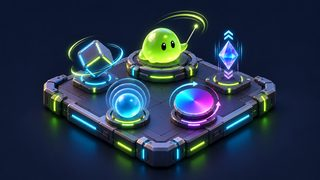 | 🎞 **Animations** | Float, color, `Vector3` and transform animators with a manual clock | [Animations](./Docs/Animations/README.md) |
|  | 🔊 **Audio** | Music/SFX manager, one-shot pooling, settings-bound volume and mute saved between launches | [Audio](./Docs/Audio/README.md) |
|  | 📳 **Haptics** | Named vibration feels, settings switch, repeat throttle | [Haptics](./Docs/Haptics/Haptics.md) |
|  | 🏞 **Parallax** | Camera-bound parallax layers with seamless recycling | [Parallax](./Docs/Parallax/README.md) |
|  | 🌐 **Network** | Optional Mirror wrappers + no-code sync/action bridges + realtime .io toolkit (bootstrap, snapshots, prediction, telemetry) | [Multiplayer Guide](./Docs/Network/Multiplayer_Guide.md), [Realtime IO Guide](./Docs/Network/Realtime_IO_Guide.md) |
|  | 🖱 **Interaction** | C# contracts, hover/click, 2D/3D physics events, ray modes, and range checks | [Interaction](./Docs/Tools/InteractableObject/README.md) |
| 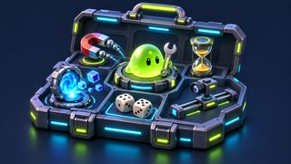 | 🧰 **Tools** | 80+ components: 3D character controller (slopes, stairs, platforms, 1st/3rd person), free-fly camera, physics, spawners, timers and injectable clocks, exact-odds random tables, dialogue and bark lines, input, text, view helpers | [Tools](./Docs/Tools/README.md) |
|  | ➕ **Extensions** | 200+ C# / Unity API extension methods, including seeded random helpers | [Extensions](./Docs/Extensions/README.md) |
|  | 🛠 **Editor** | Living inspector, `[Button]` and inject attributes, Create Neoxider Object window, maintenance tools | [Editor](./Docs/Editor/README.md) |

Full navigation lives in the [Docs index](./Docs/README.md); the [Project Summary](./PROJECT_SUMMARY.md) is a compact "what already exists, reuse it" map.

## HTML/CSS → UI Toolkit

The HTML/CSS → UI Toolkit converter (HtmlToUitk) left this package after 11.0.1 and is now the standalone
[HtmlToUitk](https://github.com/NeoXider/HtmlToUitk) library (`com.neoxider.htmltouitk`); see [Upgrading to 12](./Docs/Migration12.md#htmltouitk-moved-to-its-own-package).

## Demos

Demo scenes are not part of the package: each one is a separate download on the [releases page](https://github.com/NeoXider/NeoxiderTools/releases), imported into `Assets/NeoxiderDemos/<name>`, for example `Assets/NeoxiderDemos/Demo/Scenes/SurvivorDemo.unity`. Install the package first.

Every demo scene is saved with its UI, configured components and UnityEvent wiring: open it and inspect the setup in Edit Mode, then press Play. Re-import a demo to restore a scene you changed ([how demo scenes are made](./Docs/Samples.md#how-demo-scenes-are-made)).

| Download | Folder | Purpose |
|----------|--------|---------|
| `NeoxiderTools.Demo` | `Assets/NeoxiderDemos/Demo` | Integration and NoCode scenes, plus **`SurvivorDemo`**, a NoCode game on `Neo.Abilities` ([guide](./Docs/Abilities/SurvivorDemo.md)). |
| `NeoxiderPages` | `Assets/NeoxiderDemos/NeoxiderPages` | Optional page-navigation module (`PM`, `UIPage`, `BtnChangePage`, `UIKit`). |
| `NeoxiderTools.CharacterMovementDemo` | `Assets/NeoxiderDemos/CharacterMovementFundamentals` | Character-controller scenes for slopes, stairs, platforms, gravity, and a top-down arena ([guide](./Docs/Tools/Move/CharacterController/README.md)). |

Samples imported from 12.1 and earlier stay in `Assets/Samples/NeoxiderTools/<version>/`; delete that copy before importing a demo download, because both carry the same asset GUIDs. See [Upgrading to 12](./Docs/Migration12.md#samples-and-demo-scenes).

## Games built with NeoxiderTools

| Game | Genres | Platform | Link | Notes |
|------|--------|----------|------|-------|
| **Fake Grandkids** *(Внуки понарошку)* | Arcade, Survival | Windows | [MyIndie](https://myindie.ru/games/game/fake-grandkids) | UralGameJam 2026; NeoCondition / Neoxider workflow |

## Tests

More than 5,000 EditMode cases plus the PlayMode suites under `Tests/` cover save flows, resource/level math, abilities & combat, grid/bonus/UI behavior, networking, and NoCode bindings. Read the [EditMode and isolation guide](./Docs/Testing.md) and [PlayMode guide](./Docs/PlayModeTesting.md) for host prerequisites and scope. The host needs `com.unity.test-framework`; the broad suites also reference integrations such as Mirror. For UPM, `"com.neoxider.tools"` in the host manifest's `testables` list exposes package tests, while host prerequisites and supported test layouts still apply.

Static-reset and Play Mode transition fixtures require an isolated host. [Verification 11](./Verification11.md) records accepted Windows results and remaining artifact gates for 11.0.0. The repository does not currently configure GitHub Actions workflows; local native receipts are separate. `python scripts/check_package.py` belongs to the full repository, not a legacy-Core consumer validator. Use full-checkout/UPM testables sources with their host prerequisites; final archive contents are listed in the release-input manifest.

## Project layout

```text
Assets/Neoxider/
  Scripts/    Runtime modules (asmdef-separated)
  Editor/     Custom inspectors, windows, tooling
  Tests/      EditMode + PlayMode coverage
  Docs/       Documentation
  Prefabs/    Ready-to-use prefabs
  Resources/  Settings & package assets
```

Demo scenes live outside the package, in `Assets/NeoxiderDemos/` of the repository.

## License

Starting with 11.0.1, NeoxiderTools is released under the [PolyForm Small Business License 1.0.0](./LICENSE.md).
It is free for personal and non-commercial use and for small businesses: fewer than 100 people and less than
1,000,000 USD (2019) revenue in the prior tax year. Larger companies need a commercial license: contact
neoxider@gmail.com. Earlier releases keep the license they shipped with. Bundled third-party code keeps its own
license, see [third-party notices](./THIRD-PARTY-NOTICES.md).

## Support

Found a bug or have an idea? Open an [issue](https://github.com/NeoXider/NeoxiderTools/issues) or PR. Behavior changes are tracked in the [Changelog](./CHANGELOG.md) and the relevant module docs.
