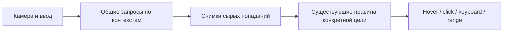

# Общие запросы взаимодействия для 11.0.0

Целевая ветка: `demo`. Это утверждённый координатором контракт для исправления 11.0.0 после независимого ревью A и B-extra. Сам документ не подтверждает реализацию или запуск проверок. Пользователь явно требует оптимизацию с сохранением механики и существующих настроек.

## Что действительно повторяется

`InteractiveObject.Update` вызывает `UpdateMouseTargetRaycast` у каждого экземпляра. `TryGetCurrentTargetHit` выполняет собственный `Physics.RaycastNonAlloc` или `Physics2D.GetRayIntersectionNonAlloc`. `InteractionRayProvider` сейчас создаёт геометрию луча и выбирает Mouse/ScreenCenter/Both, но не объединяет физические запросы разных объектов. Переиспользование hover/click внутри одного экземпляра не устраняет N одинаковых запросов от N экземпляров.

Есть и другие запросы: `IsInRange` проверяет препятствия по направлению от `distanceCheckPoint` к конкретной цели; `IsInViewForKeyboardInteraction` использует направление взгляда. Разные направления/начала лучей нельзя заменять одним общим результатом, если нужно сохранить поведение.

## Базовое решение

Владелец камеры/источника взаимодействия предоставляет общий сервис запросов. Он хранит сырые попадания текущего шага обработки ввода и возвращает их всем потребителям одинакового запроса. Объект применяет свои правила и получает свои переходы состояния. Физический запрос не принадлежит каждому target-компоненту.

Первый этап — прозрачное объединение одинаковых запросов через существующий `InteractionRayProvider` и небольшой backend. Новая общая машина ввода/жестов не является обязательной предпосылкой исправления. `IInteractiveTarget` и `InteractionQueryMath` переиспользуются; обязательные члены в пользовательские интерфейсы не добавляются.

### Контекст кэша

Учитываются только параметры, реально влияющие на исходный физический запрос:

- physics scene/world, 3D или 2D и вид запроса;
- фактические origin/direction, максимальная дистанция и при наличии другие геометрические ограничения;
- физический LayerMask и trigger/contact-filter policy, включая действующие глобальные флаги там, где текущий API их использует;
- версия/epoch текущего прохода обработки; camera/viewport/pointer context помогает получить правильную геометрию.

Разные камеры и Mouse/ScreenCenter не смешиваются. Никакого приблизительного округления origin/direction ради попадания в кэш. Если hover/click дают один и тот же запрос, результат используется повторно. В Both могут потребоваться два разных результата; 2D и 3D остаются разными backend-запросами.

Цель по производительности: число одинаковых физических запросов зависит от числа уникальных контекстов K, а не числа объектов N. Не обещать один луч для всех возможных настроек и направлений.

### Что хранит снимок

Сырые данные попадания: collider/receiver reference, point, distance и необходимые геометрические данные. Кэш не хранит общий `IsTarget`, `CanInteract`, hover или принятое событие: они зависят от конкретного потребителя. `InteractionRayHit.IsTarget` формируется в target-specific оценке.

Буферы переиспользуются. Потребитель не изменяет и не сортирует общий массив. Заимствованный снимок действует только в объявленном epoch; долгосрочное хранение требует явной копии. Нельзя называть переиспользуемый буфер неизменяемым постоянным snapshot.

## Слои и теги

### Слои физического запроса

Начальная безопасная реализация кэширует точные query-параметры. Сто объектов с одной маской используют один результат. Для другой физической маски выполняется один дополнительный запрос этой группы, затем он тоже переиспользуется. Разные trigger/contact policies обрабатываются аналогично.

Объединение масок в superset допустимо только как последующая доказанная оптимизация: нужны полный набор попаданий, фильтрация по исходной маске до выбора ближайшего попадания/блокера и отсутствие изменения trigger/depth/scene semantics. Это не обязательная часть первого исправления. Широкий AllLayers-запрос может быть дороже нескольких узких запросов.

В текущем `InteractiveObject` поле `obstacleLayers` — маска препятствий для range/line-of-sight, а не универсальный фильтр всех мышиных целей. Mouse/look сейчас запрашивают `~0` и применяют свои правила после получения попаданий. Эти смыслы сохраняются; одинаково названные настройки из разных компонентов не объединяются автоматически.

### Теги и фильтры получателя

Теги и прочие проверки допустимости цели применяются к попаданиям в прежнем порядке и на прежнем объекте/корне. Они сами по себе не требуют нового физического запроса. Стена с неподходящим тегом цели не должна исчезать из проверки препятствий.

`PhysicsEvents2D`/`PhysicsEvents3D.layers`, `filterByTag`, `requiredTag` фильтруют настоящие collision/trigger callbacks. Это отдельный канал; raycast-кэш не заменяет эти callbacks и не меняет их payload или фильтры.

Геометрический кэш не должен незаметно замораживать tag/layer/availability. Изменения настроек и регистрации должны инвалидировать относящуюся к ним оценку. Не вводить новые tag-фильтры в `InteractiveObject`, если их сейчас нет.

## Полнота и время жизни

Текущие массивы из 16 элементов могут терять цель или блокер. Полный буфер не доказывает полноту результата. Backend увеличивает reusable-буфер и повторяет запрос; у предела нужен полный fallback или явное неполное состояние с согласованным поведением, а не принятие усечённого результата как полного. Тест счётчика отделяет обычный прогретый запрос от дополнительных попыток роста буфера.

Кэш имеет ограниченный срок жизни: один согласованный проход взаимодействия. Новый кадр/проход, другой луч, камера/viewport, physics context или query settings создают новый результат. Disable/destroy/pooling освобождают регистрацию и не оставляют старую цель hovered. Нужен явный C# путь инвалидирования для ручной simulation/изменения физического мира внутри прохода и возможность свежего запроса для внешнего вызывающего кода.

Не заявлять автоматическое обнаружение всех произвольных изменений физического мира внутри кадра, если backend не имеет такого механизма. Порядок обработки и границы snapshot должны быть определены до реализации и проверены на изменении/отключении blocker из callback.

### Границы обновления и синхронные callbacks

`Time.frameCount` — только одна граница, а не доказательство неизменности физического мира. Общий кэш действует в стабильном epoch между внешними callbacks взаимодействия. Перед вызовом пользовательского обработчика epoch инвалидируется; после dispatch, включая исключение через `finally`, инвалидируется снова. Вложенный запрос из обработчика получает свежие данные или явно обходит кэш. Нельзя отложить существующий синхронный UnityEvent в конец кадра ради меньшего числа запросов.

До внешнего callback потребитель завершает чтение заимствованного набора попаданий. Он не продолжает обход старого общего массива после callback, который может инициировать повторный запрос и переиспользовать буфер. Локальные выбранные значения/ссылки сохраняются только в пределах существующей операции с проверками lifetime/generation.

Публичный синхронный `IsInInteractionRange` вне автоматического прохода по умолчанию выполняет свежую проверку. Предусматривается явный C# путь `Invalidate` и свежего запроса для `Physics.Simulate`, `SyncTransforms` и изменений мира между автоматическими проходами. Произвольное стороннее перемещение коллайдера между чужими `Update` нельзя обнаружить по одному счётчику кадров: приложение должно обозначить такую границу через этот API. Эта граница совместимости описывается в публичном руководстве, без обещания автоматической прозрачности для необъявленных изменений.

Счётчики отделяют стабильный прогретый epoch от холодного роста буфера, явной invalidation, вложенного callback и уникального LOS. В стабильном epoch одинаковые запросы дают K физических запросов для N целей. Callback, изменяющий мир, правомерно создаёт следующий epoch и дополнительные запросы. Нельзя скрывать их из общей статистики.

Память кэша ограничена живыми контекстами/текущим проходом: движения камеры и новый луч не оставляют бессрочную историю ключей. Между epoch переиспользуются слоты и буферы; subsystem reset очищает статическое состояние. Для origin/direction применяется точное сравнение компонент float, без приблизительного `Vector3.operator ==`.

### Точная политика триггеров 2D/3D

Явные 3D `Collide`/`Ignore` сохраняются независимо от глобального флага. У 2D mouse `GetRayIntersection` и keyboard planar ray сохраняется действие `Physics2D.queriesHitTriggers`; локальный `includeTriggers` остаётся post-filter. Локальное `true` не восстанавливает попадания, которые глобальный запрос уже исключил. Range LOS с явным `ContactFilter2D` сохраняет собственную политику фильтра и не получает неявное дополнительное AND с глобальным флагом. Ключ отражает фактический overload/filter, включая относящиеся к нему глобальные параметры.

Индивидуальные line-of-sight лучи с разными направлениями сохраняются там, где они нужны существующей механике. Их можно объединять только при действительно одинаковых параметрах. Нельзя ради показателя «один raycast» отключать `checkObstacles`, менять `onEnterRange` или пропускать проверки дальности.

## Приёмка после общего завершения исходников

1. Для 1/100/1000 targets с одинаковым mouse/look query context число прогретых backend-запросов постоянно. Both, несколько камер, 2D/3D и разные физические маски считаются отдельно.
2. Разные только post-filters не создают повторных одинаковых physics queries. Разные query masks/policies дают корректные отдельные результаты.
3. Сравнение с некэшированным полным эталоном: target hit, point, eligibility, obstacle decision и последовательность событий совпадают для всех существующих настроек. Эталон не закрепляет прежнюю ошибку усечения на 16 hits.
4. Покрыть target behind wall, `checkObstacles` on/off, чужие triggers, obstacleLayers, ignored hierarchy, явный collider, nested targets, равные расстояния, нет/отключённая камера, split-screen/viewport, Mouse/Center/Both.
5. При 17/64/1000 hits сохраняется правильный блокер/цель; после прогрева повторные обращения не увеличивают массивы без причины. Учитываются все native retry/fallback calls.
6. Изменение слоя, tag, настроек, камеры и blocker; disable/re-enable/pooling; явная invalidation внутри epoch; callback reentry и отсутствие повторных hover/click/up.
7. Отдельно проверить уникальные per-target LOS-запросы: оптимизация общих лучей сохраняет их правильные ответы, не подменяет разными направлениями один результат.

Сначала исходный аудитор уточняет конкретный минимальный контракт; нативное ревью подтверждает его или запрашивает доказательства. Реализуют исходные владельцы сборок после общего ревью. Все исполняемые проверки — только после завершения всех source writers, по последнему указанию пользователя. Serialized settings, публичные события и действующая механика сохраняются; крупная версия не отменяет это требование для взаимодействия.
