<div align="center">

# NeoxiderTools

**Build games from reusable Unity C# systems.**

A modular construction library: use runtime APIs directly, then add scene components and optional Inspector / NoCode workflows.

[](Assets/Neoxider/package.json)
[](Assets/Neoxider/LICENSE.md)
[](Assets/Neoxider/Docs/PackageCompatibility.md)
[](Assets/Neoxider/Docs/README.md#namespace-policy)
[](Assets/Neoxider/Docs/NoCode/README.md)

### [Demos](#-see-it-running) · [Start](#quick-start) · [Install](#-install) · [Modules](#-what-is-inside) · [Documentation](Assets/Neoxider/Docs/README.md) · [Samples](#-samples) · [Upgrade from 11.x](Assets/Neoxider/Docs/Migration12.md)

</div>

> **Upgrading from 11.x?** Read [Upgrading to 12](Assets/Neoxider/Docs/Migration12.md): the HTML → UI Toolkit converter moved to [its own package](https://github.com/NeoXider/HtmlToUitk), a few APIs became obsolete, and the demo scenes are now authored in the scene. Coming from 10.x, read [Migration to 11](Assets/Neoxider/Docs/Migration11.md) first. The Windows validation of 11.0.0 (Unity `6000.3.14f1` and `6000.6.0f1`, optional-dependency profiles, imported samples, separate network players) is in the [verification record](Assets/Neoxider/Verification11.md).

**По-русски:** [C# API, компоненты и NoCode](Assets/Neoxider/Docs/README.md) · [обновление с 11.x](Assets/Neoxider/Docs/Migration12.md) · [обновление с 10.x](Assets/Neoxider/Docs/Migration11.md).

<p align="center">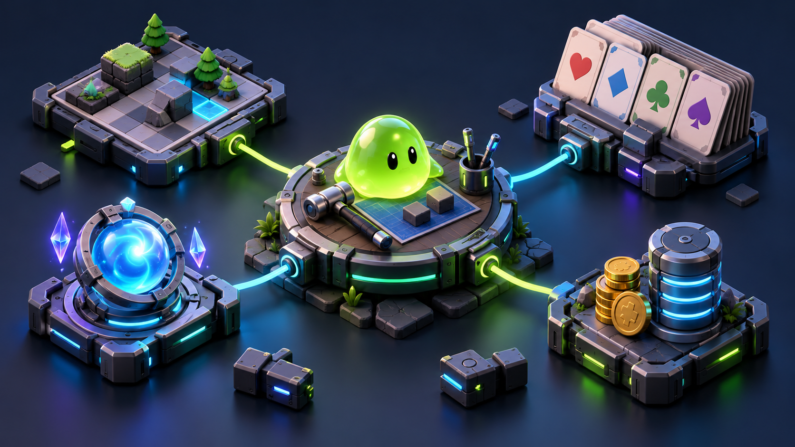</p>

*Concept artwork for the construction library; not an Editor or gameplay capture.*

<!-- demo-gallery:begin -->

## 🎬 See it running

Captures taken in the Unity Editor (several in Play Mode) of scenes from the **Demo Scenes** sample (Package Manager > NeoxiderTools > Samples). Click a picture to open the module guide.

<table>
<tr>
<td width="33%" align="center"><a href="Assets/Neoxider/Docs/Abilities/README.md">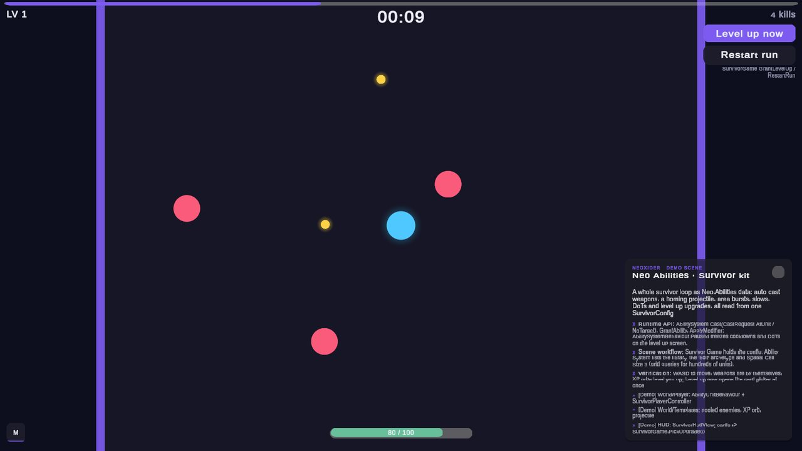</a><br /><b>Survivor arena</b><br /><sub>Abilities, waves and upgrades from one config</sub></td>
<td width="33%" align="center"><a href="Assets/Neoxider/Docs/GridSystem/README.md">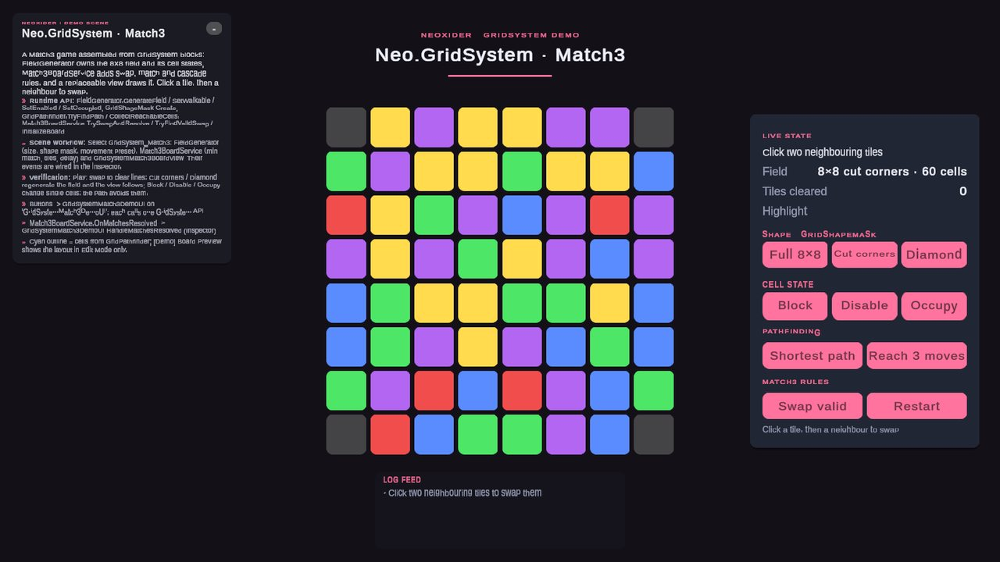</a><br /><b>Match3 board</b><br /><sub>Shaped boards, paths and match rules</sub></td>
<td width="33%" align="center"><a href="Assets/Neoxider/Docs/Bonus/README.md">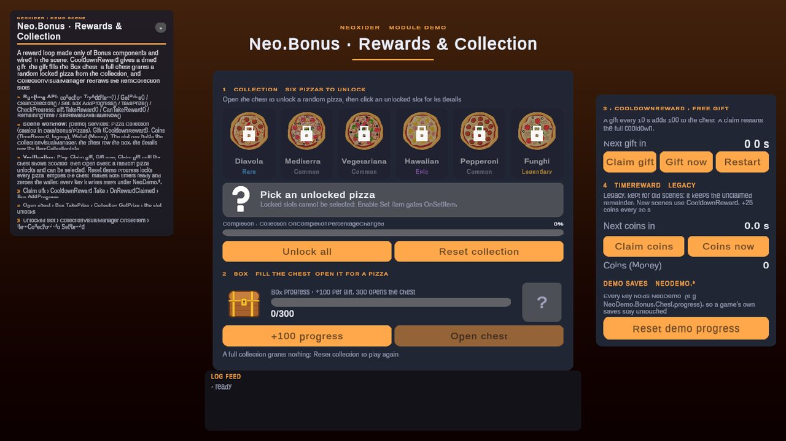</a><br /><b>Rewards and collection</b><br /><sub>Collection, chest and cooldown gifts, no script</sub></td>
</tr>
<tr>
<td width="33%" align="center"><a href="Assets/Neoxider/Docs/Tools/Physics/README.md">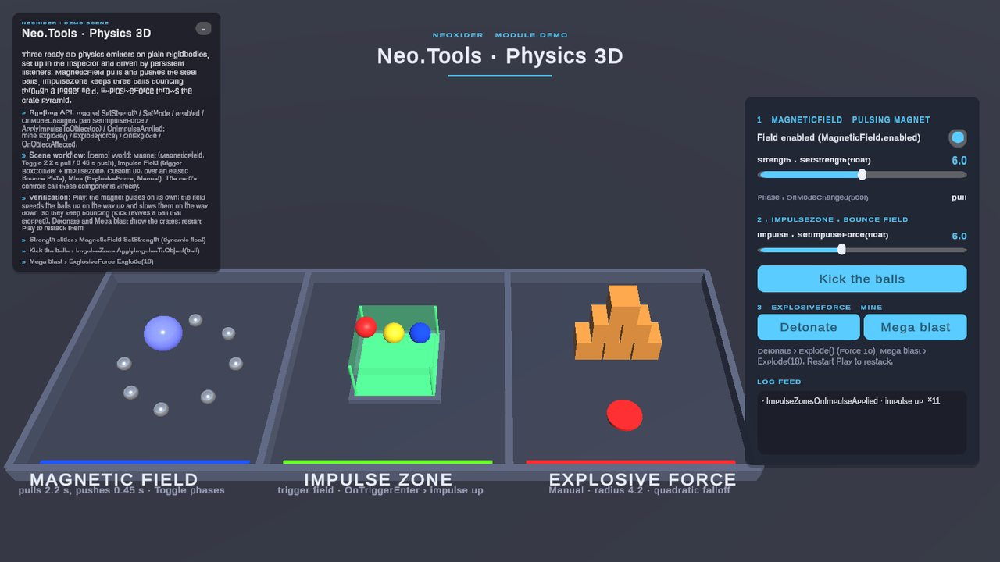</a><br /><b>Physics 3D</b><br /><sub>Magnet, impulse zone and explosive force</sub></td>
<td width="33%" align="center"><a href="Assets/Neoxider/Docs/UI/README.md">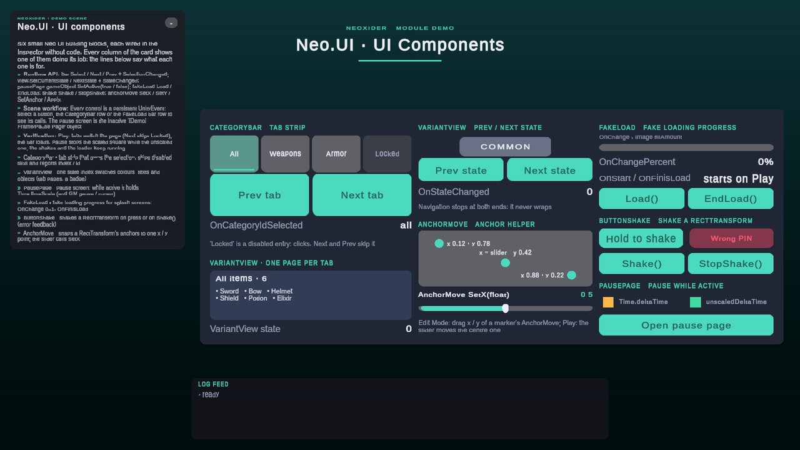</a><br /><b>UI components</b><br /><sub>Tabs, variants, loader, shake and pause</sub></td>
<td width="33%" align="center"><a href="Assets/Neoxider/Docs/Cards/README.md">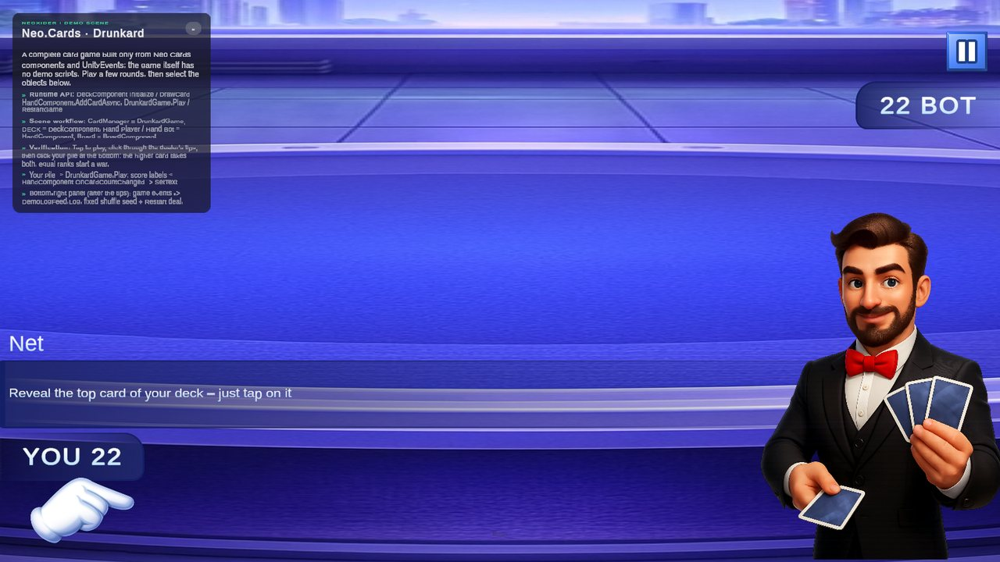</a><br /><b>Card game</b><br /><sub>Deck, hand and board components</sub></td>
</tr>
<tr>
<td width="33%" align="center"><a href="Assets/Neoxider/Docs/Bonus/README.md">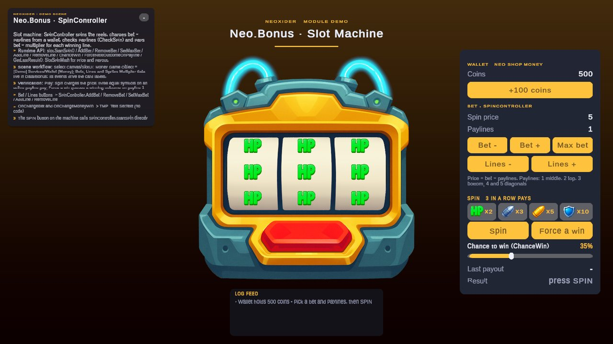</a><br /><b>Slot machine</b><br /><sub>Bets, paylines and a paytable</sub></td>
<td width="33%" align="center"><a href="Assets/Neoxider/Docs/Shop/README.md">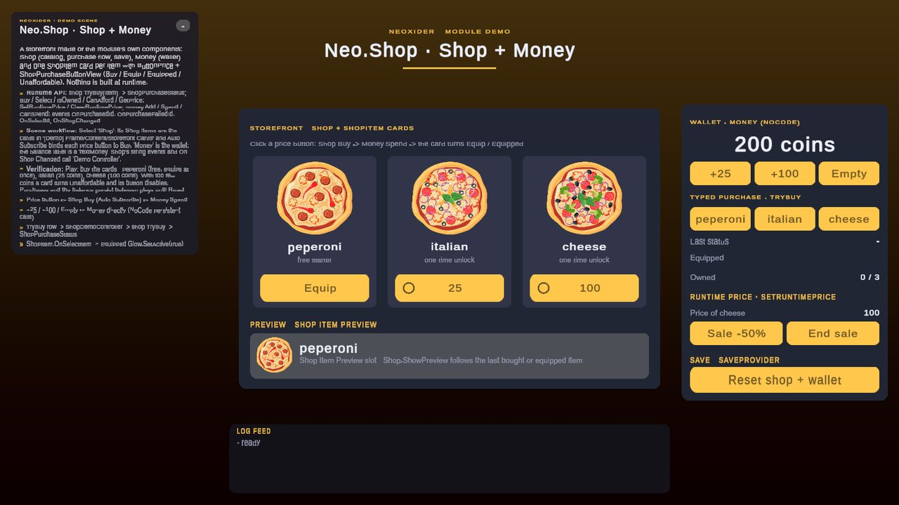</a><br /><b>Shop</b><br /><sub>Storefront, purchase states and a wallet</sub></td>
<td width="33%" align="center"><a href="Assets/Neoxider/Docs/UI/README.md">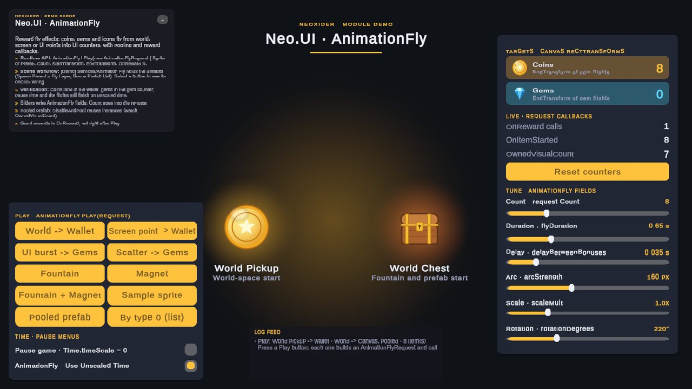</a><br /><b>Reward fly</b><br /><sub>Coins flying from world, canvas and screen</sub></td>
</tr>
<tr>
<td width="33%" align="center"><a href="Assets/Neoxider/Docs/NoCode/README.md">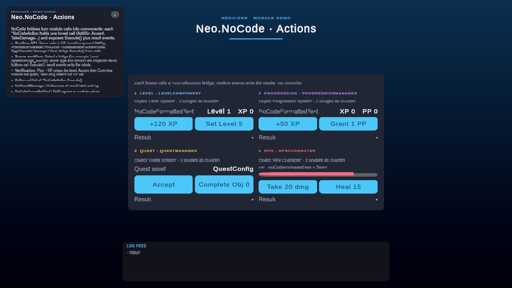</a><br /><b>NoCode actions</b><br /><sub>Level, Progression, Quest and RPG without code</sub></td>
<td width="33%" align="center"><a href="Assets/Neoxider/Docs/Progression/README.md">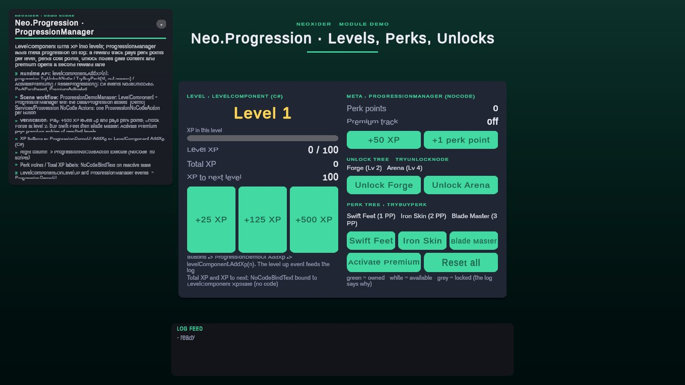</a><br /><b>Progression</b><br /><sub>XP, perk and unlock trees, premium track</sub></td>
<td width="33%" align="center"><a href="Assets/Neoxider/Docs/UI/README.md">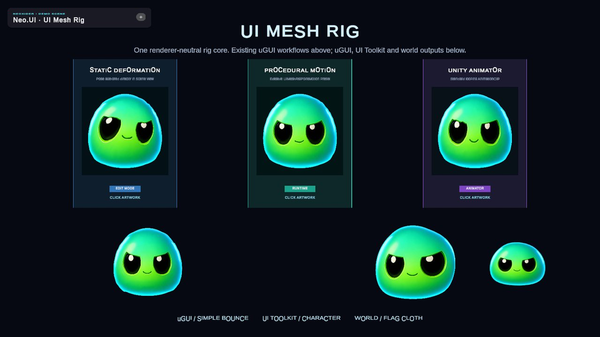</a><br /><b>UI Mesh Rig</b><br /><sub>One rig in uGUI, UI Toolkit and world space</sub></td>
</tr>
</table>

<!-- demo-gallery:end -->

## Quick start

1. [Install NeoxiderTools](#-install), plus DOTween and UniTask in the host project.
2. Choose one feature and one entry point:

| Start with | Use it for | Guide |
|------------|------------|-------|
| **C# runtime API** | Own models and services from your code; add views when needed | [Runtime-model example](Assets/Neoxider/Docs/GettingStarted.md#start-with-a-c-runtime-model) |
| **Scene components** | Add a component and assign its explicit dependencies | [First audio scene](Assets/Neoxider/Docs/GettingStarted.md#your-first-scene-in-5-minutes-audio-manager-am), [scene checklist](#first-scene-checklist) |
| **Inspector / NoCode** | Connect values and events to the same typed APIs | [NoCode guide](Assets/Neoxider/Docs/NoCode/GettingStarted.md) |
| **A working demo** | Open a ready scene and inspect how it is wired | [Sample scenes](Assets/Neoxider/Docs/Samples.md) |

3. Find the next building block in the [module map](#-what-is-inside). Keep reusable configuration in assets and scene references on components.

For an existing project, start with [Upgrading to 12](Assets/Neoxider/Docs/Migration12.md#behaviour-changes-to-review): it lists the behaviour changes per module (for example, `AMSettings` now saves the player's mute, and `ButtonScale`/`ButtonShake`/`FakeLoad` animate in unscaled time).

The [package README](Assets/Neoxider/README.md), [reuse map](Assets/Neoxider/PROJECT_SUMMARY.md) and [changelog](Assets/Neoxider/CHANGELOG.md) provide the wider package context.

<!-- whats-new:begin -->
## ⚡ What's new in 12

- **Faster where games spend their frames.** Measured in the Unity 6000.3 Editor ([full record](Docs/Audits/2026-11-02/Performance/MeasuredResults-12.0.md)):

  | Case | 11.x | 12.0 |
  |------|------|------|
  | 1,000 interactable objects, one frame | 3,366 ms | 5.5 ms |
  | Input read (8 keys + stick) | 141 µs, 68 allocations | 3.7 µs, 0 |
  | Match3 valid-swap search, 32×32 board | 74.5 ms, 4,978 allocations | 0.87 ms, 0 |
  | NoCode StateMachine, 128 states | 17.3 µs | 0.55 µs |
  | Card placement on a 128-card board | 113 µs per card | 15 µs per card |

- **Demo scenes you can read without Play Mode.** Every module demo is saved with its UI and UnityEvent wiring; four new scenes (Animations, UI Components, Bonus Rewards, Physics 3D) and info cards on the NoCode example games.
- **More NoCode targets.** One-argument UnityEvent methods where an enum or a second argument used to block wiring (`SetModeIndex`, `SetDirectionIndex`, `AnchorMove.SetX`, `Leaderboard.SubmitScore`, `Box.ResetProgress`, `CategoryBar.DisableEntry`).
- **Hundreds of fixes**, each with a test: more than 5,800 EditMode and 1,000 PlayMode cases. See the [changelog](Assets/Neoxider/CHANGELOG.md) and [Upgrading to 12](Assets/Neoxider/Docs/Migration12.md).

<!-- whats-new:end -->

## 📑 Contents

<details>
<summary>Navigate the README</summary>

- [See it running](#-see-it-running)
- [Quick start](#quick-start)
- [What's new in 12](#-whats-new-in-12)
- [Install](#-install) and [requirements](#requirements)
- [First scene checklist](#first-scene-checklist)
- [Module map](#-what-is-inside)
- [How it fits together](#how-it-fits-together)
- [Four ways to build](#one-package--four-ways-to-build)
- [NoCode example](#no-code-example-neocondition)
- [Samples](#-samples)
- [HTML/CSS → UI Toolkit](#htmlcss--ui-toolkit)
- [Tests](#tests)
- [Project layout](#project-layout)
- [Games](#games-using-neoxidertools) and [support](#support)

</details>

## 🚀 Install

Install **NeoxiderTools** plus the required third-party packages below. In Unity: `Window > Package Manager > + > Add package from git URL` (or import from Asset Store for DOTween).

### NeoxiderTools (Git URL)

```text
https://github.com/NeoXider/NeoxiderTools.git?path=Assets/Neoxider
```

This URL follows the remote default branch; append a release tag (for example `#v12.0.0`) to pin a version. For source development, use the [local-package route](Assets/Neoxider/Docs/GettingStarted.md#option-b--local-path-for-development).

### DOTween (required)

Install from the [Unity Asset Store — DOTween (HOTween v2)](https://assetstore.unity.com/packages/tools/animation/dotween-hotween-v2-27676), then run setup via `Tools > Demigiant > DOTween Utility Panel`.

### UniTask (required)

```text
https://github.com/Cysharp/UniTask.git?path=src/UniTask/Assets/Plugins/UniTask#2.5.11
```

### Manual install (NeoxiderTools only)

Copy `Assets/Neoxider` into your project. You still need DOTween and UniTask installed separately.

## Requirements

- Unity `6000.0+`.
- Installed automatically by UPM with NeoxiderTools: `com.unity.ai.navigation`, `com.unity.inputsystem`, `com.unity.ugui` (which includes TextMeshPro on Unity 6).
- **Required (host project):** [DOTween](https://assetstore.unity.com/packages/tools/animation/dotween-hotween-v2-27676), [UniTask](https://github.com/Cysharp/UniTask) — see [Install](#-install).
- **Optional:** `DOTween Pro`, `Mirror`, `Spine Unity Runtime`, `Odin Inspector`, `MarkdownRenderer`, [HtmlToUitk](https://github.com/NeoXider/HtmlToUitk) (HTML/CSS → UI Toolkit), and the [mobile haptics backend](Assets/Neoxider/Docs/Haptics/Haptics.md). NeoxiderPages imports without DOTween Pro.
- URP is optional. The package does not depend on `com.unity.render-pipelines.universal`; add URP yourself only if your project uses URP-specific rendering features or 2D lights.
- Samples additionally need **TMP Essential Resources** and `com.unity.2d.sprite`; see [sample prerequisites](Assets/Neoxider/Docs/Samples.md#host-and-sample-prerequisites).

Character Movement Fundamentals runtime/editor code is bundled under `ThirdParty/CharacterMovementFundamentals`; its demo content is an optional sample. See [third-party notices](Assets/Neoxider/THIRD-PARTY-NOTICES.md) for the bundled license and external dependencies.

See [dependency versions and optional MCP setup](Assets/Neoxider/Docs/Dependencies.md) for pinned updates,
Unity SDK compatibility and the DOTween Core/Pro upgrade constraint.

## First scene checklist

1. Install NeoxiderTools, DOTween, and UniTask (see [Install](#-install)).
2. Pick one module and assign its dependencies in the Inspector or through its initialization API. Follow the [first audio scene](Assets/Neoxider/Docs/GettingStarted.md#your-first-scene-in-5-minutes-audio-manager-am) for a small working example.
3. Add components through `Add Component > Neoxider` or `Neoxider > Windows > Create Neoxider Object`.
4. For the existing manager bootstrap, use the package's `Prefabs/-System--.prefab` (`Assets/Neoxider/Prefabs/-System--.prefab` in a manual install). Read the selected module's setup before adding managers.
5. For multiplayer, install Mirror first and follow the [Multiplayer guide](Assets/Neoxider/Docs/Network/Multiplayer_Guide.md).

For a C# model such as `ResourcePoolModel`, `MergeResolver`, `IntegerChanceTable` or `StateMachine<TState>`, start from the [runtime API route](Assets/Neoxider/Docs/GettingStarted.md#choose-your-starting-point). These APIs can be owned by your own code without the bootstrap prefab. Keep reusable configuration in ScriptableObjects and scene references on scene components.

## 🧩 What is inside

26 module areas plus 17 Tools submodules, compiled as 54 runtime and 6 editor assemblies with explicit references, so a game pulls in only what it uses.

| | Area | What it solves | Docs |
|:-:|------|----------------|------|
| 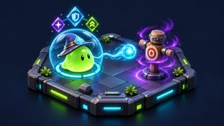 | Abilities | Data-driven Dota-style abilities and modifiers: units, properties, buffs/debuffs/DoT/shields, cast pipeline with typed results, opt-in spatial grid for hundreds of units, multiplayer-ready receipts; successor to RPG | [Abilities](Assets/Neoxider/Docs/Abilities/README.md) |
|  | RPG | Resources, stats, buffs, statuses, progression, combat, damage modifiers, targets, multiplayer-ready APIs (superseded by Abilities) | [RPG](Assets/Neoxider/Docs/Rpg/README.md) |
| 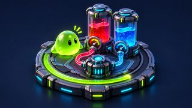 | Core | Resource pools, health, levels and XP curves | [Core](Assets/Neoxider/Docs/Core/README.md) |
|  | Condition | Inspector-driven checks over fields, properties, methods, GameObject state, AND/OR, events | [Condition](Assets/Neoxider/Docs/Condition/README.md) |
| 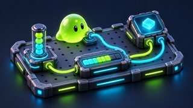 | NoCode | Bind component values to UI and actions without writing one-off view scripts; every component has a typed C# API | [NoCode](Assets/Neoxider/Docs/NoCode/README.md) |
|  | Shop | Items, bundles, typed purchase results, owned/equipped state, multi-currency, inventory bridge, save profile | [Shop](Assets/Neoxider/Docs/Shop/README.md) |
|  | Inventory | Aggregated and slot-grid inventories, pickups, transfer rules, selection events, save integration | [Inventory](Assets/Neoxider/Docs/Tools/Inventory/README.md) |
|  | Save | PlayerPrefs and JSON-backed provider flow, typed helpers including 64-bit values, save attributes | [Save](Assets/Neoxider/Docs/Save/README.md) |
|  | Settings | Game settings service, deferred saving, UI bindings | [Settings](Assets/Neoxider/Docs/Settings/README.md) |
|  | Progression | XP, levels, perk tree, unlock tree, premium track, persistent progression | [Progression](Assets/Neoxider/Docs/Progression/README.md) |
| 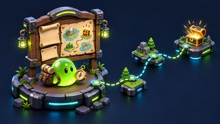 | Quest | Quest configs, goals, manager, kill/collect/reach/talk notifications, no-code actions, runtime state | [Quest](Assets/Neoxider/Docs/Quest/README.md) |
| 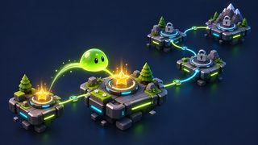 | Level | Level manager, scene loading, level map flow | [Level](Assets/Neoxider/Docs/Level/README.md) |
| 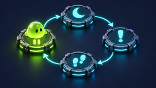 | StateMachine | Runtime state machine plus no-code transition predicates | [StateMachine](Assets/Neoxider/Docs/StateMachine/README.md) |
| 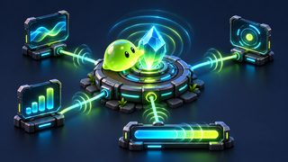 | Reactive | Serializable reactive `float`/`int`/`bool` properties | [Reactive](Assets/Neoxider/Docs/Reactive/README.md) |
|  | Merge | Pure C# connected-group merge engine for grids, inventories, lists, and custom graphs | [Merge](Assets/Neoxider/Docs/Merge/README.md) |
| 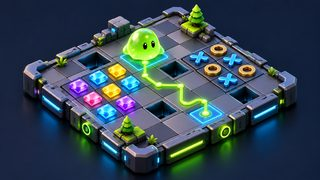 | GridSystem | Field generation, pathfinding and movement ranges, grid merge adapter, Dice, Match3, TicTacToe / n-in-a-row, SlidingMerge (2048) | [GridSystem](Assets/Neoxider/Docs/GridSystem/README.md) |
|  | Cards | Deck/hand/board runtime, seeded shuffling, stable custom sorting, custom decks/views, poker, Drunkard sample | [Cards](Assets/Neoxider/Docs/Cards/README.md) |
|  | Bonus | Wheel of Fortune, slot machine, collections, daily/cooldown rewards, each with a plain C# core | [Bonus](Assets/Neoxider/Docs/Bonus/README.md) |
| 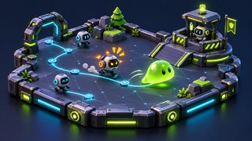 | NPC | Navigation, patrol, chase, animator driver, modular RPG-ready combat | [NPC](Assets/Neoxider/Docs/NPC/README.md) |
|  | UI | UI panels, button animations, toggles, `AnimationFly` reward motion, UI Mesh Rig | [UI](Assets/Neoxider/Docs/UI/README.md) |
|  | Animations | Float, color, `Vector3` and transform animators with a manual clock | [Animations](Assets/Neoxider/Docs/Animations/README.md) |
|  | Audio | Music/SFX manager, one-shot pooling, settings-bound volume and mute that persist between launches | [Audio](Assets/Neoxider/Docs/Audio/README.md) |
|  | Haptics | Named vibration feels with a settings switch and repeat throttle | [Haptics](Assets/Neoxider/Docs/Haptics/Haptics.md) |
|  | Parallax | Camera-bound parallax layers with seamless recycling | [Parallax](Assets/Neoxider/Docs/Parallax/README.md) |
|  | Network | Optional Mirror wrappers, no-code network action/sync bridges, and a realtime .io toolkit (bootstrap, snapshots, prediction, telemetry) | [Network](Assets/Neoxider/Docs/Network/README.md), [Realtime IO guide](Assets/Neoxider/Docs/Network/Realtime_IO_Guide.md) |
|  | Interaction | C# interaction contracts, hover/click, 2D/3D physics events, ray modes, and range checks | [Interaction](Assets/Neoxider/Docs/Tools/InteractableObject/README.md) |
|  | Tools | Movement, free-fly camera, physics, timers and injectable clocks, exact-odds random tables, dialogue and bark lines, spawners, text, managers, view helpers | [Tools](Assets/Neoxider/Docs/Tools/README.md) |
|  | Extensions | 200+ C# and Unity API extension methods, including seeded random helpers | [Extensions](Assets/Neoxider/Docs/Extensions/README.md) |
|  | Editor | Living inspector, `[Button]` and inject attributes, creation windows, maintenance tools | [Editor](Assets/Neoxider/Docs/Editor/README.md) |

## How it fits together

<p align="center">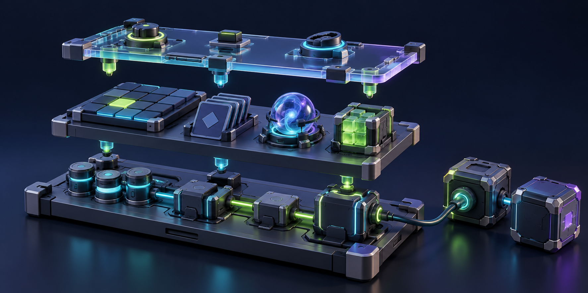</p>

**Foundation → gameplay → adapters.** Start with the module's runtime API, then add scene wrappers, views, or NoCode helpers where your game needs them. Module dependencies are declared in assembly definitions; some runtime APIs use ordinary C# objects, while scene-facing services use components:

<p align="center">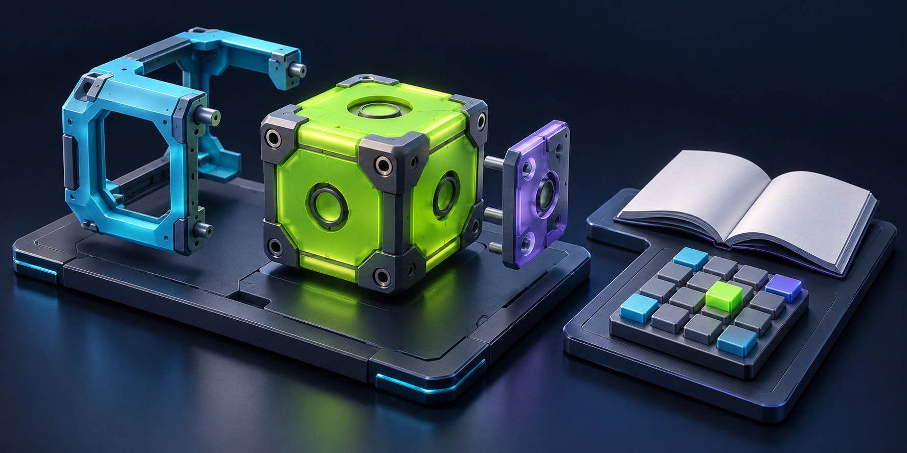</p>

The module core is the starting point. Scene adapters, Inspector helpers, documentation and samples complement it; each module guide describes its actual dependencies. Time-dependent rules take an injectable clock (`IFrameClock`, `INeoClock`) and random rolls take a seed or source, so the same rules run in tests, replays and servers.

## One package — four ways to build

<p align="center">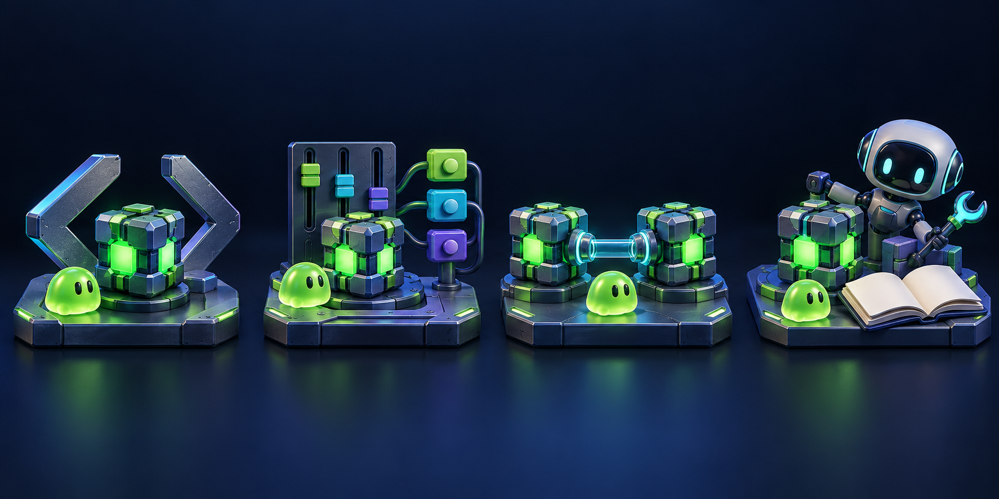</p>

*Left to right: C# APIs, component/Inspector authoring, optional multiplayer, and coding-agent guidance.*

- 🛠 **Programmers — clean C# APIs.** Use runtime models and services directly, with **200+ extension methods** in `Neo.Extensions`. Start with the [C# quick start](Assets/Neoxider/Docs/GettingStarted.md#start-with-a-c-runtime-model); scene singletons such as `AM.I` are optional integration choices for the modules that expose them.
- 🧩 **Components and optional NoCode.** Configure gameplay in the Inspector: conditions, counters, timers, shops, slots, wheels, equipment, page navigation, click sounds. Start with the [NoCode guide](Assets/Neoxider/Docs/NoCode/GettingStarted.md).
- 🌐 **Multiplayer, if you need it.** Optional Mirror integration: NoCode sync bridges (`NetworkPropertySync`, `NetworkReactiveSync`, `NetworkActionRelay`) and one-button LAN Quick Play. The bridges include a solo-mode path; install Mirror when enabling networking.
- 🤖 **AI-agent development.** A bundled [agent skill](Assets/Neoxider/Skill/neoxider-tools/SKILL.md), `[NeoDoc]`-linked docs, and a machine-readable [reuse map](Assets/Neoxider/PROJECT_SUMMARY.md) let coding agents (Claude, Codex) build games on top of the package instead of reinventing it.

## No-code example: NeoCondition

`NeoCondition` lets designers wire gameplay logic from the Inspector:

- Check fields, properties, GameObject state, or single-argument methods.
- Compare against constants or another object.
- Use `AND`, `OR`, and inversion.
- When events are dispatched, emit `OnResult(result)` and `OnInvertedResult(!result)`, followed by either `OnTrue` or `OnFalse`. **Only On Change** can suppress dispatch for an unchanged result.

Example: a condition calling `CanSpend(100f)` on a configured `Money` component can drive a local affordability hint. Perform the purchase through the Shop API and the configured server authority.

Read more: [NeoCondition docs](Assets/Neoxider/Docs/Condition/NeoCondition.md).

## 🎮 Samples

<!-- samples-shots:begin -->
<p align="center"> 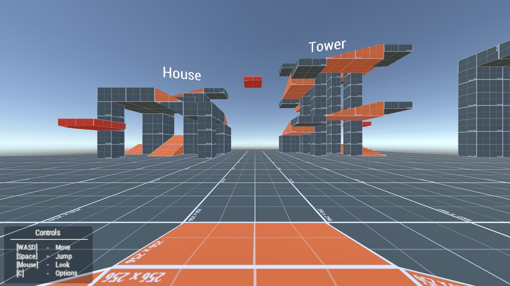</p>

*SurvivorDemo (Demo Scenes) and the Character Movement Fundamentals showcase, captured in Play Mode.*
<!-- samples-shots:end -->

This checkout uses the release layout: sources live under `Assets/Neoxider/Samples~/` and are hidden from Unity's normal asset import. Import them from `Package Manager > NeoxiderTools > Samples`. Unity copies each sample into `Assets/Samples/NeoxiderTools/<version>/<sample name>/`, for example `Assets/Samples/NeoxiderTools/<version>/Demo Scenes/Scenes/SurvivorDemo.unity`.

| Package Manager sample | Source path | Purpose |
|------------------------|-------------|---------|
| Demo Scenes | `Samples~/Demo` | Module demo scenes, example games and `SurvivorDemo`, configured by `SurvivorConfig` on top of `Neo.Abilities` ([guide](Assets/Neoxider/Docs/Abilities/SurvivorDemo.md)) |
| NeoxiderPages | `Samples~/NeoxiderPages` | Optional page-navigation sample with `PM`, `UIPage`, `BtnChangePage`, and UIKit helpers |
| Character Movement Fundamentals | `Samples~/CharacterMovementFundamentals` | Character-controller scenes for slopes, stairs, platforms, gravity, and a top-down arena ([guide](Assets/Neoxider/Docs/Tools/Move/CharacterController/README.md)) |

Every demo scene is saved with its UI, configured components and UnityEvent wiring, so you can see how a button reaches a module API without entering Play Mode. Editor builders in the sample author these scenes; **Neoxider > Demo > Rebuild Active Demo Scene** restores a scene you changed. See [how demo scenes are made](Assets/Neoxider/Docs/Samples.md#how-demo-scenes-are-made).

Import all three for the full integration collection: example games can reference sibling sample
assets (CardGame uses the NeoxiderPages PM prefab). Module demos can be explored separately;
see the [sample dependency and scene guide](Assets/Neoxider/Docs/Samples.md).

For sample development, the source folder can be renamed to `Assets/Neoxider/Samples/`; release packaging restores `Samples~` and the matching package sample paths. The [sample guide](Assets/Neoxider/Docs/Samples.md) explains the source/imported layouts.

Imported copies from earlier versions remain separate project content and are not updated by a package upgrade. Re-import the samples you use; see [Upgrading to 12](Assets/Neoxider/Docs/Migration12.md#samples-and-demo-scenes).

## HTML/CSS → UI Toolkit

The HTML/CSS → UI Toolkit converter (HtmlToUitk) left this package after 11.0.1 and is now the standalone
[HtmlToUitk](https://github.com/NeoXider/HtmlToUitk) library (`com.neoxider.htmltouitk`); see [Upgrading to 12](Assets/Neoxider/Docs/Migration12.md#htmltouitk-moved-to-its-own-package).

## Tests

Package tests live under `Assets/Neoxider/Tests/`:

- `Edit` for edit-mode and pure logic coverage (`Neo.Editor.Tests`).
- `Play` for runtime and scene behavior (`Neo.Tests.Play`).
- `Fixtures`, `Integration` (Mirror network) and shared test helpers.

Together they hold more than 5,000 EditMode cases plus the PlayMode suites. Read the [EditMode and isolation guide](Assets/Neoxider/Docs/Testing.md) and [PlayMode guide](Assets/Neoxider/Docs/PlayModeTesting.md) before running Unity Test Runner. The host needs `com.unity.test-framework`; the broad suites also reference integrations such as Mirror. For a UPM installation, `"com.neoxider.tools"` in the host manifest's `testables` list exposes package tests, while host prerequisites and supported test layouts still apply. The demo builders have their own `Neo.Demo.Editor.Tests`, which compile while the Demo sample is visible.

Run static-reset and Play Mode transition fixtures in an isolated test host: they can change global state, providers, and editor lifecycle. The [11.0.0 verification record](Assets/Neoxider/Verification11.md) separates actual runs, qualified unchanged inputs, manual observations and remaining limits. After source changes, run `python scripts/check_package.py` locally to check package integrity without Unity. Record actual pass/fail/skip results for the tested checkout, Unity version, dependencies, and sample layout. This repository does not currently configure GitHub Actions workflows.

## Project layout

```text
Assets/Neoxider/
  Scripts/       Runtime modules and asmdef-separated code
  Editor/        Custom inspectors, windows, and editor utilities
  Tests/         EditMode and PlayMode package tests
  Docs/          Documentation
  Samples~/      Current UPM sample sources (three importable samples)
  Prefabs/       Ready-to-use prefabs
  Resources/     Settings and package assets
  Skill/         Agent skill for coding assistants
dev-docs/        Maintainer documents (repository only, not in the package)
```

`Samples/` is the alternative source location during sample development, replacing `Samples~/` until release packaging.

## Games using NeoxiderTools

| Game | Genre | Platform | Link | Notes |
|------|-------|----------|------|-------|
| Fake Grandkids | Arcade, Survival | Windows | [MyIndie](https://myindie.ru/games/game/fake-grandkids) | UralGameJam 2026; inspector-driven Neoxider workflow |

## License

Starting with 11.0.1, NeoxiderTools is released under the [PolyForm Small Business License 1.0.0](Assets/Neoxider/LICENSE.md).
It is free for personal and non-commercial use and for small businesses: fewer than 100 people and less than
1,000,000 USD (2019) revenue in the prior tax year. Larger companies need a commercial license: contact
neoxider@gmail.com. Earlier releases keep the license they shipped with. Bundled third-party code keeps its own
license, see [third-party notices](Assets/Neoxider/THIRD-PARTY-NOTICES.md).

## Support

Open an issue or pull request in the repository. Keep public behavior changes documented in [CHANGELOG.md](Assets/Neoxider/CHANGELOG.md) and the relevant module docs.
