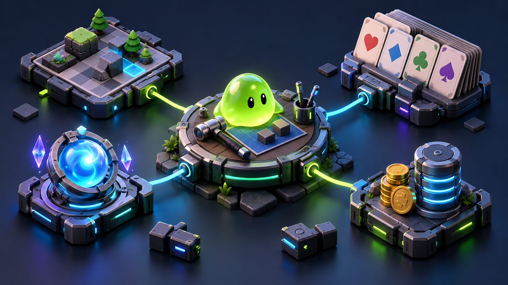
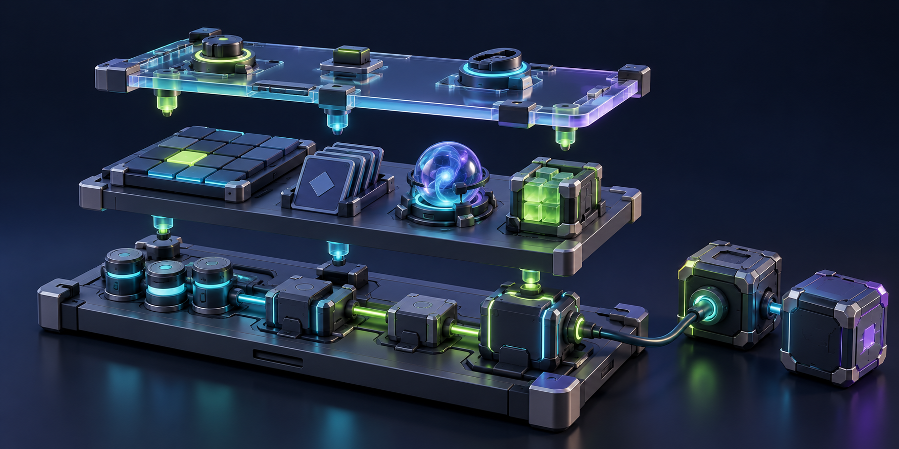
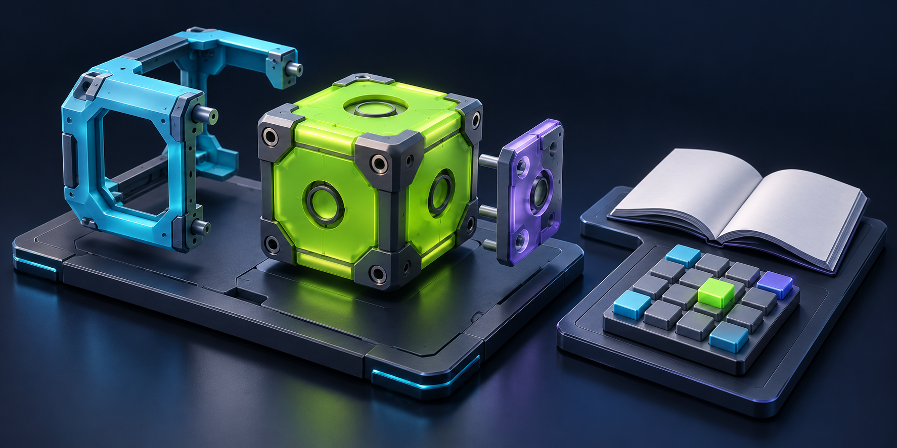
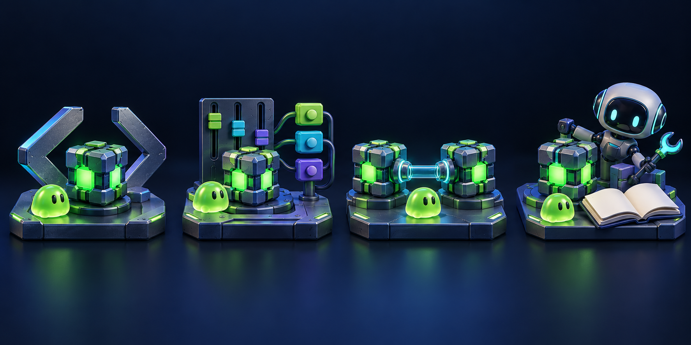
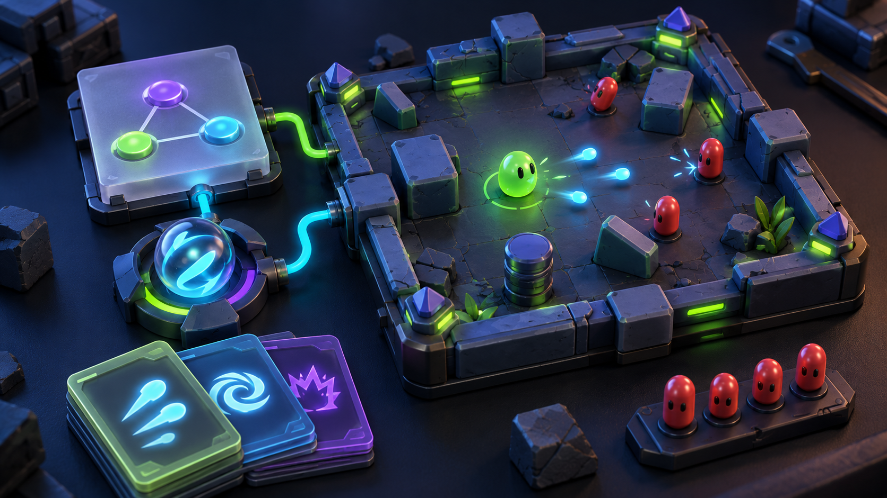

<div align="center">

# NeoxiderTools

**Build games from reusable Unity C# systems.**

A modular construction library: use runtime APIs directly, then add scene components and optional Inspector / NoCode workflows.

[](Assets/Neoxider/package.json)
[](Assets/Neoxider/Docs/PackageCompatibility.md)
[](Assets/Neoxider/Docs/README.md#namespace-policy)
[](https://github.com/NeoXider/NeoxiderTools/actions/workflows/tests.yml)
[](Assets/Neoxider/Docs/NoCode/README.md)

### [Start](#quick-start) · [Install](#-install) · [Modules](#-what-is-inside) · [Documentation](Assets/Neoxider/Docs/README.md) · [Samples](#-samples) · [Upgrade from 10.x](Assets/Neoxider/Docs/Migration11.md)

</div>

> **11.0.0 on `demo`.** Windows validation is recorded for Unity `6000.3.14f1` and `6000.6.0f1`, including optional-dependency profiles, imported samples and separate network players. The CardGame Canvas-scale and tutorial-click fixes passed focused native checks on both SDKs and three manually played rounds. Read the [verification record](Assets/Neoxider/Verification11.md) and [Migration to 11](Assets/Neoxider/Docs/Migration11.md).

**По-русски:** [C# API, компоненты и NoCode](Assets/Neoxider/Docs/README.md) · [обновление с 10.x](Assets/Neoxider/Docs/Migration11.md).

<p align="center"></p>

*Concept artwork for the construction library; not an Editor or gameplay capture.*

## Quick start

1. [Install NeoxiderTools](#-install), plus DOTween and UniTask in the host project.
2. Choose one feature and one entry point:

| Start with | Use it for | Guide |
|------------|------------|-------|
| **C# runtime API** | Own models and services from your code; add views when needed | [Runtime-model example](Assets/Neoxider/Docs/GettingStarted.md#start-with-a-c-runtime-model) |
| **Scene components** | Add a component and assign its explicit dependencies | [First audio scene](Assets/Neoxider/Docs/GettingStarted.md#your-first-scene-in-5-minutes-audio-manager-am), [scene checklist](#first-scene-checklist) |
| **Inspector / NoCode** | Connect values and events to the same typed APIs | [NoCode guide](Assets/Neoxider/Docs/NoCode/GettingStarted.md) |

3. Find the next building block in the [module map](#-what-is-inside). Keep reusable configuration in assets and scene references on components.

For an existing project, review [numeric text endpoint changes](Assets/Neoxider/Docs/Migration11.md#state-pause-and-exact-numeric-output) and [saved-data contracts](Assets/Neoxider/Docs/Migration11.md#saved-configuration-and-generated-resources), including explicit required JSON root arrays and the inventory snapshot codec for nullable item instances.

The [package README](Assets/Neoxider/README.md), [reuse map](Assets/Neoxider/PROJECT_SUMMARY.md) and [changelog](Assets/Neoxider/CHANGELOG.md) provide the wider package context.

## 📑 Contents

<details>
<summary>Navigate the README</summary>

- [Quick start](#quick-start)
- [Install](#-install) and [requirements](#requirements)
- [First scene checklist](#first-scene-checklist)
- [Module map](#-what-is-inside)
- [How it fits together](#how-it-fits-together)
- [Four ways to build](#one-package--four-ways-to-build)
- [NoCode example](#no-code-example-neocondition)
- [Samples](#-samples)
- [HTML/CSS → UI Toolkit](#htmlcss--ui-toolkit)
- [Tests](#tests)
- [Project layout](#project-layout)
- [Games](#games-using-neoxidertools) and [support](#support)

</details>

## 🚀 Install

Install **NeoxiderTools** plus the required third-party packages below. In Unity: `Window > Package Manager > + > Add package from git URL` (or import from Asset Store for DOTween).

### NeoxiderTools (Git URL)

```text
https://github.com/NeoXider/NeoxiderTools.git?path=Assets/Neoxider
```

This URL follows the remote default branch. For the current 11.0.0 preparation checkout, use the [local-package route](Assets/Neoxider/Docs/GettingStarted.md#option-b--local-path-for-development).

### DOTween (required)

Install from the [Unity Asset Store — DOTween (HOTween v2)](https://assetstore.unity.com/packages/tools/animation/dotween-hotween-v2-27676), then run setup via `Tools > Demigiant > DOTween Utility Panel`.

### UniTask (required)

```text
https://github.com/Cysharp/UniTask.git?path=src/UniTask/Assets/Plugins/UniTask#2.5.11
```

### Manual install (NeoxiderTools only)

Copy `Assets/Neoxider` into your project. You still need DOTween and UniTask installed separately.

## Requirements

- Unity `6000.0+`.
- Installed automatically by UPM with NeoxiderTools: `com.unity.ai.navigation`, `com.unity.inputsystem`, `com.unity.ugui` (which includes TextMeshPro on Unity 6).
- **Required (host project):** [DOTween](https://assetstore.unity.com/packages/tools/animation/dotween-hotween-v2-27676), [UniTask](https://github.com/Cysharp/UniTask) — see [Install](#-install).
- **Optional:** `DOTween Pro`, `Mirror`, `Spine Unity Runtime`, `Odin Inspector`, `MarkdownRenderer`, and the [mobile haptics backend](Assets/Neoxider/Docs/Haptics/Haptics.md). NeoxiderPages imports without DOTween Pro.
- URP is optional. The package no longer depends on `com.unity.render-pipelines.universal`; add URP yourself only if your project uses URP-specific rendering features or 2D lights.

Character Movement Fundamentals runtime/editor code is bundled under `ThirdParty/CharacterMovementFundamentals`; its demo content is an optional sample. See [third-party notices](Assets/Neoxider/THIRD-PARTY-NOTICES.md) for the bundled license and external dependencies.

See [dependency versions and optional MCP setup](Assets/Neoxider/Docs/Dependencies.md) for pinned updates,
Unity SDK compatibility and the DOTween Core/Pro upgrade constraint.

## First scene checklist

1. Install NeoxiderTools, DOTween, and UniTask (see [Install](#-install)).
2. Pick one module and assign its dependencies in the Inspector or through its initialization API. Follow the [first audio scene](Assets/Neoxider/Docs/GettingStarted.md#your-first-scene-in-5-minutes-audio-manager-am) for a small working example.
3. Add components through `Add Component > Neoxider` or `Neoxider > Windows > Create Neoxider Object`.
4. For the existing manager bootstrap, use the package's `Prefabs/-System--.prefab` (`Assets/Neoxider/Prefabs/-System--.prefab` in a manual install). Read the selected module's setup before adding managers.
5. For multiplayer, install Mirror first and follow the [Multiplayer guide](Assets/Neoxider/Docs/Network/Multiplayer_Guide.md).

For a C# model such as `ResourcePoolModel`, `MergeResolver`, or `StateMachine<TState>`, start from the [runtime API route](Assets/Neoxider/Docs/GettingStarted.md#choose-your-starting-point). These APIs can be owned by your own code without the bootstrap prefab. Keep reusable configuration in ScriptableObjects and scene references on scene components.

## 🧩 What is inside

| Area | What it solves | Docs |
|------|----------------|------|
| Condition | Inspector-driven checks over fields, properties, methods, GameObject state, AND/OR, events | [Condition](Assets/Neoxider/Docs/Condition/README.md) |
| NoCode | Bind component values to UI and actions without writing one-off view scripts | [NoCode](Assets/Neoxider/Docs/NoCode/README.md) |
| Abilities | Data-driven Dota-style abilities and modifiers: units, properties, buffs/debuffs/DoT/shields, cast pipeline, effect ops, multiplayer-ready receipts; v10 successor to RPG | [Abilities](Assets/Neoxider/Docs/Abilities/README.md) |
| RPG | Universal resources, stats, buffs, statuses, progression, combat, targets, multiplayer-ready APIs (superseded by Abilities in v10) | [RPG](Assets/Neoxider/Docs/Rpg/README.md) |
| Shop | Items, bundles, owned/equipped state, multi-currency, inventory bridge, save profile | [Shop](Assets/Neoxider/Docs/Shop/README.md) |
| Inventory | Aggregated and slot-grid inventories, pickups, transfer rules, save integration | [Inventory](Assets/Neoxider/Docs/Tools/Inventory/README.md) |
| Save | PlayerPrefs and JSON-backed provider flow, typed helpers, save attributes | [Save](Assets/Neoxider/Docs/Save/README.md) |
| Progression | XP, levels, perk tree, unlock tree, persistent progression | [Progression](Assets/Neoxider/Docs/Progression/README.md) |
| Quest | Quest configs, goals, manager, no-code actions, runtime state | [Quest](Assets/Neoxider/Docs/Quest/README.md) |
| StateMachine | Runtime state machine plus no-code transition predicates | [StateMachine](Assets/Neoxider/Docs/StateMachine/README.md) |
| Merge | Pure C# connected-group merge engine for grids, inventories, lists, and custom graphs | [Merge](Assets/Neoxider/Docs/Merge/README.md) |
| GridSystem | Field generation, grid merge adapter, Dice, Match3, TicTacToe, SlidingMerge | [GridSystem](Assets/Neoxider/Docs/GridSystem/README.md) |
| Cards | Deck/hand/board runtime, custom decks/views, poker, Drunkard sample | [Cards](Assets/Neoxider/Docs/Cards/README.md) |
| UI | UI panels, button animations, toggles, `AnimationFly` reward motion | [UI](Assets/Neoxider/Docs/UI/README.md) |
| HTML → UITK | HTML/CSS authoring, native controls, typed actions, adaptive/nav/anim specs | [Module](Assets/Neoxider/Docs/UI/HtmlToUitk.md), [CLI](Tools/HtmlToUitk/README.md) |
| Network | Optional Mirror wrappers, no-code network action/sync bridges, and a realtime .io toolkit (bootstrap, snapshots, prediction, telemetry) | [Network](Assets/Neoxider/Docs/Network/README.md), [Realtime IO guide](Assets/Neoxider/Docs/Network/Realtime_IO_Guide.md) |
| Interaction | C# interaction contracts, hover/click, 2D/3D physics events, ray modes, and range checks | [Interaction](Assets/Neoxider/Docs/Tools/InteractableObject/README.md) |
| Tools | Movement, free-fly camera, physics, timers, spawners, interaction, text, managers, view helpers | [Tools](Assets/Neoxider/Docs/Tools/README.md) |
| Extensions | 200+ C# and Unity API extension methods | [Extensions](Assets/Neoxider/Docs/Extensions/README.md) |

## How it fits together

<p align="center"></p>

**Foundation → gameplay → adapters.** Start with the module's runtime API, then add scene wrappers, views, or NoCode helpers where your game needs them. Module dependencies are declared in assembly definitions; some runtime APIs use ordinary C# objects, while scene-facing services use components:

<p align="center"></p>

The module core is the starting point. Scene adapters, Inspector helpers, documentation and samples complement it; each module guide describes its actual dependencies.

## One package — four ways to build

<p align="center"></p>

*Left to right: C# APIs, component/Inspector authoring, optional multiplayer, and coding-agent guidance.*

- 🛠 **Programmers — clean C# APIs.** Use runtime models and services directly, with **200+ extension methods** in `Neo.Extensions`. Start with the [C# quick start](Assets/Neoxider/Docs/GettingStarted.md#start-with-a-c-runtime-model); scene singletons such as `AM.I` are optional integration choices for the modules that expose them.
- 🧩 **Components and optional NoCode.** Configure gameplay in the Inspector: conditions, counters, timers, shops, slots, wheels, equipment, page navigation, click sounds. Start with the [NoCode guide](Assets/Neoxider/Docs/NoCode/GettingStarted.md).
- 🌐 **Multiplayer, if you need it.** Optional Mirror integration: NoCode sync bridges (`NetworkPropertySync`, `NetworkReactiveSync`, `NetworkActionRelay`) and one-button LAN Quick Play. The bridges include a solo-mode path; install Mirror when enabling networking.
- 🤖 **AI-agent development.** A bundled [agent skill](Assets/Neoxider/Skill/neoxider-tools/SKILL.md), `[NeoDoc]`-linked docs, and a machine-readable [reuse map](Assets/Neoxider/PROJECT_SUMMARY.md) let coding agents (Claude, Codex) build games on top of the package instead of reinventing it.

## No-code example: NeoCondition

`NeoCondition` lets designers wire gameplay logic from the Inspector:

- Check fields, properties, GameObject state, or single-argument methods.
- Compare against constants or another object.
- Use `AND`, `OR`, and inversion.
- When events are dispatched, emit `OnResult(result)` and `OnInvertedResult(!result)`, followed by either `OnTrue` or `OnFalse`. **Only On Change** can suppress dispatch for an unchanged result.

Example: a condition calling `CanSpend(100f)` on a configured `Money` component can drive a local affordability hint. Perform the purchase through the Shop API and the configured server authority.

Read more: [NeoCondition docs](Assets/Neoxider/Docs/Condition/NeoCondition.md).

## 🎮 Samples

<p align="center"></p>

*Concept art for the configuration → abilities → waves/upgrades flow. This is not a screenshot of SurvivorDemo; follow the linked sample guide for the actual setup.*

This checkout uses the release layout: sources live under `Assets/Neoxider/Samples~/` and are hidden from Unity's normal asset import. Import them from `Package Manager > NeoxiderTools > Samples`. Unity copies each sample into `Assets/Samples/NeoxiderTools/11.0.0/<sample name>/`, for example `Assets/Samples/NeoxiderTools/11.0.0/Demo Scenes/Scenes/SurvivorDemo.unity`.

| Package Manager sample | Source path | Purpose |
|------------------------|-------------|---------|
| Demo Scenes | `Samples~/Demo` | Integration scenes and `SurvivorDemo`, configured by `SurvivorConfig` on top of `Neo.Abilities` ([guide](Assets/Neoxider/Docs/Abilities/SurvivorDemo.md)) |
| NeoxiderPages | `Samples~/NeoxiderPages` | Optional page-navigation sample with `PM`, `UIPage`, `BtnChangePage`, and UIKit helpers |
| Character Movement Fundamentals | `Samples~/CharacterMovementFundamentals` | Character-controller scenes for slopes, stairs, platforms, gravity, and a top-down arena ([guide](Assets/Neoxider/Docs/Tools/Move/CharacterController/README.md)) |

Import all three for the full integration collection: legacy example games can reference sibling sample
assets (CardGame uses the NeoxiderPages PM prefab). Focused module demos can be explored separately;
see the [sample dependency and scene guide](Assets/Neoxider/Docs/Samples.md).

For sample development, the source folder can be renamed to `Assets/Neoxider/Samples/`; release packaging restores `Samples~` and the matching package sample paths. The [sample guide](Assets/Neoxider/Docs/Samples.md) explains the source/imported layouts.

Imported copies from earlier versions remain separate project content. Review customized samples using the [migration guide](Assets/Neoxider/Docs/Migration11.md).

## HTML/CSS → UI Toolkit

The module converts a supported subset of HTML/CSS into native UITK controls: [runtime/editor, typed C# actions and lifecycle](Assets/Neoxider/Docs/UI/HtmlToUitk.md), media width/height/aspect, nav/modal/tabs and animation specs. The [external CLI](Tools/HtmlToUitk/README.md) produces UXML/USS/localization and gradient PNGs with a manifest. Static gradient geometry has clear limits; arbitrary CSS/JS and full browser parity are not promised. Historical verification slice (2026-10-14): Unity 6000.3.14f1 EditMode — 239/239, Unity 6000.6.0f1 EditMode — 239/239 and PlayMode — 7/7; failures/skips — 0, exit0. [Checks and limits](Docs/Plans/HtmlToUitk-Verification-20261014.md), [remaining TODO](Docs/Plans/HtmlToUitk-TODO.md). These results do not verify the current 11.0.0 source; player/mobile and full browser parity are not claimed.

The UPM/manual package includes runtime/editor, but **not the CLI or its .NET DLL**. Conversion needs a full NeoxiderTools checkout, or a separately built CLI, .NET 9 and a configured external CLI path in the editor integration. From the root of a full checkout:

```powershell
dotnet publish Tools/HtmlToUitk/src/HtmlToUitk.Cli/HtmlToUitk.Cli.csproj -c Release -o Tools/HtmlToUitk/bin
dotnet Tools/HtmlToUitk/bin/htmltouitk.dll run Tools/HtmlToUitk/fixtures/production-neutral/neutral.htujob.json
```

The C# `preview`/`compare` commands honestly return nonzero unsupported; the working Python oracle preview/comparison commands are listed in the CLI docs. NuGet install is not required and not claimed.

## Tests

Package tests live under `Assets/Neoxider/Tests/`:

- `Edit` for edit-mode and pure logic coverage.
- `Play` / `PlayMode` for runtime and scene behavior.
- `Editor` for editor-specific package checks.

Read the [EditMode and isolation guide](Assets/Neoxider/Docs/Testing.md) and [PlayMode guide](Assets/Neoxider/Docs/PlayModeTesting.md) before running Unity Test Runner. The host needs `com.unity.test-framework`; the broad suites also reference integrations such as Mirror. For a UPM installation, `"com.neoxider.tools"` in the host manifest's `testables` list exposes package tests, while host prerequisites and supported test layouts still apply.

Run static-reset and Play Mode transition fixtures in an isolated test host: they can change global state, providers, and editor lifecycle. The [11.0.0 verification record](Assets/Neoxider/Verification11.md) separates actual runs, qualified unchanged inputs, manual observations and remaining limits. After source changes, `python scripts/check_package.py` checks package integrity without Unity. GitHub Actions runs that check independently; Unity tests require the [license configuration](.github/UNITY_CI.md). Record actual pass/fail/skip results for the tested checkout, Unity version, dependencies, and sample layout. The workflow badge and historical reports describe their own runs.

## Project layout

```text
Assets/Neoxider/
  Scripts/       Runtime modules and asmdef-separated code
  Editor/        Custom inspectors, windows, and editor utilities
  Tests/         EditMode and PlayMode package tests
  Docs/          Documentation
  Samples~/      Current UPM sample sources (three importable samples)
  Prefabs/       Ready-to-use prefabs
  Resources/     Settings and package assets
```

`Samples/` is the alternative source location during sample development, replacing `Samples~/` until release packaging.

## Games using NeoxiderTools

| Game | Genre | Platform | Link | Notes |
|------|-------|----------|------|-------|
| Fake Grandkids | Arcade, Survival | Windows | [MyIndie](https://myindie.ru/games/game/fake-grandkids) | UralGameJam 2026; inspector-driven Neoxider workflow |

## Support

Open an issue or pull request in the repository. Keep public behavior changes documented in [CHANGELOG.md](Assets/Neoxider/CHANGELOG.md) and the relevant module docs.
